# Data Challenge HUN 2026 · Predicción de estancia prolongada y saturación hospitalaria

**Hospital Universidad del Norte (HUN)** · base OMOP CDM `uninorte_omop` · Data Challenge Pro 2026, Universidad del Norte.

Este documento reúne en un solo capítulo todo el proyecto: el contexto y los datos (M1), el análisis exploratorio (M2–M4), la ingeniería de variables (M5), el modelado con validación cruzada (M6) y la evaluación, calibración, explicabilidad y pruebas estadísticas (M7). Cada módulo trae su informe, sus figuras y el código fuente de cada subfase.

**Dos tareas de predicción**

1. **Paciente**: ¿la estancia superará el percentil 75 de su servicio? Se predice en τ = ingreso + 0, 2 y 6 h.
2. **Servicio**: ¿la ocupación llegará al umbral de saturación dentro de 4 h?

**Cómo leer este documento.** Las celdas de código muestran el código fuente tal como está en el repositorio; no se ejecutan en esta página porque los datos de pacientes no se publican. Las tablas y figuras son resultados agregados de las corridas con los datos reales.

## Equipo y módulos

| Persona | Módulos |
|---|---|
| Persona 1 (SQL & MLOps) | M1 ETL y targets, M4 (SQL de transiciones), M8 API + dashboard |
| Persona 2 (ML) | M5 features, M6 modelos y CV, M7 evaluación y calibración |
| Persona 3 (EDA) | M2 univariado y censura, M3 bivariado y colas, M4 (visual) |

## Contexto del proyecto y reglas de trabajo

### Lo que el PDF supone y NO es cierto en los datos

| El PDF dice | La realidad | Qué hacer |
|---|---|---|
| Kaplan-Meier por **nivel de triaje (1–5)** | **No existe triaje** en ninguna tabla | Estratificar por `servicio`, `origen_urgencias`, grupo de `edad`, `sexo` |
| Estancia = `visit_end − visit_start` | En el 100 % de las visitas fin = inicio (LOS 0) | La estancia está en `visit_detail` → usar `episodio.los_h` |
| Visitas abiertas (`visit_end IS NULL`) = censura | No hay ninguna visita abierta | La censura real es **truncamiento al final**: `en_riesgo_truncamiento` |
| Muchos servicios (UCI, salas, etc.) | Solo **4**: `ambulatorio`, `urgencias_ingreso`, `urgencias_observacion`, `hospitalizacion` | Analizar a ese nivel |
| `visit_occurrence_id` une eventos con su visita | **Roto** en una parte: 29 % de subprocesos, 19 % de diagnósticos, 43 % de mediciones apuntan a la visita de otra persona (~16 días después) | Nunca cruzar eventos por `visit_occurrence_id`; ya viene filtrado (`vinculo_coherente`) |
| Procedimientos como variable | `procedure_date` vacío | No usar procedimientos |
| Tiempo de espera por transición (colas) | Fin de un subproceso = inicio del siguiente (espera ≈ 0) | Medir cuello de botella por **duración y ocupación**, no por espera |
| Capacidad c (camas) para ρ = λ/(cμ) | No se conoce el número de camas | `capacidad` = proxy: P95 del censo de los 90 días previos |

Detalle completo y evidencia: `docs/M1_hallazgos_datos.md`.

### Reglas no negociables

1. **El servidor es solo lectura.** Nunca DDL/INSERT. Solo Persona 1 extrae; los demás trabajan con los parquets.
2. **Columnas `y_*` = futuro/etiqueta.** Nunca como variable de entrada ni para filtrar antes de modelar.
3. **Filtrar `en_periodo_estable = true`** (2023-01-31 → 2026-04-01) en análisis y modelos. Fuera de ese rango la carga de datos cambia (censo subestimado al inicio; saltos y caídas desde abril 2026).
4. **Partición**: `es_entrenamiento` (corte temporal en `parametros.fin_entrenamiento` = 2025-07-13). CV con `StratifiedGroupKFold` por **`person_id`** (paciente) o `TimeSeriesSplit` con gap ≥ 4 h (servicio). Nunca CV estratificada simple.
5. **Variables nuevas**: solo eventos de la misma `person_id` con `datetime < snapshot_time`. Escalado/imputación dentro de `Pipeline`.
6. **n es grande** (cientos de miles): todo p-valor sale < 0.001. Reportar siempre **tamaño de efecto** (Cramér's V, ε², diferencia de medianas con IC) y corrección **Benjamini-Hochberg**.
7. **Datos de pacientes**: no subir `data/` a git ni a servicios externos; no imprimir filas individuales en informes, solo agregados.

### Particularidades de cada servicio

| Servicio | Qué es | Duración |
|---|---|---|
| `ambulatorio` | Consulta externa (horario 7–17 h) | **0 h siempre** (registro puntual): no tiene estancia ni censo |
| `urgencias_ingreso` | Registro de llegada a urgencias | ~3 min (puntual) |
| `urgencias_observacion` | Estancia en urgencias / observación (24 h) | p50 1.2 h, P75 umbral 8.9 h; 38 % dura 0 |
| `hospitalizacion` | Hospitalización | p50 ~46–71 h, P75 umbral 141.6 h |

### Cifras de referencia (para verificar que lees bien los datos)

- Episodios: hospitalización 49 423 (36 723 personas), urgencias/observación 493 320; ~26 % positivos en ambos.
- Snapshots: 718 k. Hospitalización 0 h: 49 416.
- Ley de Little cuadra: censo medio hospitalización 289.5 ≈ λ·W 288.7; urgencias 224.0 ≈ 223.6.
- Ocupación media (vs proxy): hospitalización 0.93, urgencias 0.74. Umbral de saturación: 0.95 hospitalización (provisional, sin camas reales), 0.85 urgencias.
- Rutas: 65 % ambulatorio → egreso; 17 % urgencias_ingreso → observación → egreso; 1.8 % urgencias → hospitalización.
- Efecto festivo en urgencias/observación: laboral ~999/día, fin de semana ~763, festivo ~758, día después de festivo ~1 067.
- Censo hospitalario con tendencia: ~265 (2023) → ~315 (2025). Usar STL / desestacionalizar antes de comparar periodos.

## Módulo 1 · Datos: extracción, hallazgos y contrato

Fecha: 2026-11-10 · Autor: Persona 1 · Consultas: `m1_etl/sql/00*.sql` (solo lectura) · Resultados: `outputs/exploracion/`

### 1. Conexión y alcance

- Base: **`uhn_i`**, esquema **`uninorte_omop`** (no existe una base llamada `uninorte_omop`).
- Usuario sin permisos de escritura y servidor de **solo lectura por decisión del equipo**: todo el ETL se hace con `SELECT` y se procesa en local.
- Periodo: **2023-01-01 → 2026-08-13**. 1 706 001 visitas, 304 457 personas con visitas (912 083 en `person`).

### 2. El OMOP del HUN está recortado

| Tabla | Columnas disponibles | Lo que falta respecto al estándar |
|---|---|---|
| visit_occurrence | id, person_id, visit_concept_id, start/end_datetime, provider_id | `*_date`, source_value, admitted_from, discharged_to, care_site |
| visit_detail | id, visit_occurrence_id, visit_detail_concept_id, start/end_datetime, provider_id | **person_id**, care_site_id, source_value |
| condition_occurrence | id, person_id, visit_occurrence_id, concept_id, start_datetime, type_concept_id | fecha fin, status |
| procedure_occurrence | id, person_id, visit_occurrence_id, concept_id, **procedure_date (sin hora, todo NULL)** | datetime |
| measurement | id, person_id, visit_occurrence_id, concept_id, datetime, value_as_number, `measurement_source_value_extended` | unidad, value_as_concept |
| person | id, gender, year_of_birth, race, ethnicity | — |
| cups (extra) | codigo, descripcion, periodo | catálogo de procedimientos colombiano |

`provider_id` es siempre 0.

### 3. La estancia NO está en `visit_occurrence`

- En **el 100 % de las visitas `visit_end_datetime = visit_start_datetime`**: LOS = 0 h en todos los tipos de visita. No hay visitas abiertas.
- Las duraciones reales están en **`visit_detail`**:

| visit_detail_concept_id | Interpretación | n | Duración p50 / p75 / p90 |
|---|---|---|---|
| 581479 Ambulatory Rehabilitation Visit | Consulta ambulatoria (horario 7–17 h) | 1.54 M | 0 h |
| 3045729 Treatment urgency | Urgencias / observación (24 h) | 1.15 M | 1.2 / 4.7 / 12.6 h |
| 9203 Emergency Room Visit | Ingreso a urgencias (registro puntual) | 0.48 M | 3 / 4 / 6 min |
| 9201 Inpatient Visit | **Hospitalización** | 108 601 | **46 / 96 / 188 h** |

- Solo hay **4 "servicios"** identificables. No hay UCI, pediatría, etc.
- El **triaje no existe** en `measurement`: no hay conceptos ni texto fuente con triage/triaje/clasificación.

### 4. Problema crítico: eventos vinculados a la visita equivocada

En una parte de los registros, `visit_occurrence_id` apunta a una visita que **no es la suya**:

- Diagnósticos: cuando `person_id` del evento ≠ `person_id` de la visita (~19 %), el **98 %** está fechado **15–19 días antes** que la visita. Cuando la persona coincide, eso casi no ocurre.
- Mediciones: el `person_id` coincide con la visita solo en ~55 %; procedimientos, ~51 %.
- `visit_detail`: en visitas con 1 subproceso está alineado el 99.5 %; en visitas con ≥ 2 subprocesos, el **75–89 %** tiene subprocesos ~16 días antes de su visita.
- Ocurre de forma estable desde 2023 y desaparece en abril de 2026.
- **No se puede reparar**: solo el 12 % de los diagnósticos mal vinculados tiene una visita de su propia persona en ±48 h, y la diferencia de IDs no es constante.

**Consecuencia:** `visit_occurrence_id` no es una llave confiable para cruzar eventos. Hay que reportarlo a los organizadores del challenge.

### 5. Decisiones de diseño del M1 (propuestas)

1. **Eventos por persona y tiempo, no por visita.** Las variables de un paciente en el instante τ usan `event.person_id` y `event.datetime ≤ τ`, ignorando `visit_occurrence_id`. Esto respeta la regla anti-fuga y no depende del vínculo roto.
2. **Unidad de estancia = subproceso de hospitalización (`visit_detail` 9201).** LOS = `end − start` del subproceso. Se unen los subprocesos 9201 contiguos o solapados de una misma visita en un solo episodio.
3. **Persona del episodio confiable solo si el vínculo es coherente:** el subproceso no empieza más de 12 h antes de su visita. Los episodios no coherentes se excluyen del modelo de paciente, pero **sí cuentan para la ocupación**.
4. **Ocupación por servicio** desde todos los `visit_detail`. No necesita persona ni vínculo, solo inicio, fin y tipo. La capacidad (camas) es desconocida: se usa un proxy (P95 del censo histórico) mientras no tengamos el número real.
5. **Diagnósticos**: un dx está disponible en `condition_start_datetime`. Concepto 0 = 37 % de los dx (vocabulario `None`).
6. **Procedimientos**: `procedure_date` está vacío, así que **no se pueden ubicar en el tiempo** y quedan fuera de las variables anti-fuga.

### 6. Censo hospitalario y periodo estable

- **Calentamiento:** en enero de 2023 el censo está subestimado (~225 frente a ~265) porque faltan las estancias iniciadas antes de 2023. Se excluyen los primeros 30 días.
- **Cambio de patrón desde abril de 2026:** el censo salta (333–340), cae (223) y vuelve a saltar. Coincide con la desaparición del mal vínculo. Se excluye desde el 2026-04-01.
- **Crecimiento sostenido:** el censo de hospitalización pasa de ~265 (2023) a ~315 (2025). Con una capacidad fija calculada en entrenamiento, el 98.6 % de las horas de prueba quedaban "saturadas". Por eso la capacidad proxy es **móvil**: P95 del censo de los 90 días anteriores, que usa solo el pasado.
- **Ocupación hospitalaria alta:** el hospital opera en promedio al ~93 % de su P95 reciente. Con umbral 0.85 el target sale positivo el 90–95 % del tiempo. Se usa 0.95 para hospitalización (~38 % positivos) y 0.85 para urgencias (~27 %) hasta tener el número real de camas.
- **Pendiente:** pedir al HUN o a los organizadores el **número de camas por servicio**. Con ese dato la definición de saturación vuelve a la del enunciado (≥ 85 %).

Archivos: `data/m1/*.parquet` (no se suben a git; se regeneran con el pipeline).
Contexto de por qué cada regla existe: [M1_hallazgos_datos.md](docs/M1_hallazgos_datos.md).

```bash
python m1_etl/run_etl.py extraer      # servidor → data/raw (solo lectura, VPN)
python m1_etl/run_etl.py construir    # data/raw → data/m1 + outputs/m1_validaciones.md
```

### Reglas que todo el equipo debe respetar

1. **Columnas `y_*` son etiquetas o futuro.** Nunca entran como variables de un modelo.
2. **Partición temporal**: usar `es_entrenamiento` (inicio del episodio < `parametros.fin_entrenamiento`) para el test final. La CV dentro de entrenamiento va con `StratifiedGroupKFold` por **`person_id`** (paciente) o `TimeSeriesSplit` con gap ≥ 4 h (servicio).
3. **Filtrar `en_periodo_estable = true`** para entrenar y evaluar. Fuera de ese periodo la carga de datos es distinta (inicio de la base y desde abril de 2026).
4. **`visit_occurrence_id` no sirve para cruzar eventos** (re-anonimización rota). Cualquier variable nueva se construye por `person_id` + `datetime < snapshot_time`.
5. **Procedimientos no se usan**: `procedure_date` está vacío.
6. **No recalcular umbrales ni capacidades con datos de prueba.** El umbral de LOS y la capacidad ya vienen calculados sin fuga.

### Tablas

#### `snapshot` — tarea de PACIENTE (una fila = un paciente en un instante τ)

Snapshots en τ = ingreso al servicio + {0, 2, 6} h, solo si el paciente sigue ahí en τ y aún no superó el umbral.

| Columna | Descripción |
|---|---|
| snapshot_id, episodio_id, person_id | llaves. **`person_id` = grupo para la CV** |
| servicio | `hospitalizacion` o `urgencias_observacion` |
| horas_desde_ingreso, snapshot_time | instante de decisión τ |
| es_entrenamiento, en_periodo_estable, en_riesgo_truncamiento | partición y filtros |
| edad, sexo, origen_urgencias | demografía; si la hospitalización vino de urgencias |
| hora_del_dia, dia_semana, mes, fin_de_semana | calendario (los festivos colombianos se agregan en M4) |
| n_dx_historia, n_dx_distintos_historia, n_dx_30d | diagnósticos de la persona con datetime < τ |
| n_mediciones_24h, n_mediciones_historia | laboratorios < τ. `n_mediciones_24h = 0` es informativo (MNAR) |
| n_visitas_365d, n_hospitalizaciones_previas, horas_desde_ultima_alta_hosp | historial de uso |
| censo_servicio_t_menos_1h, ocupacion_servicio_t_menos_1h, llegadas_servicio_t_menos_1h | carga del servicio 1 h antes de τ, **sin contar al propio paciente** |
| umbral_los_h | P75 del servicio (calculado solo con entrenamiento) |
| **y_target_los_largo** | 1 si la estancia total supera `umbral_los_h` (target de clasificación) |
| y_los_h, y_los_restante_h, y_fin_episodio | targets de regresión / futuro |

#### `episodio` — estancias (una fila por episodio)

Subprocesos `visit_detail` del mismo servicio y la misma visita unidos si se solapan o los separa ≤ 1 h. Solo vínculos coherentes (persona conocida). Incluye `los_h`, `target_los_largo`, `umbral_los_h` y los mismos filtros. Sirve para el EDA univariado y las curvas Kaplan-Meier (no hay estancias abiertas: `fin` siempre existe; `en_riesgo_truncamiento` marca los ingresos de los últimos 30 días).

#### `ocupacion_servicio_hora` — tarea de SERVICIO (una fila por servicio y hora)

| Columna | Descripción |
|---|---|
| servicio, hora | llave |
| censo, llegadas | pacientes presentes en `hora` y llegadas en esa hora (todos los subprocesos, incluidos los mal vinculados) |
| capacidad | P95 del censo de los 90 días anteriores (proxy móvil, sin fuga) o camas reales |
| ocupacion | censo / capacidad (conocida en `hora`) |
| umbral_ocupacion | 0.85 urgencias, 0.95 hospitalización (ver abajo) |
| **y_target_saturacion** | 1 si `ocupacion` en `hora + 4 h` ≥ umbral |
| y_ocupacion_futura | ocupación en `hora + 4 h` (regresión) |
| es_entrenamiento, en_periodo_estable | partición y filtro |

Para predecir en `hora` se pueden usar `censo`, `ocupacion` y `llegadas` de `hora` y anteriores (lags). **No** se puede usar nada con `y_`.

**Sobre el umbral de hospitalización:** sin el número real de camas, "ocupación" es censo / P95 reciente. El hospital opera en promedio al ~93 % de ese valor, así que con 0.85 el 90–95 % de las horas serían positivas (target inútil). Con 0.95 la tasa es ~38 % y estable entre entrenamiento y prueba. **Si conseguimos las camas reales**, se ponen en `config/capacidad_camas.csv` (`servicio,camas`) y ambos umbrales vuelven a 0.85 (`HUN_UMBRAL_OCUPACION_HOSP=0.85` en `.env`).

#### Otras

- `llegadas_servicio_hora`: llegadas por hora a los 4 servicios (incluye `urgencias_ingreso` y `ambulatorio`). Base para los heatmaps del M4.
- `detalle`: subprocesos con `servicio`, duración y `vinculo_coherente`. Base para las transiciones del M4.
- `umbral_los`, `capacidad_servicio`, `parametros`: trazabilidad de cómo se construyó todo.
- `reporte_calidad`: n afectados / n total por chequeo de calidad.

### Parámetros (`.env`)

| Variable | Defecto | Qué controla |
|---|---|---|
| HUN_SNAPSHOTS_HORAS | 0,2,6 | instantes de decisión |
| HUN_PERCENTIL_LOS | 0.75 | definición de estancia larga |
| HUN_TRAIN_END | P80 del periodo estable | corte entrenamiento/prueba |
| HUN_FIN_PERIODO_ESTABLE | 2026-04-01 | fin del periodo confiable |
| HUN_UMBRAL_OCUPACION_URG / _HOSP | 0.85 / 0.95 | definición de saturación |
| HUN_HORIZONTE_H | 4 | horizonte del target de saturación |
| HUN_PERCENTIL_CAPACIDAD, HUN_VENTANA_CAPACIDAD_DIAS | 0.95, 90 | capacidad proxy |
| HUN_TOLERANCIA_VINCULO_H | 12 | regla de vínculo coherente |
| HUN_GAP_UNION_H | 1 | unión de subprocesos en episodios |

### Validaciones del ETL

#### CHECK_snapshot_no_posterior_al_fin

```
 count_star()
            0
```

#### CHECK_target_no_trivial

```
 count_star()
            0
```

#### CHECK_episodio_con_persona

```
 count_star()
            0
```

#### CHECK_snapshot_id_unico

```
 (count_star() - count(DISTINCT snapshot_id))
                                            0
```

#### CHECK_umbral_solo_entrenamiento

```
 count_star()
            0
```

#### CHECK_capacidad_sin_futuro

```
 count_star()
            0
```

#### CHECK_dx_sin_futuro

```
 count_star()
            0
```

#### CHECK_mediciones_sin_futuro

```
 count_star()
            0
```

#### CHECK_censo_sin_propio_paciente

```
 count_star()
            0
```

#### CHECK_target_saturacion_sin_horizonte_completo

```
 count_star()
            0
```

#### RESUMEN_parametros

```
  fecha_corte_datos inicio_periodo_estable fin_periodo_estable   fin_entrenamiento snapshots_horas  percentil_los  umbral_ocupacion_urgencias  umbral_ocupacion_hospitalizacion  ventana_capacidad_dias  horizonte_horas  percentil_capacidad  tolerancia_vinculo_h  gap_union_subprocesos_h  dias_riesgo_truncamiento              construido_en
2026-07-17 18:41:56    2023-01-31 00:23:38          2026-04-01 2025-07-13 19:59:00           0,2,6           0.75                        0.85                              0.95                      90                4                 0.95                    12                      1.0                        30 2026-11-10 18:00:51.512882
```

#### RESUMEN_episodios

```
             servicio  n_episodios  n_personas  frac_entrenamiento  los_p50_h  umbral_p75_h  tasa_positivos  frac_origen_urgencias  n_riesgo_truncamiento
      hospitalizacion        49423       36723               0.726       70.8         141.6           0.260                  0.972                  924.0
urgencias_observacion       493320      203638               0.736        0.0           8.9           0.255                  0.000                 8548.0
```

#### RESUMEN_snapshots

```
             servicio  horas_desde_ingreso      n  n_estables  tasa_positivos  prom_dx  frac_sin_mediciones_24h  prom_censo_t1
      hospitalizacion                    0  49416     44416.0           0.260    232.0                    0.412          278.2
      hospitalizacion                    2  49223     44247.0           0.261    244.8                    0.361          280.5
      hospitalizacion                    6  48879     43936.0           0.263    256.1                    0.366          283.1
urgencias_observacion                    0 241463    216827.0           0.521    106.1                    0.969          227.0
urgencias_observacion                    2 212616    191539.0           0.592    116.0                    0.761          236.2
urgencias_observacion                    6 164934    148968.0           0.763    136.6                    0.350          243.9
```

#### RESUMEN_ocupacion

```
             servicio          fuente_capacidad  umbral_ocupacion  capacidad_media  n_horas  n_horas_estables  censo_prom  censo_max  ocupacion_media  tasa_entren  tasa_prueba
      hospitalizacion proxy_movil_p95_censo_90d              0.95            311.7    31051           25579.0       284.3      378.0            0.928        0.383         0.38
urgencias_observacion proxy_movil_p95_censo_90d              0.85            311.1    31051           25579.0       224.2      639.0            0.743        0.263         0.27
```

#### RESUMEN_calidad

```
               tabla                                                                chequeo  n_afectados  n_total    pct
    visit_occurrence                                  fin = inicio (LOS 0 en toda la tabla)      1706001  1706001 100.00
    visit_occurrence                                                   visit_concept_id = 0            2  1706001   0.00
    visit_occurrence               tipo LOINC 3045729 como visita (no es un concepto Visit)        17858  1706001   1.05
        visit_detail                                            fin < inicio o fechas nulas            0  3281613   0.00
        visit_detail vínculo a visita incoherente (empieza > tolerancia antes de su visita)       954735  3281613  29.09
        visit_detail                                hospitalización con vínculo incoherente        31524   108601  29.03
        visit_detail                                         hospitalización con duración 0         3533   108601   3.25
        visit_detail                                                     duración > 90 días           38  3281613   0.00
condition_occurrence                     person_id distinto al de su visita (mal vinculado)      7186749 38636063  18.60
condition_occurrence                                               condition_concept_id = 0     14605421 38636063  37.80
condition_occurrence                                                sin visit_occurrence_id       823429 38636063   2.13
condition_occurrence                                  fecha posterior a 2026-08-13 (futura)           82 38636063   0.00
         measurement                     person_id distinto al de su visita (mal vinculado)      7115665 16575888  42.93
         measurement                                             measurement_concept_id = 0      8876114 16575888  53.55
         measurement                                                    sin value_as_number      6373242 16575888  38.45
              person                                                   year_of_birth < 1900           87   912205   0.01
              person                                                  gender_concept_id = 0          129   912205   0.01
procedure_occurrence   procedure_date nulo (tabla no utilizable en el tiempo; no se extrae)         <NA>     <NA>    NaN
```

## Módulo 2 · Análisis univariado, calidad y censura

Persona 3 · generado por `m2_eda/run_m2.py` · datos: `data/m1/*`, `data/raw/person` · periodo estable 2023-01-31 → 2026-04-01 salvo donde se indica. Solo agregados.

**Resumen ejecutivo**

- Calidad: inconsistencias clásicas despreciables; problemas graves y ya mitigados en M1 (vínculo roto, LOS de visita = 0).
- La estancia es muy asimétrica: se resume con mediana/percentiles y curvas KM, no con la media.
- **No hay triaje**: se estratifica por servicio, origen, edad y sexo. La edad es el estratificador con más efecto.
- La censura real (estancias abiertas en la extracción) y el truncamiento afectan < 0.5 % y no tocan el periodo estable.
- La prevalencia del target de paciente en snapshots de urgencias depende de τ (0.52 → 0.76): evaluar por τ.
- **Deriva**: la estancia hospitalaria crece (mediana ~68 h en 2023 → ~75 h en 2025–26; % sobre el umbral 23 % → 28 %), así que la prevalencia en prueba es 0.28 frente a 0.25 en entrenamiento.
- **Cambio de registro en urgencias**: el % de LOS = 0 cambia por tramos dentro del periodo estable (hay que reportarlo a Persona 1).
- Hospitalización tiene un componente obstétrico/neonatal visible en la pirámide de edad.
- La falta de laboratorios no es aleatoria pero su efecto marginal es despreciable (V < 0.1): usar indicadores, no imputar.

### 1. Calidad de los datos (auditoría de inconsistencias)

Chequeos cuantificados por Persona 1 en el M1 (`reporte_calidad`), incluidos los que el plan pedía explícitamente (`visit_end < visit_start`, `year_of_birth` anómalo).

| tabla                | chequeo                                                                | n_afectados   | n_total   |      % |
|:---------------------|:-----------------------------------------------------------------------|:--------------|:----------|-------:|
| visit_occurrence     | fin = inicio (LOS 0 en toda la tabla)                                  | 1706001       | 1706001   | 100.00 |
| visit_occurrence     | visit_concept_id = 0                                                   | 2             | 1706001   |   0.00 |
| visit_occurrence     | tipo LOINC 3045729 como visita (no es un concepto Visit)               | 17858         | 1706001   |   1.05 |
| visit_detail         | fin < inicio o fechas nulas                                            | 0             | 3281613   |   0.00 |
| visit_detail         | vínculo a visita incoherente (empieza > tolerancia antes de su visita) | 954735        | 3281613   |  29.09 |
| visit_detail         | hospitalización con vínculo incoherente                                | 31524         | 108601    |  29.03 |
| visit_detail         | hospitalización con duración 0                                         | 3533          | 108601    |   3.25 |
| visit_detail         | duración > 90 días                                                     | 38            | 3281613   |   0.00 |
| condition_occurrence | person_id distinto al de su visita (mal vinculado)                     | 7186749       | 38636063  |  18.60 |
| condition_occurrence | condition_concept_id = 0                                               | 14605421      | 38636063  |  37.80 |
| condition_occurrence | sin visit_occurrence_id                                                | 823429        | 38636063  |   2.13 |
| condition_occurrence | fecha posterior a 2026-08-13 (futura)                                  | 82            | 38636063  |   0.00 |
| measurement          | person_id distinto al de su visita (mal vinculado)                     | 7115665       | 16575888  |  42.93 |
| measurement          | measurement_concept_id = 0                                             | 8876114       | 16575888  |  53.55 |
| measurement          | sin value_as_number                                                    | 6373242       | 16575888  |  38.45 |
| person               | year_of_birth < 1900                                                   | 87            | 912205    |   0.01 |
| person               | gender_concept_id = 0                                                  | 129           | 912205    |   0.01 |
| procedure_occurrence | procedure_date nulo (tabla no utilizable en el tiempo; no se extrae)   | <NA>          | <NA>      | nan    |

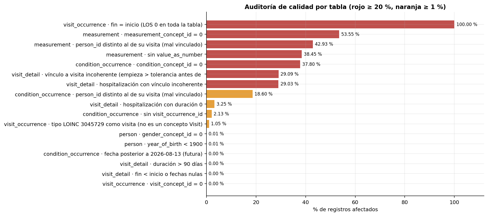

**Lectura.** Las inconsistencias clásicas son marginales (`visit_detail` con fin < inicio = 0; `year_of_birth < 1900` = 87 personas, 0.01 %). Los problemas graves son estructurales: la estancia en `visit_occurrence` es siempre 0 (se usa `visit_detail`), ~29 % de los subprocesos y ~19–43 % de diagnósticos/mediciones están vinculados a la visita de otra persona (se descartan con `vinculo_coherente`), y 38–54 % de conceptos son 0 (sin vocabulario).

### 2. Caracterización demográfica

**Tabla `person`** (912,205 personas): F 53.1 %, M 46.9 %, desconocido 0.01 %. Año de nacimiento fuera de [1900, 2026]: 87 personas.

**Episodios del periodo estable** (2023-01-31 → 2026-04-01):

| servicio                |   episodios |   personas |   episodios/persona | edad mediana [RIC]   |   % mujeres |   % < 15 años |   % ≥ 65 años |   % vienen de urgencias |
|:------------------------|------------:|-----------:|--------------------:|:---------------------|------------:|--------------:|--------------:|------------------------:|
| Hospitalización         |       44417 |      34252 |                 1.3 | 35 [19–61]           |        56.7 |          18.1 |          20.9 |                    97.1 |
| Urgencias / observación |      442986 |     191391 |                 2.3 | 29 [14–50]           |        56.7 |          25.7 |          13.0 |                     0.0 |

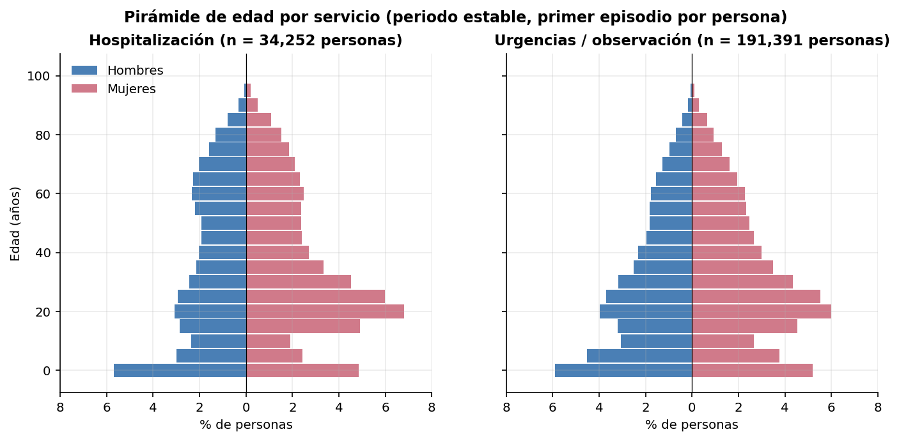

**Lectura.**

- Ambos servicios tienen un **pico en 0–4 años** y un **pico de mujeres de 15–35 años**. En hospitalización ese pico femenino es mucho más marcado que en hombres, lo que sugiere un componente **obstétrico** importante (partos/cesáreas, y recién nacidos en 0–4). No hay códigos de servicio para confirmarlo; si Persona 2 lo necesita, se puede aproximar con los diagnósticos.

- Hospitalización tiene más adultos mayores (21 % ≥ 65 frente a 13 % en urgencias) y el 97 % de sus episodios viene de urgencias.

- Sexo desconocido es despreciable (< 0.01 %).

### 3. Distribución univariada de la estancia (LOS)

| servicio                |      n |   media_h |   p10_h |   p25_h |   p50_h |   p75_h |   p90_h |   p95_h |   p99_h |   % LOS = 0 |   asimetría |   umbral P75 (train) |
|:------------------------|-------:|----------:|--------:|--------:|--------:|--------:|--------:|--------:|--------:|------------:|------------:|---------------------:|
| Hospitalización         |  44417 |    123.80 |   19.92 |   40.21 |   70.54 |  143.84 |  279.52 |  402.02 |  787.81 |        0.00 |       16.59 |               141.62 |
| Urgencias / observación | 442986 |      9.89 |    0.00 |    0.00 |    0.00 |    9.14 |   24.37 |   46.81 |  117.83 |       51.05 |      277.29 |                 8.90 |

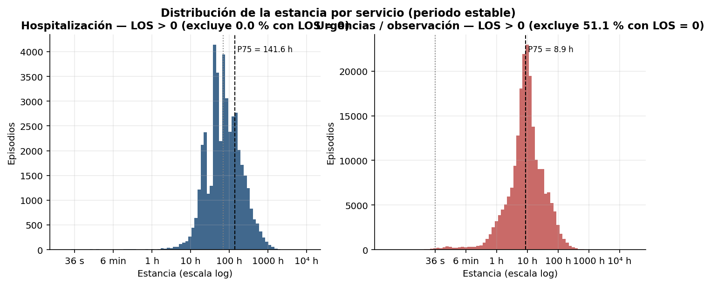

**Lectura.** Ambas distribuciones son muy asimétricas a la derecha (asimetría 17 y 277): la media sobreestima la estancia típica y no debe usarse como resumen. En urgencias/observación el 51 % de los episodios dura 0 h (registro puntual) y la distribución es bimodal (≈ minutos vs. ≈ horas); en hospitalización la moda está en 2–4 días con cola larga de estancias de semanas.

### 4. Censura y truncamiento al final de los datos

No hay visitas abiertas (`visit_end` nunca es NULL), así que la censura clásica del plan no existe. Hay dos fenómenos reales:

1. **Estancias abiertas en la extracción** (censura por la derecha): episodios cuyo `fin` coincide con la fecha de corte (2026-07-17 18:41) ±1 h. Seguían en curso; su LOS es un mínimo.

2. **Truncamiento**: los ingresos de los últimos 30 días (`en_riesgo_truncamiento`) solo pueden aparecer si ya terminaron, así que están sesgados hacia estancias cortas.

| servicio              |   episodios |   en_riesgo_truncamiento |   abiertos_en_corte |   abiertos_en_corte_periodo_estable |   truncamiento_periodo_estable |   margen_h_hasta_corte |   % LOS > margen (prob. de truncar) |
|:----------------------|------------:|-------------------------:|--------------------:|------------------------------------:|-------------------------------:|-----------------------:|------------------------------------:|
| hospitalizacion       |       49423 |                      924 |                 176 |                                   2 |                              0 |               2586.699 |                               0.011 |
| urgencias_observacion |      493320 |                     8548 |                 290 |                                   4 |                              0 |               2586.699 |                               0.002 |

El periodo estable termina 108 días antes del corte: un ingreso del último día del periodo solo quedaría truncado si su estancia supera ese margen, cosa que ocurre en 0.011 % (hosp.) y 0.002 % (urg.) de los episodios. **Conclusión: dentro del periodo estable el sesgo por censura/truncamiento es despreciable.**

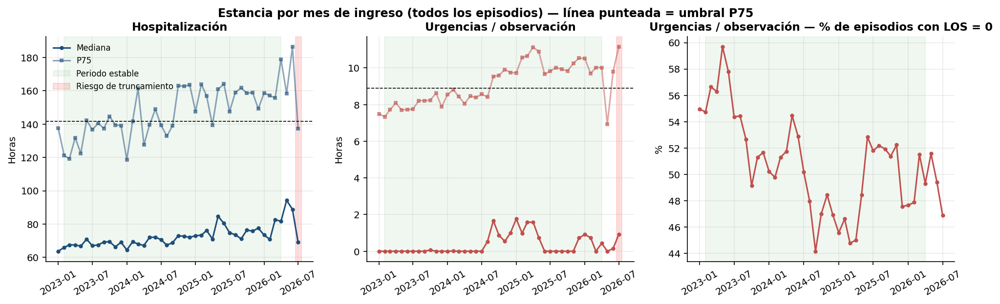


**Deriva de la estancia dentro del periodo estable** (por año de ingreso):

| servicio              |   anio |   mediana |    p75 |   pct_cero |      n |   % > umbral P75 de train |
|:----------------------|-------:|----------:|-------:|-----------:|-------:|--------------------------:|
| hospitalizacion       |   2023 |     67.81 | 136.54 |       0.00 |  12988 |                     23.14 |
| hospitalizacion       |   2024 |     69.52 | 143.62 |       0.00 |  14403 |                     25.49 |
| hospitalizacion       |   2025 |     75.06 | 157.10 |       0.01 |  13785 |                     27.64 |
| hospitalizacion       |   2026 |     73.44 | 157.60 |       0.00 |   3241 |                     28.14 |
| urgencias_observacion |   2023 |      0.00 |   7.97 |      54.56 | 137103 |                     22.77 |
| urgencias_observacion |   2024 |      0.02 |   8.92 |      49.75 | 139926 |                     25.04 |
| urgencias_observacion |   2025 |      0.29 |  10.26 |      49.29 | 135411 |                     28.56 |
| urgencias_observacion |   2026 |      0.42 |  10.11 |      49.09 |  30546 |                     27.92 |

**Lectura de la figura.**

- **Truncamiento visible al final**: en julio de 2026 la mediana y el P75 de hospitalización caen bruscamente (solo aparecen las estancias que ya terminaron). Ese mes está fuera del periodo estable.

- **La estancia crece con el tiempo**: la mediana de hospitalización pasa de ~68 h (2023) a ~75 h (2025–26) y el P75 mensual queda casi siempre **por encima del umbral fijo** de entrenamiento (141.6 h) desde 2024-07. Por eso la tasa de positivos en prueba (0.28) es mayor que en entrenamiento (0.25). Es deriva real del target, y Persona 2 debe tenerla en cuenta al calibrar (M7).

- **Cambio de registro en urgencias/observación**: el % de episodios con LOS = 0 cambia por tramos (cae entre 2024-08 y 2025-04 y otra vez desde 2025-12), y con él la mediana salta de 0 a 1–2 h. Parece un cambio en cómo se registra, no en la atención. Hay que reportarlo a Persona 1 y considerar una variable de "régimen" o validar por periodos.

**Sensibilidad de Kaplan-Meier al tratamiento de la censura** (S(umbral) = fracción que supera el P75):

| servicio                | escenario                             |      n |   censurados |   mediana_KM_h | IC95           |   S(umbral P75) |   media_simple_h |
|:------------------------|:--------------------------------------|-------:|-------------:|---------------:|:---------------|----------------:|-----------------:|
| Hospitalización         | A. Ingenuo (todos como evento)        |  49423 |            0 |         70.840 | [70.35, 71.40] |           0.260 |          124.389 |
| Hospitalización         | B. Abiertos en corte = censurados     |  49423 |          176 |         70.920 | [70.42, 71.48] |           0.260 |          124.389 |
| Hospitalización         | C. Excluir riesgo de truncamiento     |  48499 |           14 |         70.780 | [70.29, 71.32] |           0.259 |          124.534 |
| Hospitalización         | D. Solo periodo estable (recomendado) |  44417 |            2 |         70.540 | [70.01, 71.08] |           0.257 |          123.797 |
| Urgencias / observación | A. Ingenuo (todos como evento)        | 493320 |            0 |          0.000 | [0.00, 0.00]   |           0.255 |           10.037 |
| Urgencias / observación | B. Abiertos en corte = censurados     | 493320 |          290 |          0.000 | [0.00, 0.00]   |           0.255 |           10.037 |
| Urgencias / observación | C. Excluir riesgo de truncamiento     | 484772 |           22 |          0.000 | [0.00, 0.00]   |           0.255 |            9.955 |
| Urgencias / observación | D. Solo periodo estable (recomendado) | 442986 |            4 |          0.000 | [0.00, 0.00]   |           0.256 |            9.895 |

Las medianas KM y la fracción por encima del umbral apenas cambian entre escenarios: la censura afecta a < 0.5 % de los episodios. En el resto del análisis se usa el escenario D (periodo estable, abiertos en corte como censurados).

### 5. Curvas de Kaplan-Meier estratificadas (sustituto del triaje)

El plan pedía estratificar por nivel de triaje (1–5), pero **el triaje no existe** en los datos. Se estratifica por servicio, origen en urgencias (solo hospitalización: en urgencias/observación es siempre falso), grupo de edad y sexo. Evento = alta del servicio. Se reporta el log-rank (p ajustado por BH) **y** el tamaño de efecto ε² de Kruskal-Wallis sobre LOS, porque con n grande todo log-rank es significativo.


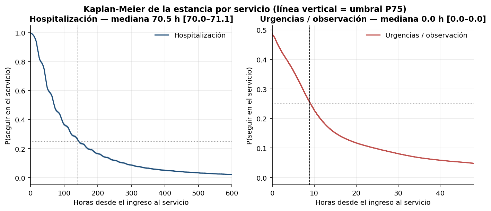


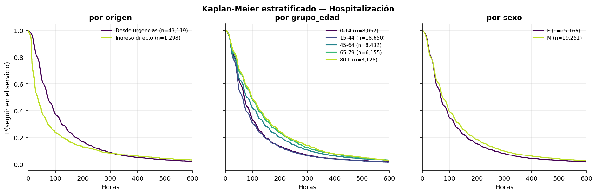


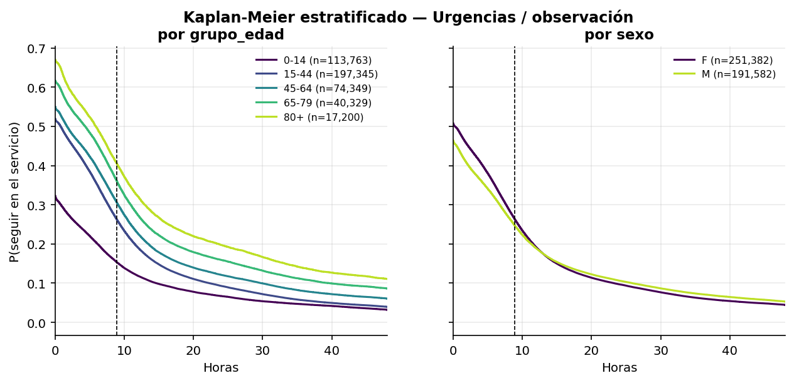

**Medianas KM por estrato** (horas, IC 95 %):

| servicio                | variable   | nivel           |      n |   mediana_h |   IC95_inf |   IC95_sup |   P(LOS > umbral) |
|:------------------------|:-----------|:----------------|-------:|------------:|-----------:|-----------:|------------------:|
| Hospitalización         | origen     | Desde urgencias |  43119 |       71.24 |      70.65 |      71.78 |              0.26 |
| Hospitalización         | origen     | Ingreso directo |   1298 |       34.29 |      29.23 |      37.76 |              0.18 |
| Hospitalización         | grupo_edad | 0-14            |   8052 |       69.42 |      68.42 |      70.55 |              0.21 |
| Hospitalización         | grupo_edad | 15-44           |  18650 |       63.15 |      61.67 |      64.16 |              0.21 |
| Hospitalización         | grupo_edad | 45-64           |   8432 |       79.48 |      75.11 |      85.41 |              0.30 |
| Hospitalización         | grupo_edad | 65-79           |   6155 |       95.04 |      92.84 |      97.53 |              0.35 |
| Hospitalización         | grupo_edad | 80+             |   3128 |       96.24 |      93.37 |     100.60 |              0.36 |
| Hospitalización         | sexo       | F               |  25166 |       68.26 |      67.59 |      68.94 |              0.24 |
| Hospitalización         | sexo       | M               |  19251 |       74.16 |      72.98 |      75.95 |              0.28 |
| Urgencias / observación | grupo_edad | 0-14            | 113763 |        0.00 |       0.00 |       0.00 |              0.15 |
| Urgencias / observación | grupo_edad | 15-44           | 197345 |        0.77 |       0.70 |       0.84 |              0.26 |
| Urgencias / observación | grupo_edad | 45-64           |  74349 |        1.69 |       1.57 |       1.82 |              0.31 |
| Urgencias / observación | grupo_edad | 65-79           |  40329 |        4.30 |       4.09 |       4.52 |              0.36 |
| Urgencias / observación | grupo_edad | 80+             |  17200 |        5.85 |       5.61 |       6.14 |              0.41 |
| Urgencias / observación | sexo       | F               | 251382 |        0.23 |       0.11 |       0.36 |              0.26 |
| Urgencias / observación | sexo       | M               | 191582 |        0.00 |       0.00 |       0.00 |              0.25 |

**Log-rank + tamaño de efecto:**

| servicio                | variable   |      n |   logrank_chi2 | p_BH    |   eps2 | magnitud ε²   |
|:------------------------|:-----------|-------:|---------------:|:--------|-------:|:--------------|
| Hospitalización         | origen     |  44417 |       109.8653 | < 0.001 | 0.0089 | despreciable  |
| Hospitalización         | grupo_edad |  44417 |       823.2520 | < 0.001 | 0.0198 | pequeño       |
| Hospitalización         | sexo       |  44417 |       103.3492 | < 0.001 | 0.0015 | despreciable  |
| Urgencias / observación | grupo_edad | 442986 |     12563.0836 | < 0.001 | 0.0450 | pequeño       |
| Urgencias / observación | sexo       | 442964 |         2.4950 | 0.114   | 0.0013 | despreciable  |

**Lectura.** Todos los log-rank son significativos (n enorme), pero el tamaño de efecto dice cuáles importan: la **edad** es el estratificador con más efecto en ambos servicios (en hospitalización, los mayores de 65 tienen curvas claramente más lentas); sexo y origen tienen efecto despreciable o pequeño. Ningún estrato por sí solo separa bien quién supera el P75: el modelo de paciente necesita variables clínicas e historial (M5).

### 6. Balance de clases de los dos targets


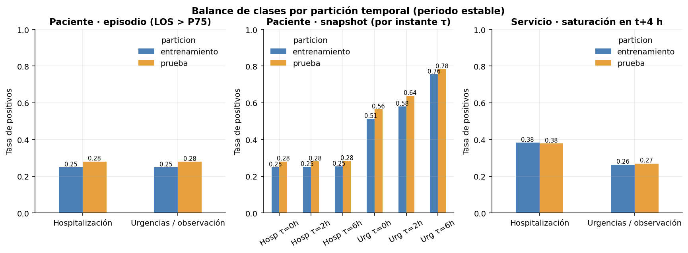

**Episodio:**

| servicio              | particion     |      n |   positivos |   tasa |
|:----------------------|:--------------|-------:|------------:|-------:|
| hospitalizacion       | entrenamiento |  34635 |        8658 |  0.250 |
| hospitalizacion       | prueba        |   9782 |        2742 |  0.280 |
| urgencias_observacion | entrenamiento | 350296 |       87574 |  0.250 |
| urgencias_observacion | prueba        |  92690 |       25883 |  0.279 |

**Snapshot (unidad del modelo de paciente):**

| servicio              |   horas_desde_ingreso | particion     |      n |   positivos |   tasa |
|:----------------------|----------------------:|:--------------|-------:|------------:|-------:|
| hospitalizacion       |                     0 | entrenamiento |  34634 |        8658 |  0.250 |
| hospitalizacion       |                     0 | prueba        |   9782 |        2742 |  0.280 |
| hospitalizacion       |                     2 | entrenamiento |  34496 |        8658 |  0.251 |
| hospitalizacion       |                     2 | prueba        |   9751 |        2742 |  0.281 |
| hospitalizacion       |                     6 | entrenamiento |  34274 |        8658 |  0.253 |
| hospitalizacion       |                     6 | prueba        |   9662 |        2742 |  0.284 |
| urgencias_observacion |                     0 | entrenamiento | 170960 |       87574 |  0.512 |
| urgencias_observacion |                     0 | prueba        |  45867 |       25883 |  0.564 |
| urgencias_observacion |                     2 | entrenamiento | 150972 |       87574 |  0.580 |
| urgencias_observacion |                     2 | prueba        |  40567 |       25883 |  0.638 |
| urgencias_observacion |                     6 | entrenamiento | 115924 |       87574 |  0.755 |
| urgencias_observacion |                     6 | prueba        |  33044 |       25883 |  0.783 |

**Saturación por servicio y hora:**

| servicio              |     n |   positivos |   tasa |   ocupacion_media | particion     |
|:----------------------|------:|------------:|-------:|------------------:|:--------------|
| hospitalizacion       |  6268 |    2379.000 |  0.380 |             0.932 | prueba        |
| hospitalizacion       | 19311 |    7402.000 |  0.383 |             0.927 | entrenamiento |
| urgencias_observacion |  6268 |    1690.000 |  0.270 |             0.751 | prueba        |
| urgencias_observacion | 19311 |    5082.000 |  0.263 |             0.740 | entrenamiento |

**Lectura.**

- A nivel episodio el target está en ~26 % por construcción (P75). A nivel **snapshot** la tasa **sube con τ en urgencias/observación** (≈ 0.52 → 0.59 → 0.76): los snapshots se crean solo si el paciente sigue en el servicio, así que en τ = 0 ya se excluyen los episodios de LOS 0 y en τ = 6 h solo quedan los que llevan 6 h. Persona 2 debe estratificar métricas por τ y no comparar AUC-PR entre τ sin mirar la prevalencia base.

- En hospitalización la tasa es estable entre τ (≈ 0.26) porque casi nadie sale antes de 6 h.

- La prevalencia de prueba es ~3 puntos mayor que la de entrenamiento en todos los casos del modelo de paciente (0.25 → 0.28), coherente con la estancia creciente (sección 4). En saturación no hay diferencia, porque la capacidad proxy es móvil.

- El desbalance es moderado (25–40 % positivos en casi todo): no exige sobremuestreo; basta con `class_weight` o umbral por costo (M7).

### 7. Faltantes y nulos informativos (MNAR)

**% de NULL por variable del snapshot:**

| variable                      |   Hospitalización |   Urgencias / observación |
|:------------------------------|------------------:|--------------------------:|
| n_mediciones_24h              |              0.00 |                      0.00 |
| n_mediciones_historia         |              0.00 |                      0.00 |
| n_dx_historia                 |              0.00 |                      0.00 |
| n_dx_distintos_historia       |              0.00 |                      0.00 |
| n_dx_30d                      |              0.00 |                      0.00 |
| n_visitas_365d                |              0.00 |                      0.00 |
| n_hospitalizaciones_previas   |              0.00 |                      0.00 |
| horas_desde_ultima_alta_hosp  |             83.91 |                     88.34 |
| censo_servicio_t_menos_1h     |              0.00 |                      0.00 |
| ocupacion_servicio_t_menos_1h |              0.00 |                      0.00 |
| llegadas_servicio_t_menos_1h  |              0.00 |                      0.00 |
| edad                          |              0.00 |                      0.00 |

Los NULL reales son pocos y **estructurales**: `horas_desde_ultima_alta_hosp` es NULL cuando la persona nunca estuvo hospitalizada (no es un dato perdido). El resto de variables no tiene NULL porque los conteos se construyeron con 0 por defecto. El faltante clínicamente relevante no aparece como NULL sino como **cero**: `n_mediciones_24h = 0` (no se pidió ningún laboratorio).

**Indicadores de ausencia vs target (Chi² + V de Cramér, BH):**

| servicio                |   τ_h | indicador               |   % con indicador |   tasa_target_si |   tasa_target_no |   V_cramer | p_BH    | magnitud     |
|:------------------------|------:|:------------------------|------------------:|-----------------:|-----------------:|-----------:|:--------|:-------------|
| Hospitalización         |     0 | sin_mediciones_24h      |            41.118 |            0.247 |            0.263 |      0.017 | < 0.001 | despreciable |
| Hospitalización         |     0 | sin_mediciones_historia |            18.887 |            0.252 |            0.258 |      0.001 | 0.302   | despreciable |
| Hospitalización         |     0 | sin_dx_historia         |            27.186 |            0.270 |            0.252 |      0.018 | < 0.001 | despreciable |
| Hospitalización         |     0 | nunca_hospitalizado     |            83.963 |            0.243 |            0.329 |      0.072 | < 0.001 | despreciable |
| Hospitalización         |     2 | sin_mediciones_24h      |            35.892 |            0.235 |            0.270 |      0.039 | < 0.001 | despreciable |
| Hospitalización         |     2 | sin_mediciones_historia |            13.490 |            0.229 |            0.262 |      0.026 | < 0.001 | despreciable |
| Hospitalización         |     2 | sin_dx_historia         |            26.501 |            0.265 |            0.255 |      0.009 | 0.036   | despreciable |
| Hospitalización         |     2 | nunca_hospitalizado     |            83.915 |            0.244 |            0.329 |      0.072 | < 0.001 | despreciable |
| Hospitalización         |     6 | sin_mediciones_24h      |            36.367 |            0.227 |            0.278 |      0.057 | < 0.001 | despreciable |
| Hospitalización         |     6 | sin_mediciones_historia |            11.945 |            0.212 |            0.266 |      0.039 | < 0.001 | despreciable |
| Hospitalización         |     6 | sin_dx_historia         |            26.154 |            0.269 |            0.256 |      0.013 | 0.005   | despreciable |
| Hospitalización         |     6 | nunca_hospitalizado     |            83.861 |            0.246 |            0.331 |      0.071 | < 0.001 | despreciable |
| Urgencias / observación |     0 | sin_mediciones_24h      |            96.988 |            0.520 |            0.632 |      0.038 | < 0.001 | despreciable |
| Urgencias / observación |     0 | sin_mediciones_historia |            68.514 |            0.513 |            0.545 |      0.030 | < 0.001 | despreciable |
| Urgencias / observación |     0 | sin_dx_historia         |            37.860 |            0.463 |            0.560 |      0.095 | < 0.001 | despreciable |
| Urgencias / observación |     0 | nunca_hospitalizado     |            88.503 |            0.516 |            0.580 |      0.041 | < 0.001 | despreciable |
| Urgencias / observación |     2 | sin_mediciones_24h      |            76.048 |            0.582 |            0.624 |      0.036 | < 0.001 | despreciable |
| Urgencias / observación |     2 | sin_mediciones_historia |            53.996 |            0.576 |            0.612 |      0.037 | < 0.001 | despreciable |
| Urgencias / observación |     2 | sin_dx_historia         |            32.929 |            0.539 |            0.619 |      0.077 | < 0.001 | despreciable |
| Urgencias / observación |     2 | nunca_hospitalizado     |            88.483 |            0.584 |            0.655 |      0.046 | < 0.001 | despreciable |
| Urgencias / observación |     6 | sin_mediciones_24h      |            34.368 |            0.720 |            0.783 |      0.070 | < 0.001 | despreciable |
| Urgencias / observación |     6 | sin_mediciones_historia |            25.827 |            0.716 |            0.778 |      0.064 | < 0.001 | despreciable |
| Urgencias / observación |     6 | sin_dx_historia         |            30.554 |            0.741 |            0.771 |      0.032 | < 0.001 | despreciable |
| Urgencias / observación |     6 | nunca_hospitalizado     |            87.922 |            0.756 |            0.804 |      0.037 | < 0.001 | despreciable |

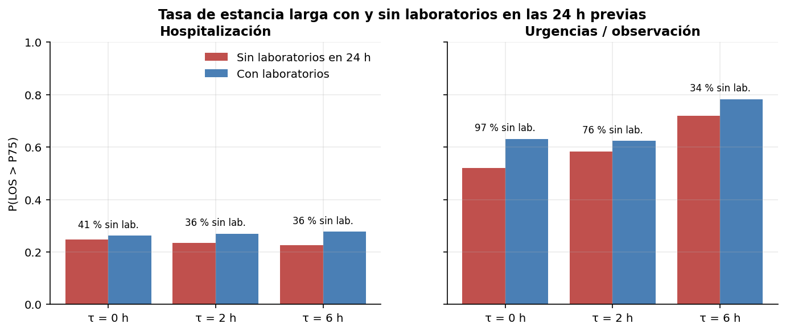


**Lectura.**

- La ausencia **no es aleatoria** (todas las diferencias son significativas tras BH y tienen dirección consistente entre τ), pero su **efecto marginal es despreciable** (V de Cramér < 0.1). Por sí sola no predice la estancia larga.

- Dirección: no tener laboratorios o no tener historia se asocia con **menos** estancia larga, salvo `sin_dx_historia` en hospitalización. Que el paciente haya estado hospitalizado antes (`nunca_hospitalizado = 0`) es el indicador con más efecto (hosp.: 0.33 frente a 0.24).

- En urgencias, en τ = 0 el 97 % no tiene laboratorios, y en τ = 6 h baja al 34 %: los laboratorios se registran durante la estancia. La información MNAR crece con τ.


**Recomendación para M5.** Incluir los indicadores binarios (`sin_mediciones_24h`, `nunca_hospitalizado`, `sin_dx_historia`). Son baratos y pueden interactuar con otras variables en modelos de árboles. **No imputar** `horas_desde_ultima_alta_hosp` con la mediana: usar el indicador más un valor centinela dentro del `Pipeline`.

### 8. Resumen univariado de las variables de entrada (snapshot τ = 0)

| servicio                | variable                      |   mediana |    p25 |     p75 |      p99 |      máx |   % cero |   asimetría |
|:------------------------|:------------------------------|----------:|-------:|--------:|---------:|---------:|---------:|------------:|
| Hospitalización         | n_mediciones_24h              |      5.00 |   0.00 |   63.00 |   179.00 |   480.00 |    41.12 |        1.61 |
| Hospitalización         | n_mediciones_historia         |     78.00 |  46.00 |  157.00 |  1609.70 |  7286.00 |    18.89 |        7.59 |
| Hospitalización         | n_dx_historia                 |     51.00 |   0.00 |  156.00 |  3517.70 | 36354.00 |    27.19 |       12.99 |
| Hospitalización         | n_dx_distintos_historia       |      1.00 |   0.00 |    3.00 |    10.00 |    32.00 |    27.19 |        2.39 |
| Hospitalización         | n_dx_30d                      |     40.00 |   0.00 |  120.00 |  1079.00 | 10767.00 |    32.21 |        9.88 |
| Hospitalización         | n_visitas_365d                |      2.00 |   2.00 |    4.00 |    20.00 |   276.00 |     0.29 |       17.10 |
| Hospitalización         | n_hospitalizaciones_previas   |      0.00 |   0.00 |    0.00 |     4.00 |    28.00 |    83.96 |        8.87 |
| Hospitalización         | horas_desde_ultima_alta_hosp  |   1879.17 | 462.08 | 5808.74 | 22838.87 | 27405.53 |     0.06 |        1.81 |
| Hospitalización         | censo_servicio_t_menos_1h     |    282.00 | 264.00 |  299.00 |   330.00 |   351.00 |     0.00 |       -0.39 |
| Hospitalización         | ocupacion_servicio_t_menos_1h |      0.91 |   0.87 |    0.95 |     1.02 |     1.09 |     0.00 |       -0.70 |
| Hospitalización         | llegadas_servicio_t_menos_1h  |      3.00 |   0.00 |    9.00 |    24.00 |    42.00 |    26.18 |        1.40 |
| Hospitalización         | edad                          |     35.00 |  19.00 |   61.00 |    90.00 |   108.00 |     4.34 |        0.27 |
| Urgencias / observación | n_mediciones_24h              |      0.00 |   0.00 |    0.00 |    72.00 |   331.00 |    96.99 |        8.32 |
| Urgencias / observación | n_mediciones_historia         |      0.00 |   0.00 |   55.00 |  1092.74 |  7165.00 |    68.51 |        9.70 |
| Urgencias / observación | n_dx_historia                 |      3.00 |   0.00 |   18.00 |  2094.00 | 39338.00 |    37.86 |       20.02 |
| Urgencias / observación | n_dx_distintos_historia       |      1.00 |   0.00 |    2.00 |    10.00 |    40.00 |    37.86 |        3.24 |
| Urgencias / observación | n_dx_30d                      |      3.00 |   0.00 |    3.00 |   429.00 | 10860.00 |    44.46 |       23.39 |
| Urgencias / observación | n_visitas_365d                |      2.00 |   1.00 |    4.00 |    21.00 |   296.00 |     3.45 |       13.60 |
| Urgencias / observación | n_hospitalizaciones_previas   |      0.00 |   0.00 |    0.00 |     3.00 |    28.00 |    88.50 |       10.90 |
| Urgencias / observación | horas_desde_ultima_alta_hosp  |   2926.48 | 665.73 | 8178.50 | 23300.56 | 27815.73 |     0.00 |        1.35 |
| Urgencias / observación | censo_servicio_t_menos_1h     |    223.00 | 186.00 |  260.00 |   351.00 |   421.00 |     0.00 |        0.16 |
| Urgencias / observación | ocupacion_servicio_t_menos_1h |      0.75 |   0.64 |    0.87 |     1.13 |     1.38 |     0.00 |        0.05 |
| Urgencias / observación | llegadas_servicio_t_menos_1h  |     44.00 |  30.00 |   60.00 |   106.00 |   244.00 |     0.33 |        0.56 |
| Urgencias / observación | edad                          |     33.00 |  20.00 |   56.00 |    90.00 |   108.00 |     3.10 |        0.39 |

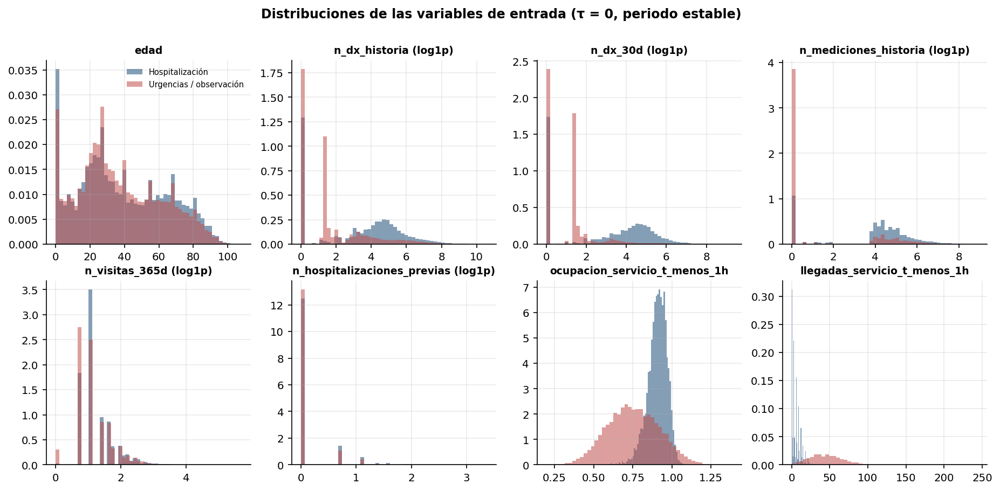


**Lectura.** Las variables de conteo (diagnósticos, mediciones, visitas) son muy asimétricas y con muchos ceros: conviene `log1p` o modelos de árboles. La ocupación del servicio en t−1 está concentrada cerca de 1 en hospitalización (el servicio opera casi siempre lleno respecto al proxy).

**Código fuente · utilidades compartidas del EDA y script del M2**


```python
# Archivo: eda_comun/__init__.py
"""Utilidades compartidas de Persona 3 (M2, M3, M4 visual).

Rutas, conexión DuckDB, estilo de figuras, tamaños de efecto y helpers de informe.
Todo lo que se escribe en outputs/ son AGREGADOS: nunca filas de pacientes.
"""
from __future__ import annotations

import sys
from pathlib import Path

import duckdb
import matplotlib

matplotlib.use("Agg")
import matplotlib.pyplot as plt  # noqa: E402
import numpy as np  # noqa: E402
import pandas as pd  # noqa: E402
from scipy import stats  # noqa: E402
from statsmodels.stats.multitest import multipletests  # noqa: E402

if hasattr(sys.stdout, "reconfigure"):
    sys.stdout.reconfigure(encoding="utf-8")

ROOT = Path(__file__).resolve().parents[1]
DATA = ROOT / "data"
M1 = DATA / "m1"
M4 = DATA / "m4"
RAW = DATA / "raw"
OUT = ROOT / "outputs"

SEED = 42

# ---------------------------------------------------------------- estilo
COLORES = {
    "hospitalizacion": "#1f4e79",
    "urgencias_observacion": "#c0504d",
    "urgencias_ingreso": "#e6a03c",
    "ambulatorio": "#5b9b64",
}
NOMBRE = {
    "hospitalizacion": "Hospitalización",
    "urgencias_observacion": "Urgencias / observación",
    "urgencias_ingreso": "Ingreso a urgencias",
    "ambulatorio": "Ambulatorio",
}
DIAS = ["Lun", "Mar", "Mié", "Jue", "Vie", "Sáb", "Dom"]  # dia_semana 1..7 (ISO)

plt.rcParams.update(
    {
        "figure.dpi": 110,
        "savefig.dpi": 150,
        "savefig.bbox": "tight",
        "axes.spines.top": False,
        "axes.spines.right": False,
        "axes.grid": True,
        "grid.alpha": 0.25,
        "axes.titleweight": "bold",
        "axes.titlesize": 11,
        "font.size": 9.5,
        "legend.frameon": False,
    }
)


def con() -> duckdb.DuckDBPyConnection:
    c = duckdb.connect()
    c.execute(f"SET file_search_path='{ROOT.as_posix()}'")
    return c


def q(sql: str, c: duckdb.DuckDBPyConnection | None = None) -> pd.DataFrame:
    return (c or con()).sql(sql).df()


def parametros() -> pd.Series:
    return pd.read_parquet(M1 / "parametros.parquet").iloc[0]


def carpeta(modulo: str) -> tuple[Path, Path]:
    """Devuelve (carpeta de figuras, carpeta de tablas) del módulo."""
    fig = OUT / modulo / "figuras"
    tab = OUT / modulo / "tablas"
    fig.mkdir(parents=True, exist_ok=True)
    tab.mkdir(parents=True, exist_ok=True)
    return fig, tab


def guardar(fig, ruta: Path) -> str:
    fig.savefig(ruta)
    plt.close(fig)
    return ruta.name


# ---------------------------------------------------------------- tamaños de efecto
def cramers_v(tabla: np.ndarray) -> tuple[float, float, float, int]:
    """Chi² de independencia + V de Cramér con corrección de sesgo (Bergsma 2013).

    Devuelve (chi2, p, V, gl)."""
    tabla = np.asarray(tabla, dtype=float)
    tabla = tabla[tabla.sum(1) > 0][:, tabla.sum(0) > 0]
    chi2, p, gl, _ = stats.chi2_contingency(tabla, correction=False)
    n = tabla.sum()
    r, k = tabla.shape
    phi2 = chi2 / n
    phi2c = max(0.0, phi2 - (k - 1) * (r - 1) / (n - 1))
    rc = r - (r - 1) ** 2 / (n - 1)
    kc = k - (k - 1) ** 2 / (n - 1)
    v = np.sqrt(phi2c / max(1e-12, min(kc - 1, rc - 1)))
    return chi2, p, v, gl


def kruskal_eps2(grupos: list[np.ndarray]) -> tuple[float, float, float]:
    """Kruskal-Wallis + épsilon² = H / (n − 1). Devuelve (H, p, ε²)."""
    grupos = [np.asarray(g) for g in grupos if len(g) > 0]
    n = sum(len(g) for g in grupos)
    h, p = stats.kruskal(*grupos)
    return h, p, h / (n - 1)


def auc_univariada(x: np.ndarray, y: np.ndarray) -> float:
    """AUC de una variable numérica para separar y=1 de y=0 (= P(X1 > X0)).

    Equivale a (1 + correlación rango-biserial) / 2."""
    x = np.asarray(x, float)
    y = np.asarray(y, int)
    m = ~np.isnan(x)
    x, y = x[m], y[m]
    r = stats.rankdata(x)
    n1 = y.sum()
    n0 = len(y) - n1
    return (r[y == 1].sum() - n1 * (n1 + 1) / 2) / (n1 * n0)


def dif_medianas_ic(a: np.ndarray, b: np.ndarray, n_boot: int = 1000, max_n: int = 20000) -> tuple[float, float, float]:
    """Diferencia de medianas (a − b) con IC 95 % bootstrap percentil.

    Submuestrea a `max_n` por grupo para que sea rápido (el IC sigue siendo
    conservador: con n completo sería más estrecho)."""
    rng = np.random.default_rng(SEED)
    a = np.asarray(a, float)
    b = np.asarray(b, float)
    a, b = a[~np.isnan(a)], b[~np.isnan(b)]
    est = np.median(a) - np.median(b)
    if len(a) > max_n:
        a = rng.choice(a, max_n, replace=False)
    if len(b) > max_n:
        b = rng.choice(b, max_n, replace=False)
    ia = rng.integers(0, len(a), (n_boot, len(a)))
    ib = rng.integers(0, len(b), (n_boot, len(b)))
    boots = np.median(a[ia], axis=1) - np.median(b[ib], axis=1)
    lo, hi = np.percentile(boots, [2.5, 97.5])
    return est, lo, hi


def bh(pvals) -> np.ndarray:
    """p-valores ajustados por Benjamini-Hochberg (FDR)."""
    p = np.asarray(pvals, float)
    out = np.full_like(p, np.nan)
    m = ~np.isnan(p)
    if m.any():
        out[m] = multipletests(p[m], method="fdr_bh")[1]
    return out


def magnitud_v(v: float, gl: int = 1) -> str:
    """Cohen (1988) ajustado por grados de libertad mínimos (df* = min(r,k) − 1)."""
    gl = max(1, min(gl, 5))
    cortes = {1: (0.10, 0.30, 0.50), 2: (0.07, 0.21, 0.35), 3: (0.06, 0.17, 0.29), 4: (0.05, 0.15, 0.25), 5: (0.04, 0.13, 0.22)}[gl]
    return _mag(v, cortes)


def magnitud_eps2(e: float) -> str:
    """Tomczak & Tomczak (2014): 0.01 pequeño, 0.08 mediano, 0.26 grande."""
    return _mag(e, (0.01, 0.08, 0.26))


def magnitud_auc(a: float) -> str:
    """|AUC − 0.5| en escala de rango-biserial: 0.1/0.3/0.5 → AUC 0.55/0.65/0.75."""
    return _mag(abs(2 * a - 1), (0.10, 0.30, 0.50))


def _mag(x: float, cortes) -> str:
    if np.isnan(x):
        return "—"
    if x < cortes[0]:
        return "despreciable"
    if x < cortes[1]:
        return "pequeño"
    if x < cortes[2]:
        return "mediano"
    return "grande"


def fmt_p(p: float) -> str:
    if np.isnan(p):
        return "—"
    return "< 0.001" if p < 0.001 else f"{p:.3f}"


# ---------------------------------------------------------------- informe
def md_tabla(df: pd.DataFrame, floatfmt: str = ".3f", index: bool = False) -> str:
    return df.to_markdown(index=index, floatfmt=floatfmt)


def grupo_edad_sql(col: str = "edad") -> str:
    return f"""CASE WHEN {col} < 15 THEN '0-14'
                    WHEN {col} < 45 THEN '15-44'
                    WHEN {col} < 65 THEN '45-64'
                    WHEN {col} < 80 THEN '65-79'
                    ELSE '80+' END"""


GRUPOS_EDAD = ["0-14", "15-44", "45-64", "65-79", "80+"]

```


```python
# Archivo: m2_eda/run_m2.py
"""M2 · EDA univariado, calidad y censura (HUN-201) — Persona 3.

Uso:  python m2_eda/run_m2.py
Salida: outputs/m2/{figuras,tablas}/ y outputs/m2/M2_informe.md (solo agregados).

Periodo: `en_periodo_estable = true` (descriptivo sobre todo el periodo estable,
entrenamiento + prueba). La auditoría de truncamiento usa todos los episodios.
"""
from __future__ import annotations

import sys
from pathlib import Path

sys.path.insert(0, str(Path(__file__).resolve().parents[1]))

import matplotlib.pyplot as plt  # noqa: E402
import numpy as np  # noqa: E402
import pandas as pd  # noqa: E402
from lifelines import KaplanMeierFitter  # noqa: E402
from lifelines.statistics import multivariate_logrank_test  # noqa: E402
from lifelines.utils import median_survival_times  # noqa: E402

from eda_comun import (  # noqa: E402
    COLORES, GRUPOS_EDAD, M1, NOMBRE, OUT, bh, carpeta, con, cramers_v, fmt_p, grupo_edad_sql,
    guardar, kruskal_eps2, magnitud_eps2, magnitud_v, md_tabla, parametros,
)

FIG, TAB = carpeta("m2")
C = con()
P = parametros()
CORTE = pd.Timestamp(P.fecha_corte_datos)
SERV = ["hospitalizacion", "urgencias_observacion"]
XMAX = {"hospitalizacion": 600, "urgencias_observacion": 48}
informe: list[str] = []


def sec(titulo: str):
    print(f"· {titulo}")
    informe.append(f"\n## {titulo}\n")


def add(*lineas: str):
    informe.extend(lineas)


def fig_md(nombre: str, alt: str):
    add(f"\n\n")


# =====================================================================================
# 1. Calidad de datos
# =====================================================================================
sec("1. Calidad de los datos (auditoría de inconsistencias)")
cal = pd.read_parquet(M1 / "reporte_calidad.parquet")
cal.to_csv(TAB / "calidad.csv", index=False)
add(
    "Chequeos cuantificados por Persona 1 en el M1 (`reporte_calidad`), incluidos los que el plan "
    "pedía explícitamente (`visit_end < visit_start`, `year_of_birth` anómalo).\n",
    md_tabla(cal.rename(columns={"pct": "%"}).astype({"n_afectados": "Int64", "n_total": "Int64"}), floatfmt=".2f"),
)
cc = cal.dropna(subset=["pct"]).copy()
cc["etiqueta"] = cc.tabla + " · " + cc.chequeo.str.slice(0, 60)
cc = cc.sort_values("pct")
fig, ax = plt.subplots(figsize=(9, 6))
color = np.where(cc.pct >= 20, "#c0504d", np.where(cc.pct >= 1, "#e6a03c", "#5b9b64"))
ax.barh(cc.etiqueta, cc.pct, color=color)
for y, v in enumerate(cc.pct):
    ax.text(v + 0.8, y, f"{v:.2f} %", va="center", fontsize=8)
ax.set_xlabel("% de registros afectados")
ax.set_title("Auditoría de calidad por tabla (rojo ≥ 20 %, naranja ≥ 1 %)")
ax.set_xlim(0, 112)
fig_md(guardar(fig, FIG / "01_calidad.png"), "calidad")
add(
    "**Lectura.** Las inconsistencias clásicas son marginales (`visit_detail` con fin < inicio = 0; "
    "`year_of_birth < 1900` = 87 personas, 0.01 %). Los problemas graves son estructurales: "
    "la estancia en `visit_occurrence` es siempre 0 (se usa `visit_detail`), ~29 % de los "
    "subprocesos y ~19–43 % de diagnósticos/mediciones están vinculados a la visita de otra persona "
    "(se descartan con `vinculo_coherente`), y 38–54 % de conceptos son 0 (sin vocabulario).",
)

# =====================================================================================
# 2. Demografía
# =====================================================================================
sec("2. Caracterización demográfica")
per = C.sql(
    """SELECT CASE gender_concept_id WHEN 8507 THEN 'M' WHEN 8532 THEN 'F' ELSE 'desconocido' END sexo,
              year_of_birth FROM 'data/raw/person.parquet'"""
).df()
n_per = len(per)
anom_yob = int(((per.year_of_birth < 1900) | (per.year_of_birth > 2026)).sum())
sexo_per = per.sexo.value_counts(normalize=True).mul(100).round(2)
add(
    f"**Tabla `person`** ({n_per:,} personas): F {sexo_per.get('F', 0):.1f} %, "
    f"M {sexo_per.get('M', 0):.1f} %, desconocido {sexo_per.get('desconocido', 0):.2f} %. "
    f"Año de nacimiento fuera de [1900, 2026]: {anom_yob} personas.\n"
)

ep = C.sql(
    f"""SELECT servicio, person_id, edad, sexo, origen_urgencias, los_h, target_los_largo,
               es_entrenamiento, inicio, fin, {grupo_edad_sql()} grupo_edad
        FROM 'data/m1/episodio.parquet' WHERE en_periodo_estable"""
).df()

filas = []
for s, d in ep.groupby("servicio"):
    filas.append(
        {
            "servicio": NOMBRE[s],
            "episodios": len(d),
            "personas": d.person_id.nunique(),
            "episodios/persona": len(d) / d.person_id.nunique(),
            "edad mediana [RIC]": f"{d.edad.median():.0f} [{d.edad.quantile(.25):.0f}–{d.edad.quantile(.75):.0f}]",
            "% mujeres": 100 * (d.sexo == "F").mean(),
            "% < 15 años": 100 * (d.edad < 15).mean(),
            "% ≥ 65 años": 100 * (d.edad >= 65).mean(),
            "% vienen de urgencias": 100 * d.origen_urgencias.mean(),
        }
    )
demo = pd.DataFrame(filas)
demo.to_csv(TAB / "demografia_servicio.csv", index=False)
add("**Episodios del periodo estable** (2023-01-31 → 2026-04-01):\n", md_tabla(demo, floatfmt=".1f"))

# Pirámide de edad (personas únicas, primer episodio por servicio)
fig, axes = plt.subplots(1, 2, figsize=(11, 4.6), sharey=True)
bins = np.arange(0, 110, 5)
for ax, s in zip(axes, SERV):
    d = ep[ep.servicio == s].sort_values("inicio").drop_duplicates("person_id")
    hm = np.histogram(d.loc[d.sexo == "M", "edad"], bins)[0] / len(d) * 100
    hf = np.histogram(d.loc[d.sexo == "F", "edad"], bins)[0] / len(d) * 100
    ax.barh(bins[:-1], -hm, height=4.6, color="#4a7fb5", label="Hombres")
    ax.barh(bins[:-1], hf, height=4.6, color="#d07a8a", label="Mujeres")
    lim = max(hm.max(), hf.max()) * 1.1
    ax.set_xlim(-lim, lim)
    ax.set_xticks(ax.get_xticks())
    ax.set_xticklabels([f"{abs(t):.0f}" for t in ax.get_xticks()])
    ax.set_title(f"{NOMBRE[s]} (n = {len(d):,} personas)")
    ax.set_xlabel("% de personas")
    ax.axvline(0, color="k", lw=0.6)
axes[0].set_ylabel("Edad (años)")
axes[0].legend(loc="upper left")
fig.suptitle("Pirámide de edad por servicio (periodo estable, primer episodio por persona)", fontweight="bold")
fig_md(guardar(fig, FIG / "02_piramide_edad.png"), "pirámide")
add(
    "**Lectura.**\n",
    "- Ambos servicios tienen un **pico en 0–4 años** y un **pico de mujeres de 15–35 años**. En "
    "hospitalización ese pico femenino es mucho más marcado que en hombres, lo que sugiere un componente "
    "**obstétrico** importante (partos/cesáreas, y recién nacidos en 0–4). No hay códigos de servicio "
    "para confirmarlo; si Persona 2 lo necesita, se puede aproximar con los diagnósticos.\n",
    "- Hospitalización tiene más adultos mayores (21 % ≥ 65 frente a 13 % en urgencias) y el 97 % de "
    "sus episodios viene de urgencias.\n",
    "- Sexo desconocido es despreciable (< 0.01 %).",
)

# =====================================================================================
# 3. Estancia (LOS) univariada
# =====================================================================================
sec("3. Distribución univariada de la estancia (LOS)")
umb = pd.read_parquet(M1 / "umbral_los.parquet")
umbral = dict(zip(umb.servicio, umb.umbral_los_h))
qs = [0.10, 0.25, 0.50, 0.75, 0.90, 0.95, 0.99]
filas = []
for s, d in ep.groupby("servicio"):
    x = d.los_h
    fila = {"servicio": NOMBRE[s], "n": len(x), "media_h": x.mean()}
    fila.update({f"p{int(q*100)}_h": x.quantile(q) for q in qs})
    fila.update({"% LOS = 0": 100 * (x == 0).mean(), "asimetría": x.skew(), "umbral P75 (train)": umbral[s]})
    filas.append(fila)
los_tab = pd.DataFrame(filas)
los_tab.to_csv(TAB / "los_cuantiles.csv", index=False)
add(md_tabla(los_tab, floatfmt=".2f"))

fig, axes = plt.subplots(1, 2, figsize=(11, 4))
for ax, s in zip(axes, SERV):
    x = ep.loc[ep.servicio == s, "los_h"]
    pos = x[x > 0]
    ax.hist(np.log10(pos), bins=80, color=COLORES[s], alpha=0.85)
    ax.axvline(np.log10(umbral[s]), color="k", ls="--", lw=1)
    ax.text(np.log10(umbral[s]), ax.get_ylim()[1] * 0.92, f" P75 = {umbral[s]:.1f} h", fontsize=8)
    ax.axvline(np.log10(x.median() if x.median() > 0 else 0.01), color="grey", ls=":", lw=1)
    ticks = [-2, -1, 0, 1, 2, 3, 4]
    ax.set_xticks(ticks)
    ax.set_xticklabels(["36 s", "6 min", "1 h", "10 h", "100 h", "1000 h", "10⁴ h"])
    ax.set_title(f"{NOMBRE[s]} — LOS > 0 (excluye {100*(x==0).mean():.1f} % con LOS = 0)")
    ax.set_xlabel("Estancia (escala log)")
    ax.set_ylabel("Episodios")
fig.suptitle("Distribución de la estancia por servicio (periodo estable)", fontweight="bold")
fig_md(guardar(fig, FIG / "03_los_hist.png"), "LOS")
h = los_tab.set_index("servicio")
add(
    f"**Lectura.** Ambas distribuciones son muy asimétricas a la derecha (asimetría "
    f"{h.loc[NOMBRE['hospitalizacion'], 'asimetría']:.0f} y {h.loc[NOMBRE['urgencias_observacion'], 'asimetría']:.0f}): "
    "la media sobreestima la estancia típica y no debe usarse como resumen. En urgencias/observación "
    f"el {h.loc[NOMBRE['urgencias_observacion'], '% LOS = 0']:.0f} % de los episodios dura 0 h (registro puntual) y la "
    "distribución es bimodal (≈ minutos vs. ≈ horas); en hospitalización la moda está en 2–4 días "
    "con cola larga de estancias de semanas.",
)

# =====================================================================================
# 4. Censura y truncamiento
# =====================================================================================
sec("4. Censura y truncamiento al final de los datos")
todo = C.sql(
    """SELECT servicio, date_trunc('month', inicio) mes, los_h, fin, inicio, en_periodo_estable,
              en_riesgo_truncamiento FROM 'data/m1/episodio.parquet'"""
).df()
todo["abierto_en_corte"] = todo.fin >= CORTE - pd.Timedelta(hours=1)
resumen_cens = (
    todo.groupby("servicio")
    .agg(
        episodios=("los_h", "size"),
        en_riesgo_truncamiento=("en_riesgo_truncamiento", "sum"),
        abiertos_en_corte=("abierto_en_corte", "sum"),
    )
    .reset_index()
)
est = todo[todo.en_periodo_estable]
resumen_cens["abiertos_en_corte_periodo_estable"] = est.groupby("servicio").abierto_en_corte.sum().values
resumen_cens["truncamiento_periodo_estable"] = est.groupby("servicio").en_riesgo_truncamiento.sum().values
# margen: última admisión del periodo estable vs corte
margen_h = (CORTE - pd.Timestamp(P.fin_periodo_estable)).total_seconds() / 3600
resumen_cens["margen_h_hasta_corte"] = margen_h
resumen_cens["% LOS > margen (prob. de truncar)"] = [
    100 * (est.loc[est.servicio == s, "los_h"] > margen_h).mean() for s in resumen_cens.servicio
]
resumen_cens.to_csv(TAB / "censura_resumen.csv", index=False)
add(
    "No hay visitas abiertas (`visit_end` nunca es NULL), así que la censura clásica del plan no "
    "existe. Hay dos fenómenos reales:\n",
    "1. **Estancias abiertas en la extracción** (censura por la derecha): episodios cuyo `fin` coincide "
    f"con la fecha de corte ({CORTE:%Y-%m-%d %H:%M}) ±1 h. Seguían en curso; su LOS es un mínimo.\n",
    "2. **Truncamiento**: los ingresos de los últimos 30 días (`en_riesgo_truncamiento`) solo pueden "
    "aparecer si ya terminaron, así que están sesgados hacia estancias cortas.\n",
    md_tabla(resumen_cens, floatfmt=".3f"),
    f"\nEl periodo estable termina {margen_h/24:.0f} días antes del corte: un ingreso del último día del "
    "periodo solo quedaría truncado si su estancia supera ese margen, cosa que ocurre en "
    f"{resumen_cens.iloc[0]['% LOS > margen (prob. de truncar)']:.3f} % (hosp.) y "
    f"{resumen_cens.iloc[1]['% LOS > margen (prob. de truncar)']:.3f} % (urg.) de los episodios. "
    "**Conclusión: dentro del periodo estable el sesgo por censura/truncamiento es despreciable.**",
)

# Evolución mensual de la mediana y P75 de LOS por mes de ingreso
fig, axes = plt.subplots(1, 3, figsize=(16, 4))
cero_mes = todo[todo.servicio == "urgencias_observacion"].groupby("mes").los_h.apply(lambda x: 100 * (x == 0).mean())
ax = axes[2]
ax.plot(cero_mes.index, cero_mes.values, "-o", ms=3, color=COLORES["urgencias_observacion"])
ax.axvspan(pd.Timestamp(P.inicio_periodo_estable), pd.Timestamp(P.fin_periodo_estable), color="green", alpha=0.06)
ax.set_title("Urgencias / observación — % de episodios con LOS = 0")
ax.set_ylabel("%")
ax.tick_params(axis="x", rotation=30)
mes_tab = []
for ax, s in zip(axes, SERV):
    m = todo[todo.servicio == s].groupby("mes").los_h.agg(
        p50="median", p75=lambda x: x.quantile(0.75), n="size"
    )
    mes_tab.append(m.assign(servicio=s).reset_index())
    ax.plot(m.index, m.p50, "-o", ms=3, color=COLORES[s], label="Mediana")
    ax.plot(m.index, m.p75, "-s", ms=3, color=COLORES[s], alpha=0.5, label="P75")
    ax.axvspan(pd.Timestamp(P.inicio_periodo_estable), pd.Timestamp(P.fin_periodo_estable), color="green", alpha=0.06, label="Periodo estable")
    ax.axvspan(CORTE - pd.Timedelta(days=30), CORTE, color="red", alpha=0.12, label="Riesgo de truncamiento")
    ax.axhline(umbral[s], color="k", ls="--", lw=0.8)
    ax.set_title(NOMBRE[s])
    ax.set_ylabel("Horas")
    ax.tick_params(axis="x", rotation=30)
axes[0].legend(fontsize=8)
fig.suptitle("Estancia por mes de ingreso (todos los episodios) — línea punteada = umbral P75", fontweight="bold")
fig_md(guardar(fig, FIG / "04_los_por_mes.png"), "LOS por mes")
mes_tab = pd.concat(mes_tab)
mes_tab.to_csv(TAB / "los_por_mes.csv", index=False)
anual = (
    todo[todo.en_periodo_estable].assign(anio=lambda d: d.inicio.dt.year)
    .groupby(["servicio", "anio"]).los_h.agg(mediana="median", p75=lambda x: x.quantile(0.75),
                                             pct_cero=lambda x: 100 * (x == 0).mean(), n="size").reset_index()
)
anual["% > umbral P75 de train"] = [
    100 * (todo[(todo.servicio == s) & todo.en_periodo_estable & (todo.inicio.dt.year == a)].los_h > umbral[s]).mean()
    for s, a in zip(anual.servicio, anual.anio)
]
anual.to_csv(TAB / "los_por_anio.csv", index=False)
add(
    "\n**Deriva de la estancia dentro del periodo estable** (por año de ingreso):\n",
    md_tabla(anual, floatfmt=".2f"),
    "\n**Lectura de la figura.**\n",
    "- **Truncamiento visible al final**: en julio de 2026 la mediana y el P75 de hospitalización caen "
    "bruscamente (solo aparecen las estancias que ya terminaron). Ese mes está fuera del periodo estable.\n",
    "- **La estancia crece con el tiempo**: la mediana de hospitalización pasa de ~68 h (2023) a ~75 h "
    "(2025–26) y el P75 mensual queda casi siempre **por encima del umbral fijo** de entrenamiento "
    f"({umbral['hospitalizacion']:.1f} h) desde 2024-07. Por eso la tasa de positivos en prueba (0.28) es "
    "mayor que en entrenamiento (0.25). Es deriva real del target, y Persona 2 debe tenerla en cuenta "
    "al calibrar (M7).\n",
    "- **Cambio de registro en urgencias/observación**: el % de episodios con LOS = 0 cambia por "
    "tramos (cae entre 2024-08 y 2025-04 y otra vez desde 2025-12), y con él la mediana salta de 0 a "
    "1–2 h. Parece un cambio en cómo se registra, no en la atención. Hay que reportarlo a Persona 1 y "
    "considerar una variable de \"régimen\" o validar por periodos.",
)


def km(dur, ev, label=None):
    k = KaplanMeierFitter()
    k.fit(np.round(np.asarray(dur, float), 2), np.asarray(ev, int), label=label)
    return k


def mediana_ic(k: KaplanMeierFitter) -> tuple[float, float, float]:
    ci = median_survival_times(k.confidence_interval_)
    return float(k.median_survival_time_), float(ci.iloc[0, 0]), float(ci.iloc[0, 1])


# Sensibilidad: 3 tratamientos de los episodios recientes (todos los datos)
filas = []
for s in SERV:
    d = todo[todo.servicio == s]
    escenarios = {
        "A. Ingenuo (todos como evento)": (d.los_h, np.ones(len(d))),
        "B. Abiertos en corte = censurados": (d.los_h, (~d.abierto_en_corte).astype(int)),
        "C. Excluir riesgo de truncamiento": (d.loc[~d.en_riesgo_truncamiento, "los_h"], (~d.loc[~d.en_riesgo_truncamiento, "abierto_en_corte"]).astype(int)),
        "D. Solo periodo estable (recomendado)": (d.loc[d.en_periodo_estable, "los_h"], (~d.loc[d.en_periodo_estable, "abierto_en_corte"]).astype(int)),
    }
    for nombre, (dur, ev) in escenarios.items():
        k = km(dur, ev)
        med, lo, hi = mediana_ic(k)
        filas.append(
            {
                "servicio": NOMBRE[s],
                "escenario": nombre,
                "n": len(dur),
                "censurados": int((np.asarray(ev) == 0).sum()),
                "mediana_KM_h": med,
                "IC95": f"[{lo:.2f}, {hi:.2f}]",
                "S(umbral P75)": float(k.survival_function_at_times(umbral[s]).iloc[0]),
                "media_simple_h": float(np.mean(dur)),
            }
        )
sens = pd.DataFrame(filas)
sens.to_csv(TAB / "km_sensibilidad_censura.csv", index=False)
add(
    "\n**Sensibilidad de Kaplan-Meier al tratamiento de la censura** (S(umbral) = fracción que supera el P75):\n",
    md_tabla(sens, floatfmt=".3f"),
    "\nLas medianas KM y la fracción por encima del umbral apenas cambian entre escenarios: la "
    "censura afecta a < 0.5 % de los episodios. En el resto del análisis se usa el escenario D "
    "(periodo estable, abiertos en corte como censurados).",
)

# =====================================================================================
# 5. Kaplan-Meier estratificado
# =====================================================================================
sec("5. Curvas de Kaplan-Meier estratificadas (sustituto del triaje)")
add(
    "El plan pedía estratificar por nivel de triaje (1–5), pero **el triaje no existe** en los datos. "
    "Se estratifica por servicio, origen en urgencias (solo hospitalización: en urgencias/observación "
    "es siempre falso), grupo de edad y sexo. Evento = alta del servicio. Se reporta el log-rank "
    "(p ajustado por BH) **y** el tamaño de efecto ε² de Kruskal-Wallis sobre LOS, porque con n "
    "grande todo log-rank es significativo.\n"
)
ep["evento"] = (ep.fin < CORTE - pd.Timedelta(hours=1)).astype(int)
ep["origen"] = np.where(ep.origen_urgencias, "Desde urgencias", "Ingreso directo")
estratos = {
    "hospitalizacion": [("origen", ["Desde urgencias", "Ingreso directo"]), ("grupo_edad", GRUPOS_EDAD), ("sexo", ["F", "M"])],
    "urgencias_observacion": [("grupo_edad", GRUPOS_EDAD), ("sexo", ["F", "M"])],
}
paleta = plt.get_cmap("viridis")

# 5a. por servicio (dos escalas)
fig, axes = plt.subplots(1, 2, figsize=(11, 4))
for ax, s in zip(axes, SERV):
    d = ep[ep.servicio == s]
    k = km(d.los_h, d.evento, NOMBRE[s])
    k.plot_survival_function(ax=ax, color=COLORES[s], ci_show=True)
    ax.axvline(umbral[s], color="k", ls="--", lw=0.8)
    ax.axhline(0.25, color="grey", ls=":", lw=0.8)
    ax.set_xlim(0, XMAX[s])
    ax.set_xlabel("Horas desde el ingreso al servicio")
    ax.set_ylabel("P(seguir en el servicio)")
    med, lo, hi = mediana_ic(k)
    ax.set_title(f"{NOMBRE[s]} — mediana {med:.1f} h [{lo:.1f}–{hi:.1f}]")
fig.suptitle("Kaplan-Meier de la estancia por servicio (línea vertical = umbral P75)", fontweight="bold")
fig_md(guardar(fig, FIG / "05_km_servicio.png"), "KM servicio")

filas = []
for s in SERV:
    d = ep[ep.servicio == s]
    n_est = len(estratos[s])
    fig, axes = plt.subplots(1, n_est, figsize=(5 * n_est, 4), sharey=True)
    for ax, (var, niveles) in zip(np.atleast_1d(axes), estratos[s]):
        dd = d[d[var].isin(niveles)]
        for i, nv in enumerate(niveles):
            g = dd[dd[var] == nv]
            if len(g) < 30:
                continue
            k = km(g.los_h, g.evento, f"{nv} (n={len(g):,})")
            k.plot_survival_function(ax=ax, ci_show=False, color=paleta(i / max(1, len(niveles) - 1) * 0.9))
            med, lo, hi = mediana_ic(k)
            filas.append(
                {"servicio": NOMBRE[s], "variable": var, "nivel": nv, "n": len(g), "mediana_h": med,
                 "IC95_inf": lo, "IC95_sup": hi, "P(LOS > umbral)": float(k.survival_function_at_times(umbral[s]).iloc[0])}
            )
        lr = multivariate_logrank_test(np.round(dd.los_h, 2), dd[var], dd.evento)
        _, _, e2 = kruskal_eps2([dd.loc[dd[var] == nv, "los_h"].values for nv in niveles])
        filas.append({"servicio": NOMBRE[s], "variable": var, "nivel": "__test__", "n": len(dd),
                      "logrank_chi2": lr.test_statistic, "p": lr.p_value, "eps2": e2})
        ax.axvline(umbral[s], color="k", ls="--", lw=0.8)
        ax.set_xlim(0, XMAX[s])
        ax.set_title(f"por {var}")
        ax.set_xlabel("Horas")
        ax.legend(fontsize=7.5)
    np.atleast_1d(axes)[0].set_ylabel("P(seguir en el servicio)")
    fig.suptitle(f"Kaplan-Meier estratificado — {NOMBRE[s]}", fontweight="bold")
    fig_md(guardar(fig, FIG / f"06_km_estratos_{s}.png"), f"KM {s}")

km_tab = pd.DataFrame(filas)
tests = km_tab[km_tab.nivel == "__test__"].copy()
tests["p_BH"] = bh(tests.p)
tests["magnitud ε²"] = tests.eps2.map(magnitud_eps2)
tests["p_BH"] = tests.p_BH.map(fmt_p)
niveles_tab = km_tab[km_tab.nivel != "__test__"].dropna(axis=1, how="all")
niveles_tab.to_csv(TAB / "km_medianas_estrato.csv", index=False)
tests.drop(columns=["nivel", "p"]).dropna(axis=1, how="all").to_csv(TAB / "km_logrank.csv", index=False)
add(
    "**Medianas KM por estrato** (horas, IC 95 %):\n",
    md_tabla(niveles_tab, floatfmt=".2f"),
    "\n**Log-rank + tamaño de efecto:**\n",
    md_tabla(tests[["servicio", "variable", "n", "logrank_chi2", "p_BH", "eps2", "magnitud ε²"]], floatfmt=".4f"),
)
add(
    "\n**Lectura.** Todos los log-rank son significativos (n enorme), pero el tamaño de efecto dice "
    "cuáles importan: la **edad** es el estratificador con más efecto en ambos servicios (en "
    "hospitalización, los mayores de 65 tienen curvas claramente más lentas); sexo y origen tienen "
    "efecto despreciable o pequeño. Ningún estrato por sí solo separa bien quién supera el P75: el "
    "modelo de paciente necesita variables clínicas e historial (M5).",
)

# =====================================================================================
# 6. Balance de clases
# =====================================================================================
sec("6. Balance de clases de los dos targets")
snap = C.sql(
    """SELECT servicio, horas_desde_ingreso, es_entrenamiento, y_target_los_largo,
              n_mediciones_24h, n_mediciones_historia, n_dx_historia, n_dx_distintos_historia, n_dx_30d,
              n_visitas_365d, n_hospitalizaciones_previas, horas_desde_ultima_alta_hosp,
              censo_servicio_t_menos_1h, ocupacion_servicio_t_menos_1h, llegadas_servicio_t_menos_1h, edad
       FROM 'data/m1/snapshot.parquet' WHERE en_periodo_estable"""
).df()
snap["particion"] = np.where(snap.es_entrenamiento, "entrenamiento", "prueba")
bal_snap = (
    snap.groupby(["servicio", "horas_desde_ingreso", "particion"])
    .y_target_los_largo.agg(n="size", positivos="sum", tasa="mean").reset_index()
)
ep["particion"] = np.where(ep.es_entrenamiento, "entrenamiento", "prueba")
bal_ep = ep.groupby(["servicio", "particion"]).target_los_largo.agg(n="size", positivos="sum", tasa="mean").reset_index()
osh = C.sql(
    """SELECT servicio, es_entrenamiento, count(*) n, sum(y_target_saturacion) positivos,
              avg(y_target_saturacion) tasa, avg(ocupacion) ocupacion_media
       FROM 'data/m1/ocupacion_servicio_hora.parquet' WHERE en_periodo_estable GROUP BY ALL ORDER BY ALL"""
).df()
osh["particion"] = np.where(osh.es_entrenamiento, "entrenamiento", "prueba")
bal_ep.to_csv(TAB / "balance_episodio.csv", index=False)
bal_snap.to_csv(TAB / "balance_snapshot.csv", index=False)
osh.drop(columns="es_entrenamiento").to_csv(TAB / "balance_saturacion.csv", index=False)

fig, axes = plt.subplots(1, 3, figsize=(14, 4))
piv = bal_ep.pivot(index="servicio", columns="particion", values="tasa").rename(index=NOMBRE)
piv.plot.bar(ax=axes[0], color=["#4a7fb5", "#e6a03c"], rot=0)
axes[0].set_title("Paciente · episodio (LOS > P75)")
pv = bal_snap.assign(etq=lambda d: d.servicio.map({"hospitalizacion": "Hosp", "urgencias_observacion": "Urg"}) + " τ=" + d.horas_desde_ingreso.astype(str) + "h")
pv.pivot(index="etq", columns="particion", values="tasa").plot.bar(ax=axes[1], color=["#4a7fb5", "#e6a03c"], rot=30)
axes[1].set_title("Paciente · snapshot (por instante τ)")
osh.assign(s=osh.servicio.map(NOMBRE)).pivot(index="s", columns="particion", values="tasa").plot.bar(ax=axes[2], color=["#4a7fb5", "#e6a03c"], rot=0)
axes[2].set_title("Servicio · saturación en t+4 h")
for ax in axes:
    ax.set_ylabel("Tasa de positivos")
    ax.set_xlabel("")
    ax.set_ylim(0, 1)
    for c in ax.containers:
        ax.bar_label(c, fmt="%.2f", fontsize=7)
fig.suptitle("Balance de clases por partición temporal (periodo estable)", fontweight="bold")
fig_md(guardar(fig, FIG / "07_balance_clases.png"), "balance")
add(
    "**Episodio:**\n", md_tabla(bal_ep, floatfmt=".3f"),
    "\n**Snapshot (unidad del modelo de paciente):**\n", md_tabla(bal_snap, floatfmt=".3f"),
    "\n**Saturación por servicio y hora:**\n", md_tabla(osh.drop(columns="es_entrenamiento"), floatfmt=".3f"),
    "\n**Lectura.**\n",
    "- A nivel episodio el target está en ~26 % por construcción (P75). A nivel **snapshot** la tasa "
    "**sube con τ en urgencias/observación** (≈ 0.52 → 0.59 → 0.76): los snapshots se crean solo si el "
    "paciente sigue en el servicio, así que en τ = 0 ya se excluyen los episodios de LOS 0 y en τ = 6 h "
    "solo quedan los que llevan 6 h. Persona 2 debe estratificar métricas por τ y no comparar AUC-PR "
    "entre τ sin mirar la prevalencia base.\n",
    "- En hospitalización la tasa es estable entre τ (≈ 0.26) porque casi nadie sale antes de 6 h.\n",
    "- La prevalencia de prueba es ~3 puntos mayor que la de entrenamiento en todos los casos del "
    "modelo de paciente (0.25 → 0.28), coherente con la estancia creciente (sección 4). En saturación "
    "no hay diferencia, porque la capacidad proxy es móvil.\n",
    "- El desbalance es moderado (25–40 % positivos en casi todo): no exige sobremuestreo; basta con "
    "`class_weight` o umbral por costo (M7).",
)

# =====================================================================================
# 7. Nulos informativos (MNAR)
# =====================================================================================
sec("7. Faltantes y nulos informativos (MNAR)")
cols = [c for c in snap.columns if c not in ("servicio", "horas_desde_ingreso", "es_entrenamiento", "y_target_los_largo", "particion")]
falt = snap.groupby("servicio")[cols].apply(lambda d: d.isna().mean() * 100).T.round(2)
falt.columns = [NOMBRE[c] for c in falt.columns]
falt.to_csv(TAB / "faltantes_snapshot.csv")
add(
    "**% de NULL por variable del snapshot:**\n",
    md_tabla(falt.reset_index().rename(columns={"index": "variable"}), floatfmt=".2f"),
    "\nLos NULL reales son pocos y **estructurales**: `horas_desde_ultima_alta_hosp` es NULL cuando la "
    "persona nunca estuvo hospitalizada (no es un dato perdido). El resto de variables no tiene NULL "
    "porque los conteos se construyeron con 0 por defecto. El faltante clínicamente relevante no aparece como "
    "NULL sino como **cero**: `n_mediciones_24h = 0` (no se pidió ningún laboratorio).\n",
)
indic = {
    "sin_mediciones_24h": snap.n_mediciones_24h.fillna(0) == 0,
    "sin_mediciones_historia": snap.n_mediciones_historia.fillna(0) == 0,
    "sin_dx_historia": snap.n_dx_historia.fillna(0) == 0,
    "nunca_hospitalizado": snap.horas_desde_ultima_alta_hosp.isna(),
}
filas = []
for (s, tau), d in snap.groupby(["servicio", "horas_desde_ingreso"]):
    for nombre, m in indic.items():
        mm = m.loc[d.index]
        y = d.y_target_los_largo
        tabla = pd.crosstab(mm, y).reindex(index=[False, True], columns=[0, 1], fill_value=0).values
        chi2, p, v, gl = cramers_v(tabla)
        filas.append(
            {"servicio": NOMBRE[s], "τ_h": tau, "indicador": nombre, "% con indicador": 100 * mm.mean(),
             "tasa_target_si": y[mm].mean(), "tasa_target_no": y[~mm].mean(), "chi2": chi2, "p": p, "V_cramer": v}
        )
mnar = pd.DataFrame(filas)
mnar["p_BH"] = bh(mnar.p)
mnar["magnitud"] = mnar.V_cramer.map(magnitud_v)
mnar["p_BH"] = mnar.p_BH.map(fmt_p)
mnar.drop(columns="p").to_csv(TAB / "mnar_indicadores.csv", index=False)
add(
    "**Indicadores de ausencia vs target (Chi² + V de Cramér, BH):**\n",
    md_tabla(mnar.drop(columns=["p", "chi2"]), floatfmt=".3f"),
)
fig, axes = plt.subplots(1, 2, figsize=(11, 4), sharey=True)
for ax, s in zip(axes, SERV):
    d = mnar[(mnar.servicio == NOMBRE[s]) & (mnar.indicador == "sin_mediciones_24h")]
    x = np.arange(len(d))
    ax.bar(x - 0.2, d.tasa_target_si, 0.4, color="#c0504d", label="Sin laboratorios en 24 h")
    ax.bar(x + 0.2, d.tasa_target_no, 0.4, color="#4a7fb5", label="Con laboratorios")
    for xi, (a, b, pc) in enumerate(zip(d.tasa_target_si, d.tasa_target_no, d["% con indicador"])):
        ax.text(xi, max(a, b) + 0.03, f"{pc:.0f} % sin lab.", ha="center", fontsize=8)
    ax.set_xticks(x)
    ax.set_xticklabels([f"τ = {t} h" for t in d["τ_h"]])
    ax.set_title(NOMBRE[s])
    ax.set_ylim(0, 1)
axes[0].set_ylabel("P(LOS > P75)")
axes[0].legend()
fig.suptitle("Tasa de estancia larga con y sin laboratorios en las 24 h previas", fontweight="bold")
fig_md(guardar(fig, FIG / "08_mnar_mediciones.png"), "MNAR")
add(
    "\n**Lectura.**\n",
    "- La ausencia **no es aleatoria** (todas las diferencias son significativas tras BH y tienen "
    "dirección consistente entre τ), pero su **efecto marginal es despreciable** (V de Cramér < 0.1). "
    "Por sí sola no predice la estancia larga.\n",
    "- Dirección: no tener laboratorios o no tener historia se asocia con **menos** estancia larga, "
    "salvo `sin_dx_historia` en hospitalización. Que el paciente haya estado hospitalizado antes "
    "(`nunca_hospitalizado = 0`) es el indicador con más efecto (hosp.: 0.33 frente a 0.24).\n",
    "- En urgencias, en τ = 0 el 97 % no tiene laboratorios, y en τ = 6 h baja al 34 %: los "
    "laboratorios se registran durante la estancia. La información MNAR crece con τ.\n",
    "\n**Recomendación para M5.** Incluir los indicadores binarios (`sin_mediciones_24h`, "
    "`nunca_hospitalizado`, `sin_dx_historia`). Son baratos y pueden interactuar con otras variables "
    "en modelos de árboles. **No imputar** `horas_desde_ultima_alta_hosp` con la mediana: usar el "
    "indicador más un valor centinela dentro del `Pipeline`.",
)

# =====================================================================================
# 8. Resumen univariado de variables del snapshot
# =====================================================================================
sec("8. Resumen univariado de las variables de entrada (snapshot τ = 0)")
s0 = snap[snap.horas_desde_ingreso == 0]
filas = []
for s, d in s0.groupby("servicio"):
    for c in cols:
        x = d[c].dropna()
        filas.append(
            {"servicio": NOMBRE[s], "variable": c, "mediana": x.median(), "p25": x.quantile(.25), "p75": x.quantile(.75),
             "p99": x.quantile(.99), "máx": x.max(), "% cero": 100 * (x == 0).mean(), "asimetría": x.skew()}
        )
uni = pd.DataFrame(filas)
uni.to_csv(TAB / "univariado_snapshot_tau0.csv", index=False)
add(md_tabla(uni, floatfmt=".2f"))
num_plot = ["edad", "n_dx_historia", "n_dx_30d", "n_mediciones_historia", "n_visitas_365d", "n_hospitalizaciones_previas", "ocupacion_servicio_t_menos_1h", "llegadas_servicio_t_menos_1h"]
fig, axes = plt.subplots(2, 4, figsize=(15, 6.5))
for ax, c in zip(axes.ravel(), num_plot):
    for s in SERV:
        x = s0.loc[s0.servicio == s, c].dropna()
        logx = x.skew() > 3
        v = np.log1p(x) if logx else x
        ax.hist(v, bins=50, density=True, alpha=0.55, color=COLORES[s], label=NOMBRE[s])
    ax.set_title(c + (" (log1p)" if logx else ""), fontsize=9)
axes[0, 0].legend(fontsize=7)
fig.suptitle("Distribuciones de las variables de entrada (τ = 0, periodo estable)", fontweight="bold")
fig_md(guardar(fig, FIG / "09_univariado_variables.png"), "univariado")
add(
    "\n**Lectura.** Las variables de conteo (diagnósticos, mediciones, visitas) son muy asimétricas y "
    "con muchos ceros: conviene `log1p` o modelos de árboles. La ocupación del servicio en t−1 está "
    "concentrada cerca de 1 en hospitalización (el servicio opera casi siempre lleno respecto al proxy).",
)

# =====================================================================================
cab = [
    "# M2 · EDA univariado, calidad y censura (HUN-201)",
    "",
    "Persona 3 · generado por `m2_eda/run_m2.py` · datos: `data/m1/*`, `data/raw/person` · "
    "periodo estable 2023-01-31 → 2026-04-01 salvo donde se indica. Solo agregados.",
    "",
    "**Resumen ejecutivo**",
    "",
    "- Calidad: inconsistencias clásicas despreciables; problemas graves y ya mitigados en M1 (vínculo roto, LOS de visita = 0).",
    "- La estancia es muy asimétrica: se resume con mediana/percentiles y curvas KM, no con la media.",
    "- **No hay triaje**: se estratifica por servicio, origen, edad y sexo. La edad es el estratificador con más efecto.",
    "- La censura real (estancias abiertas en la extracción) y el truncamiento afectan < 0.5 % y no tocan el periodo estable.",
    "- La prevalencia del target de paciente en snapshots de urgencias depende de τ (0.52 → 0.76): evaluar por τ.",
    "- **Deriva**: la estancia hospitalaria crece (mediana ~68 h en 2023 → ~75 h en 2025–26; % sobre el umbral 23 % → 28 %), así que la prevalencia en prueba es 0.28 frente a 0.25 en entrenamiento.",
    "- **Cambio de registro en urgencias**: el % de LOS = 0 cambia por tramos dentro del periodo estable (hay que reportarlo a Persona 1).",
    "- Hospitalización tiene un componente obstétrico/neonatal visible en la pirámide de edad.",
    "- La falta de laboratorios no es aleatoria pero su efecto marginal es despreciable (V < 0.1): usar indicadores, no imputar.",
]
(OUT / "m2" / "M2_informe.md").write_text("\n".join(cab + informe) + "\n", encoding="utf-8")
print("OK → outputs/m2/M2_informe.md")

```

## Módulo 3 · Análisis bivariado y teoría de colas

Persona 3 · generado por `m3_bivariado/run_m3.py` · pruebas bivariadas sobre **entrenamiento** del periodo estable; colas sobre todo el periodo estable. Solo agregados.

**Resumen ejecutivo**

- Con n de decenas o cientos de miles todo sale p < 0.001: se ordena por tamaño de efecto (V de Cramér, ε², AUC) con BH.
- Ninguna variable tiene por sí sola un efecto grande sobre la estancia larga. Las más fuertes son historia de uso/diagnósticos, edad y mediciones.
- El calendario afecta a las llegadas, pero casi nada a la estancia individual.
- Saturación a 4 h: la ocupación actual es un baseline de persistencia muy fuerte (AUC alta). El modelo tiene que superarlo.
- La espera registrada entre subprocesos es ~0: los cuellos de botella se miden por duración y ocupación.
- Hospitalización es el cuello de botella (ρ ≈ 0.93 respecto al proxy). Su censo crece porque las estancias se alargan, no porque lleguen más pacientes.
- Urgencias → cama de hospitalización tarda una mediana de ~14 h. Depende poco de la ocupación al llegar (señal débil de boarding).
- Turnos críticos: mañana en hospitalización (altas tardías) y tarde en urgencias.

### 1. Asociación bivariada con el target de paciente (LOS > P75)

Unidad: snapshot τ = 0 (uno por episodio), **solo entrenamiento** del periodo estable (hospitalización n = 34,634; urgencias/observación n = 170,960; en urgencias, τ = 0 excluye las estancias de LOS 0).

- **Categóricas**: Chi² de independencia + **V de Cramér** con corrección de sesgo.
- **Numéricas**: Mann-Whitney / Kruskal-Wallis + **ε²**, **AUC univariada** (P(X₁ > X₀)), diferencia de medianas (positivos − negativos) con **IC 95 % bootstrap**.
- Todos los p-valores se corrigen por **Benjamini-Hochberg** dentro de cada servicio. Las magnitudes siguen a Cohen (V) y Tomczak (ε²); para el AUC se usa |2·AUC − 1| con cortes 0.1/0.3/0.5.


**Hospitalización** (ordenado por tamaño de efecto):

| variable                      | tipo       | métrica   |   efecto | magnitud     | p_BH    | detalle                                             |
|:------------------------------|:-----------|:----------|---------:|:-------------|:--------|:----------------------------------------------------|
| edad                          | numérica   | |2AUC−1|  |    0.167 | pequeño      | < 0.001 | AUC=0.584; ε²=0.0157; Δmed=13.00 [11.00, 14.00]     |
| grupo_edad                    | categórica | V Cramér  |    0.136 | pequeño      | < 0.001 | tasa 15-44=0.20 … 80+=0.36                          |
| n_mediciones_historia         | numérica   | |2AUC−1|  |    0.136 | pequeño      | < 0.001 | AUC=0.568; ε²=0.0104; Δmed=21.00 [16.00, 23.00]     |
| n_visitas_365d                | numérica   | |2AUC−1|  |    0.074 | despreciable | < 0.001 | AUC=0.463; ε²=0.0033; Δmed=0.00 [0.00, 0.00]        |
| nunca_hospitalizado           | categórica | V Cramér  |    0.072 | despreciable | < 0.001 | tasa sí=0.24 … no=0.32                              |
| n_hospitalizaciones_previas   | numérica   | |2AUC−1|  |    0.061 | despreciable | < 0.001 | AUC=0.530; ε²=0.0054; Δmed=0.00 [0.00, 0.00]        |
| llegadas_servicio_t_menos_1h  | numérica   | |2AUC−1|  |    0.046 | despreciable | < 0.001 | AUC=0.523; ε²=0.0012; Δmed=1.00 [1.00, 2.00]        |
| n_dx_historia                 | numérica   | |2AUC−1|  |    0.044 | despreciable | < 0.001 | AUC=0.522; ε²=0.0011; Δmed=3.00 [-4.00, 6.00]       |
| n_dx_30d                      | numérica   | |2AUC−1|  |    0.043 | despreciable | < 0.001 | AUC=0.522; ε²=0.0011; Δmed=-3.00 [-7.00, 2.00]      |
| sexo                          | categórica | V Cramér  |    0.042 | despreciable | < 0.001 | tasa F=0.23 … M=0.27                                |
| ocupacion_servicio_t_menos_1h | numérica   | |2AUC−1|  |    0.041 | despreciable | < 0.001 | AUC=0.479; ε²=0.0010; Δmed=-0.00 [-0.01, -0.00]     |
| origen                        | categórica | V Cramér  |    0.035 | despreciable | < 0.001 | tasa directo=0.16 … urgencias=0.25                  |
| n_mediciones_24h              | numérica   | |2AUC−1|  |    0.032 | despreciable | < 0.001 | AUC=0.516; ε²=0.0006; Δmed=1.00 [0.00, 3.00]        |
| n_dx_distintos_historia       | numérica   | |2AUC−1|  |    0.032 | despreciable | < 0.001 | AUC=0.516; ε²=0.0006; Δmed=0.00 [0.00, 0.00]        |
| mes                           | categórica | V Cramér  |    0.030 | despreciable | < 0.001 | tasa 4=0.23 … 10=0.28                               |
| hora_del_dia                  | numérica   | |2AUC−1|  |    0.029 | despreciable | < 0.001 | AUC=0.515; ε²=0.0005; Δmed=0.00 [0.00, 0.00]        |
| dia                           | categórica | V Cramér  |    0.028 | despreciable | < 0.001 | tasa Lun=0.23 … Sáb=0.27                            |
| tipo_dia                      | categórica | V Cramér  |    0.027 | despreciable | < 0.001 | tasa día después festivo=0.22 … festivo=0.27        |
| sin_mediciones_24h            | categórica | V Cramér  |    0.017 | despreciable | 0.001   | tasa sí=0.24 … no=0.26                              |
| puente                        | categórica | V Cramér  |    0.012 | despreciable | 0.016   | tasa False=0.25 … True=0.27                         |
| horas_desde_ultima_alta_hosp  | numérica   | |2AUC−1|  |    0.010 | despreciable | 0.598   | AUC=0.505; ε²=0.0001; Δmed=112.84 [-105.23, 341.72] |
| censo_servicio_t_menos_1h     | numérica   | |2AUC−1|  |    0.003 | despreciable | 0.689   | AUC=0.501; ε²=0.0000; Δmed=0.00 [0.00, 1.00]        |
| turno                         | categórica | V Cramér  |    0.000 | despreciable | 0.581   | tasa mañana=0.24 … noche=0.25                       |

**Urgencias / observación** (ordenado por tamaño de efecto):

| variable                      | tipo       | métrica   |   efecto | magnitud     | p_BH    | detalle                                              |
|:------------------------------|:-----------|:----------|---------:|:-------------|:--------|:-----------------------------------------------------|
| n_dx_30d                      | numérica   | |2AUC−1|  |    0.128 | pequeño      | < 0.001 | AUC=0.564; ε²=0.0141; Δmed=3.00 [3.00, 3.00]         |
| n_dx_distintos_historia       | numérica   | |2AUC−1|  |    0.122 | pequeño      | < 0.001 | AUC=0.561; ε²=0.0122; Δmed=0.00 [0.00, 0.00]         |
| n_dx_historia                 | numérica   | |2AUC−1|  |    0.108 | pequeño      | < 0.001 | AUC=0.554; ε²=0.0094; Δmed=0.00 [0.00, 0.00]         |
| edad                          | numérica   | |2AUC−1|  |    0.100 | pequeño      | < 0.001 | AUC=0.550; ε²=0.0075; Δmed=5.00 [4.00, 5.00]         |
| grupo_edad                    | categórica | V Cramér  |    0.085 | despreciable | < 0.001 | tasa 0-14=0.46 … 80+=0.60                            |
| hora_del_dia                  | numérica   | |2AUC−1|  |    0.062 | despreciable | < 0.001 | AUC=0.469; ε²=0.0029; Δmed=-1.00 [-1.00, -1.00]      |
| nunca_hospitalizado           | categórica | V Cramér  |    0.044 | despreciable | < 0.001 | tasa sí=0.51 … no=0.58                               |
| mes                           | categórica | V Cramér  |    0.042 | despreciable | < 0.001 | tasa 8=0.48 … 5=0.55                                 |
| sin_mediciones_24h            | categórica | V Cramér  |    0.040 | despreciable | < 0.001 | tasa sí=0.51 … no=0.62                               |
| n_visitas_365d                | numérica   | |2AUC−1|  |    0.036 | despreciable | < 0.001 | AUC=0.482; ε²=0.0010; Δmed=0.00 [0.00, 0.00]         |
| n_mediciones_historia         | numérica   | |2AUC−1|  |    0.032 | despreciable | < 0.001 | AUC=0.516; ε²=0.0012; Δmed=0.00 [0.00, 0.00]         |
| tipo_dia                      | categórica | V Cramér  |    0.029 | despreciable | < 0.001 | tasa festivo=0.46 … laboral=0.52                     |
| n_hospitalizaciones_previas   | numérica   | |2AUC−1|  |    0.027 | despreciable | < 0.001 | AUC=0.514; ε²=0.0020; Δmed=0.00 [0.00, 0.00]         |
| horas_desde_ultima_alta_hosp  | numérica   | |2AUC−1|  |    0.026 | despreciable | 0.004   | AUC=0.487; ε²=0.0005; Δmed=-227.35 [-392.72, -86.88] |
| dia                           | categórica | V Cramér  |    0.024 | despreciable | < 0.001 | tasa Dom=0.49 … Mar=0.53                             |
| sexo                          | categórica | V Cramér  |    0.022 | despreciable | < 0.001 | tasa F=0.50 … desconocido=0.60                       |
| puente                        | categórica | V Cramér  |    0.022 | despreciable | < 0.001 | tasa True=0.48 … False=0.52                          |
| censo_servicio_t_menos_1h     | numérica   | |2AUC−1|  |    0.020 | despreciable | < 0.001 | AUC=0.510; ε²=0.0003; Δmed=2.00 [0.00, 2.00]         |
| llegadas_servicio_t_menos_1h  | numérica   | |2AUC−1|  |    0.016 | despreciable | < 0.001 | AUC=0.492; ε²=0.0002; Δmed=-1.00 [-1.00, 0.00]       |
| n_mediciones_24h              | numérica   | |2AUC−1|  |    0.014 | despreciable | < 0.001 | AUC=0.507; ε²=0.0017; Δmed=0.00 [0.00, 0.00]         |
| turno                         | categórica | V Cramér  |    0.010 | despreciable | < 0.001 | tasa tarde=0.51 … mañana=0.52                        |
| ocupacion_servicio_t_menos_1h | numérica   | |2AUC−1|  |    0.005 | despreciable | 0.069   | AUC=0.503; ε²=0.0000; Δmed=0.00 [-0.00, 0.01]        |

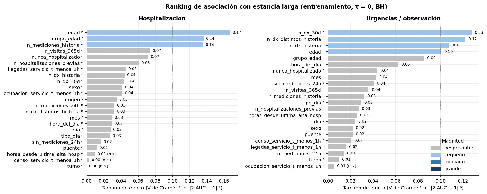


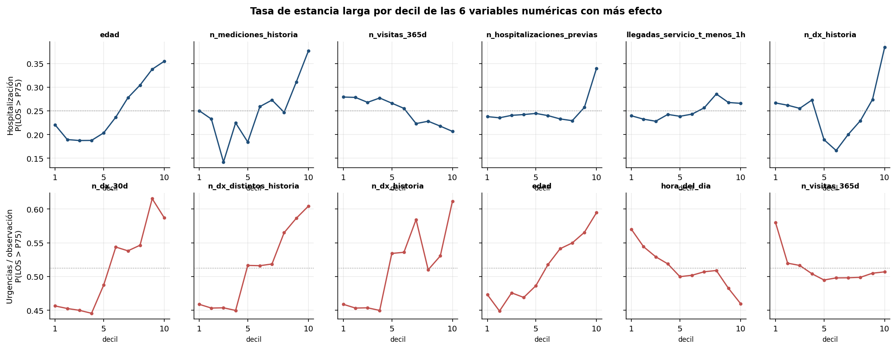


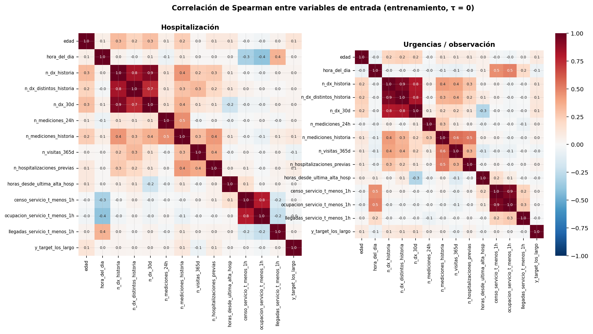


**Pares con |ρ de Spearman| ≥ 0.7 (redundancia para M5):**

| servicio                | var_1                     | var_2                         |   rho |
|:------------------------|:--------------------------|:------------------------------|------:|
| Hospitalización         | n_dx_historia             | n_dx_distintos_historia       |  0.83 |
| Hospitalización         | n_dx_historia             | n_dx_30d                      |  0.93 |
| Hospitalización         | n_dx_distintos_historia   | n_dx_30d                      |  0.74 |
| Hospitalización         | censo_servicio_t_menos_1h | ocupacion_servicio_t_menos_1h |  0.80 |
| Urgencias / observación | n_dx_historia             | n_dx_distintos_historia       |  0.94 |
| Urgencias / observación | n_dx_historia             | n_dx_30d                      |  0.80 |
| Urgencias / observación | n_dx_distintos_historia   | n_dx_30d                      |  0.82 |
| Urgencias / observación | censo_servicio_t_menos_1h | ocupacion_servicio_t_menos_1h |  0.94 |

**Lectura.**

- Hospitalización: las variables con más efecto son `edad` (0.17, pequeño), `grupo_edad` (0.14, pequeño), `n_mediciones_historia` (0.14, pequeño), `n_visitas_365d` (0.07, despreciable).

- Urgencias/observación: `n_dx_30d` (0.13, pequeño), `n_dx_distintos_historia` (0.12, pequeño), `n_dx_historia` (0.11, pequeño), `edad` (0.10, pequeño).

- Casi todo es estadísticamente significativo tras BH, pero **ninguna variable tiene por sí sola un efecto grande**: el target de paciente es multifactorial y el modelo tendrá que combinar historia clínica, edad y carga del servicio. Las variables de calendario (día, turno, festivo) tienen efecto despreciable sobre la estancia del paciente, aunque sí afectan a las llegadas (M4).

- Las variables de diagnósticos y mediciones están muy correlacionadas entre sí: conviene reducirlas (SVD o selección L1, M5) o usar modelos robustos a la colinealidad.

### 2. Estancia continua por grupos (Kruskal-Wallis + ε²)

| servicio                | variable            |     ε² | magnitud     | p_BH    | mediana LOS por grupo (h)                                                    |
|:------------------------|:--------------------|-------:|:-------------|:--------|:-----------------------------------------------------------------------------|
| Hospitalización         | grupo_edad          | 0.0186 | pequeño      | < 0.001 | 0-14: 69.0; 15-44: 62.9; 45-64: 74.8; 65-79: 93.0; 80+: 95.8                 |
| Hospitalización         | origen              | 0.0144 | pequeño      | < 0.001 | directo: 24.7; urgencias: 70.6                                               |
| Hospitalización         | nunca_hospitalizado | 0.0082 | despreciable | < 0.001 | no: 90.5; sí: 67.9                                                           |
| Hospitalización         | sin_mediciones_24h  | 0.0033 | despreciable | < 0.001 | no: 71.9; sí: 66.9                                                           |
| Hospitalización         | tipo_dia            | 0.0023 | despreciable | < 0.001 | día después festivo: 66.4; festivo: 72.0; fin de semana: 73.8; laboral: 68.4 |
| Hospitalización         | dia                 | 0.0022 | despreciable | < 0.001 | Dom: 71.4; Jue: 69.2; Lun: 66.9; Mar: 67.6; Mié: 66.7; Sáb: 77.5; Vie: 70.8  |
| Hospitalización         | sexo                | 0.0012 | despreciable | < 0.001 | F: 67.8; M: 72.7                                                             |
| Hospitalización         | turno               | 0.0007 | despreciable | < 0.001 | mañana: 60.4; noche: 68.6; tarde: 71.1                                       |
| Urgencias / observación | grupo_edad          | 0.0089 | despreciable | < 0.001 | 0-14: 8.1; 15-44: 8.7; 45-64: 9.9; 65-79: 10.5; 80+: 11.3                    |
| Urgencias / observación | nunca_hospitalizado | 0.0025 | despreciable | < 0.001 | no: 10.6; sí: 9.0                                                            |
| Urgencias / observación | sin_mediciones_24h  | 0.0024 | despreciable | < 0.001 | no: 13.4; sí: 9.1                                                            |
| Urgencias / observación | tipo_dia            | 0.0008 | despreciable | < 0.001 | día después festivo: 9.2; festivo: 8.1; fin de semana: 8.8; laboral: 9.3     |
| Urgencias / observación | dia                 | 0.0007 | despreciable | < 0.001 | Dom: 8.6; Jue: 9.3; Lun: 9.0; Mar: 9.4; Mié: 9.2; Sáb: 9.0; Vie: 9.3         |
| Urgencias / observación | sexo                | 0.0006 | despreciable | < 0.001 | F: 9.0; M: 9.5; desconocido: 9.1                                             |
| Urgencias / observación | turno               | 0.0002 | despreciable | < 0.001 | mañana: 9.2; noche: 9.2; tarde: 9.0                                          |

### 3. Asociación con el target de servicio (saturación en t + 4 h)

Unidad: servicio × hora (entrenamiento, periodo estable). **Advertencia**: las horas consecutivas están autocorrelacionadas, así que los p-valores son optimistas; lo informativo es el tamaño de efecto.

| servicio                | variable       | métrica   |   efecto | magnitud     | p_BH    |
|:------------------------|:---------------|:----------|---------:|:-------------|:--------|
| Hospitalización         | turno          | V Cramér  |    0.277 | pequeño      | < 0.001 |
| Hospitalización         | dia_semana     | V Cramér  |    0.036 | despreciable | < 0.001 |
| Hospitalización         | mes            | V Cramér  |    0.200 | pequeño      | < 0.001 |
| Hospitalización         | festivo        | V Cramér  |    0.030 | despreciable | < 0.001 |
| Hospitalización         | fin_de_semana  | V Cramér  |    0.011 | despreciable | 0.082   |
| Hospitalización         | hora_del_dia   | V Cramér  |    0.309 | mediano      | < 0.001 |
| Hospitalización         | ocupacion      | AUC       |    0.892 | grande       | < 0.001 |
| Hospitalización         | censo          | AUC       |    0.797 | grande       | < 0.001 |
| Hospitalización         | llegadas       | AUC       |    0.456 | despreciable | < 0.001 |
| Hospitalización         | llegadas_4h    | AUC       |    0.472 | despreciable | < 0.001 |
| Hospitalización         | delta_censo_4h | AUC       |    0.635 | pequeño      | < 0.001 |
| Hospitalización         | capacidad      | AUC       |    0.504 | despreciable | 0.294   |
| Urgencias / observación | turno          | V Cramér  |    0.407 | mediano      | < 0.001 |
| Urgencias / observación | dia_semana     | V Cramér  |    0.265 | pequeño      | < 0.001 |
| Urgencias / observación | mes            | V Cramér  |    0.173 | pequeño      | < 0.001 |
| Urgencias / observación | festivo        | V Cramér  |    0.104 | pequeño      | < 0.001 |
| Urgencias / observación | fin_de_semana  | V Cramér  |    0.246 | pequeño      | < 0.001 |
| Urgencias / observación | hora_del_dia   | V Cramér  |    0.456 | mediano      | < 0.001 |
| Urgencias / observación | ocupacion      | AUC       |    0.835 | grande       | < 0.001 |
| Urgencias / observación | censo          | AUC       |    0.817 | grande       | < 0.001 |
| Urgencias / observación | llegadas       | AUC       |    0.774 | grande       | < 0.001 |
| Urgencias / observación | llegadas_4h    | AUC       |    0.821 | grande       | < 0.001 |
| Urgencias / observación | delta_censo_4h | AUC       |    0.780 | grande       | < 0.001 |
| Urgencias / observación | capacidad      | AUC       |    0.508 | despreciable | 0.098   |

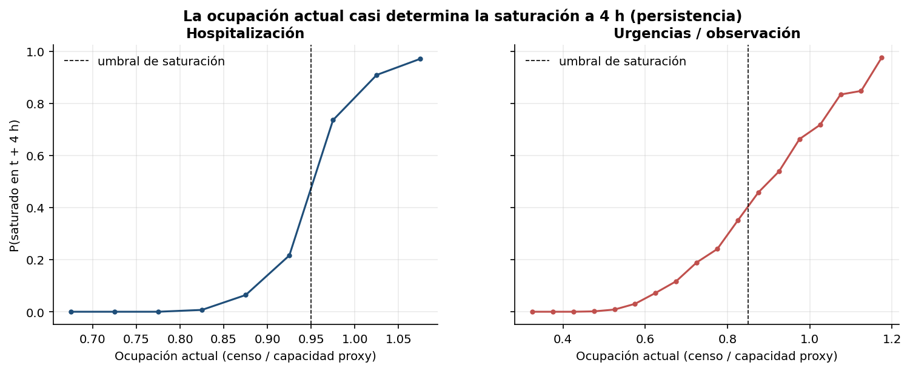


**Lectura.** La ocupación actual sola tiene AUC = 0.892 (hosp.) y 0.835 (urg.) para predecir la saturación a 4 h: es un **baseline de persistencia** muy fuerte que Persona 2 debe reportar como referencia mínima. La **hora del día** tiene efecto mediano en ambos servicios (V ≈ 0.31 hosp., 0.46 urg.) y el mes, efecto pequeño: hay que darle al modelo el ciclo diario (hora y turno) y la estacionalidad. En urgencias también pesan las llegadas de las últimas 4 h (AUC 0.82) y el cambio de censo en 4 h (0.78); en hospitalización las llegadas casi no informan (AUC ≈ 0.46): lo que la satura es que las altas no liberen camas.

### 4. Teoría de colas por servicio

Tabla de Persona 1 (`resumen_colas`, periodo estable). λ = llegadas/h, E[S] = duración media del subproceso, μ = 1/E[S], L = censo medio, c = capacidad proxy media, ρ = λ·E[S]/c.

| servicio              |   lambda_por_hora |   estancia_media_h |   mu_por_hora |   estancia_p50_h |   estancia_p90_h |   n_subprocesos |   censo_prom_L |   little_lambda_x_W |   capacidad_media_c |   rho_aprox |
|:----------------------|------------------:|-------------------:|--------------:|-----------------:|-----------------:|----------------:|---------------:|--------------------:|--------------------:|------------:|
| ambulatorio           |            51.445 |              0.000 |       nan     |            0.000 |            0.000 |         1427228 |        nan     |               0.000 |             nan     |     nan     |
| hospitalizacion       |             3.586 |             80.506 |         0.012 |           45.729 |          187.358 |           99483 |        289.500 |             288.700 |             311.900 |       0.926 |
| urgencias_ingreso     |            16.100 |              0.355 |         2.819 |            0.054 |            0.097 |          446657 |        nan     |               5.700 |             nan     |     nan     |
| urgencias_observacion |            38.364 |              5.828 |         0.172 |            1.178 |           12.476 |         1064329 |        224.000 |             223.600 |             301.200 |       0.742 |

La **ley de Little** (L = λ·W) cuadra en los dos servicios con estancia (error < 0.5 %), lo que valida que censo, llegadas y duraciones son coherentes entre sí.

**Por año** (λ y W desde `detalle`; L, c y fracción de horas con ocupación ≥ umbral desde `ocupacion_servicio_hora`, ambos sobre las mismas horas; 2023 empieza en mayo por la ventana de 90 días de la capacidad):

| servicio              |   anio |   lambda_h |    W_h |       L |   little_lambdaW |       c |   rho |   frac_085 |   frac_095 |   frac_100 |   horas |
|:----------------------|-------:|-----------:|-------:|--------:|-----------------:|--------:|------:|-----------:|-----------:|-----------:|--------:|
| hospitalizacion       |   2023 |      3.420 | 77.636 | 265.893 |          265.524 | 293.632 | 0.904 |      0.824 |      0.251 |      0.068 |    5879 |
| hospitalizacion       |   2024 |      3.684 | 78.179 | 286.783 |          288.019 | 306.341 | 0.940 |      0.936 |      0.449 |      0.101 |    8784 |
| hospitalizacion       |   2025 |      3.633 | 84.783 | 304.368 |          308.055 | 326.249 | 0.944 |      0.939 |      0.393 |      0.079 |    8760 |
| hospitalizacion       |   2026 |      3.517 | 85.221 | 304.825 |          299.695 | 326.272 | 0.919 |      0.937 |      0.429 |      0.056 |    2156 |
| urgencias_observacion |   2023 |     40.668 |  5.107 | 197.428 |          207.703 | 276.016 | 0.753 |      0.232 |      0.102 |      0.057 |    5879 |
| urgencias_observacion |   2024 |     39.886 |  5.265 | 212.755 |          209.994 | 287.419 | 0.731 |      0.257 |      0.111 |      0.063 |    8784 |
| urgencias_observacion |   2025 |     36.122 |  6.914 | 248.115 |          249.736 | 328.719 | 0.760 |      0.274 |      0.109 |      0.059 |    8760 |
| urgencias_observacion |   2026 |     32.530 |  7.466 | 244.019 |          242.879 | 314.528 | 0.772 |      0.350 |      0.156 |      0.097 |    2156 |

**Lectura.** En hospitalización L y W crecen año a año con λ casi constante: el censo sube porque las estancias se alargan (coherente con la deriva del M2), no porque lleguen más pacientes. En urgencias/observación λ baja y W sube. Es la misma firma del cambio de registro visto en el M2: hay menos subprocesos y más largos, y el producto λ·W apenas cambia.

**Por turno** (mañana 7–13, tarde 13–19, noche 19–7):

| servicio              | turno   |   ocupacion_media |   frac_085 |   frac_095 |   llegadas_h |
|:----------------------|:--------|------------------:|-----------:|-----------:|-------------:|
| hospitalizacion       | manana  |             0.947 |      0.958 |      0.523 |        1.335 |
| hospitalizacion       | noche   |             0.921 |      0.890 |      0.329 |        3.780 |
| hospitalizacion       | tarde   |             0.924 |      0.908 |      0.348 |        5.473 |
| urgencias_observacion | manana  |             0.686 |      0.123 |      0.032 |       52.584 |
| urgencias_observacion | noche   |             0.718 |      0.206 |      0.080 |       25.739 |
| urgencias_observacion | tarde   |             0.849 |      0.524 |      0.256 |       48.556 |

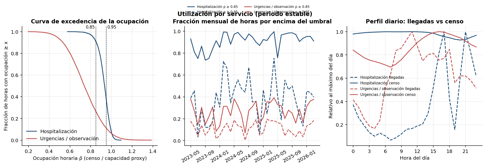


**Desfase llegadas → censo** (correlación cruzada de las series sin tendencia semanal):

| servicio                |   hora pico llegadas |   hora pico censo |   desfase de máx. correlación (h) |   corr máx |
|:------------------------|---------------------:|------------------:|----------------------------------:|-----------:|
| Hospitalización         |                   17 |                11 |                                13 |       0.23 |
| Urgencias / observación |                   11 |                16 |                                 4 |       0.54 |

### 5. Cuellos de botella: duración por etapa, espera y bloqueo urgencias → hospitalización

**Duración de cada subproceso** (`detalle`, periodo estable):

| servicio              |       n |   media_h |   p50_h |   p75_h |   p90_h |   p99_h |   frac_cero |
|:----------------------|--------:|----------:|--------:|--------:|--------:|--------:|------------:|
| hospitalizacion       |   99483 |    80.506 |  45.729 |  95.174 | 187.358 | 531.585 |       0.034 |
| urgencias_observacion | 1064329 |     5.828 |   1.178 |   4.665 |  12.476 |  73.490 |       0.385 |
| urgencias_ingreso     |  446657 |     0.355 |   0.054 |   0.073 |   0.097 |   0.185 |       0.228 |
| ambulatorio           | 1427228 |     0.000 |   0.000 |   0.000 |   0.000 |   0.000 |       1.000 |

**Espera entre subprocesos** (transiciones con n ≥ 1 000, `matriz_transicion`):

| desde                 | hacia                 |      n |   prob |   espera_p50_h |   espera_p75_h |   espera_p90_h |   frac_solapada |   duracion_desde_p50_h |
|:----------------------|:----------------------|-------:|-------:|---------------:|---------------:|---------------:|----------------:|-----------------------:|
| ambulatorio           | urgencias_observacion |  10520 |  0.011 |          0.067 |          0.088 |          0.135 |           0.000 |                  0.000 |
| ambulatorio           | ambulatorio           |   2303 |  0.002 |          1.272 |          7.625 |        120.322 |           0.000 |                  0.000 |
| hospitalizacion       | hospitalizacion       |  24885 |  0.360 |          0.000 |          0.000 |          0.000 |           0.044 |                 24.696 |
| urgencias_ingreso     | urgencias_observacion | 273768 |  0.770 |         -0.000 |         -0.000 |         -0.000 |           0.974 |                  0.062 |
| urgencias_observacion | urgencias_observacion | 293497 |  0.404 |          0.000 |          0.000 |          0.000 |           0.010 |                  2.186 |
| urgencias_observacion | hospitalizacion       |  42924 |  0.059 |          0.000 |          0.000 |         18.210 |           0.000 |                  7.642 |

La espera registrada entre subprocesos es **0 en la mediana y el P75** de todas las transiciones frecuentes: el fin de un registro es el inicio del siguiente. Los datos **no registran colas de espera** (no hay triaje → consulta → exámenes). El cuello de botella hay que medirlo con la **duración** de la etapa previa y con la **ocupación**.

**Bloqueo urgencias → hospitalización (boarding).** Para las 40,520 visitas del periodo estable que entran por urgencias y terminan hospitalizadas, se mide el tiempo desde la llegada hasta el ingreso a hospitalización y se cruza con la ocupación hospitalaria en la hora de llegada:

|   decil_ocup |   ocup_media |       n |   mediana_h |   p75_h |   p90_h |
|-------------:|-------------:|--------:|------------:|--------:|--------:|
|         1.00 |         0.81 | 4052.00 |       14.13 |   29.78 |   54.76 |
|         2.00 |         0.87 | 4062.00 |       14.10 |   30.90 |   58.04 |
|         3.00 |         0.90 | 4050.00 |       14.59 |   32.38 |   58.76 |
|         4.00 |         0.91 | 4060.00 |       14.53 |   32.88 |   60.76 |
|         5.00 |         0.93 | 4062.00 |       14.99 |   34.23 |   60.91 |
|         6.00 |         0.94 | 4032.00 |       14.48 |   35.78 |   65.84 |
|         7.00 |         0.96 | 4058.00 |       14.04 |   34.94 |   61.73 |
|         8.00 |         0.97 | 4055.00 |       15.32 |   34.40 |   60.71 |
|         9.00 |         0.99 | 4039.00 |       16.01 |   34.79 |   59.91 |
|        10.00 |         1.01 | 4050.00 |       15.95 |   35.77 |   61.65 |

Kruskal-Wallis entre deciles: ε² = 0.0025 (despreciable), p = < 0.001; Spearman ρ = 0.048. Diferencia de medianas decil 10 − decil 1 = 1.82 h [IC 95 % 0.29, 3.36].


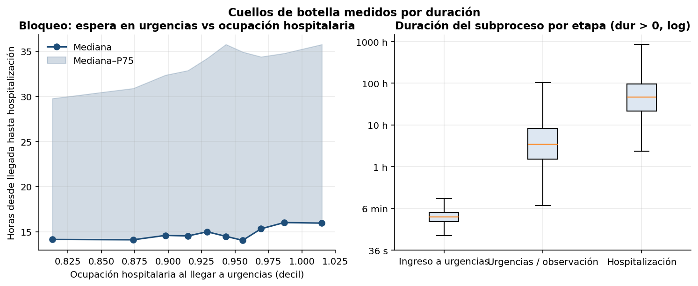


**Lectura de colas.**

- **Hospitalización es el cuello de botella del sistema**: ρ ≈ 0.93 respecto a su propio P95 reciente, con ocupación ≥ 0.85 en el 91 % de las horas. Recibe pocas llegadas (≈ 3.6/h) pero cada una ocupa una cama ~80 h, de modo que pequeñas variaciones de llegadas o de estancia saturan el servicio.

- **Ciclo diario de hospitalización**: el censo llega al máximo hacia las 11 h y las llegadas hacia las 17 h. La mañana es el turno más lleno (ρ ≥ 0.95 en ~52 % de las horas, frente a ~33–35 % en tarde y noche): las camas se liberan con las altas del mediodía. Las alertas de saturación hospitalaria se concentrarán en la mañana.

- Urgencias/observación tiene muchas llegadas (≈ 38/h) y estancias cortas. Las llegadas pican hacia las 11 h y el censo ~4–5 h después (16 h); la **tarde** es el turno crítico (ocupación ≥ 0.85 en ~52 % de sus horas, frente a 12 % en la mañana).

- **Tiempo hasta cama**: quien entra por urgencias y termina hospitalizado tarda una mediana de ~15 h desde la llegada hasta el ingreso a hospitalización (P75 ~34 h). Ese es el mayor tiempo "de paso" del sistema. Con más ocupación hospitalaria ese tiempo crece, pero poco (+1.8 h entre el decil 10 y el 1; ε² despreciable). Hay una señal débil de *boarding*: la mayor parte de la espera no se explica por la ocupación en el momento de llegar.

- Advertencia: la capacidad es un proxy (P95 móvil del censo). ρ mide qué tan cerca está el servicio de su máximo reciente, no de las camas reales. Con el número real de camas, ρ y la fracción de horas saturadas cambiarán.

**Código fuente**


```python
# Archivo: m3_bivariado/run_m3.py
"""M3 · EDA bivariado, tamaños de efecto y colas (HUN-202) — Persona 3.

Uso:  python m3_bivariado/run_m3.py
Salida: outputs/m3/{figuras,tablas}/ y outputs/m3/M3_informe.md (solo agregados).

Pruebas bivariadas: SOLO entrenamiento + periodo estable (no se mira la prueba para no
contaminar la selección de variables de Persona 2). Colas: periodo estable completo.
"""
from __future__ import annotations

import sys
from pathlib import Path

sys.path.insert(0, str(Path(__file__).resolve().parents[1]))

import matplotlib.pyplot as plt  # noqa: E402
import numpy as np  # noqa: E402
import pandas as pd  # noqa: E402
import seaborn as sns  # noqa: E402
from scipy import stats  # noqa: E402

from eda_comun import (  # noqa: E402
    COLORES, DIAS, GRUPOS_EDAD, M1, M4, NOMBRE, OUT, auc_univariada, bh, carpeta, con, cramers_v,
    dif_medianas_ic, fmt_p, grupo_edad_sql, guardar, kruskal_eps2, magnitud_auc, magnitud_eps2,
    magnitud_v, md_tabla, parametros,
)

FIG, TAB = carpeta("m3")
C = con()
P = parametros()
SERV = ["hospitalizacion", "urgencias_observacion"]
informe: list[str] = []


def sec(t):
    print(f"· {t}")
    informe.append(f"\n## {t}\n")


def add(*x):
    informe.extend(x)


def fig_md(n, alt):
    add(f"\n\n")


# =====================================================================================
# Datos: snapshot τ = 0 (una fila por episodio), entrenamiento + estable, con calendario
# =====================================================================================
snap = C.sql(
    f"""
    SELECT s.*, {grupo_edad_sql('s.edad')} grupo_edad,
           CASE WHEN s.hora_del_dia BETWEEN 7 AND 12 THEN 'mañana'
                WHEN s.hora_del_dia BETWEEN 13 AND 18 THEN 'tarde' ELSE 'noche' END turno,
           CASE WHEN c.festivo THEN 'festivo' WHEN c.dia_despues_festivo THEN 'día después festivo'
                WHEN c.fin_de_semana THEN 'fin de semana' ELSE 'laboral' END tipo_dia,
           coalesce(c.puente, false) puente
    FROM 'data/m1/snapshot.parquet' s
    LEFT JOIN 'data/m4/calendario_dia.parquet' c ON c.fecha = CAST(s.snapshot_time AS DATE)
    WHERE s.en_periodo_estable AND s.es_entrenamiento AND s.horas_desde_ingreso = 0
    """
).df()
snap["sin_mediciones_24h"] = (snap.n_mediciones_24h == 0).map({True: "sí", False: "no"})
snap["nunca_hospitalizado"] = snap.horas_desde_ultima_alta_hosp.isna().map({True: "sí", False: "no"})
snap["origen"] = np.where(snap.origen_urgencias, "urgencias", "directo")
snap["dia"] = snap.dia_semana.map(dict(enumerate(DIAS, 1)))

CAT = ["sexo", "grupo_edad", "origen", "turno", "dia", "tipo_dia", "puente", "mes", "sin_mediciones_24h", "nunca_hospitalizado"]
NUM = ["edad", "hora_del_dia", "n_dx_historia", "n_dx_distintos_historia", "n_dx_30d", "n_mediciones_24h",
       "n_mediciones_historia", "n_visitas_365d", "n_hospitalizaciones_previas", "horas_desde_ultima_alta_hosp",
       "censo_servicio_t_menos_1h", "ocupacion_servicio_t_menos_1h", "llegadas_servicio_t_menos_1h"]

# =====================================================================================
# 1. Bivariado vs target de paciente
# =====================================================================================
sec("1. Asociación bivariada con el target de paciente (LOS > P75)")
add(
    "Unidad: snapshot τ = 0 (uno por episodio), **solo entrenamiento** del periodo estable "
    f"(hospitalización n = {(snap.servicio=='hospitalizacion').sum():,}; urgencias/observación "
    f"n = {(snap.servicio=='urgencias_observacion').sum():,}; en urgencias, τ = 0 excluye las estancias de LOS 0).\n",
    "- **Categóricas**: Chi² de independencia + **V de Cramér** con corrección de sesgo.\n"
    "- **Numéricas**: Mann-Whitney / Kruskal-Wallis + **ε²**, **AUC univariada** (P(X₁ > X₀)), "
    "diferencia de medianas (positivos − negativos) con **IC 95 % bootstrap**.\n"
    "- Todos los p-valores se corrigen por **Benjamini-Hochberg** dentro de cada servicio. Las "
    "magnitudes siguen a Cohen (V) y Tomczak (ε²); para el AUC se usa |2·AUC − 1| con cortes 0.1/0.3/0.5.\n",
)
filas = []
for s in SERV:
    d = snap[snap.servicio == s]
    y = d.y_target_los_largo.values
    for v in CAT:
        if d[v].nunique() < 2:
            continue
        tabla = pd.crosstab(d[v], d.y_target_los_largo)
        chi2, p, cv, gl = cramers_v(tabla.values)
        tasas = (tabla[1] / tabla.sum(1)).round(3)
        filas.append({"servicio": s, "variable": v, "tipo": "categórica", "estadístico": chi2, "p": p,
                      "efecto": cv, "métrica": "V Cramér", "magnitud": magnitud_v(cv, min(tabla.shape) - 1),
                      "detalle": f"tasa {tasas.idxmin()}={tasas.min():.2f} … {tasas.idxmax()}={tasas.max():.2f}"})
    for v in NUM:
        x = d[v].values.astype(float)
        m = ~np.isnan(x)
        if m.sum() < 100:
            continue
        x1, x0 = x[m & (y == 1)], x[m & (y == 0)]
        h, p, e2 = kruskal_eps2([x1, x0])
        auc = auc_univariada(x[m], y[m])
        dm, lo, hi = dif_medianas_ic(x1, x0)
        filas.append({"servicio": s, "variable": v, "tipo": "numérica", "estadístico": h, "p": p,
                      "efecto": abs(2 * auc - 1), "métrica": "|2AUC−1|", "magnitud": magnitud_auc(auc),
                      "detalle": f"AUC={auc:.3f}; ε²={e2:.4f}; Δmed={dm:.2f} [{lo:.2f}, {hi:.2f}]",
                      "auc": auc, "eps2": e2})
biv = pd.DataFrame(filas)
biv["p_BH"] = biv.groupby("servicio").p.transform(bh)
biv = biv.sort_values(["servicio", "efecto"], ascending=[True, False])
biv.to_csv(TAB / "bivariado_target_paciente.csv", index=False)
for s in SERV:
    t = biv[biv.servicio == s].copy()
    t["p_BH"] = t.p_BH.map(fmt_p)
    add(f"\n**{NOMBRE[s]}** (ordenado por tamaño de efecto):\n",
        md_tabla(t[["variable", "tipo", "métrica", "efecto", "magnitud", "p_BH", "detalle"]], floatfmt=".3f"))

colmag = {"despreciable": "#bfbfbf", "pequeño": "#9dc3e6", "mediano": "#2e75b6", "grande": "#1f3864"}
fig, axes = plt.subplots(1, 2, figsize=(14, 5.5), gridspec_kw={"wspace": 0.6})
for ax, s in zip(axes, SERV):
    t = biv[biv.servicio == s].sort_values("efecto")
    ax.barh(t.variable + np.where(t.tipo == "numérica", " ⁿ", " ᶜ"), t.efecto, color=t.magnitud.map(colmag))
    for yy, (e, sig) in enumerate(zip(t.efecto, t.p_BH)):
        ax.text(e + 0.003, yy, f"{e:.2f}" + ("" if sig < 0.05 else " (n.s.)"), va="center", fontsize=7.5)
    ax.set_title(NOMBRE[s])
    ax.set_xlabel("Tamaño de efecto (V de Cramér ᶜ  o  |2·AUC − 1| ⁿ)")
    ax.axvline(0.1, color="grey", ls=":", lw=0.8)
handles = [plt.Rectangle((0, 0), 1, 1, color=c) for c in colmag.values()]
axes[1].legend(handles, colmag.keys(), loc="lower right", title="Magnitud")
fig.suptitle("Ranking de asociación con estancia larga (entrenamiento, τ = 0, BH)", fontweight="bold")
fig_md(guardar(fig, FIG / "01_ranking_efectos_paciente.png"), "ranking")

# Tasa de target por decil de las numéricas más fuertes
top = {s: biv[(biv.servicio == s) & (biv.tipo == "numérica")].head(6).variable.tolist() for s in SERV}
fig, axes = plt.subplots(2, 6, figsize=(18, 6), sharey="row")
for r, s in enumerate(SERV):
    d = snap[snap.servicio == s]
    for c, v in enumerate(top[s]):
        ax = axes[r, c]
        x = d[v]
        try:
            b = pd.qcut(x.rank(method="first"), 10, labels=False)
        except ValueError:
            continue
        g = d.groupby(b).agg(tasa=("y_target_los_largo", "mean"), med=(v, "median"))
        ax.plot(range(1, len(g) + 1), g.tasa, "-o", ms=3, color=COLORES[s])
        ax.axhline(d.y_target_los_largo.mean(), color="grey", ls=":", lw=0.8)
        ax.set_title(v, fontsize=8.5)
        ax.set_xticks([1, 5, 10])
        ax.set_xlabel("decil", fontsize=8)
    axes[r, 0].set_ylabel(f"{NOMBRE[s]}\nP(LOS > P75)")
fig.suptitle("Tasa de estancia larga por decil de las 6 variables numéricas con más efecto", fontweight="bold")
fig_md(guardar(fig, FIG / "02_tasa_por_decil.png"), "deciles")

# Correlación de Spearman entre variables
fig, axes = plt.subplots(1, 2, figsize=(15, 6.5))
for ax, s in zip(axes, SERV):
    d = snap.loc[snap.servicio == s, NUM + ["y_target_los_largo"]]
    cm = d.corr(method="spearman")
    sns.heatmap(cm, ax=ax, cmap="RdBu_r", center=0, vmin=-1, vmax=1, annot=True, fmt=".1f",
                annot_kws={"size": 6}, cbar=ax is axes[1], square=True)
    ax.set_title(NOMBRE[s])
    ax.tick_params(labelsize=7)
fig.suptitle("Correlación de Spearman entre variables de entrada (entrenamiento, τ = 0)", fontweight="bold")
fig_md(guardar(fig, FIG / "03_spearman.png"), "spearman")
pares = []
for s in SERV:
    cm = snap.loc[snap.servicio == s, NUM].corr(method="spearman")
    iu = np.triu_indices_from(cm, 1)
    for i, j in zip(*iu):
        if abs(cm.iat[i, j]) >= 0.7:
            pares.append({"servicio": NOMBRE[s], "var_1": cm.index[i], "var_2": cm.columns[j], "rho": cm.iat[i, j]})
pares = pd.DataFrame(pares)
pares.to_csv(TAB / "colinealidad_spearman_07.csv", index=False)
add("\n**Pares con |ρ de Spearman| ≥ 0.7 (redundancia para M5):**\n", md_tabla(pares, floatfmt=".2f") if len(pares) else "Ninguno.")

def resumen_top(s, k=4):
    t = biv[(biv.servicio == s)].head(k)
    return ", ".join(f"`{v}` ({e:.2f}, {m})" for v, e, m in zip(t.variable, t.efecto, t.magnitud))

add(
    "\n**Lectura.**\n",
    f"- Hospitalización: las variables con más efecto son {resumen_top('hospitalizacion')}.\n",
    f"- Urgencias/observación: {resumen_top('urgencias_observacion')}.\n",
    "- Casi todo es estadísticamente significativo tras BH, pero **ninguna variable tiene por sí sola "
    "un efecto grande**: el target de paciente es multifactorial y el modelo tendrá que combinar "
    "historia clínica, edad y carga del servicio. Las variables de calendario (día, turno, festivo) "
    "tienen efecto despreciable sobre la estancia del paciente, aunque sí afectan a las llegadas (M4).\n",
    "- Las variables de diagnósticos y mediciones están muy correlacionadas entre sí: conviene "
    "reducirlas (SVD o selección L1, M5) o usar modelos robustos a la colinealidad.",
)

# =====================================================================================
# 2. Estancia (continua) por grupos
# =====================================================================================
sec("2. Estancia continua por grupos (Kruskal-Wallis + ε²)")
filas = []
for s in SERV:
    d = snap[snap.servicio == s]
    for v in ["grupo_edad", "turno", "dia", "tipo_dia", "sin_mediciones_24h", "nunca_hospitalizado", "sexo", "origen"]:
        grupos = [g.y_los_h.values for _, g in d.groupby(v) if len(g) > 30]
        if len(grupos) < 2:
            continue
        h, p, e2 = kruskal_eps2(grupos)
        meds = d.groupby(v).y_los_h.median()
        filas.append({"servicio": NOMBRE[s], "variable": v, "H": h, "p": p, "ε²": e2, "magnitud": magnitud_eps2(e2),
                      "mediana LOS por grupo (h)": "; ".join(f"{k}: {m:.1f}" for k, m in meds.items())})
kw = pd.DataFrame(filas)
kw["p_BH"] = kw.groupby("servicio").p.transform(bh).map(fmt_p)
kw = kw.sort_values(["servicio", "ε²"], ascending=[True, False])
kw.drop(columns="p").to_csv(TAB / "kruskal_los_grupos.csv", index=False)
add(md_tabla(kw[["servicio", "variable", "ε²", "magnitud", "p_BH", "mediana LOS por grupo (h)"]], floatfmt=".4f"))

# =====================================================================================
# 3. Bivariado vs target de servicio (saturación t+4h)
# =====================================================================================
sec("3. Asociación con el target de servicio (saturación en t + 4 h)")
osh = C.sql(
    """
    SELECT o.*, extract(hour FROM o.hora) hora_del_dia, isodow(o.hora) dia_semana, month(o.hora) mes,
           h.turno, h.festivo, h.fin_de_semana,
           o.censo - lag(o.censo, 4) OVER (PARTITION BY o.servicio ORDER BY o.hora) delta_censo_4h,
           sum(o.llegadas) OVER (PARTITION BY o.servicio ORDER BY o.hora ROWS BETWEEN 3 PRECEDING AND CURRENT ROW) llegadas_4h
    FROM 'data/m1/ocupacion_servicio_hora.parquet' o
    LEFT JOIN 'data/m4/calendario_hora.parquet' h ON h.hora = o.hora
    WHERE o.en_periodo_estable
    """
).df()
tr = osh[osh.es_entrenamiento]
filas = []
for s in SERV:
    d = tr[tr.servicio == s]
    y = d.y_target_saturacion.values
    for v in ["turno", "dia_semana", "mes", "festivo", "fin_de_semana", "hora_del_dia"]:
        tabla = pd.crosstab(d[v], d.y_target_saturacion)
        chi2, p, cv, gl = cramers_v(tabla.values)
        filas.append({"servicio": NOMBRE[s], "variable": v, "métrica": "V Cramér", "efecto": cv,
                      "magnitud": magnitud_v(cv, min(tabla.shape) - 1), "p": p})
    for v in ["ocupacion", "censo", "llegadas", "llegadas_4h", "delta_censo_4h", "capacidad"]:
        x = d[v].values.astype(float)
        m = ~np.isnan(x)
        auc = auc_univariada(x[m], y[m])
        _, p, _ = kruskal_eps2([x[m & (y == 1)], x[m & (y == 0)]])
        filas.append({"servicio": NOMBRE[s], "variable": v, "métrica": "AUC", "efecto": auc,
                      "magnitud": magnitud_auc(auc), "p": p})
sat = pd.DataFrame(filas)
sat["p_BH"] = sat.groupby("servicio").p.transform(bh).map(fmt_p)
sat.drop(columns="p").to_csv(TAB / "bivariado_target_saturacion.csv", index=False)
add(
    "Unidad: servicio × hora (entrenamiento, periodo estable). **Advertencia**: las horas consecutivas "
    "están autocorrelacionadas, así que los p-valores son optimistas; lo informativo es el tamaño de efecto.\n",
    md_tabla(sat.drop(columns="p"), floatfmt=".3f"),
)
fig, axes = plt.subplots(1, 2, figsize=(12, 4), sharey=True)
for ax, s in zip(axes, SERV):
    d = tr[tr.servicio == s]
    g = d.groupby(pd.cut(d.ocupacion, np.arange(0.3, 1.31, 0.05)), observed=True).y_target_saturacion.agg(["mean", "size"])
    g = g[g["size"] >= 30]
    ax.plot([i.mid for i in g.index], g["mean"], "-o", ms=3, color=COLORES[s])
    ax.axvline(d.umbral_ocupacion.iloc[0], color="k", ls="--", lw=0.8, label="umbral de saturación")
    ax.set_title(NOMBRE[s])
    ax.set_xlabel("Ocupación actual (censo / capacidad proxy)")
    ax.legend()
axes[0].set_ylabel("P(saturado en t + 4 h)")
fig.suptitle("La ocupación actual casi determina la saturación a 4 h (persistencia)", fontweight="bold")
fig_md(guardar(fig, FIG / "04_saturacion_vs_ocupacion.png"), "persistencia")
auc_ocu = sat[(sat.variable == "ocupacion")].set_index("servicio").efecto
add(
    f"\n**Lectura.** La ocupación actual sola tiene AUC = {auc_ocu.iloc[0]:.3f} (hosp.) y "
    f"{auc_ocu.iloc[1]:.3f} (urg.) para predecir la saturación a 4 h: es un **baseline de persistencia** "
    "muy fuerte que Persona 2 debe reportar como referencia mínima. La **hora del día** tiene efecto "
    "mediano en ambos servicios (V ≈ 0.31 hosp., 0.46 urg.) y el mes, efecto pequeño: hay que darle "
    "al modelo el ciclo diario (hora y turno) y la estacionalidad. En urgencias también pesan las "
    "llegadas de las últimas 4 h (AUC 0.82) y el cambio de censo en 4 h (0.78); en hospitalización "
    "las llegadas casi no informan (AUC ≈ 0.46): lo que la satura es que las altas no liberen camas.",
)

# =====================================================================================
# 4. Teoría de colas
# =====================================================================================
sec("4. Teoría de colas por servicio")
rc = pd.read_parquet(M4 / "resumen_colas.parquet")
rc.to_csv(TAB / "resumen_colas_p1.csv", index=False)
add(
    "Tabla de Persona 1 (`resumen_colas`, periodo estable). λ = llegadas/h, E[S] = duración media "
    "del subproceso, μ = 1/E[S], L = censo medio, c = capacidad proxy media, ρ = λ·E[S]/c.\n",
    md_tabla(rc, floatfmt=".3f"),
    "\nLa **ley de Little** (L = λ·W) cuadra en los dos servicios con estancia (error < 0.5 %), lo que "
    "valida que censo, llegadas y duraciones son coherentes entre sí.\n",
)
# Por año: λ, W, L, c, ρ
anual = C.sql(
    f"""
    WITH lim AS (
      SELECT min(hora) h0, max(hora) + INTERVAL 1 HOUR h1
      FROM 'data/m1/ocupacion_servicio_hora.parquet' WHERE en_periodo_estable),
    d AS (
      SELECT servicio, year(inicio) anio, count(*) n, avg(dur_h) W
      FROM 'data/m1/detalle.parquet', lim
      WHERE servicio IN ('hospitalizacion','urgencias_observacion') AND inicio >= h0 AND inicio < h1
      GROUP BY ALL),
    o AS (
      SELECT servicio, year(hora) anio, count(*) horas, avg(censo) L, avg(capacidad) c,
             avg((ocupacion >= 0.85)::int) frac_085, avg((ocupacion >= 0.95)::int) frac_095,
             avg((ocupacion >= 1)::int) frac_100
      FROM 'data/m1/ocupacion_servicio_hora.parquet' WHERE en_periodo_estable GROUP BY ALL)
    SELECT d.servicio, d.anio, d.n / o.horas lambda_h, d.W W_h, o.L, d.n / o.horas * d.W little_lambdaW,
           o.c, d.n / o.horas * d.W / o.c rho, o.frac_085, o.frac_095, o.frac_100, o.horas
    FROM d JOIN o USING (servicio, anio) ORDER BY 1, 2
    """
).df()
anual.to_csv(TAB / "colas_por_anio.csv", index=False)
add(
    "**Por año** (λ y W desde `detalle`; L, c y fracción de horas con ocupación ≥ umbral desde "
    "`ocupacion_servicio_hora`, ambos sobre las mismas horas; 2023 empieza en mayo por la ventana "
    "de 90 días de la capacidad):\n",
    md_tabla(anual, floatfmt=".3f"),
    "\n**Lectura.** En hospitalización L y W crecen año a año con λ casi constante: el censo sube "
    "porque las estancias se alargan (coherente con la deriva del M2), no porque lleguen más pacientes. "
    "En urgencias/observación λ baja y W sube. Es la misma firma del cambio de registro visto en el "
    "M2: hay menos subprocesos y más largos, y el producto λ·W apenas cambia.",
)

# Fracción de horas saturadas por turno y servicio
turno = (
    osh.groupby(["servicio", "turno"])
    .agg(ocupacion_media=("ocupacion", "mean"), frac_085=("ocupacion", lambda x: (x >= 0.85).mean()),
         frac_095=("ocupacion", lambda x: (x >= 0.95).mean()), llegadas_h=("llegadas", "mean"))
    .reset_index()
)
turno.to_csv(TAB / "saturacion_por_turno.csv", index=False)
add("\n**Por turno** (mañana 7–13, tarde 13–19, noche 19–7):\n", md_tabla(turno, floatfmt=".3f"))

fig, axes = plt.subplots(1, 3, figsize=(16, 4.2))
ax = axes[0]
for s in SERV:
    x = np.sort(osh.loc[osh.servicio == s, "ocupacion"].dropna())
    ax.plot(x, 1 - np.arange(len(x)) / len(x), color=COLORES[s], label=NOMBRE[s])
for u in (0.85, 0.95):
    ax.axvline(u, color="k", ls="--", lw=0.7)
    ax.text(u + (0.01 if u > 0.9 else -0.01), 1.03, f"{u}", ha="left" if u > 0.9 else "right", fontsize=8)
ax.set_xlabel("Ocupación horaria ρ̂ (censo / capacidad proxy)")
ax.set_ylabel("Fracción de horas con ocupación ≥ x")
ax.set_title("Curva de excedencia de la ocupación")
ax.legend()
ax = axes[1]
mens = osh.assign(m=osh.hora.dt.to_period("M").dt.to_timestamp()).groupby(["servicio", "m"]).ocupacion.agg(
    f085=lambda x: (x >= 0.85).mean(), f095=lambda x: (x >= 0.95).mean()).reset_index()
for s in SERV:
    d = mens[mens.servicio == s]
    ax.plot(d.m, d.f085, color=COLORES[s], label=f"{NOMBRE[s]} ρ ≥ 0.85")
    ax.plot(d.m, d.f095, color=COLORES[s], ls="--", label=f"{NOMBRE[s]} ρ ≥ 0.95")
ax.set_title("Fracción mensual de horas por encima del umbral")
ax.tick_params(axis="x", rotation=30)
ax.legend(fontsize=6.5, loc="lower left", bbox_to_anchor=(0, 1.08), ncol=2)
ax = axes[2]
perfil = osh.groupby(["servicio", "hora_del_dia"]).agg(llegadas=("llegadas", "mean"), censo=("censo", "mean")).reset_index()
for s in SERV:
    d = perfil[perfil.servicio == s]
    ax.plot(d.hora_del_dia, d.llegadas / d.llegadas.max(), color=COLORES[s], ls="--", label=f"{NOMBRE[s]} llegadas")
    ax.plot(d.hora_del_dia, d.censo / d.censo.max(), color=COLORES[s], label=f"{NOMBRE[s]} censo")
ax.set_xlabel("Hora del día")
ax.set_ylabel("Relativo al máximo del día")
ax.set_title("Perfil diario: llegadas vs censo")
ax.set_xticks(range(0, 24, 3))
ax.legend(fontsize=7)
fig.suptitle("Utilización por servicio (periodo estable)", fontweight="bold")
fig_md(guardar(fig, FIG / "05_utilizacion.png"), "utilización")

# Desfase llegadas → censo (correlación cruzada de las series sin ciclo semanal)
lags = []
for s in SERV:
    d = osh[osh.servicio == s].set_index("hora").sort_index()
    pl = perfil[perfil.servicio == s].set_index("hora_del_dia")
    pico_ll = int(pl.llegadas.idxmax())
    pico_ce = int(pl.censo.idxmax())
    a = d.llegadas - d.llegadas.rolling(168, center=True, min_periods=24).mean()
    b = d.censo - d.censo.rolling(168, center=True, min_periods=24).mean()
    cc = {k: a.corr(b.shift(-k)) for k in range(0, 25)}
    kmax = max(cc, key=cc.get)
    lags.append({"servicio": NOMBRE[s], "hora pico llegadas": pico_ll, "hora pico censo": pico_ce,
                 "desfase de máx. correlación (h)": kmax, "corr máx": cc[kmax]})
lags = pd.DataFrame(lags)
lags.to_csv(TAB / "desfase_llegadas_censo.csv", index=False)
add("\n**Desfase llegadas → censo** (correlación cruzada de las series sin tendencia semanal):\n", md_tabla(lags, floatfmt=".2f"))

# =====================================================================================
# 5. Cuellos de botella: duración por etapa y espera entre subprocesos
# =====================================================================================
sec("5. Cuellos de botella: duración por etapa, espera y bloqueo urgencias → hospitalización")
etapas = C.sql(
    f"""
    SELECT servicio, count(*) n, avg(dur_h) media_h,
           quantile_cont(dur_h, 0.5) p50_h, quantile_cont(dur_h, 0.75) p75_h,
           quantile_cont(dur_h, 0.9) p90_h, quantile_cont(dur_h, 0.99) p99_h,
           avg((dur_h = 0)::int) frac_cero, sum(dur_h) / 24 / 1186 camas_dia_prom
    FROM 'data/m1/detalle.parquet'
    WHERE inicio >= TIMESTAMP '{P.inicio_periodo_estable}' AND inicio < TIMESTAMP '{P.fin_periodo_estable}'
    GROUP BY ALL ORDER BY p50_h DESC
    """
).df().drop(columns="camas_dia_prom")
etapas.to_csv(TAB / "duracion_por_etapa.csv", index=False)
mt = pd.read_parquet(M4 / "matriz_transicion.parquet")
mt_main = mt[(mt.n >= 1000) & ~mt.desde.str.startswith("(") & ~mt.hacia.str.startswith("(")]
mt_main.to_csv(TAB / "esperas_transiciones.csv", index=False)
add(
    "**Duración de cada subproceso** (`detalle`, periodo estable):\n", md_tabla(etapas, floatfmt=".3f"),
    "\n**Espera entre subprocesos** (transiciones con n ≥ 1 000, `matriz_transicion`):\n",
    md_tabla(mt_main[["desde", "hacia", "n", "prob", "espera_p50_h", "espera_p75_h", "espera_p90_h", "frac_solapada", "duracion_desde_p50_h"]], floatfmt=".3f"),
    "\nLa espera registrada entre subprocesos es **0 en la mediana y el P75** de todas las transiciones "
    "frecuentes: el fin de un registro es el inicio del siguiente. Los datos **no registran colas de "
    "espera** (no hay triaje → consulta → exámenes). El cuello de botella hay que medirlo con la "
    "**duración** de la etapa previa y con la **ocupación**.\n",
)

# Bloqueo (boarding): tiempo en urgencias de quienes terminan hospitalizados vs ocupación hospitalaria
board = C.sql(
    """
    WITH v AS (
      SELECT visit_occurrence_id,
             min(momento) FILTER (WHERE desde = '(llegada)') t_llegada,
             min(momento) FILTER (WHERE hacia = 'hospitalizacion' AND desde LIKE 'urgencias%') t_hosp,
             bool_or(hacia = 'hospitalizacion') va_hosp,
             bool_or(desde = '(llegada)' AND hacia LIKE 'urgencias%') entra_urg,
             bool_and(en_periodo_estable) estable
      FROM 'data/m4/transicion.parquet' GROUP BY 1)
    SELECT v.*, date_diff('second', t_llegada, t_hosp) / 3600.0 horas_hasta_hosp,
           o.ocupacion ocup_hosp_llegada, ou.ocupacion ocup_urg_llegada, extract(hour FROM t_llegada) hora_llegada
    FROM v
    LEFT JOIN 'data/m1/ocupacion_servicio_hora.parquet' o
      ON o.servicio = 'hospitalizacion' AND o.hora = date_trunc('hour', v.t_llegada)
    LEFT JOIN 'data/m1/ocupacion_servicio_hora.parquet' ou
      ON ou.servicio = 'urgencias_observacion' AND ou.hora = date_trunc('hour', v.t_llegada)
    WHERE v.estable AND v.entra_urg AND v.t_hosp IS NOT NULL AND o.ocupacion IS NOT NULL
    """
).df()
board = board[(board.horas_hasta_hosp >= 0) & (board.horas_hasta_hosp < 24 * 7)]
board["decil_ocup"] = pd.qcut(board.ocup_hosp_llegada, 10, labels=False) + 1
bd = board.groupby("decil_ocup").agg(
    ocup_media=("ocup_hosp_llegada", "mean"), n=("horas_hasta_hosp", "size"),
    mediana_h=("horas_hasta_hosp", "median"), p75_h=("horas_hasta_hosp", lambda x: x.quantile(.75)),
    p90_h=("horas_hasta_hosp", lambda x: x.quantile(.9))).reset_index()
bd.to_csv(TAB / "bloqueo_urg_hosp_por_ocupacion.csv", index=False)
h_b, p_b, e2_b = kruskal_eps2([g.horas_hasta_hosp.values for _, g in board.groupby("decil_ocup")])
rho_b, prho_b = stats.spearmanr(board.ocup_hosp_llegada, board.horas_hasta_hosp)
q1 = board[board.decil_ocup == 1].horas_hasta_hosp
q10 = board[board.decil_ocup == 10].horas_hasta_hosp
dm, lo, hi = dif_medianas_ic(q10.values, q1.values)
add(
    f"**Bloqueo urgencias → hospitalización (boarding).** Para las {len(board):,} visitas del periodo "
    "estable que entran por urgencias y terminan hospitalizadas, se mide el tiempo desde la llegada "
    "hasta el ingreso a hospitalización y se cruza con la ocupación hospitalaria en la hora de llegada:\n",
    md_tabla(bd, floatfmt=".2f"),
    f"\nKruskal-Wallis entre deciles: ε² = {e2_b:.4f} ({magnitud_eps2(e2_b)}), p = {fmt_p(p_b)}; "
    f"Spearman ρ = {rho_b:.3f}. Diferencia de medianas decil 10 − decil 1 = {dm:.2f} h "
    f"[IC 95 % {lo:.2f}, {hi:.2f}].\n",
)
fig, axes = plt.subplots(1, 2, figsize=(12, 4))
ax = axes[0]
ax.plot(bd.ocup_media, bd.mediana_h, "-o", color=COLORES["hospitalizacion"], label="Mediana")
ax.fill_between(bd.ocup_media, bd.mediana_h, bd.p75_h, alpha=0.2, color=COLORES["hospitalizacion"], label="Mediana–P75")
ax.set_xlabel("Ocupación hospitalaria al llegar a urgencias (decil)")
ax.set_ylabel("Horas desde llegada hasta hospitalización")
ax.set_title("Bloqueo: espera en urgencias vs ocupación hospitalaria")
ax.legend()
ax = axes[1]
dd = C.sql(
    f"""SELECT servicio, dur_h FROM 'data/m1/detalle.parquet'
        WHERE servicio <> 'ambulatorio' AND dur_h > 0
          AND inicio >= TIMESTAMP '{P.inicio_periodo_estable}' AND inicio < TIMESTAMP '{P.fin_periodo_estable}'
        USING SAMPLE reservoir(300000 ROWS) REPEATABLE (42)"""
).df()
orden = ["urgencias_ingreso", "urgencias_observacion", "hospitalizacion"]
ax.boxplot([np.log10(dd.loc[dd.servicio == s, "dur_h"]) for s in orden],
           showfliers=False, patch_artist=True, boxprops=dict(facecolor="#dde7f2"))
ax.set_xticks(range(1, len(orden) + 1))
ax.set_xticklabels([NOMBRE[s] for s in orden])
ax.set_yticks([-2, -1, 0, 1, 2, 3])
ax.set_yticklabels(["36 s", "6 min", "1 h", "10 h", "100 h", "1000 h"])
ax.set_title("Duración del subproceso por etapa (dur > 0, log)")
fig.suptitle("Cuellos de botella medidos por duración", fontweight="bold")
fig_md(guardar(fig, FIG / "06_cuellos_botella.png"), "cuellos")

r_h = anual[anual.servicio == "hospitalizacion"]
add(
    "\n**Lectura de colas.**\n",
    f"- **Hospitalización es el cuello de botella del sistema**: ρ ≈ {rc.loc[rc.servicio=='hospitalizacion','rho_aprox'].iloc[0]:.2f} "
    f"respecto a su propio P95 reciente, con ocupación ≥ 0.85 en el {100*r_h.frac_085.mean():.0f} % de las horas. "
    "Recibe pocas llegadas (≈ 3.6/h) pero cada una ocupa una cama ~80 h, de modo que pequeñas "
    "variaciones de llegadas o de estancia saturan el servicio.\n",
    "- **Ciclo diario de hospitalización**: el censo llega al máximo hacia las 11 h y las llegadas "
    "hacia las 17 h. La mañana es el turno más lleno (ρ ≥ 0.95 en ~52 % de las horas, frente a ~33–35 % "
    "en tarde y noche): las camas se liberan con las altas del mediodía. Las alertas de saturación "
    "hospitalaria se concentrarán en la mañana.\n",
    "- Urgencias/observación tiene muchas llegadas (≈ 38/h) y estancias cortas. Las llegadas pican "
    "hacia las 11 h y el censo ~4–5 h después (16 h); la **tarde** es el turno crítico (ocupación ≥ 0.85 "
    "en ~52 % de sus horas, frente a 12 % en la mañana).\n",
    f"- **Tiempo hasta cama**: quien entra por urgencias y termina hospitalizado tarda una mediana de "
    f"~{board.horas_hasta_hosp.median():.0f} h desde la llegada hasta el ingreso a hospitalización "
    f"(P75 ~{board.horas_hasta_hosp.quantile(.75):.0f} h). Ese es el mayor tiempo \"de paso\" del sistema. "
    "Con más ocupación hospitalaria ese tiempo crece, pero poco "
    f"(+{dm:.1f} h entre el decil 10 y el 1; ε² despreciable). Hay una señal débil de *boarding*: "
    "la mayor parte de la espera no se explica por la ocupación en el momento de llegar.\n",
    "- Advertencia: la capacidad es un proxy (P95 móvil del censo). ρ mide qué tan cerca está el "
    "servicio de su máximo reciente, no de las camas reales. Con el número real de camas, ρ y la "
    "fracción de horas saturadas cambiarán.",
)

# =====================================================================================
cab = [
    "# M3 · EDA bivariado, tamaños de efecto y colas (HUN-202)",
    "",
    "Persona 3 · generado por `m3_bivariado/run_m3.py` · pruebas bivariadas sobre **entrenamiento** del "
    "periodo estable; colas sobre todo el periodo estable. Solo agregados.",
    "",
    "**Resumen ejecutivo**",
    "",
    "- Con n de decenas o cientos de miles todo sale p < 0.001: se ordena por tamaño de efecto (V de Cramér, ε², AUC) con BH.",
    "- Ninguna variable tiene por sí sola un efecto grande sobre la estancia larga. Las más fuertes son historia de uso/diagnósticos, edad y mediciones.",
    "- El calendario afecta a las llegadas, pero casi nada a la estancia individual.",
    "- Saturación a 4 h: la ocupación actual es un baseline de persistencia muy fuerte (AUC alta). El modelo tiene que superarlo.",
    "- La espera registrada entre subprocesos es ~0: los cuellos de botella se miden por duración y ocupación.",
    "- Hospitalización es el cuello de botella (ρ ≈ 0.93 respecto al proxy). Su censo crece porque las estancias se alargan, no porque lleguen más pacientes.",
    "- Urgencias → cama de hospitalización tarda una mediana de ~14 h. Depende poco de la ocupación al llegar (señal débil de boarding).",
    "- Turnos críticos: mañana en hospitalización (altas tardías) y tarde en urgencias.",
]
(OUT / "m3" / "M3_informe.md").write_text("\n".join(cab + informe) + "\n", encoding="utf-8")
print("OK → outputs/m3/M3_informe.md")

```

## Módulo 4 · Análisis espacio-temporal

### Parte SQL (transiciones, calendario y colas)

- ✓ `CHECK_una_salida_por_subproceso` = 0
- ✓ `CHECK_una_llegada_y_un_egreso_por_visita` = 0
- ✓ `CHECK_probabilidades_suman_1` = 0
- ✓ `CHECK_festivos_por_anio_17_18` = 0
- ✓ `CHECK_heatmap_168_celdas_por_servicio` = 0

#### resumen_colas (ley de Little: censo_prom_L ≈ little_lambda_x_W)

```
             servicio  lambda_por_hora  estancia_media_h  mu_por_hora  estancia_p50_h  estancia_p90_h  n_subprocesos  censo_prom_L  little_lambda_x_W  capacidad_media_c  rho_aprox
          ambulatorio           51.445             0.000          NaN           0.000           0.000        1427228           NaN                0.0                NaN        NaN
      hospitalizacion            3.586            80.506       0.0124          45.729         187.358          99483         289.5              288.7              311.9      0.926
    urgencias_ingreso           16.100             0.355       2.8189           0.054           0.097         446657           NaN                5.7                NaN        NaN
urgencias_observacion           38.364             5.828       0.1716           1.178          12.476        1064329         224.0              223.6              301.2      0.742
```

#### matriz_transicion (top 25)

```
                desde                 hacia      n   prob  espera_p50_h  espera_p75_h  espera_p90_h  frac_solapada  duracion_desde_p50_h
            (llegada)           ambulatorio 957806 0.6544           NaN           NaN           NaN            NaN                   NaN
          ambulatorio              (egreso) 946972 0.9862           NaN           NaN           NaN            NaN                 0.000
urgencias_observacion              (egreso) 390593 0.5372           NaN           NaN           NaN            NaN                 0.000
            (llegada)     urgencias_ingreso 355577 0.2429           NaN           NaN           NaN            NaN                   NaN
urgencias_observacion urgencias_observacion 293497 0.4037         0.000         0.000         0.000          0.010                 2.186
    urgencias_ingreso urgencias_observacion 273768 0.7698        -0.000        -0.000        -0.000          0.974                 0.062
            (llegada) urgencias_observacion 149348 0.1020           NaN           NaN           NaN            NaN                   NaN
    urgencias_ingreso              (egreso)  81740 0.2299           NaN           NaN           NaN            NaN                 0.000
      hospitalizacion              (egreso)  44245 0.6395           NaN           NaN           NaN            NaN                52.157
urgencias_observacion       hospitalizacion  42924 0.0590         0.000         0.000        18.210          0.000                 7.642
      hospitalizacion       hospitalizacion  24885 0.3597         0.000         0.000         0.000          0.044                24.696
          ambulatorio urgencias_observacion  10520 0.0110         0.067         0.088         0.135          0.000                 0.000
          ambulatorio           ambulatorio   2303 0.0024         1.272         7.625       120.322          0.000                 0.000
            (llegada)       hospitalizacion    909 0.0006           NaN           NaN           NaN            NaN                   NaN
          ambulatorio       hospitalizacion    396 0.0004        35.559       150.343       331.321          0.000                 0.000
    urgencias_ingreso       hospitalizacion    101 0.0003        15.934        42.011       277.293          0.000                 0.044
urgencias_observacion           ambulatorio     77 0.0001        78.543       307.703      1175.655          0.052                 0.000
          ambulatorio     urgencias_ingreso     33 0.0000       287.667       434.769      1619.689          0.000                 0.000
      hospitalizacion           ambulatorio     28 0.0004       -25.153        -3.679        98.521          0.750                39.233
      hospitalizacion urgencias_observacion     25 0.0004         0.000         0.000         0.000          0.240                 0.316
      hospitalizacion     urgencias_ingreso      8 0.0001       -69.339       -10.196        -8.506          1.000                70.940
    urgencias_ingreso           ambulatorio      7 0.0000       289.010       339.609       863.552          0.000                 0.000
urgencias_observacion     urgencias_ingreso      7 0.0000       406.766      2195.128      3618.584          0.143                 0.000
```

#### rutas_frecuentes (top 15)

```
                                                                  ruta  n_pasos  n_visitas   frac
                                                ambulatorio → (egreso)        1     946877 0.6469
                  urgencias_ingreso → urgencias_observacion → (egreso)        2     247319 0.1690
                                      urgencias_observacion → (egreso)        1     134512 0.0919
                                          urgencias_ingreso → (egreso)        1      81732 0.0558
urgencias_ingreso → urgencias_observacion → hospitalizacion → (egreso)        3      26364 0.0180
                    urgencias_observacion → hospitalizacion → (egreso)        2      14798 0.0101
                        ambulatorio → urgencias_observacion → (egreso)        2       8780 0.0060
      ambulatorio → urgencias_observacion → hospitalizacion → (egreso)        3       1710 0.0012
                                            hospitalizacion → (egreso)        1        877 0.0006
                              ambulatorio → hospitalizacion → (egreso)        2        384 0.0003
                        urgencias_ingreso → hospitalizacion → (egreso)        2        101 0.0001
    urgencias_ingreso → urgencias_observacion → ambulatorio → (egreso)        3         32 0.0000
                        urgencias_observacion → ambulatorio → (egreso)        2         24 0.0000
    ambulatorio → urgencias_ingreso → urgencias_observacion → (egreso)        3         20 0.0000
          ambulatorio → urgencias_observacion → ambulatorio → (egreso)        3         16 0.0000
```

#### efecto festivo en llegadas diarias

```
             servicio  laboral  fin_de_semana  festivo  dia_despues_festivo
          ambulatorio   1768.2          173.0      5.4               1640.1
      hospitalizacion     91.6           76.6     63.9                 82.3
    urgencias_ingreso    420.4          315.4    328.2                471.9
urgencias_observacion    998.6          762.8    758.2               1067.2
```

#### cobertura de transiciones

```
 visitas  transiciones  en_periodo_estable  frac_mismo_servicio
 1620451       3947329           3575769.0                0.089
```

De: Persona 1 · Fecha: 2026-11-10
Paquete: `entrega_persona3.zip`. Descomprímelo en la raíz del proyecto y quedan las rutas `data/...` y `docs/...` de esta guía.

> ⚠️ El paquete tiene datos a nivel paciente (re-anonimizados). Compártelo solo por el canal aprobado del equipo y no lo subas a git ni a servicios públicos.

#### Si trabajas con Claude

El paquete trae un **`CLAUDE.md` en la raíz**. Abre Claude Code en esa carpeta y lo carga solo: así conoce las reglas, las trampas de los datos y dónde está cada archivo. Ese archivo **corrige al PDF `modulos_hospital_hun_contexto_claude.pdf`**, que se escribió antes de ver los datos reales (supone triaje, estancia en visit_occurrence, etc.). Si le pasas el PDF a Claude, dile que `CLAUDE.md` manda cuando se contradigan.

Para arrancar, pídele algo como: *"Lee CLAUDE.md y docs/M4_entrega_persona3.md y arranca el M2: caracterización demográfica y curvas Kaplan-Meier de `episodio` por servicio y origen en urgencias, solo periodo estable"*.

#### Lee esto primero (5 minutos)

1. **`docs/M1_hallazgos_datos.md`**: los datos del HUN son muy distintos a lo que suponía el plan. Lo esencial:
   - **No hay triaje.** Las curvas Kaplan-Meier "por nivel de triaje" no se pueden hacer. Propongo estratificar por **servicio**, **origen en urgencias** y **grupo de edad**.
   - **Hay solo 4 servicios:** `ambulatorio`, `urgencias_ingreso`, `urgencias_observacion` y `hospitalizacion`.
   - **La estancia está en los subprocesos (`visit_detail`)**, no en la visita.
   - **Parte de los registros están mal vinculados a su visita.** Ya están filtrados en todo lo que te entrego (`vinculo_coherente`).
2. **`docs/M1_contrato_datos.md`**: qué es cada columna. Lo más importante:
   - Las columnas `y_*` son el futuro.
   - **Filtra `en_periodo_estable = true`**: del 31 de enero de 2023 al 1 de abril de 2026. Fuera de ese rango la carga de datos se comporta distinto.

#### Qué usar para cada módulo

##### M2 · EDA univariado y censura (HUN-201)

| Archivo | Para qué |
|---|---|
| `data/m1/episodio.parquet` | **Una fila por estancia** (hospitalización 49 k, urgencias/observación 493 k). `los_h`, `edad`, `sexo`, `origen_urgencias`, `target_los_largo`, `umbral_los_h` |
| `data/raw/person.parquet` | Demografía de todas las personas (912 k): `gender_concept_id` (8507 M, 8532 F), `year_of_birth` |
| `data/m1/reporte_calidad.parquet` | Calidad cuantificada (n afectados / n total por chequeo), lista para tablas del informe |
| `data/m1/snapshot.parquet` | Balance de clases del target por servicio y por instante (0, 2, 6 h); `n_mediciones_24h = 0` como indicador MNAR |

Sobre la **censura**: no hay estancias abiertas, todas tienen `fin`. El sesgo real es el **truncamiento al final de los datos**: las estancias largas que empezaron cerca del corte no aparecen completas. Esos episodios vienen marcados con `en_riesgo_truncamiento` (ingresos de los últimos 30 días). Para Kaplan-Meier puedes:
- tratarlos como censurados en `parametros.fecha_corte_datos`, o
- excluirlos y reportar cuántos son (924 de hospitalización y 8 548 de urgencias).

##### M3 · EDA bivariado y colas (HUN-202)

| Archivo | Para qué |
|---|---|
| `data/m4/resumen_colas.parquet` | **λ (llegadas/h), E[S], μ, censo L, capacidad c y ρ ≈ λ·E[S]/c por servicio**. La ley de Little cuadra (L ≈ λW): hospitalización 289.5 frente a 288.7, urgencias 224.0 frente a 223.6 |
| `data/m4/matriz_transicion.parquet` | Probabilidad de pasar de un servicio a otro y tiempos entre subprocesos (p50 / p75 / p90) |
| `data/m1/ocupacion_servicio_hora.parquet` | Censo, capacidad y ocupación hora a hora: base para la "fracción de horas con ρ > 0.85" |
| `data/m1/episodio.parquet`, `snapshot.parquet` | Pruebas bivariadas (Chi² / Kruskal-Wallis + Cramér's V / ε², corrección BH) |

Ten en cuenta dos cosas:
- Los **tiempos de espera entre subprocesos son ~0** casi siempre: el fin de un registro es el inicio del siguiente. Los datos no registran la espera dentro de urgencias, así que el cuello de botella se mide por **duración** y **ocupación**, no por espera.
- La **capacidad es un proxy**: el P95 del censo de los últimos 90 días, porque no tenemos el número de camas. Por eso ρ en hospitalización (~0.93) está medido contra ese proxy y no contra camas reales.

##### M4 · Espacio-temporal (HUN-203, tu parte visual)

| Archivo | Visual sugerido |
|---|---|
| `data/m4/heatmap_llegadas.parquet` / `.csv` | Heatmap **día de la semana × hora** de llegadas promedio por servicio (168 celdas por servicio) |
| `data/m4/heatmap_ocupacion.parquet` / `.csv` | Heatmap de ocupación promedio y `frac_horas_saturadas` por día × hora |
| `data/m4/sankey_aristas.parquet` / `.csv` | **Sankey** listo para plotly: columnas `origen`, `destino`, `n` (nodos tipo `"1:urgencias_ingreso"`) |
| `data/m4/rutas_frecuentes.parquet` / `.csv` | Top 50 recorridos completos (p. ej. urgencias_ingreso → urgencias_observacion → hospitalizacion → egreso) |
| `data/m4/matriz_transicion.parquet` / `.csv` | Heatmap de la matriz de transición (probabilidades) |
| `data/m4/llegadas_dia.parquet` / `.csv` | Serie diaria con **festivos, puentes y día después de festivo**: efecto calendario y descomposición STL |
| `data/m4/ocupacion_dia.parquet` / `.csv` | Serie diaria de ocupación (promedio y máximo) |
| `data/m4/calendario_dia.parquet`, `calendario_hora.parquet` | Calendario colombiano 2022-12 → 2026-09: festivos (Ley Emiliani), puentes, fin de semana y **turno** (mañana 7–13, tarde 13–19, noche 19–7) |
| `data/m4/transicion.parquet` | Nivel fila (3.9 M transiciones) por si necesitas otro corte |

Hallazgos rápidos para arrancar:
- **Rutas:**
  - El 65 % de las visitas son ambulatorias directas.
  - El 17 % sigue urgencias_ingreso → observación → egreso.
  - Solo el 1.8 % llega a hospitalización desde urgencias.
- **Efecto festivo:** las llegadas a urgencias en festivo (~758/día en observación) son iguales a las de un fin de semana (~763) y un 24 % menores que en día laboral (~999). El día después de un festivo hay un **rebote**: 1 067/día, un 7 % sobre lo normal.
- **Tendencia del censo hospitalario:** sube de ~265 (2023) a ~315 (2025). Conviene mostrarlo con STL.

#### Cómo regenerar (si cambian los parámetros)

Solo Persona 1 necesita la VPN. Con los parquets del paquete ya puedes trabajar sin conexión.

```bash
python m1_etl/run_etl.py construir
python m4_espaciotemporal/run_m4.py --paquete
```

Reportes de validación incluidos: `outputs/m1_validaciones.md` (10 checks anti-fuga) y `outputs/m4_resumen.md` (5 checks del M4 + resúmenes).

### Parte visual

Persona 3 · generado por `m4_visual/run_m4_visual.py` sobre las tablas `data/m4/*` de Persona 1 · periodo estable. Los HTML interactivos (`html/`) son para el dashboard (M8). Para verlos hace falta conexión, porque cargan plotly.js desde CDN.

**Resumen ejecutivo**

- Las llegadas siguen un ciclo diario y semanal muy fuerte (pico entre semana a las 10–11 h). La saturación de urgencias llega por la tarde y la de hospitalización por la mañana.
- El 65 % de las visitas son ambulatorias aisladas. Hospitalización se alimenta casi solo de observación de urgencias (≈ 6 % de conversión).
- Festivo ≈ domingo. El "rebote" tras festivo es sobre todo un efecto de primer día hábil (los lunes normales rebotan igual). La columna `dia_despues_festivo` de Persona 1 incluye los lunes normales y hay que corregirla.
- Hospitalización satura de madrugada y por la mañana, con el máximo los lunes (pocas altas en fin de semana).
- El censo hospitalario tiene una tendencia creciente. Las llegadas a urgencias muestran una tendencia a la baja que coincide con un cambio de registro.
- Los umbrales de alerta deberían fijarse por servicio y turno.

#### 1. Densidad de admisiones por día de la semana × hora


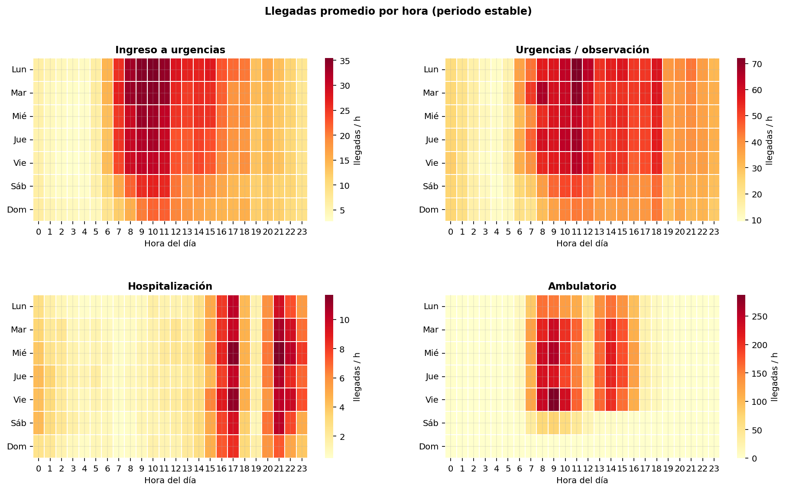

| servicio                | pico      |   llegadas_pico_h |   llegadas_valle_h |   razón pico/valle |   llegadas_prom_h |
|:------------------------|:----------|------------------:|-------------------:|-------------------:|------------------:|
| Ingreso a urgencias     | Lun 10:00 |              35.5 |                2.7 |               13.0 |              16.1 |
| Urgencias / observación | Lun 11:00 |              72.1 |                9.4 |                7.6 |              38.4 |
| Hospitalización         | Mié 21:00 |              11.7 |                0.5 |               23.5 |               3.6 |
| Ambulatorio             | Vie 9:00  |             287.4 |                0.0 |            28741.2 |              51.4 |

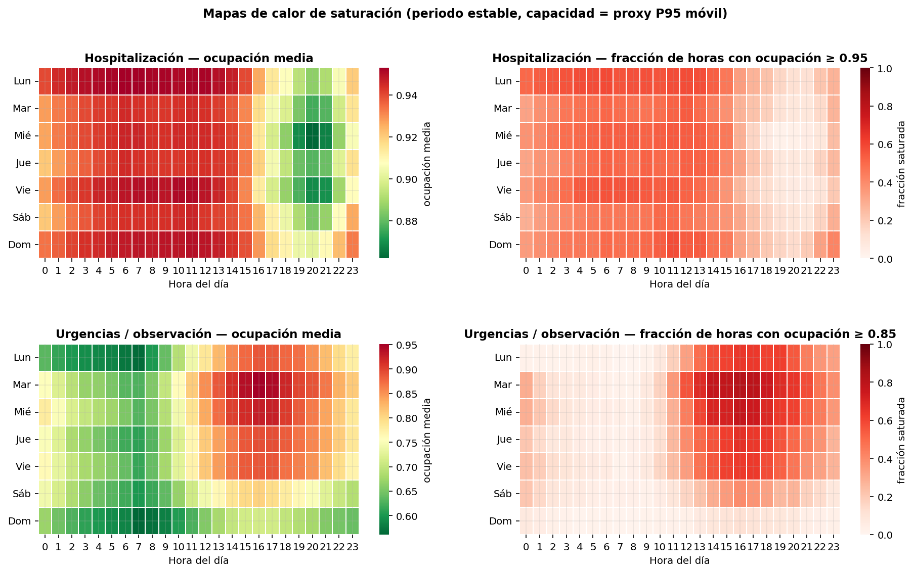


**Franjas con más horas saturadas** (top 5 por servicio):

| servicio              | dia   |   hora_del_dia |   ocupacion_prom |   frac_horas_saturadas |
|:----------------------|:------|---------------:|-----------------:|-----------------------:|
| urgencias_observacion | Mar   |             16 |            0.951 |                  0.817 |
| urgencias_observacion | Mar   |             17 |            0.943 |                  0.797 |
| urgencias_observacion | Mar   |             15 |            0.938 |                  0.778 |
| urgencias_observacion | Mar   |             14 |            0.914 |                  0.771 |
| urgencias_observacion | Mié   |             16 |            0.926 |                  0.770 |
| hospitalizacion       | Lun   |              6 |            0.953 |                  0.588 |
| hospitalizacion       | Lun   |              4 |            0.951 |                  0.582 |
| hospitalizacion       | Lun   |             12 |            0.952 |                  0.582 |
| hospitalizacion       | Lun   |              5 |            0.952 |                  0.582 |
| hospitalizacion       | Lun   |             11 |            0.952 |                  0.582 |

**Lectura.**

- **Urgencias (ingreso y observación)**: las llegadas son muy diurnas, con pico a media mañana (≈ 10–11 h) de lunes a viernes, valle a las 3–5 h y fines de semana más planos. La saturación de observación llega con 4–6 h de retraso: se concentra **por la tarde, de lunes a viernes, sobre todo martes y miércoles entre las 14 y las 17 h**.

- **Ambulatorio**: solo en horario hábil (7–17 h, lunes a viernes), con un hueco al mediodía (12 h). Prácticamente no hay actividad el fin de semana.

- **Hospitalización**: las llegadas se concentran en **dos franjas exactas, 16–17 h y 20–22 h**, todos los días. Un patrón tan rígido parece la hora de **registro administrativo** (lotes por cambio de turno) más que la hora clínica de ingreso. Persona 2 debe tenerlo en cuenta: la `hora_del_dia` de ingreso a hospitalización refleja el proceso de registro. La saturación se da en la **madrugada y la mañana**, antes de las altas del mediodía, y es máxima el **lunes**: durante el fin de semana hay menos altas y las camas se acumulan.

#### 2. Flujo de pacientes entre servicios (Sankey y matriz de transición)


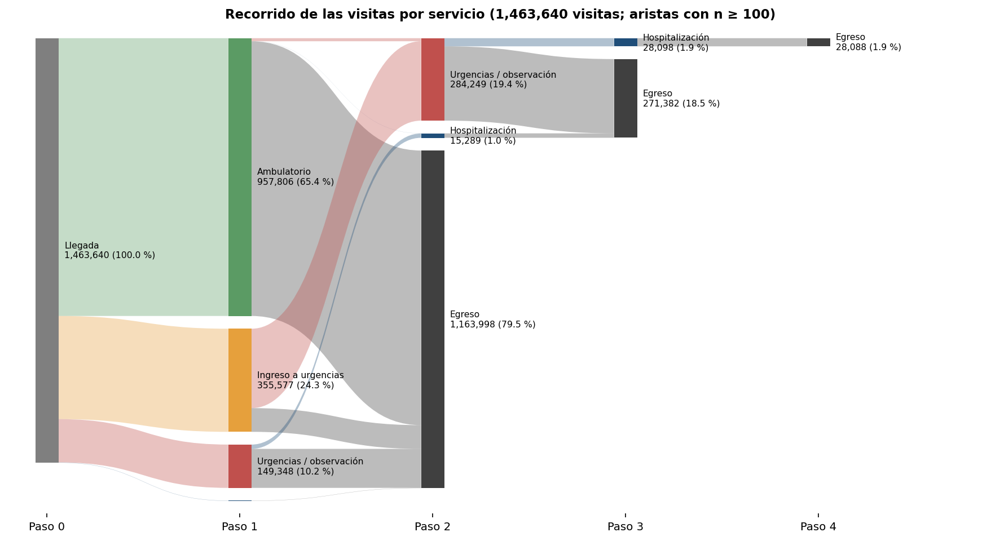

Sankey interactivo: [`html/sankey_flujo.html`](outputs/m4_visual/html/sankey_flujo.html). Se omiten las aristas con menos de 100 visitas (25 de 42, 0.01 % del flujo).


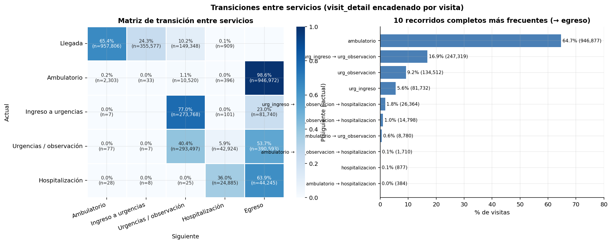

**Lectura.**

- El 65 % de las visitas son una consulta ambulatoria aislada, y el 17 % sigue el circuito típico de urgencias (ingreso → observación → egreso).

- De los ingresos a hospitalización (sin contar registros encadenados del mismo servicio), el 97 % viene de observación de urgencias. Hospitalización es casi exclusivamente un destino de urgencias.

- Desde observación, el 54 % egresa, el 40 % pasa a otro registro de observación (cadenas de registros del mismo servicio) y el 6 % se hospitaliza. Ese 6 % es la tasa de conversión que alimenta la presión sobre camas.

- Las transiciones raras (hospitalización → urgencias, observación → ambulatorio) tienen esperas de cientos de horas: son reingresos dentro de la misma visita, no flujo operativo.

#### 3. Efecto del calendario colombiano (festivos, puentes, día después de festivo)

Para separar el efecto del día de la tendencia de largo plazo, cada día se expresa como un **índice** = llegadas del día / mediana de los días laborales normales (martes–viernes) en ±14 días (1.0 = un día laboral típico de esas fechas).


> ⚠️ **Nota para Persona 1**: en `calendario_dia`, `dia_despues_festivo` está marcado en 174 días del periodo, pero solo 46 siguen a un festivo real. La columna marca el primer día hábil tras **cualquier** día no hábil, así que incluye los lunes normales tras un fin de semana. Por eso el "rebote" de `outputs/m4_resumen.md` (1 067/día) mezcla el efecto lunes con el efecto festivo. Aquí se separan: `lunes` (tras un fin de semana normal) y `día después festivo` (el día hábil siguiente a un festivo real). Sugiero renombrar la columna o añadir `tras_festivo`.

| servicio              | tipo_dia            |   dias |   llegadas_media |   indice_mediano |
|:----------------------|:--------------------|-------:|-----------------:|-----------------:|
| ambulatorio           | día después festivo |     46 |         1689.674 |            0.982 |
| ambulatorio           | festivo             |     54 |            5.352 |            0.002 |
| ambulatorio           | fin de semana       |    327 |          173.034 |            0.011 |
| ambulatorio           | laboral (mar–vie)   |    601 |         1805.291 |            1.000 |
| ambulatorio           | lunes               |    128 |         1622.281 |            0.913 |
| hospitalizacion       | día después festivo |     46 |           79.804 |            0.817 |
| hospitalizacion       | festivo             |     54 |           63.889 |            0.650 |
| hospitalizacion       | fin de semana       |    327 |           76.584 |            0.798 |
| hospitalizacion       | laboral (mar–vie)   |    601 |           94.300 |            1.000 |
| hospitalizacion       | lunes               |    128 |           83.164 |            0.900 |
| urgencias_ingreso     | día después festivo |     46 |          475.348 |            1.156 |
| urgencias_ingreso     | festivo             |     54 |          328.167 |            0.803 |
| urgencias_ingreso     | fin de semana       |    327 |          315.434 |            0.773 |
| urgencias_ingreso     | laboral (mar–vie)   |    601 |          405.448 |            1.000 |
| urgencias_ingreso     | lunes               |    128 |          470.688 |            1.177 |
| urgencias_observacion | día después festivo |     46 |         1057.804 |            1.094 |
| urgencias_observacion | festivo             |     54 |          758.204 |            0.776 |
| urgencias_observacion | fin de semana       |    327 |          762.789 |            0.788 |
| urgencias_observacion | laboral (mar–vie)   |    601 |          978.807 |            1.000 |
| urgencias_observacion | lunes               |    128 |         1070.555 |            1.113 |


| servicio                |   KW ε² (tipo de día, índice sin tendencia) | magnitud   | Δ día después festivo − laboral   | Δ lunes − laboral       |   índice mediano festivo de puente | p_BH    |
|:------------------------|--------------------------------------------:|:-----------|:----------------------------------|:------------------------|-----------------------------------:|:--------|
| Ambulatorio             |                                       0.668 | grande     | -0.018 [-0.087, +0.015]           | -0.087 [-0.120, -0.066] |                              0.003 | < 0.001 |
| Hospitalización         |                                       0.206 | mediano    | -0.183 [-0.241, -0.112]           | -0.100 [-0.132, -0.068] |                              0.633 | < 0.001 |
| Ingreso a urgencias     |                                       0.633 | grande     | +0.156 [+0.111, +0.187]           | +0.177 [+0.162, +0.195] |                              0.828 | < 0.001 |
| Urgencias / observación |                                       0.600 | grande     | +0.094 [+0.054, +0.139]           | +0.113 [+0.094, +0.133] |                              0.777 | < 0.001 |

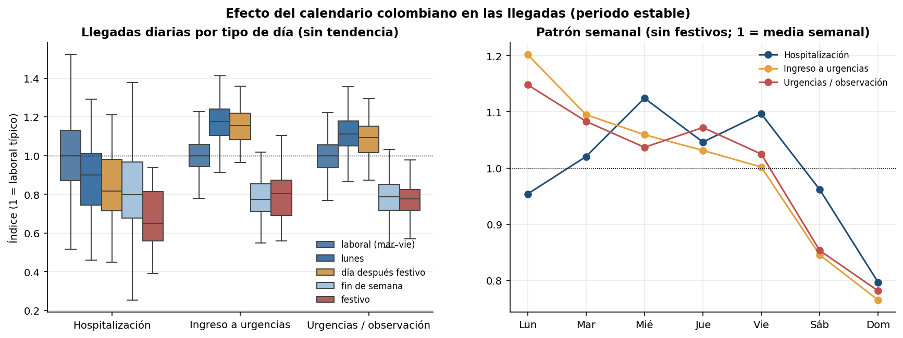


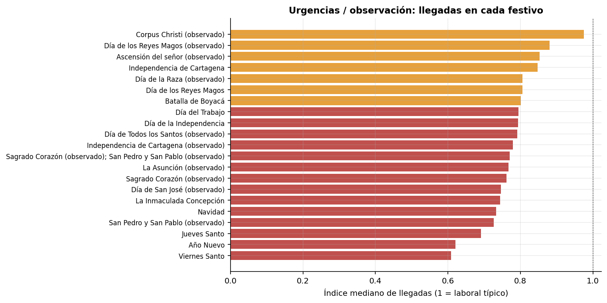


**Lectura.**

- **Festivo ≈ domingo** en urgencias/observación: índice 0.78 frente a 0.79 en fin de semana.

- **El rebote existe, pero es sobre todo un efecto lunes**: el primer día hábil tras el descanso concentra la demanda acumulada. En urgencias/observación, lunes normal = 1.11 y día después de festivo = 1.09 (con la Ley Emiliani suele ser martes). Ingreso a urgencias se comporta igual. Los dos efectos son de magnitud parecida: la variable útil es "primer día hábil tras descanso".

- El tipo de día tiene un efecto **grande** sobre las llegadas a urgencias y ambulatorio y **mediano** sobre hospitalización (ε² en la tabla). Para el modelo de servicio son variables obligatorias: `festivo`, `fin_de_semana`, día de la semana y `primer_dia_habil`.

- **Hospitalización baja más que urgencias en festivos** (índice 0.65 frente a 0.78) y no rebota al día siguiente (0.82). Esto es coherente con que se aplacen los ingresos programados y, quizá, con menos traslados desde urgencias en festivos.

- Los festivos con menos llegadas a urgencias son **Viernes Santo, Año Nuevo y Jueves Santo** (índice ≈ 0.6–0.7). La mayoría de los festivos trasladados a lunes (Emiliani) quedan en 0.75–0.85.

#### 4. Tendencia y estacionalidad (descomposición STL / MSTL)


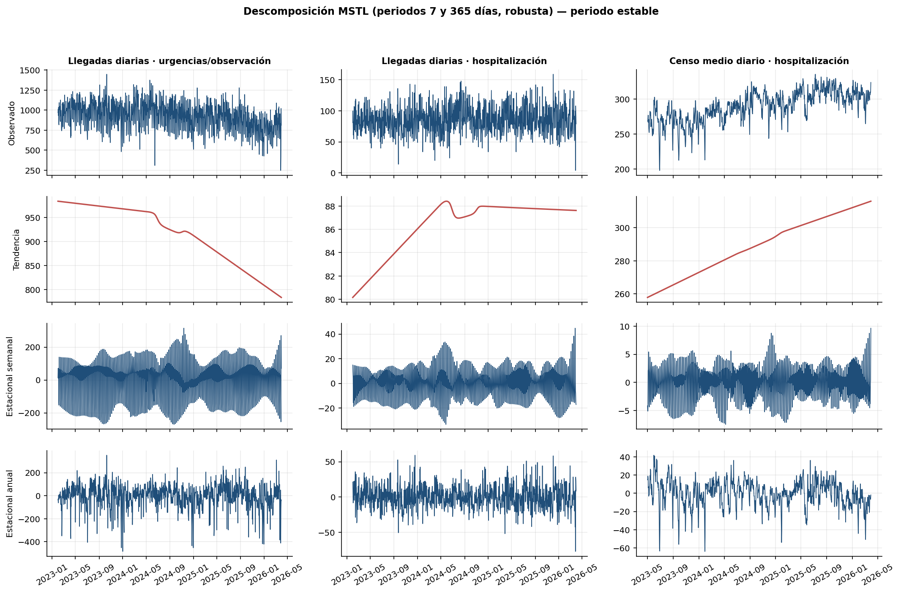

Se usa **MSTL** (STL con varias estacionalidades: semanal y anual) con ajuste robusto, para que festivos y picos no deformen la tendencia. La *fuerza* (Hyndman: 1 − Var(resto)/Var(resto + componente)) va de 0 (sin efecto) a 1 (domina la serie).

| serie                                    |   tendencia inicio |   tendencia fin |   cambio % |   amplitud semanal (máx−mín) |   amplitud anual (máx−mín) |   fuerza estacional semanal |   fuerza estacional anual |   fuerza de tendencia |
|:-----------------------------------------|-------------------:|----------------:|-----------:|-----------------------------:|---------------------------:|----------------------------:|--------------------------:|----------------------:|
| Llegadas diarias · urgencias/observación |             983.39 |          787.63 |     -19.91 |                       524.96 |                     836.51 |                        0.65 |                      0.51 |                  0.37 |
| Llegadas diarias · hospitalización       |              80.42 |           87.63 |       8.97 |                        61.95 |                     136.45 |                        0.31 |                      0.35 |                  0.02 |
| Censo medio diario · hospitalización     |             258.77 |          315.43 |      21.90 |                        14.18 |                     105.57 |                        0.06 |                      0.62 |                  0.78 |

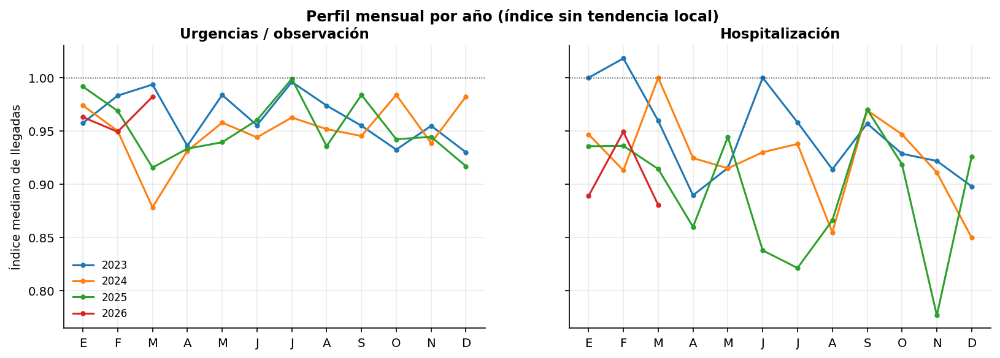


**Lectura.**

- **Censo hospitalario**: la tendencia sube un 22 % entre el inicio y el final del periodo estable. El censo de un año no es comparable con el de otro sin desestacionalizar, y la capacidad debe ser móvil (como ya hace el proxy de Persona 1).

- **Llegadas a urgencias/observación**: la tendencia **baja** (-20 %). Esto coincide con el cambio de registro visto en M2/M3 (menos subprocesos, más largos), así que no necesariamente hay menos pacientes. El ciclo semanal es la componente estacional más fuerte.

- **Estacionalidad anual**: el perfil mensual (índice sin tendencia local) **no se repite de forma consistente entre años**. Lo único estable son las caídas de **Semana Santa** (marzo en 2024, abril en 2023 y 2025) y, en hospitalización, de julio–agosto y diciembre (vacaciones, menos cirugía programada). No se ve un pico respiratorio claro. La componente anual de MSTL absorbe parte del cambio de registro, así que su "fuerza" está sobreestimada. Con ~3 años, conviene modelar la estacionalidad con `mes`/Semana Santa o términos de Fourier, no con un rezago de 365 días.

#### 5. Turno operativo (mañana 7–13, tarde 13–19, noche 19–7)

| servicio              | turno   | no_habil   |   llegadas_h |   ocupacion |   frac_sat |   horas_turno |   horas_saturadas_por_turno |
|:----------------------|:--------|:-----------|-------------:|------------:|-----------:|--------------:|----------------------------:|
| hospitalizacion       | mañana  | False      |        1.439 |       0.946 |      0.528 |             6 |                       3.167 |
| hospitalizacion       | mañana  | True       |        1.124 |       0.948 |      0.513 |             6 |                       3.080 |
| hospitalizacion       | noche   | False      |        4.057 |       0.917 |      0.322 |            12 |                       3.863 |
| hospitalizacion       | noche   | True       |        3.217 |       0.928 |      0.344 |            12 |                       4.129 |
| hospitalizacion       | tarde   | False      |        5.778 |       0.921 |      0.343 |             6 |                       2.056 |
| hospitalizacion       | tarde   | True       |        4.857 |       0.930 |      0.359 |             6 |                       2.156 |
| urgencias_observacion | mañana  | False      |       59.399 |       0.717 |      0.164 |             6 |                       0.986 |
| urgencias_observacion | mañana  | True       |       38.760 |       0.622 |      0.040 |             6 |                       0.239 |
| urgencias_observacion | noche   | False      |       26.806 |       0.749 |      0.267 |            12 |                       3.207 |
| urgencias_observacion | noche   | True       |       23.575 |       0.655 |      0.081 |            12 |                       0.972 |
| urgencias_observacion | tarde   | False      |       52.772 |       0.903 |      0.683 |             6 |                       4.095 |
| urgencias_observacion | tarde   | True       |       40.002 |       0.740 |      0.203 |             6 |                       1.219 |

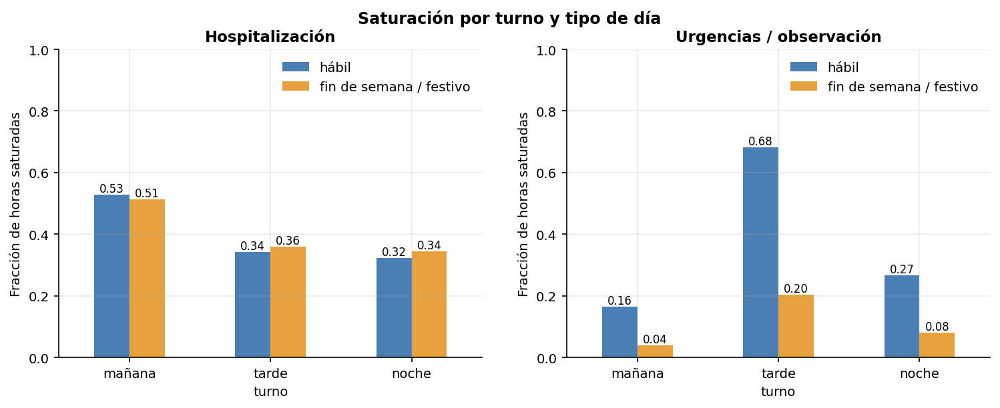


**Lectura.** La saturación se concentra en un turno distinto en cada servicio: la **mañana** en hospitalización y la **tarde** en urgencias/observación (en días hábiles). Para el dashboard (M8) y el presupuesto de fatiga (máx. 2 falsas alarmas por turno, M7), el umbral de decisión debería fijarse **por servicio y turno**, porque la tasa base de saturación cambia mucho entre turnos.

#### 6. Vista calendario de las llegadas diarias


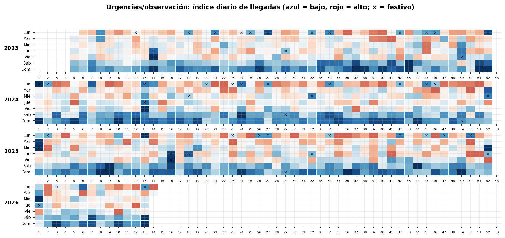

Versiones interactivas (plotly): [heatmap_llegadas](outputs/m4_visual/html/heatmap_llegadas.html) · [heatmap_saturacion](outputs/m4_visual/html/heatmap_saturacion.html) · [sankey_flujo](outputs/m4_visual/html/sankey_flujo.html)

**Código fuente**


```python
# Archivo: m4_visual/run_m4_visual.py
"""M4 · EDA espacio-temporal, parte visual (HUN-203) — Persona 3.

Uso:  python m4_visual/run_m4_visual.py
Salida: outputs/m4_visual/{figuras,tablas,html}/ y outputs/m4_visual/M4_visual_informe.md
Los HTML interactivos (Sankey, heatmaps) están pensados para el dashboard de Persona 1 (M8).
"""
from __future__ import annotations

import sys
from pathlib import Path

sys.path.insert(0, str(Path(__file__).resolve().parents[1]))

import matplotlib.pyplot as plt  # noqa: E402
import numpy as np  # noqa: E402
import pandas as pd  # noqa: E402
import plotly.graph_objects as go  # noqa: E402
import seaborn as sns  # noqa: E402
from plotly.subplots import make_subplots  # noqa: E402
from statsmodels.tsa.seasonal import MSTL, STL  # noqa: E402

from eda_comun import (  # noqa: E402
    COLORES, DIAS, M4, NOMBRE, OUT, bh, carpeta, con, dif_medianas_ic, fmt_p, guardar,
    kruskal_eps2, magnitud_eps2, md_tabla, parametros,
)

FIG, TAB = carpeta("m4_visual")
HTML = OUT / "m4_visual" / "html"
HTML.mkdir(exist_ok=True)
C = con()
P = parametros()
SERV4 = ["urgencias_ingreso", "urgencias_observacion", "hospitalizacion", "ambulatorio"]
SERV2 = ["hospitalizacion", "urgencias_observacion"]
informe: list[str] = []


def sec(t):
    print(f"· {t}")
    informe.append(f"\n## {t}\n")


def add(*x):
    informe.extend(x)


def fig_md(n, alt):
    add(f"\n\n")


def html(fig: go.Figure, nombre: str) -> str:
    fig.write_html(HTML / nombre, include_plotlyjs="cdn", full_html=True)
    return nombre


# =====================================================================================
# 1. Heatmaps día × hora
# =====================================================================================
sec("1. Densidad de admisiones por día de la semana × hora")
hl = pd.read_parquet(M4 / "heatmap_llegadas.parquet")
fig, axes = plt.subplots(2, 2, figsize=(15, 8), gridspec_kw={"hspace": 0.45})
pico = []
for ax, s in zip(axes.ravel(), SERV4):
    m = hl[hl.servicio == s].pivot(index="dia_semana", columns="hora_del_dia", values="llegadas_prom").sort_index()
    sns.heatmap(m, ax=ax, cmap="YlOrRd", cbar_kws={"label": "llegadas / h"}, linewidths=0.2)
    ax.set_yticklabels(DIAS, rotation=0)
    ax.set_title(NOMBRE[s])
    ax.set_xlabel("Hora del día")
    ax.set_ylabel("")
    i, j = np.unravel_index(np.nanargmax(m.values), m.shape)
    pico.append({"servicio": NOMBRE[s], "pico": f"{DIAS[i]} {m.columns[j]}:00", "llegadas_pico_h": m.values[i, j],
                 "llegadas_valle_h": np.nanmin(m.values), "razón pico/valle": m.values[i, j] / max(np.nanmin(m.values), 0.01),
                 "llegadas_prom_h": np.nanmean(m.values)})
fig.suptitle("Llegadas promedio por hora (periodo estable)", fontweight="bold")
fig_md(guardar(fig, FIG / "01_heatmap_llegadas.png"), "heatmap llegadas")
pico = pd.DataFrame(pico)
pico.to_csv(TAB / "picos_llegadas.csv", index=False)
add(md_tabla(pico, floatfmt=".1f"))

pf = make_subplots(rows=2, cols=2, subplot_titles=[NOMBRE[s] for s in SERV4], horizontal_spacing=0.08, vertical_spacing=0.12)
for k, s in enumerate(SERV4):
    m = hl[hl.servicio == s].pivot(index="dia_semana", columns="hora_del_dia", values="llegadas_prom").sort_index()
    pf.add_trace(go.Heatmap(z=m.values, x=list(m.columns), y=DIAS, colorscale="YlOrRd", showscale=False,
                            hovertemplate="%{y} %{x}:00<br>%{z:.1f} llegadas/h<extra>" + NOMBRE[s] + "</extra>"),
                 row=k // 2 + 1, col=k % 2 + 1)
pf.update_yaxes(autorange="reversed")
pf.update_layout(title="Llegadas promedio por día × hora — HUN (periodo estable)", height=650)
html(pf, "heatmap_llegadas.html")

ho = pd.read_parquet(M4 / "heatmap_ocupacion.parquet")
fig, axes = plt.subplots(2, 2, figsize=(15, 8), gridspec_kw={"hspace": 0.45})
for r, s in enumerate(SERV2):
    d = ho[ho.servicio == s]
    m1 = d.pivot(index="dia_semana", columns="hora_del_dia", values="ocupacion_prom").sort_index()
    m2 = d.pivot(index="dia_semana", columns="hora_del_dia", values="frac_horas_saturadas").sort_index()
    sns.heatmap(m1, ax=axes[r, 0], cmap="RdYlGn_r", cbar_kws={"label": "ocupación media"}, linewidths=0.2)
    sns.heatmap(m2, ax=axes[r, 1], cmap="Reds", vmin=0, vmax=1, cbar_kws={"label": "fracción saturada"}, linewidths=0.2)
    umbral = 0.95 if s == "hospitalizacion" else 0.85
    axes[r, 0].set_title(f"{NOMBRE[s]} — ocupación media")
    axes[r, 1].set_title(f"{NOMBRE[s]} — fracción de horas con ocupación ≥ {umbral}")
    for ax in axes[r]:
        ax.set_yticklabels(DIAS, rotation=0)
        ax.set_xlabel("Hora del día")
        ax.set_ylabel("")
fig.suptitle("Mapas de calor de saturación (periodo estable, capacidad = proxy P95 móvil)", fontweight="bold")
fig_md(guardar(fig, FIG / "02_heatmap_saturacion.png"), "heatmap saturación")
pf = make_subplots(rows=2, cols=2, horizontal_spacing=0.1, vertical_spacing=0.12,
                   subplot_titles=[f"{NOMBRE[s]} — {t}" for s in SERV2 for t in ("ocupación media", "fracción saturada")])
for r, s in enumerate(SERV2):
    d = ho[ho.servicio == s]
    for c, (col, cs) in enumerate([("ocupacion_prom", "RdYlGn_r"), ("frac_horas_saturadas", "Reds")]):
        m = d.pivot(index="dia_semana", columns="hora_del_dia", values=col).sort_index()
        pf.add_trace(go.Heatmap(z=m.values, x=list(m.columns), y=DIAS, colorscale=cs, showscale=False,
                                hovertemplate="%{y} %{x}:00<br>%{z:.3f}<extra></extra>"), row=r + 1, col=c + 1)
pf.update_yaxes(autorange="reversed")
pf.update_layout(title="Saturación por día × hora — HUN", height=650)
html(pf, "heatmap_saturacion.html")
sat_top = (ho.sort_values("frac_horas_saturadas", ascending=False).groupby("servicio").head(5)
           .assign(dia=lambda d: d.dia_semana.map(dict(enumerate(DIAS, 1))))
           [["servicio", "dia", "hora_del_dia", "ocupacion_prom", "frac_horas_saturadas"]])
sat_top.to_csv(TAB / "franjas_mas_saturadas.csv", index=False)
add(
    "\n**Franjas con más horas saturadas** (top 5 por servicio):\n", md_tabla(sat_top, floatfmt=".3f"),
    "\n**Lectura.**\n",
    "- **Urgencias (ingreso y observación)**: las llegadas son muy diurnas, con pico a media mañana "
    "(≈ 10–11 h) de lunes a viernes, valle a las 3–5 h y fines de semana más planos. La saturación de "
    "observación llega con 4–6 h de retraso: se concentra **por la tarde, de lunes a viernes, sobre "
    "todo martes y miércoles entre las 14 y las 17 h**.\n",
    "- **Ambulatorio**: solo en horario hábil (7–17 h, lunes a viernes), con un hueco al mediodía (12 h). "
    "Prácticamente no hay actividad el fin de semana.\n",
    "- **Hospitalización**: las llegadas se concentran en **dos franjas exactas, 16–17 h y 20–22 h**, "
    "todos los días. Un patrón tan rígido parece la hora de **registro administrativo** (lotes por cambio "
    "de turno) más que la hora clínica de ingreso. Persona 2 debe tenerlo en cuenta: la `hora_del_dia` de "
    "ingreso a hospitalización refleja el proceso de registro. La saturación se da en la **madrugada y "
    "la mañana**, antes de las altas del mediodía, y es máxima el **lunes**: durante el fin de semana hay "
    "menos altas y las camas se acumulan.",
)

# =====================================================================================
# 2. Sankey y matriz de transición
# =====================================================================================
sec("2. Flujo de pacientes entre servicios (Sankey y matriz de transición)")
sk = pd.read_parquet(M4 / "sankey_aristas.parquet")
MIN_N = 100
skf = sk[sk.n >= MIN_N].copy()
nodos = sorted(set(skf.origen) | set(skf.destino), key=lambda x: (int(x.split(":")[0]), x))
idx = {n: i for i, n in enumerate(nodos)}
etq_serv = {"(llegada)": "Llegada", "(egreso)": "Egreso", **NOMBRE}
col_serv = {"(llegada)": "#7f7f7f", "(egreso)": "#404040", **COLORES}
total = sk[sk.etapa == 0].n.sum()
entra = {n: 0 for n in nodos}
for o, d, n in zip(sk.origen, sk.destino, sk.n):
    if d in entra:
        entra[d] += n
labels = []
for n in nodos:
    e, s = n.split(":", 1)
    v = total if s == "(llegada)" else entra[n]
    labels.append(f"{etq_serv[s]} · paso {e}<br>{v:,} ({100*v/total:.1f} %)" if s != "(llegada)" else f"Llegada<br>{total:,} visitas")
etapas_max = max(int(n.split(":")[0]) for n in nodos)
xs = [0.001 + 0.998 * int(n.split(":")[0]) / etapas_max for n in nodos]


def rgba(hexc, a):
    h = hexc.lstrip("#")
    return f"rgba({int(h[0:2],16)},{int(h[2:4],16)},{int(h[4:6],16)},{a})"


sfig = go.Figure(go.Sankey(
    arrangement="snap",
    node=dict(label=labels, x=xs, pad=18, thickness=16, color=[col_serv[n.split(":", 1)[1]] for n in nodos],
              hovertemplate="%{label}<extra></extra>"),
    link=dict(source=[idx[o] for o in skf.origen], target=[idx[d] for d in skf.destino], value=skf.n,
              color=[rgba(col_serv[d.split(":", 1)[1]], 0.35) for d in skf.destino],
              hovertemplate="%{source.label} → %{target.label}<br>%{value:,} visitas<extra></extra>"),
))
sfig.update_layout(title=f"Recorrido de las visitas por servicio — HUN ({total:,} visitas; aristas con n ≥ {MIN_N})",
                   font=dict(size=11), height=600, width=1200)
html(sfig, "sankey_flujo.html")


def sankey_estatico(aristas: pd.DataFrame, ruta: Path):
    """Sankey estático en matplotlib (kaleido se cuelga en Windows). Nodos = 'etapa:servicio'."""
    from matplotlib.patches import PathPatch
    from matplotlib.path import Path as MPath

    etapa = lambda n: int(n.split(":")[0])  # noqa: E731
    serv = lambda n: n.split(":", 1)[1]  # noqa: E731
    flujo = {}
    for o, d, n in zip(aristas.origen, aristas.destino, aristas.n):
        flujo[o] = max(flujo.get(o, 0), 0)
        flujo[d] = flujo.get(d, 0)
    entrada = aristas.groupby("destino").n.sum()
    salida = aristas.groupby("origen").n.sum()
    tam = {n: max(entrada.get(n, 0), salida.get(n, 0)) for n in flujo}
    total = max(sum(v for n, v in tam.items() if etapa(n) == e) for e in {etapa(n) for n in tam})
    gap = 0.03 * total
    orden_s = ["(llegada)", "ambulatorio", "urgencias_ingreso", "urgencias_observacion", "hospitalizacion", "(egreso)"]
    pos = {}
    for e in sorted({etapa(n) for n in tam}):
        y = 0.0
        for n in sorted([n for n in tam if etapa(n) == e], key=lambda n: orden_s.index(serv(n))):
            pos[n] = [y, y]  # [y0 de nodo, cursor salida]
            y += tam[n] + gap
    cur_in = {n: pos[n][0] for n in pos}
    fig, ax = plt.subplots(figsize=(15, 7.5))
    w = 0.12
    for o, d, n in sorted(zip(aristas.origen, aristas.destino, aristas.n), key=lambda t: (etapa(t[0]), orden_s.index(serv(t[0])), orden_s.index(serv(t[1])))):
        x0, x1 = etapa(o) + w / 2, etapa(d) - w / 2
        y0a = pos[o][1]; pos[o][1] += n
        y1a = cur_in[d]; cur_in[d] += n
        xm = (x0 + x1) / 2
        verts = [(x0, y0a), (xm, y0a), (xm, y1a), (x1, y1a), (x1, y1a + n), (xm, y1a + n), (xm, y0a + n), (x0, y0a + n), (x0, y0a)]
        codes = [MPath.MOVETO, MPath.CURVE4, MPath.CURVE4, MPath.CURVE4, MPath.LINETO, MPath.CURVE4, MPath.CURVE4, MPath.CURVE4, MPath.CLOSEPOLY]
        ax.add_patch(PathPatch(MPath(verts, codes), fc=col_serv[serv(d)], alpha=0.35, lw=0))
    for n, (y0, _) in pos.items():
        e = etapa(n)
        ax.add_patch(plt.Rectangle((e - w / 2, y0), w, tam[n], fc=col_serv[serv(n)], ec="none"))
        if tam[n] / total > 0.004:
            ax.text(e + w / 2 + 0.03, y0 + tam[n] / 2, f"{etq_serv[serv(n)]}\n{tam[n]:,} ({100*tam[n]/total:.1f} %)",
                    va="center", fontsize=7.5)
    emax = max(etapa(n) for n in pos)
    ax.set_xlim(-0.2, emax + 0.9)
    ax.set_ylim(max(v[0] + tam[k] for k, v in pos.items()) + gap, -gap)
    ax.set_xticks(range(emax + 1))
    ax.set_xticklabels([f"Paso {i}" for i in range(emax + 1)])
    ax.set_yticks([])
    ax.grid(False)
    for sp in ax.spines.values():
        sp.set_visible(False)
    ax.set_title(f"Recorrido de las visitas por servicio ({total:,} visitas; aristas con n ≥ {MIN_N})", fontweight="bold")
    return guardar(fig, ruta)


fig_md(sankey_estatico(skf, FIG / "03_sankey.png"), "Sankey")
add(f"Sankey interactivo: [`html/sankey_flujo.html`](html/sankey_flujo.html). Se omiten las aristas con menos de {MIN_N} visitas "
    f"({(sk.n < MIN_N).sum()} de {len(sk)}, {100*sk.loc[sk.n < MIN_N,'n'].sum()/sk.n.sum():.2f} % del flujo).\n")

mt = pd.read_parquet(M4 / "matriz_transicion.parquet")
orden_f = ["(llegada)", "ambulatorio", "urgencias_ingreso", "urgencias_observacion", "hospitalizacion"]
orden_c = ["ambulatorio", "urgencias_ingreso", "urgencias_observacion", "hospitalizacion", "(egreso)"]
M = mt.pivot(index="desde", columns="hacia", values="prob").reindex(index=orden_f, columns=orden_c).fillna(0)
N = mt.pivot(index="desde", columns="hacia", values="n").reindex(index=orden_f, columns=orden_c).fillna(0)
fig, axes = plt.subplots(1, 2, figsize=(15, 5), gridspec_kw={"width_ratios": [1.1, 1]})
ann = np.vectorize(lambda p, n: f"{p:.1%}\n(n={int(n):,})" if n > 0 else "")(M.values, N.values)
sns.heatmap(M, ax=axes[0], cmap="Blues", annot=ann, fmt="", annot_kws={"size": 7.5}, vmin=0, vmax=1,
            cbar_kws={"label": "P(siguiente | actual)"}, linewidths=0.5)
axes[0].set_xticklabels([etq_serv[c] for c in orden_c], rotation=20, ha="right")
axes[0].set_yticklabels([etq_serv[c] for c in orden_f], rotation=0)
axes[0].set_xlabel("Siguiente")
axes[0].set_ylabel("Actual")
axes[0].set_title("Matriz de transición entre servicios")
rf = pd.read_parquet(M4 / "rutas_frecuentes.parquet").head(10).iloc[::-1]
axes[1].barh(rf.ruta.str.replace(" → (egreso)", "").str.replace("urgencias_", "urg_"), rf.frac * 100, color="#4a7fb5")
for y, (f, n) in enumerate(zip(rf.frac, rf.n_visitas)):
    axes[1].text(f * 100 + 0.5, y, f"{f:.1%} ({n:,})", va="center", fontsize=7.5)
axes[1].set_xlabel("% de visitas")
axes[1].set_title("10 recorridos completos más frecuentes (→ egreso)")
axes[1].tick_params(axis="y", labelsize=7.5)
axes[1].set_xlim(0, 80)
fig.suptitle("Transiciones entre servicios (visit_detail encadenado por visita)", fontweight="bold")
fig_md(guardar(fig, FIG / "04_matriz_transicion_rutas.png"), "matriz transición")
M.to_csv(TAB / "matriz_transicion_prob.csv")
hosp_desde = mt[(mt.hacia == "hospitalizacion") & (mt.desde != "hospitalizacion")].groupby("desde").n.sum()
add(
    "**Lectura.**\n",
    "- El 65 % de las visitas son una consulta ambulatoria aislada, y el 17 % sigue el circuito típico de "
    "urgencias (ingreso → observación → egreso).\n",
    f"- De los ingresos a hospitalización (sin contar registros encadenados del mismo servicio), el {100*hosp_desde.get('urgencias_observacion',0)/hosp_desde.sum():.0f} % "
    "viene de observación de urgencias. Hospitalización es casi exclusivamente un destino de urgencias.\n",
    "- Desde observación, el 54 % egresa, el 40 % pasa a otro registro de observación (cadenas de "
    "registros del mismo servicio) y el 6 % se hospitaliza. Ese 6 % es la tasa de conversión que "
    "alimenta la presión sobre camas.\n",
    "- Las transiciones raras (hospitalización → urgencias, observación → ambulatorio) tienen esperas "
    "de cientos de horas: son reingresos dentro de la misma visita, no flujo operativo.",
)

# =====================================================================================
# 3. Calendario colombiano
# =====================================================================================
sec("3. Efecto del calendario colombiano (festivos, puentes, día después de festivo)")
ld = pd.read_parquet(M4 / "llegadas_dia.parquet")
ld["fecha"] = pd.to_datetime(ld.fecha)
# OJO: en `calendario_dia` de Persona 1, `dia_despues_festivo` marca el primer día hábil tras
# CUALQUIER día no hábil (incluye ~130 lunes normales). Aquí se separa el lunes normal del día
# siguiente a un festivo real.
cd_ = pd.read_parquet(M4 / "calendario_dia.parquet").sort_values("fecha")
cd_["fecha"] = pd.to_datetime(cd_.fecha)
cd_["tras_festivo_real"] = cd_.festivo.shift(1, fill_value=False) & ~cd_.festivo & ~cd_.fin_de_semana
n_flag_p1 = int(cd_.loc[cd_.fecha.between(ld.fecha.min(), ld.fecha.max()), "dia_despues_festivo"].sum())
n_flag_real = int(cd_.loc[cd_.fecha.between(ld.fecha.min(), ld.fecha.max()), "tras_festivo_real"].sum())
ld = ld.merge(cd_[["fecha", "tras_festivo_real"]], on="fecha", how="left")
ld["tipo_dia"] = np.select(
    [ld.festivo, ld.tras_festivo_real, ld.fin_de_semana, ld.dia_semana == 1],
    ["festivo", "día después festivo", "fin de semana", "lunes"], "laboral (mar–vie)")
# Referencia sin tendencia: mediana de los días laborales "normales" en ±14 días
ref = []
for s, d in ld.groupby("servicio"):
    d = d.sort_values("fecha").set_index("fecha")
    lab = d.llegadas.where(d.tipo_dia == "laboral (mar–vie)")
    r = lab.rolling("29D", center=True, min_periods=5).median()
    ref.append(pd.Series(r.values, index=d.index).rename(s))
ld = ld.merge(pd.concat(ref, axis=1).stack().rename("ref").reset_index().rename(columns={"level_1": "servicio"}),
              on=["fecha", "servicio"], how="left")
ld["indice"] = ld.llegadas / ld.ref
filas, tests = [], []
for s, d in ld.groupby("servicio"):
    g = d.groupby("tipo_dia").agg(dias=("llegadas", "size"), llegadas_media=("llegadas", "mean"),
                                  indice_mediano=("indice", "median"))
    g["servicio"] = s
    filas.append(g.reset_index())
    _, p, e2 = kruskal_eps2([x.indice.dropna().values for _, x in d.groupby("tipo_dia")])
    lab = d.loc[d.tipo_dia == "laboral (mar–vie)", "indice"].dropna().values
    lun = d.loc[d.tipo_dia == "lunes", "indice"].dropna().values
    dd = d.loc[d.tipo_dia == "día después festivo", "indice"].dropna().values
    pu = d.loc[d.puente & d.festivo, "indice"].dropna().values
    dm, lo, hi = dif_medianas_ic(dd, lab, max_n=5000)
    dl, lol, hil = dif_medianas_ic(lun, lab, max_n=5000)
    tests.append({"servicio": NOMBRE[s], "KW ε² (tipo de día, índice sin tendencia)": e2, "magnitud": magnitud_eps2(e2), "p": p,
                  "Δ día después festivo − laboral": f"{dm:+.3f} [{lo:+.3f}, {hi:+.3f}]",
                  "Δ lunes − laboral": f"{dl:+.3f} [{lol:+.3f}, {hil:+.3f}]",
                  "índice mediano festivo de puente": np.median(pu) if len(pu) else np.nan})
cal = pd.concat(filas)[["servicio", "tipo_dia", "dias", "llegadas_media", "indice_mediano"]]
cal.to_csv(TAB / "efecto_calendario.csv", index=False)
tests = pd.DataFrame(tests)
tests["p_BH"] = bh(tests.p)
tests["p_BH"] = tests.p_BH.map(fmt_p)
tests.drop(columns="p").to_csv(TAB / "efecto_calendario_tests.csv", index=False)
add(
    "Para separar el efecto del día de la tendencia de largo plazo, cada día se expresa como un **índice** "
    "= llegadas del día / mediana de los días laborales normales (martes–viernes) en ±14 días (1.0 = un "
    "día laboral típico de esas fechas).\n",
    f"\n> ⚠️ **Nota para Persona 1**: en `calendario_dia`, `dia_despues_festivo` está marcado en {n_flag_p1} "
    f"días del periodo, pero solo {n_flag_real} siguen a un festivo real. La columna marca el primer día "
    "hábil tras **cualquier** día no hábil, así que incluye los lunes normales tras un fin de semana. "
    "Por eso el \"rebote\" de `outputs/m4_resumen.md` (1 067/día) mezcla el efecto lunes con el efecto "
    "festivo. Aquí se separan: `lunes` (tras un fin de semana normal) y `día después festivo` (el día "
    "hábil siguiente a un festivo real). Sugiero renombrar la columna o añadir `tras_festivo`.\n",
    md_tabla(cal, floatfmt=".3f"),
    "\n", md_tabla(tests.drop(columns="p"), floatfmt=".3f"),
)
orden_t = ["laboral (mar–vie)", "lunes", "día después festivo", "fin de semana", "festivo"]
fig, axes = plt.subplots(1, 2, figsize=(14, 4.5))
dplot = ld[ld.servicio != "ambulatorio"].assign(s=lambda d: d.servicio.map(NOMBRE))
sns.boxplot(data=dplot, x="s", y="indice", hue="tipo_dia", hue_order=orden_t, ax=axes[0], showfliers=False,
            palette=["#4a7fb5", "#2e75b6", "#e6a03c", "#9dc3e6", "#c0504d"])
axes[0].axhline(1, color="k", lw=0.7, ls=":")
axes[0].set_xlabel("")
axes[0].set_ylabel("Índice (1 = laboral típico)")
axes[0].set_title("Llegadas diarias por tipo de día (sin tendencia)")
axes[0].legend(fontsize=8, title="")
dw = ld[ld.servicio != "ambulatorio"].copy()
dw = dw[~dw.festivo]
wk = dw.groupby(["servicio", "dia_semana"]).llegadas.mean().unstack(0)
wk = wk / wk.mean()
for s in wk.columns:
    axes[1].plot(DIAS, wk[s], "-o", color=COLORES[s], label=NOMBRE[s])
axes[1].axhline(1, color="k", lw=0.7, ls=":")
axes[1].set_title("Patrón semanal (sin festivos; 1 = media semanal)")
axes[1].legend(fontsize=8)
fig.suptitle("Efecto del calendario colombiano en las llegadas (periodo estable)", fontweight="bold")
fig_md(guardar(fig, FIG / "05_efecto_calendario.png"), "calendario")

# Festivos individuales: índice en urgencias/observación
fest = ld[(ld.servicio == "urgencias_observacion") & ld.festivo].groupby("nombre_festivo").indice.agg(["median", "size"]).sort_values("median")
fest.to_csv(TAB / "indice_por_festivo_urgencias.csv")
fig, ax = plt.subplots(figsize=(8, 5.5))
ax.barh(fest.index, fest["median"], color=np.where(fest["median"] < 0.8, "#c0504d", "#e6a03c"))
ax.axvline(1, color="k", ls=":", lw=0.8)
ax.set_xlabel("Índice mediano de llegadas (1 = laboral típico)")
ax.set_title("Urgencias / observación: llegadas en cada festivo")
ax.tick_params(axis="y", labelsize=8)
fig_md(guardar(fig, FIG / "06_festivos_urgencias.png"), "festivos")
c_ = cal.pivot(index="servicio", columns="tipo_dia", values="indice_mediano")
u_, h_ = c_.loc["urgencias_observacion"], c_.loc["hospitalizacion"]
add(
    "\n**Lectura.**\n",
    f"- **Festivo ≈ domingo** en urgencias/observación: índice {u_['festivo']:.2f} frente a "
    f"{u_['fin de semana']:.2f} en fin de semana.\n",
    f"- **El rebote existe, pero es sobre todo un efecto lunes**: el primer día hábil tras el descanso "
    f"concentra la demanda acumulada. En urgencias/observación, lunes normal = {u_['lunes']:.2f} y día después de "
    f"festivo = {u_['día después festivo']:.2f} (con la Ley Emiliani suele ser martes). Ingreso a urgencias se comporta igual. "
    "Los dos efectos son de magnitud parecida: la variable útil es \"primer día hábil tras descanso\".\n",
    "- El tipo de día tiene un efecto **grande** sobre las llegadas a urgencias y ambulatorio y **mediano** "
    "sobre hospitalización (ε² en la tabla). Para el modelo de servicio son variables obligatorias: "
    "`festivo`, `fin_de_semana`, día de la semana y `primer_dia_habil`.\n",
    f"- **Hospitalización baja más que urgencias en festivos** (índice {h_['festivo']:.2f} frente a {u_['festivo']:.2f}) y "
    f"no rebota al día siguiente ({h_['día después festivo']:.2f}). Esto es coherente con que se aplacen los "
    "ingresos programados y, quizá, con menos traslados desde urgencias en festivos.\n",
    "- Los festivos con menos llegadas a urgencias son **Viernes Santo, Año Nuevo y Jueves Santo** "
    "(índice ≈ 0.6–0.7). La mayoría de los festivos trasladados a lunes (Emiliani) quedan en 0.75–0.85.",
)

# =====================================================================================
# 4. Descomposición STL / MSTL
# =====================================================================================
sec("4. Tendencia y estacionalidad (descomposición STL / MSTL)")
od = pd.read_parquet(M4 / "ocupacion_dia.parquet")
od["fecha"] = pd.to_datetime(od.fecha)
od = od[od.en_periodo_estable]
series = {
    "Llegadas diarias · urgencias/observación": ld[ld.servicio == "urgencias_observacion"].set_index("fecha").llegadas.asfreq("D"),
    "Llegadas diarias · hospitalización": ld[ld.servicio == "hospitalizacion"].set_index("fecha").llegadas.asfreq("D"),
    "Censo medio diario · hospitalización": od[od.servicio == "hospitalizacion"].set_index("fecha").censo_prom.asfreq("D"),
}
fig, axes = plt.subplots(4, 3, figsize=(17, 10), sharex="col")
resumen = []
for c, (nombre, y) in enumerate(series.items()):
    y = y.interpolate()
    res = MSTL(y, periods=(7, 365), stl_kwargs={"robust": True}).fit()
    comp = [("Observado", res.observed), ("Tendencia", res.trend), ("Estacional semanal", res.seasonal["seasonal_7"]),
            ("Estacional anual", res.seasonal["seasonal_365"])]
    for r, (t, v) in enumerate(comp):
        axes[r, c].plot(v.index, v.values, lw=0.8 if r != 1 else 1.6, color="#1f4e79" if r != 1 else "#c0504d")
        axes[r, c].set_ylabel(t if c == 0 else "")
    axes[0, c].set_title(nombre, fontsize=10)
    tr = res.trend
    var_res = np.var(res.resid)
    resumen.append({
        "serie": nombre,
        "tendencia inicio": tr.iloc[:30].mean(), "tendencia fin": tr.iloc[-30:].mean(),
        "cambio %": 100 * (tr.iloc[-30:].mean() / tr.iloc[:30].mean() - 1),
        "amplitud semanal (máx−mín)": np.ptp(res.seasonal["seasonal_7"].iloc[-28:]),
        "amplitud anual (máx−mín)": np.ptp(res.seasonal["seasonal_365"]),
        "fuerza estacional semanal": max(0, 1 - var_res / np.var(res.resid + res.seasonal["seasonal_7"])),
        "fuerza estacional anual": max(0, 1 - var_res / np.var(res.resid + res.seasonal["seasonal_365"])),
        "fuerza de tendencia": max(0, 1 - var_res / np.var(res.resid + tr)),
    })
for ax in axes[-1]:
    ax.tick_params(axis="x", rotation=30)
fig.suptitle("Descomposición MSTL (periodos 7 y 365 días, robusta) — periodo estable", fontweight="bold")
fig_md(guardar(fig, FIG / "07_mstl.png"), "MSTL")
resumen = pd.DataFrame(resumen)
resumen.to_csv(TAB / "mstl_resumen.csv", index=False)
add(
    "Se usa **MSTL** (STL con varias estacionalidades: semanal y anual) con ajuste robusto, para que "
    "festivos y picos no deformen la tendencia. La *fuerza* (Hyndman: 1 − Var(resto)/Var(resto + "
    "componente)) va de 0 (sin efecto) a 1 (domina la serie).\n",
    md_tabla(resumen, floatfmt=".2f"),
)
# Estacionalidad mensual (perfil por año) urgencias
mm = ld[ld.servicio.isin(["urgencias_observacion", "hospitalizacion"])].copy()
mm["anio"] = mm.fecha.dt.year
mm["mes"] = mm.fecha.dt.month
prof = mm.groupby(["servicio", "anio", "mes"]).indice.median().reset_index()
fig, axes = plt.subplots(1, 2, figsize=(13, 4), sharey=True)
for ax, s in zip(axes, SERV2[::-1]):
    for a, d in prof[prof.servicio == s].groupby("anio"):
        ax.plot(d.mes, d.indice, "-o", ms=3, label=str(a))
    ax.axhline(1, color="k", ls=":", lw=0.7)
    ax.set_xticks(range(1, 13))
    ax.set_xticklabels(["E", "F", "M", "A", "M", "J", "J", "A", "S", "O", "N", "D"])
    ax.set_title(NOMBRE[s])
axes[0].set_ylabel("Índice mediano de llegadas")
axes[0].legend(fontsize=8)
fig.suptitle("Perfil mensual por año (índice sin tendencia local)", fontweight="bold")
fig_md(guardar(fig, FIG / "08_perfil_mensual.png"), "mensual")
r = resumen.set_index("serie")
add(
    "\n**Lectura.**\n",
    f"- **Censo hospitalario**: la tendencia sube un {r.iloc[2]['cambio %']:.0f} % entre el inicio y el final del "
    "periodo estable. El censo de un año no es comparable con el de otro sin desestacionalizar, y la "
    "capacidad debe ser móvil (como ya hace el proxy de Persona 1).\n",
    f"- **Llegadas a urgencias/observación**: la tendencia **baja** ({r.iloc[0]['cambio %']:.0f} %). Esto "
    "coincide con el cambio de registro visto en M2/M3 (menos subprocesos, más largos), así que no "
    "necesariamente hay menos pacientes. El ciclo semanal es la componente estacional más fuerte.\n",
    "- **Estacionalidad anual**: el perfil mensual (índice sin tendencia local) **no se repite de forma "
    "consistente entre años**. Lo único estable son las caídas de **Semana Santa** (marzo en 2024, abril en "
    "2023 y 2025) y, en hospitalización, de julio–agosto y diciembre (vacaciones, menos cirugía "
    "programada). No se ve un pico respiratorio claro. La componente anual de MSTL absorbe parte del "
    "cambio de registro, así que su \"fuerza\" está sobreestimada. Con ~3 años, conviene modelar la "
    "estacionalidad con `mes`/Semana Santa o términos de Fourier, no con un rezago de 365 días.",
)

# =====================================================================================
# 5. Turnos
# =====================================================================================
sec("5. Turno operativo (mañana 7–13, tarde 13–19, noche 19–7)")
tur = C.sql(
    """
    SELECT o.servicio, h.turno, h.fin_de_semana OR h.festivo no_habil,
           avg(o.llegadas) llegadas_h, avg(o.ocupacion) ocupacion, avg((o.ocupacion >= o.umbral_ocupacion)::int) frac_sat,
           count(DISTINCT h.fecha) dias
    FROM 'data/m1/ocupacion_servicio_hora.parquet' o JOIN 'data/m4/calendario_hora.parquet' h USING (hora)
    WHERE o.en_periodo_estable GROUP BY ALL ORDER BY ALL
    """
).df()
tur["turno"] = tur.turno.replace({"manana": "mañana"})
tur.to_csv(TAB / "turnos.csv", index=False)
# Horas saturadas esperadas por turno (de 6 u 12 h) → insumo del presupuesto de alertas
tur["horas_turno"] = np.where(tur.turno == "noche", 12, 6)
tur["horas_saturadas_por_turno"] = tur.frac_sat * tur.horas_turno
add(md_tabla(tur.drop(columns="dias"), floatfmt=".3f"))
fig, axes = plt.subplots(1, 2, figsize=(12, 4))
for ax, s in zip(axes, SERV2):
    d = tur[tur.servicio == s].pivot(index="turno", columns="no_habil", values="frac_sat").reindex(["mañana", "tarde", "noche"])
    d.columns = ["hábil", "fin de semana / festivo"]
    d.plot.bar(ax=ax, rot=0, color=["#4a7fb5", "#e6a03c"])
    ax.set_title(NOMBRE[s])
    ax.set_ylabel("Fracción de horas saturadas")
    ax.set_ylim(0, 1)
    for cont in ax.containers:
        ax.bar_label(cont, fmt="%.2f", fontsize=8)
fig.suptitle("Saturación por turno y tipo de día", fontweight="bold")
fig_md(guardar(fig, FIG / "09_turnos.png"), "turnos")
add(
    "\n**Lectura.** La saturación se concentra en un turno distinto en cada servicio: la **mañana** "
    "en hospitalización y la **tarde** en urgencias/observación (en días hábiles). Para el dashboard "
    "(M8) y el presupuesto de fatiga (máx. 2 falsas alarmas por turno, M7), el umbral de decisión "
    "debería fijarse **por servicio y turno**, porque la tasa base de saturación cambia mucho entre turnos.",
)

# =====================================================================================
# 6. Calendario de calor diario (urgencias)
# =====================================================================================
sec("6. Vista calendario de las llegadas diarias")
u = ld[ld.servicio == "urgencias_observacion"].copy()
u["anio"] = u.fecha.dt.isocalendar().year
u["semana"] = u.fecha.dt.isocalendar().week
anios = sorted(u.anio.unique())
fig, axes = plt.subplots(len(anios), 1, figsize=(15, 1.6 * len(anios)), squeeze=False)
vmin, vmax = u.indice.quantile([0.02, 0.98])
for ax, a in zip(axes[:, 0], anios):
    d = u[u.anio == a].pivot(index="dia_semana", columns="semana", values="indice").reindex(index=range(1, 8), columns=range(1, 54))
    sns.heatmap(d, ax=ax, cmap="RdBu_r", center=1, vmin=vmin, vmax=vmax, cbar=False, linewidths=0.3, linecolor="white")
    fx = u[(u.anio == a) & u.festivo]
    ax.scatter(fx.semana - 0.5, fx.dia_semana - 0.5, marker="x", color="k", s=12, lw=0.8)
    ax.set_yticks(np.arange(7) + 0.5)
    ax.set_yticklabels(DIAS, rotation=0, fontsize=7)
    ax.set_ylabel(str(a), rotation=0, labelpad=18, fontweight="bold")
    ax.set_xlabel("")
    ax.tick_params(axis="x", labelsize=6)
fig.suptitle("Urgencias/observación: índice diario de llegadas (azul = bajo, rojo = alto; × = festivo)", fontweight="bold")
fig_md(guardar(fig, FIG / "10_calendario_urgencias.png"), "calendario urgencias")

# =====================================================================================
cab = [
    "# M4 · EDA espacio-temporal y dinámica de ocupación — parte visual (HUN-203)",
    "",
    "Persona 3 · generado por `m4_visual/run_m4_visual.py` sobre las tablas `data/m4/*` de Persona 1 · "
    "periodo estable. Los HTML interactivos (`html/`) son para el dashboard (M8). Para verlos hace "
    "falta conexión, porque cargan plotly.js desde CDN.",
    "",
    "**Resumen ejecutivo**",
    "",
    "- Las llegadas siguen un ciclo diario y semanal muy fuerte (pico entre semana a las 10–11 h). La saturación de urgencias llega por la tarde y la de hospitalización por la mañana.",
    "- El 65 % de las visitas son ambulatorias aisladas. Hospitalización se alimenta casi solo de observación de urgencias (≈ 6 % de conversión).",
    "- Festivo ≈ domingo. El \"rebote\" tras festivo es sobre todo un efecto de primer día hábil (los lunes normales rebotan igual). La columna `dia_despues_festivo` de Persona 1 incluye los lunes normales y hay que corregirla.",
    "- Hospitalización satura de madrugada y por la mañana, con el máximo los lunes (pocas altas en fin de semana).",
    "- El censo hospitalario tiene una tendencia creciente. Las llegadas a urgencias muestran una tendencia a la baja que coincide con un cambio de registro.",
    "- Los umbrales de alerta deberían fijarse por servicio y turno.",
]
(OUT / "m4_visual" / "M4_visual_informe.md").write_text("\n".join(cab + informe) + "\n", encoding="utf-8")
print("OK → outputs/m4_visual/M4_visual_informe.md")

```

### Entrega del EDA a los módulos de modelado

De: Persona 3 · Fecha: 2026-11-12 · Para: Persona 1 (M8, datos) y Persona 2 (M5–M7)

#### Cómo regenerar

```bash
pip install -r requirements.txt -r requirements-eda.txt
python m2_eda/run_m2.py            # ~20 s
python m3_bivariado/run_m3.py      # ~30 s
python m4_visual/run_m4_visual.py  # ~30 s
```

Solo leen `data/` (los parquets de Persona 1). Escriben **agregados** en `outputs/`:

| Módulo | Informe | Figuras / tablas |
|---|---|---|
| M2 · univariado, calidad y censura (HUN-201) | [outputs/m2/M2_informe.md](outputs/m2/M2_informe.md) | `outputs/m2/figuras` (10), `outputs/m2/tablas` (CSV) |
| M3 · bivariado y colas (HUN-202) | [outputs/m3/M3_informe.md](outputs/m3/M3_informe.md) | `outputs/m3/figuras` (6), `outputs/m3/tablas` |
| M4 · espacio-temporal, visual (HUN-203) | [outputs/m4_visual/M4_visual_informe.md](outputs/m4_visual/M4_visual_informe.md) | `outputs/m4_visual/figuras` (10), `tablas`, **`html/`** (Sankey y heatmaps interactivos para el dashboard) |

Funciones compartidas (tamaños de efecto, BH, estilo): `eda_comun/__init__.py`.

#### Decisiones de método

- Descriptivo (M2, M4) sobre todo el **periodo estable**. Pruebas bivariadas (M3) **solo sobre entrenamiento**, para no contaminar la selección de variables.
- Sin triaje: Kaplan-Meier estratificado por servicio, origen, grupo de edad y sexo. Se reportan log-rank y ε².
- Todo p-valor va con tamaño de efecto (V de Cramér con corrección de sesgo, ε², AUC univariada, diferencia de medianas con IC bootstrap) y corrección **Benjamini-Hochberg**.

#### Para Persona 2 (M5–M7)

1. **Deriva del target de paciente**: la estancia hospitalaria crece (mediana ~68 h en 2023 → ~75 h en 2025–26). Con el umbral P75 fijo, la prevalencia sube de 0.25 (entrenamiento) a 0.28 (prueba). Hay que tenerlo en cuenta al calibrar y elegir el umbral (M7).
2. **La prevalencia en snapshots de urgencias depende de τ**: 0.51 / 0.58 / 0.76 en τ = 0 / 2 / 6 h. Hay que reportar las métricas por τ.
3. **Variables con más efecto marginal** (todas pequeñas, ninguna grande): en hospitalización, `edad` y `n_mediciones_historia`; en urgencias, `n_dx_30d`, `n_dx_distintos_historia`, `n_dx_historia` y `edad`. El calendario casi no influye en la estancia individual.
4. **Colinealidad**: `n_dx_historia` / `n_dx_distintos_historia` / `n_dx_30d` (ρ 0.74–0.94) y `censo` / `ocupacion` t−1 (0.80–0.94).
5. **MNAR**: los indicadores `sin_mediciones_24h`, `nunca_hospitalizado` y `sin_dx_historia` tienen efecto pequeño pero consistente. Incluirlos y no imputar `horas_desde_ultima_alta_hosp` con la mediana.
6. **Saturación a 4 h**: la ocupación actual sola da AUC 0.89 (hosp.) y 0.84 (urg.). Es el **baseline de persistencia** que el modelo tiene que superar. Variables clave: hora del día y turno, mes, `festivo`, fin de semana, primer día hábil tras descanso, y llegadas de las últimas 4 h (en urgencias).
7. **Umbrales por turno**: la tasa base de saturación cambia mucho por turno (hosp.: mañana 53 % vs. tarde 34 %; urg.: tarde hábil 68 % vs. mañana 16 %). El presupuesto de 2 falsas alarmas por turno se debe fijar por servicio × turno.
8. La **hora de ingreso a hospitalización** cae en franjas rígidas (16–17 h y 20–22 h): parece la hora de registro administrativo, no la clínica.

#### Para Persona 1 (datos y M8)

1. **`calendario_dia.dia_despues_festivo` incluye los lunes normales**: está marcado en 174 días, pero solo 46 siguen a un festivo real. Marca "primer día hábil tras cualquier día no hábil". Por eso el "rebote" de `m4_resumen.md` mezcla el efecto lunes con el efecto festivo (ambos ≈ +10 % en urgencias). Propuesta: renombrar a `primer_dia_habil` y añadir `tras_festivo`.
2. **Cambio de registro en urgencias/observación dentro del periodo estable**: el % de episodios con LOS = 0 cambia por tramos (cae entre 2024-08 y 2025-04 y desde 2025-12). λ baja y W sube año a año, con λ·W casi constante. Vale la pena revisarlo en el origen o añadir una variable de régimen.
3. **Censura real**: 176 hospitalizaciones y 290 urgencias tienen `fin` = fecha de corte (estancias abiertas en la extracción). Solo 6 caen en el periodo estable, así que el impacto es despreciable, pero conviene documentarlo.
4. **Para el dashboard**: `outputs/m4_visual/html/sankey_flujo.html`, `heatmap_llegadas.html` y `heatmap_saturacion.html` (plotly, cargan plotly.js desde CDN). Las tablas agregadas que los alimentan están en `outputs/*/tablas/`.

#### Hallazgos principales (resumen)

- Hospitalización tiene un componente **obstétrico/neonatal** visible (picos en 0–4 años y en mujeres de 15–35).
- **Hospitalización es el cuello de botella** (ρ ≈ 0.93 respecto al proxy, ≥ 0.85 en el 91 % de las horas). Su censo crece porque las estancias se alargan, no porque lleguen más pacientes. Satura de madrugada y por la mañana, con el máximo los lunes.
- Urgencias satura por la tarde (martes y miércoles, 14–17 h). Las llegadas pican a las 10–11 h.
- Urgencias → cama de hospitalización: mediana ~14 h. Depende poco de la ocupación al llegar (señal débil de boarding).
- Festivo ≈ domingo (−22 % en urgencias, −35 % en hospitalización). Las mayores caídas son Viernes Santo, Año Nuevo y Jueves Santo.
- La estacionalidad anual es débil e inconsistente con ~3 años de datos. Lo estable es Semana Santa y las vacaciones.

## Módulo 5 · Ingeniería de variables

Variables para la tarea de **paciente** (`snapshot.y_target_los_largo`: ¿la estancia superará el P75 de su servicio?) a partir del maestro de M1 (`data/m1/snapshot.parquet`, una fila por paciente en τ = ingreso + {0, 2, 6} h).

Antes de tocar nada, lee `CLAUDE.md` y `docs/M1_contrato_datos.md` en la raíz del proyecto: ahí están las reglas que mandan sobre cualquier prompt o PDF del plan original.

### Estructura

| Carpeta | Subfase | Estado |
|---|---|---|
| `m5_0_extraccion/` | Extracción de `measurement` y `condition_occurrence` desde el servidor (solo lectura) | Hecha (2026-11-14) |
| `m5_1_banderas_mnar/` | 5.1 · Clasificación de variables y banderas de nulos informativos (MNAR) | Hecha, con datos reales |
| `m5_2_svd_diagnosticos/` | 5.2 · Reducción de dimensionalidad de diagnósticos con `TruncatedSVD` | Hecha, con datos reales |
| `m5_3_temporal_ocupacion/` | 5.3 · Variables cíclicas temporales y saturación del servicio en t − 1 | Hecha, con datos reales (2026-11-15) |
| `m5_4_pipeline/` | 5.4 · Ensamblaje anti-fuga en `ColumnTransformer` + `Pipeline` (entrega a M6) | Hecha, con datos reales (2026-11-15) |

Cada subfase tiene la misma forma: un módulo con las funciones (`*.py`), un `run_m5_X.py` que lo corre sobre los datos reales y un `test_*.py` con datos sintéticos.

### Cómo correr

```bash
pip install -r requirements.txt -r modulo_5/requirements-m5.txt
python -m pytest modulo_5 -q                               # 106 pruebas, ~15 s
python modulo_5/m5_1_banderas_mnar/run_m5_1.py
python modulo_5/m5_2_svd_diagnosticos/run_m5_2.py
python modulo_5/m5_2_svd_diagnosticos/run_m5_2.py --demo   # SVD con datos sintéticos
python modulo_5/m5_3_temporal_ocupacion/run_m5_3.py        # ~5 s
python modulo_5/m5_4_pipeline/run_m5_4.py                  # CV 5 folds + prueba; --rapido para probar con 15 %
```

Orden de dependencias: 5.1, 5.2 y 5.3 son independientes entre sí; la 5.4 lee las salidas de las tres.

Los `run_*.py` se corren desde la raíz del proyecto (`Hospital/`). La extracción solo hace falta si se borra `data/raw/`; necesita la VPN FortiClient y un `.env` (copiar `.env.ejemplo`):

```bash
python modulo_5/m5_0_extraccion/extraer_tablas.py probar
python modulo_5/m5_0_extraccion/extraer_tablas.py extraer   # lento por la VPN (~14 000 filas/s)
```

### Paso previo · `m5_0_extraccion`

**Código fuente · `modulo_5/m5_0_extraccion/`**


```python
# Archivo: modulo_5/m5_0_extraccion/extraer_tablas.py
"""Extrae de `uninorte_omop` las tablas que necesita el Módulo 5 y las guarda en data/raw.

Solo lectura: la sesión se abre con `readonly=True` y solo se ejecutan `SELECT`
(CLAUDE.md, regla 1). Las filas van directo del servidor al parquet en bloques: no se
imprime ningún dato de pacientes, solo conteos y nombres de columnas.

Tablas:
    measurement           -> data/raw/measurement.parquet           (subfase 5.1)
    condition_occurrence  -> data/raw/condition_occurrence.parquet  (subfase 5.2)

No se extrae `visit_occurrence_id`: el vínculo evento → visita está roto en el HUN.

Requisitos: VPN FortiClient conectada y un archivo `.env` en la raíz del proyecto
(copiar `.env.ejemplo` y completar usuario y contraseña).

Uso:
    python modulo_5/m5_0_extraccion/extraer_tablas.py probar     # conexión, columnas y conteos
    python modulo_5/m5_0_extraccion/extraer_tablas.py extraer    # descarga las dos tablas
    python modulo_5/m5_0_extraccion/extraer_tablas.py extraer --tablas measurement
"""
from __future__ import annotations

import argparse
import os
import sys
import time
from pathlib import Path

import pyarrow as pa
import pyarrow.parquet as pq

if hasattr(sys.stdout, "reconfigure"):
    sys.stdout.reconfigure(encoding="utf-8")

ROOT = Path(__file__).resolve().parents[2]
RAW = ROOT / "data" / "raw"

# Columnas deseadas por tabla (se piden solo las que existan en el servidor).
TABLAS: dict[str, list[str]] = {
    "measurement": [
        "person_id", "measurement_concept_id", "measurement_datetime", "measurement_date",
        "measurement_source_value", "measurement_source_value_extended", "value_as_number",
    ],
    "condition_occurrence": [
        "person_id", "condition_concept_id", "condition_start_datetime", "condition_start_date",
        "condition_type_concept_id",
    ],
}

TIPOS = {  # information_schema.data_type -> tipo arrow
    "smallint": pa.int64(), "integer": pa.int64(), "bigint": pa.int64(),
    "numeric": pa.float64(), "real": pa.float64(), "double precision": pa.float64(),
    "timestamp without time zone": pa.timestamp("us"), "timestamp with time zone": pa.timestamp("us", tz="UTC"),
    "date": pa.date32(), "boolean": pa.bool_(),
}


def _leer_env() -> dict[str, str]:
    ruta = ROOT / ".env"
    if not ruta.exists():
        sys.exit("✗ Falta el archivo .env en la raíz del proyecto. Copia .env.ejemplo como .env y completa usuario y contraseña.")
    env = {}
    for linea in ruta.read_text(encoding="utf-8").splitlines():
        linea = linea.strip()
        if linea and not linea.startswith("#") and "=" in linea:
            k, v = linea.split("=", 1)
            env[k.strip()] = v.strip().strip('"').strip("'")
    env = {**env, **{k: v for k, v in os.environ.items() if k.startswith("HUN_DB_")}}
    faltan = [k for k in ("HUN_DB_HOST", "HUN_DB_PORT", "HUN_DB_NAME", "HUN_DB_USER", "HUN_DB_PASSWORD") if not env.get(k)]
    if faltan:
        sys.exit(f"✗ En .env faltan: {', '.join(faltan)}")
    return env


def conectar():
    import psycopg2

    env = _leer_env()
    try:
        con = psycopg2.connect(
            host=env["HUN_DB_HOST"], port=int(env["HUN_DB_PORT"]), dbname=env["HUN_DB_NAME"],
            user=env["HUN_DB_USER"], password=env["HUN_DB_PASSWORD"], connect_timeout=15,
            application_name="hun_m5_extraccion",
        )
    except psycopg2.OperationalError as e:
        sys.exit(f"✗ No se pudo conectar ({str(e).splitlines()[0]}). ¿Está la VPN conectada?")
    con.set_session(readonly=True, autocommit=False)
    return con, env.get("HUN_DB_SCHEMA", "uninorte_omop")


def columnas_servidor(con, esquema: str, tabla: str) -> dict[str, str]:
    with con.cursor() as cur:
        cur.execute(
            "SELECT column_name, data_type FROM information_schema.columns "
            "WHERE table_schema = %s AND table_name = %s ORDER BY ordinal_position",
            (esquema, tabla),
        )
        return dict(cur.fetchall())


def probar(tablas: list[str]) -> None:
    con, esquema = conectar()
    print(f"✓ Conectado (solo lectura) · esquema {esquema}")
    with con.cursor() as cur:
        for t in tablas:
            cols = columnas_servidor(con, esquema, t)
            if not cols:
                print(f"  ✗ {t}: no existe en {esquema}")
                continue
            # estimación rápida del planificador (no recorre la tabla)
            cur.execute("SELECT reltuples::bigint FROM pg_class c JOIN pg_namespace n ON n.oid = c.relnamespace "
                        "WHERE n.nspname = %s AND c.relname = %s", (esquema, t))
            n = cur.fetchone()[0]
            usar = [c for c in TABLAS[t] if c in cols]
            print(f"  · {t}: ~{n:,} filas · columnas en servidor: {', '.join(cols)}")
            print(f"    se extraerán: {', '.join(usar)}")
    con.close()


def extraer(tablas: list[str], bloque: int) -> None:
    con, esquema = conectar()
    RAW.mkdir(parents=True, exist_ok=True)
    for t in tablas:
        cols_srv = columnas_servidor(con, esquema, t)
        usar = [c for c in TABLAS[t] if c in cols_srv]
        if "person_id" not in usar:
            print(f"  ✗ {t}: no existe o no tiene person_id; se omite")
            continue
        schema = pa.schema([(c, TIPOS.get(cols_srv[c], pa.string())) for c in usar])
        destino = RAW / f"{t}.parquet"
        tmp = destino.with_suffix(".parquet.parcial")
        # numeric llega como Decimal de Python: se convierte a double en el servidor.
        expr = [f'"{c}"::double precision' if cols_srv[c] == "numeric" else f'"{c}"' for c in usar]
        sql = f'SELECT {", ".join(expr)} FROM "{esquema}"."{t}"'

        print(f"· {t}: extrayendo {len(usar)} columnas")
        t0, n = time.time(), 0
        with con.cursor(name=f"cur_{t}") as cur:  # cursor del lado del servidor: no carga todo en RAM
            cur.itersize = bloque
            cur.execute(sql)
            with pq.ParquetWriter(tmp, schema, compression="zstd") as w:
                while True:
                    filas = cur.fetchmany(bloque)
                    if not filas:
                        break
                    columnas = list(zip(*filas))
                    w.write_table(pa.table([pa.array(col, type=f.type) for col, f in zip(columnas, schema)], schema=schema))
                    n += len(filas)
                    print(f"    {n:>12,} filas · {time.time() - t0:6.0f} s", end="\r")
        con.commit()
        tmp.replace(destino)
        print(f"    ✓ {n:,} filas en {time.time() - t0:.0f} s -> {destino.relative_to(ROOT)} "
              f"({destino.stat().st_size / 2**20:.1f} MB)")
    con.close()


def main() -> None:
    ap = argparse.ArgumentParser(description=__doc__, formatter_class=argparse.RawDescriptionHelpFormatter)
    ap.add_argument("accion", choices=["probar", "extraer"])
    ap.add_argument("--tablas", nargs="+", default=list(TABLAS), choices=list(TABLAS))
    ap.add_argument("--bloque", type=int, default=200_000, help="filas por bloque")
    a = ap.parse_args()
    probar(a.tablas) if a.accion == "probar" else extraer(a.tablas, a.bloque)


if __name__ == "__main__":
    main()

```

### Subfase 5.1 · Banderas MNAR

`m5_1_banderas_mnar/banderas_mnar.py` (solo pandas y numpy).

- **Clasifica las columnas** en tres listas disjuntas: `num_cols` (12), `cat_cols` (8) y `lab_cols` (24). Deja fuera llaves (`snapshot_id`, `episodio_id`, `person_id`), targets `y_*`, control (`es_entrenamiento`, `en_periodo_estable`, `en_riesgo_truncamiento`, `umbral_los_h`) y tiempos crudos.
- **Banderas estructurales** (recomendación de M2): `sin_mediciones_24h`, `sin_mediciones_historia`, `sin_dx_historia`, `nunca_hospitalizado`. Polaridad 1 = ausencia.
- **`has_measurement_X`** para los 20 laboratorios más frecuentes: 1 si la persona tiene un registro del examen en [τ − 24 h, τ).
- **Sinónimos**: en el HUN cada examen viene con dos conceptos (LOINC + SNOMED) sobre los mismos registros. Si dos conceptos se solapan con Jaccard ≥ 0,95 en (persona, hora), se fusionan en una sola bandera. Se fusionaron 10 pares; la lista está en la columna `sinonimos` de `labs_top_k.csv`.

Salidas: `data/m5/snapshot_m5_1.parquet` (maestro + 24 banderas), `outputs/m5/esquema_m5_1.json` (listas de columnas para las subfases siguientes) y en `outputs/m5/tablas/`: `labs_top_k.csv`, `esquema_columnas.csv`, `prevalencia_banderas.csv`.

**Código fuente · `modulo_5/m5_1_banderas_mnar/`**


```python
# Archivo: modulo_5/m5_1_banderas_mnar/banderas_mnar.py
"""Subfase 5.1 · Definición de variables y banderas de nulos informativos (MNAR).

Contexto clínico
----------------
En la historia clínica la ausencia de un laboratorio casi nunca es azar: un médico
pide (o no pide) un hemograma, un ionograma o una creatinina según cómo ve al
paciente. Que no exista el registro en `measurement` es en sí una señal clínica
(Missing Not At Random). Por eso en esta subfase **no se imputa nada**: esas
ausencias se convierten en banderas binarias explícitas que el modelo puede usar.

Garantía anti-fuga (regla 5 de CLAUDE.md y regla 4 del contrato M1)
-------------------------------------------------------------------
Cada fila del maestro (`data/m1/snapshot.parquet`) es un paciente en el instante de
predicción τ (`snapshot_time`). Todas las banderas siguen reglas fijas que solo miran
eventos **de la misma `person_id` con fecha efectiva `t < τ`**:

- El cruce con `measurement` es un `merge_asof` hacia atrás **estricto**: nunca se
  empareja un laboratorio posterior ni simultáneo a τ.
- **No se cruza por `visit_occurrence_id`**: en el OMOP del HUN el 43 % de las
  mediciones apunta a la visita de otra persona (docs/M1_hallazgos_datos.md, §4).
- Si un laboratorio solo tiene fecha (o una hora 00:00:00, típica de un ETL que
  rellenó la hora), se asume disponible **al final de ese día**. Es conservador:
  puede apagar una bandera de más, pero nunca la enciende antes de tiempo.
- La lista de "laboratorios más frecuentes" se elige solo con registros anteriores
  al último τ de entrenamiento, para que el periodo de prueba no decida qué banderas
  existen.

Solo depende de pandas y numpy.
"""
from __future__ import annotations

import re
from dataclasses import dataclass, field

import numpy as np
import pandas as pd

# Llaves del maestro: se conservan intactas y nunca son variables de entrada.
ID_COLS: tuple[str, ...] = ("snapshot_id", "episodio_id", "person_id", "visit_occurrence_id")

# Columnas de control: partición, filtros y parámetros de construcción del target.
CONTROL_COLS: frozenset[str] = frozenset(
    {"es_entrenamiento", "en_periodo_estable", "en_riesgo_truncamiento", "particion", "umbral_los_h"}
)

# Códigos numéricos que en realidad son categorías (no tienen orden aritmético útil).
CATEGORICAS_CODIFICADAS: frozenset[str] = frozenset({"mes", "dia_semana"})

# Columnas derivadas de `measurement`: van a `lab_cols` y no se imputan a ciegas.
PATRON_LAB = re.compile(r"^(has_measurement_|n_mediciones|sin_mediciones|horas_desde_ultima_medicion|lab_)")

# Banderas que salen de columnas que ya trae el snapshot de M1
# (recomendación del M2: outputs/m2/M2_informe.md, sección 7).
#   nombre_bandera: (columna_origen, regla)
#   "cero": el conteo es 0 o falta -> no hubo registro antes de τ
#   "nulo": el valor es NULL       -> el evento nunca ocurrió
BANDERAS_ESTRUCTURALES: dict[str, tuple[str, str]] = {
    "sin_mediciones_24h": ("n_mediciones_24h", "cero"),
    "sin_mediciones_historia": ("n_mediciones_historia", "cero"),
    "sin_dx_historia": ("n_dx_historia", "cero"),
    "nunca_hospitalizado": ("horas_desde_ultima_alta_hosp", "nulo"),
}

COLS_TOP = ["rango", "concepto", "nombre", "n_personas", "n_registros", "pct_personas", "sinonimos", "bandera"]


@dataclass(frozen=True)
class ConfigMNAR:
    """Parámetros de la subfase 5.1.

    Attributes:
        col_tiempo: instante de predicción τ de cada fila del maestro.
        col_entrenamiento: bandera booleana de la partición de entrenamiento.
        col_estable: bandera del periodo estable (None si no se quiere filtrar).
        top_k: cuántos laboratorios frecuentes reciben bandera propia.
        ventana_horas: el laboratorio cuenta si se tomó en [τ − ventana, τ).
            None = cualquier momento anterior a τ (toda la historia).
        prefijo: prefijo del nombre de las banderas de toma de muestra.
        umbral_sinonimo: dos conceptos son el mismo examen si sus registros
            (persona, hora) se solapan con Jaccard >= este valor. None = no fusionar.
    """

    col_tiempo: str = "snapshot_time"
    col_entrenamiento: str = "es_entrenamiento"
    col_estable: str | None = "en_periodo_estable"
    top_k: int = 20
    ventana_horas: float | None = 24.0
    prefijo: str = "has_measurement_"
    umbral_sinonimo: float | None = 0.95


@dataclass
class EsquemaColumnas:
    """Clasificación formal de las columnas del maestro.

    Las tres listas de variables (`num_cols`, `cat_cols`, `lab_cols`) son disjuntas.
    `excluidas` guarda lo que no entra al modelo y por qué (llaves, targets, control,
    tiempos y columnas sin tipo reconocible).
    """

    num_cols: list[str]
    cat_cols: list[str]
    lab_cols: list[str]
    excluidas: dict[str, list[str]] = field(default_factory=dict)

    def resumen(self) -> pd.DataFrame:
        """Tabla larga `columna, grupo` para documentar el esquema."""
        filas = [(c, "num") for c in self.num_cols]
        filas += [(c, "cat") for c in self.cat_cols]
        filas += [(c, "lab") for c in self.lab_cols]
        for motivo, cols in self.excluidas.items():
            filas += [(c, f"excluida:{motivo}") for c in cols]
        return pd.DataFrame(filas, columns=["columna", "grupo"])


# --------------------------------------------------------------------------- measurement
def _fin_del_dia(s: pd.Series) -> pd.Series:
    return s.dt.normalize() + pd.Timedelta(days=1) - pd.Timedelta(1, "ns")


def preparar_measurement(
    measurement: pd.DataFrame,
    col_concepto: str = "measurement_concept_id",
    conceptos_excluidos: tuple = (0,),
    personas: pd.Series | np.ndarray | None = None,
    medianoche_como_fecha: bool = True,
) -> pd.DataFrame:
    """Normaliza `measurement` a `person_id, concepto, t_efectiva`.

    `t_efectiva` es el momento desde el cual el resultado puede considerarse
    conocido al predecir. Lógica clínica y anti-fuga:

    - Si hay `measurement_datetime` con hora real, se usa tal cual.
    - Si solo hay `measurement_date`, o la hora es exactamente 00:00:00 (los ETL
      OMOP suelen rellenar así la hora desconocida), se usa el **final del día**.
      Sin esa regla, un examen tomado a las 18 h aparecería disponible para un
      snapshot de las 08 h del mismo día: fuga de información.

    `visit_occurrence_id` se descarta a propósito: el vínculo está roto en el HUN.

    Args:
        measurement: tabla OMOP `measurement` (al menos `person_id`, la columna de
            concepto y `measurement_datetime` o `measurement_date`).
        col_concepto: columna que identifica el examen. Por defecto el concepto
            estándar; usar `measurement_source_value_extended` si el mapeo es pobre.
        conceptos_excluidos: códigos que no son un examen real (0 = "No matching
            concept" en OMOP).
        personas: si se da, se descartan registros de personas fuera del maestro.
        medianoche_como_fecha: aplica la regla del final del día a las 00:00:00.

    Returns:
        DataFrame ordenado por `t_efectiva`.
    """
    faltan = {"person_id", col_concepto} - set(measurement.columns)
    if faltan:
        raise KeyError(f"measurement no tiene las columnas {sorted(faltan)}")
    if not {"measurement_datetime", "measurement_date"} & set(measurement.columns):
        raise KeyError("measurement necesita measurement_datetime o measurement_date")

    med = measurement
    if personas is not None:
        med = med[med["person_id"].isin(pd.unique(np.asarray(personas)))]

    if "measurement_datetime" in med.columns:
        dt = pd.to_datetime(med["measurement_datetime"], errors="coerce").astype("datetime64[ns]")
    else:
        dt = pd.Series(pd.NaT, index=med.index, dtype="datetime64[ns]")
    if medianoche_como_fecha:
        dt = dt.where(~(dt.notna() & (dt == dt.dt.normalize())), _fin_del_dia(dt))
    if "measurement_date" in med.columns:
        fecha = pd.to_datetime(med["measurement_date"], errors="coerce").astype("datetime64[ns]")
        dt = dt.fillna(_fin_del_dia(fecha))

    out = pd.DataFrame(
        {"person_id": med["person_id"].to_numpy(), "concepto": med[col_concepto].to_numpy(), "t_efectiva": dt.to_numpy()}
    )
    out = out[out["concepto"].notna() & out["t_efectiva"].notna() & out["person_id"].notna()]
    if conceptos_excluidos:
        out = out[~out["concepto"].isin(list(conceptos_excluidos))]
    return out.sort_values("t_efectiva", kind="mergesort").reset_index(drop=True)


def _slug(valor) -> str:
    """Nombre de columna seguro: minúsculas, alfanumérico y `_`, máx. 48 caracteres."""
    s = re.sub(r"[^0-9a-z]+", "_", str(valor).strip().lower()).strip("_")
    return s[:48] or "sin_nombre"


def _mascara_entrenamiento(master: pd.DataFrame, cfg: ConfigMNAR) -> pd.Series:
    if cfg.col_entrenamiento not in master.columns:
        raise KeyError(f"el maestro no tiene la columna de partición '{cfg.col_entrenamiento}'")
    m = master[cfg.col_entrenamiento].fillna(False).astype(bool)
    if cfg.col_estable and cfg.col_estable in master.columns:
        m &= master[cfg.col_estable].fillna(False).astype(bool)
    return m


def _elegir_sin_sinonimos(m: pd.DataFrame, ranking: pd.DataFrame, cfg: ConfigMNAR) -> tuple[list, dict]:
    """Recorre el ranking y acepta conceptos hasta `top_k`, fusionando los sinónimos.

    Devuelve (conceptos elegidos en orden, {elegido: [sinónimos fusionados]}).
    """
    if cfg.umbral_sinonimo is None:
        return ranking["concepto"].head(cfg.top_k).tolist(), {}
    candidatos = ranking["concepto"].head(max(3 * cfg.top_k, cfg.top_k + 20)).tolist()
    sub = m[m["concepto"].isin(candidatos)]
    claves = {
        c: np.unique(pd.util.hash_pandas_object(g[["person_id", "t_efectiva"]], index=False).to_numpy())
        for c, g in sub.groupby("concepto", sort=False)
    }
    elegidos: list = []
    sinonimos: dict = {}
    for c in candidatos:
        if len(elegidos) == cfg.top_k:
            break
        a = claves[c]
        for e in elegidos:
            b = claves[e]
            inter = np.intersect1d(a, b, assume_unique=True).size
            if inter / (a.size + b.size - inter) >= cfg.umbral_sinonimo:
                sinonimos.setdefault(e, []).append(c)
                break
        else:
            elegidos.append(c)
    return elegidos, sinonimos


def labs_mas_frecuentes(
    master: pd.DataFrame,
    med: pd.DataFrame,
    cfg: ConfigMNAR = ConfigMNAR(),
    nombres: dict | None = None,
) -> pd.DataFrame:
    """Elige los `top_k` laboratorios más pedidos, usando solo el pasado de entrenamiento.

    Lógica clínica: un examen frecuente (hemograma, creatinina, electrolitos…) es parte
    de la rutina; que **falte** dice algo del paciente o del flujo. Un examen raro casi
    siempre falta y su bandera sería casi constante, así que solo los frecuentes
    reciben bandera propia.

    Frecuencia = número de **personas distintas** con al menos un registro (no número de
    registros), para que un paciente con 200 gases arteriales no infle un examen poco
    común. Desempate por número de registros. No se usa la visita: el vínculo está roto.

    Sinónimos: en el HUN el mismo examen viene codificado dos veces (un concepto LOINC y
    uno SNOMED, p. ej. "Sodium [Moles/volume] in Serum or Plasma" y "Sodium measurement")
    con los mismos registros. Dos banderas así serían copias exactas y gastarían cupos del
    top. Si los registros (persona, hora) de un concepto se solapan con los de uno ya
    elegido con Jaccard >= `umbral_sinonimo`, se fusiona con él: no ocupa cupo y su
    bandera se enciende con cualquiera de los dos códigos.

    Anti-fuga: solo cuentan registros con `t_efectiva < max(τ de entrenamiento)`.

    Returns:
        DataFrame `rango, concepto, nombre, n_personas, n_registros, pct_personas,
        sinonimos, bandera` (`sinonimos`: códigos fusionados, separados por `;`).
    """
    entren = master.loc[_mascara_entrenamiento(master, cfg)]
    if entren.empty:
        raise ValueError("no hay filas de entrenamiento para elegir los laboratorios")
    corte = pd.to_datetime(entren[cfg.col_tiempo]).max()

    m = med[med["t_efectiva"] < corte]
    if m.empty:
        return pd.DataFrame(columns=COLS_TOP)

    por_concepto = (
        m.groupby("concepto").agg(n_personas=("person_id", "nunique"), n_registros=("person_id", "size")).reset_index()
    )
    por_concepto["_orden"] = por_concepto["concepto"].astype(str)
    ranking = (
        por_concepto.sort_values(["n_personas", "n_registros", "_orden"], ascending=[False, False, True], kind="mergesort")
        .drop(columns="_orden")
        .reset_index(drop=True)
    )
    elegidos, sinonimos = _elegir_sin_sinonimos(m, ranking, cfg)
    top = ranking[ranking["concepto"].isin(elegidos)].reset_index(drop=True)
    top["sinonimos"] = [";".join(str(s) for s in sinonimos.get(c, [])) for c in top["concepto"]]
    top.insert(0, "rango", np.arange(1, len(top) + 1))
    top["pct_personas"] = 100 * top["n_personas"] / m["person_id"].nunique()
    nombres = nombres or {}
    top.insert(2, "nombre", [nombres.get(c, "") for c in top["concepto"]])

    # Nombre de la bandera: el código del concepto (estable entre extracciones y sin
    # tildes); si el examen se identifica por texto, el texto. Se garantiza unicidad.
    vistos: set[str] = set()
    banderas = []
    for c in top["concepto"]:
        b = cfg.prefijo + _slug(c)
        if b in vistos:
            b = f"{b}_{len(vistos)}"
        vistos.add(b)
        banderas.append(b)
    top["bandera"] = banderas
    return top[COLS_TOP]


# --------------------------------------------------------------------------- banderas
def banderas_estructurales(master: pd.DataFrame) -> pd.DataFrame:
    """Añade las banderas MNAR que salen de columnas que ya trae el snapshot de M1.

    Lógica clínica (ver M2, sección 7):

    - `sin_mediciones_24h = 1`: no se tomó ningún laboratorio en las 24 h previas a τ.
      En urgencias en τ = 0 le pasa al ~97 % de los pacientes; baja con τ porque los
      laboratorios se piden durante la estancia.
    - `sin_mediciones_historia = 1`: el paciente nunca tuvo laboratorios antes de τ.
    - `sin_dx_historia = 1`: no hay diagnósticos previos; paciente nuevo para el hospital.
    - `nunca_hospitalizado = 1`: `horas_desde_ultima_alta_hosp` es NULL porque nunca hubo
      alta previa. **No es un dato perdido**: no se debe imputar con la mediana.

    Los conteos de M1 se construyeron con 0 por defecto, así que en la regla "cero" un
    NULL también se lee como "no hubo registro". Solo se crean las banderas cuya columna
    de origen existe. La polaridad (1 = ausencia) es la misma del EDA de M2.
    """
    nuevas = {}
    for nombre, (origen, regla) in BANDERAS_ESTRUCTURALES.items():
        if origen not in master.columns:
            continue
        if nombre in master.columns:
            raise ValueError(f"la columna '{nombre}' ya existe en el maestro")
        x = master[origen]
        m = x.isna() if regla == "nulo" else (x.fillna(0) == 0)
        nuevas[nombre] = m.to_numpy().astype(np.int8)
    if not nuevas:
        return master.copy()
    return pd.concat([master, pd.DataFrame(nuevas, index=master.index)], axis=1)


def banderas_toma_muestra(
    master: pd.DataFrame,
    med: pd.DataFrame,
    top: pd.DataFrame,
    cfg: ConfigMNAR = ConfigMNAR(),
) -> pd.DataFrame:
    """Añade `has_measurement_X` (int8) por cada laboratorio de `top`.

    Regla fija, igual para entrenamiento y prueba:

        has_measurement_X = 1  si la misma persona tiene un registro del examen X
                               con t_efectiva en [τ − ventana_horas, τ)
                           = 0  en otro caso

    Lógica clínica: la bandera responde "¿el equipo médico ya había pedido X cuando
    tocaba predecir?". Un 0 no significa "valor normal" ni "valor que hay que adivinar":
    significa que no se pidió, y eso refleja la sospecha clínica, la gravedad percibida
    y el flujo del servicio (p. ej. pacientes de urgencias que se van antes de que
    lleguen los laboratorios).

    Anti-fuga: `pd.merge_asof(direction="backward", allow_exact_matches=False)` sobre τ
    solo empareja registros con `t_efectiva < τ`. El cruce es por `person_id`.

    El maestro no se reordena ni se modifica: se devuelve una copia con las columnas
    nuevas al final, con el mismo índice y el mismo orden de filas.
    """
    t = cfg.col_tiempo
    for c in ("person_id", t):
        if c not in master.columns:
            raise KeyError(f"el maestro no tiene la columna '{c}'")
    tau = pd.to_datetime(master[t]).astype("datetime64[ns]")
    if tau.isna().any():
        raise ValueError(f"hay {int(tau.isna().sum())} filas sin '{t}': no se puede fijar τ")
    choque = [b for b in top["bandera"] if b in master.columns]
    if choque:
        raise ValueError(f"las columnas {choque} ya existen en el maestro")

    izq = pd.DataFrame({"_pos": np.arange(len(master)), "_tau": tau.to_numpy(), "person_id": master["person_id"].to_numpy()})
    izq = izq.sort_values("_tau", kind="mergesort")
    tol = pd.Timedelta(hours=cfg.ventana_horas) if cfg.ventana_horas is not None else None

    # Los sinónimos fusionados cuentan como el concepto que los representa.
    a_representante = {c: c for c in top["concepto"]}
    if "sinonimos" in top.columns:
        for c, sins in zip(top["concepto"], top["sinonimos"].fillna("").astype(str)):
            for s in filter(None, sins.split(";")):
                a_representante[type(c)(s) if not isinstance(c, str) else s] = c
    sub = med[med["concepto"].isin(list(a_representante))].copy()
    sub["concepto"] = sub["concepto"].map(a_representante)
    grupos = dict(tuple(sub.groupby("concepto", sort=False)))

    nuevas: dict[str, np.ndarray] = {}
    for concepto, bandera in zip(top["concepto"], top["bandera"]):
        flag = np.zeros(len(master), dtype=np.int8)
        der = grupos.get(concepto)
        if der is not None:
            der = (
                der[["person_id", "t_efectiva"]]
                .astype({"person_id": izq["person_id"].dtype, "t_efectiva": "datetime64[ns]"})
                .rename(columns={"t_efectiva": "_t_lab"})
                .sort_values("_t_lab", kind="mergesort")
            )
            m = pd.merge_asof(
                izq, der, left_on="_tau", right_on="_t_lab", by="person_id",
                direction="backward", allow_exact_matches=False, tolerance=tol,
            )
            flag[m["_pos"].to_numpy()] = m["_t_lab"].notna().to_numpy()
        nuevas[bandera] = flag

    if not nuevas:
        return master.copy()
    return pd.concat([master, pd.DataFrame(nuevas, index=master.index)], axis=1)


# --------------------------------------------------------------------------- clasificación
def clasificar_columnas(df: pd.DataFrame, excluir: list[str] | tuple[str, ...] = ()) -> EsquemaColumnas:
    """Clasifica las columnas en `num_cols`, `cat_cols` y `lab_cols` (disjuntas).

    Reglas, en orden de prioridad:

    1. Excluidas: llaves (`snapshot_id`, `episodio_id`, `person_id`, `*_id`), targets
       (`y_*`, `target_*`: son futuro), control (partición, filtros, `umbral_los_h`),
       tiempos (dtype datetime) y `excluir`. Los tiempos crudos no entran: lo útil
       (hora, día, mes, fin de semana) ya está como variable aparte.
    2. `lab_cols`: lo derivado de `measurement` (`has_measurement_*`, `n_mediciones*`,
       `sin_mediciones*`, `lab_*`). Se separa porque su ausencia es informativa: se
       trata con banderas y no con imputación ciega.
    3. `cat_cols`: texto, categoría, booleanos, códigos categóricos (`mes`,
       `dia_semana`) y las banderas estructurales no-lab (`sin_dx_historia`,
       `nunca_hospitalizado`).
    4. `num_cols`: el resto de columnas numéricas.
    """
    excl: dict[str, list[str]] = {"id": [], "target": [], "control": [], "tiempo": [], "manual": [], "otro": []}
    num, cat, lab = [], [], []
    excluir = set(excluir)
    flags_cat = {k for k in BANDERAS_ESTRUCTURALES if not PATRON_LAB.match(k)}

    for c in df.columns:
        s = df[c]
        if c in excluir:
            excl["manual"].append(c)
        elif c in ID_COLS or c.endswith("_id"):
            excl["id"].append(c)
        elif c.startswith(("y_", "target_")):
            excl["target"].append(c)
        elif c in CONTROL_COLS:
            excl["control"].append(c)
        elif pd.api.types.is_datetime64_any_dtype(s) or isinstance(s.dtype, pd.PeriodDtype):
            excl["tiempo"].append(c)
        elif PATRON_LAB.match(c):
            lab.append(c)
        elif (
            c in flags_cat
            or c in CATEGORICAS_CODIFICADAS
            or pd.api.types.is_bool_dtype(s)
            or isinstance(s.dtype, pd.CategoricalDtype)
            or pd.api.types.is_object_dtype(s)
            or pd.api.types.is_string_dtype(s)
        ):
            cat.append(c)
        elif pd.api.types.is_numeric_dtype(s):
            num.append(c)
        else:
            excl["otro"].append(c)

    return EsquemaColumnas(num, cat, lab, {k: v for k, v in excl.items() if v})


# --------------------------------------------------------------------------- orquestador
def construir_subfase_5_1(
    master: pd.DataFrame,
    measurement: pd.DataFrame | None = None,
    cfg: ConfigMNAR = ConfigMNAR(),
    col_concepto: str = "measurement_concept_id",
    nombres: dict | None = None,
) -> tuple[pd.DataFrame, EsquemaColumnas, pd.DataFrame]:
    """Ejecuta la subfase 5.1 completa.

    1. Añade las banderas estructurales (`sin_mediciones_24h`, `nunca_hospitalizado`…).
    2. Si hay `measurement`: calcula la fecha efectiva de cada examen, elige los `top_k`
       más frecuentes con el pasado de entrenamiento y añade `has_measurement_X`.
       Si `measurement` es None se omite este paso (la tabla aún no está extraída).
    3. Clasifica las columnas en `num_cols`, `cat_cols` y `lab_cols`.

    Verifica al final que el índice, las llaves (`snapshot_id`, `episodio_id`,
    `person_id`, `visit_occurrence_id` si existe) salen intactas.

    Returns:
        (maestro enriquecido, esquema de columnas, tabla de laboratorios elegidos)
    """
    out = banderas_estructurales(master)
    top = pd.DataFrame(columns=COLS_TOP)
    if measurement is not None:
        med = preparar_measurement(measurement, col_concepto=col_concepto, personas=master["person_id"])
        top = labs_mas_frecuentes(master, med, cfg, nombres=nombres)
        out = banderas_toma_muestra(out, med, top, cfg)

    assert out.index.equals(master.index), "el índice del maestro cambió"
    for c in ID_COLS:
        if c in master.columns:
            assert out[c].equals(master[c]), f"'{c}' cambió durante la subfase 5.1"

    return out, clasificar_columnas(out), top

```

**Ejecución sobre los datos reales**


```python
# Archivo: modulo_5/m5_1_banderas_mnar/run_m5_1.py
"""Ejecuta la subfase 5.1 sobre los datos reales.

Lee:
    data/m1/snapshot.parquet      dataset maestro (snapshots en τ, de M1)
    data/raw/measurement.parquet  tabla OMOP measurement (opcional: si no está, solo
                                  se crean las banderas estructurales)
    data/raw/concept.parquet      nombres de los conceptos (opcional)

Escribe:
    data/m5/snapshot_m5_1.parquet               maestro + banderas (nivel paciente: no se comparte)
    outputs/m5/tablas/labs_top_k.csv            laboratorios elegidos (agregado)
    outputs/m5/tablas/esquema_columnas.csv      clasificación num / cat / lab / excluida
    outputs/m5/tablas/prevalencia_banderas.csv  % de snapshots con cada bandera, por servicio × τ × partición
    outputs/m5/esquema_m5_1.json                listas num_cols / cat_cols / lab_cols para las subfases siguientes

Uso:
    python modulo_5/m5_1_banderas_mnar/run_m5_1.py [--top-k 20] [--ventana-horas 24|none]
"""
from __future__ import annotations

import argparse
import json
import sys
from pathlib import Path

import numpy as np
import pandas as pd

if hasattr(sys.stdout, "reconfigure"):
    sys.stdout.reconfigure(encoding="utf-8")

ROOT = Path(__file__).resolve().parents[2]
sys.path.insert(0, str(ROOT))

from modulo_5.m5_1_banderas_mnar import ConfigMNAR, construir_subfase_5_1  # noqa: E402

DATA = ROOT / "data"
OUT = ROOT / "outputs" / "m5"
COLS_MED = ["person_id", "measurement_concept_id", "measurement_source_value", "measurement_source_value_extended",
            "measurement_datetime", "measurement_date"]


def _leer_columnas(ruta: Path, deseadas: list[str]) -> pd.DataFrame:
    """Lee solo las columnas que existen (measurement puede ser muy grande)."""
    import pyarrow.parquet as pq  # motor de parquet de pandas

    disponibles = set(pq.ParquetFile(ruta).schema_arrow.names)
    return pd.read_parquet(ruta, columns=[c for c in deseadas if c in disponibles])


def main() -> None:
    ap = argparse.ArgumentParser(description=__doc__, formatter_class=argparse.RawDescriptionHelpFormatter)
    ap.add_argument("--top-k", type=int, default=20)
    ap.add_argument("--ventana-horas", default="24", help="horas hacia atrás desde τ, o 'none' para toda la historia")
    ap.add_argument("--col-concepto", default="measurement_concept_id",
                    help="columna que identifica el examen (p. ej. measurement_source_value_extended)")
    a = ap.parse_args()

    ventana = None if str(a.ventana_horas).lower() == "none" else float(a.ventana_horas)
    cfg = ConfigMNAR(top_k=a.top_k, ventana_horas=ventana)

    print("· Leyendo snapshot de M1")
    master = pd.read_parquet(DATA / "m1" / "snapshot.parquet")

    med, nombres = None, None
    ruta_med = DATA / "raw" / "measurement.parquet"
    if ruta_med.exists():
        print("· Leyendo measurement")
        # Solo las columnas necesarias: los textos de source_value pesan mucho (16 M de filas).
        med = _leer_columnas(ruta_med, ["person_id", a.col_concepto, "measurement_datetime", "measurement_date"])
        ruta_concept = DATA / "raw" / "concept.parquet"
        if a.col_concepto == "measurement_concept_id" and ruta_concept.exists():
            conc = _leer_columnas(ruta_concept, ["concept_id", "concept_name"])
            nombres = dict(zip(conc.concept_id, conc.concept_name))
    else:
        print(f"  ⚠ No existe {ruta_med.relative_to(ROOT)}: se omiten las banderas has_measurement_X.\n"
              "    Pedir a Persona 1 la extracción de measurement (person_id, measurement_concept_id,\n"
              "    measurement_datetime, measurement_source_value_extended) y volver a correr.")

    print(f"· Construyendo banderas (top_k={cfg.top_k}, ventana={cfg.ventana_horas} h, regla t < τ, cruce por person_id)")
    out, esquema, top = construir_subfase_5_1(master, med, cfg, col_concepto=a.col_concepto, nombres=nombres)

    (DATA / "m5").mkdir(parents=True, exist_ok=True)
    tab = OUT / "tablas"
    tab.mkdir(parents=True, exist_ok=True)

    out.to_parquet(DATA / "m5" / "snapshot_m5_1.parquet", index=False)
    top.to_csv(tab / "labs_top_k.csv", index=False)
    esquema.resumen().to_csv(tab / "esquema_columnas.csv", index=False)

    nuevas = [c for c in out.columns if c not in master.columns]
    estable = out[out[cfg.col_estable].astype(bool)] if cfg.col_estable in out.columns else out
    particion = np.where(estable[cfg.col_entrenamiento].astype(bool), "entrenamiento", "prueba")
    claves = [c for c in ("servicio", "horas_desde_ingreso") if c in out.columns]
    prev = (
        estable.assign(particion=particion)
        .groupby(claves + ["particion"])[nuevas].mean().mul(100).round(2)
        .reset_index()
        .melt(id_vars=claves + ["particion"], var_name="bandera", value_name="pct_snapshots")
    )
    prev.to_csv(tab / "prevalencia_banderas.csv", index=False)

    (OUT / "esquema_m5_1.json").write_text(
        json.dumps(
            {"num_cols": esquema.num_cols, "cat_cols": esquema.cat_cols, "lab_cols": esquema.lab_cols,
             "excluidas": esquema.excluidas, "banderas_nuevas": nuevas,
             "config": {"top_k": cfg.top_k, "ventana_horas": cfg.ventana_horas, "col_concepto": a.col_concepto,
                        "measurement_disponible": med is not None}},
            ensure_ascii=False, indent=2,
        ),
        encoding="utf-8",
    )

    print(f"  snapshots: {len(out):,} · banderas nuevas: {len(nuevas)} ({', '.join(nuevas)})")
    print(f"  num_cols={len(esquema.num_cols)} · cat_cols={len(esquema.cat_cols)} · lab_cols={len(esquema.lab_cols)}")
    if not top.empty:
        print(top[["rango", "concepto", "nombre", "pct_personas", "bandera"]].to_string(index=False))


if __name__ == "__main__":
    main()

```

**Pruebas con datos sintéticos**


```python
# Archivo: modulo_5/m5_1_banderas_mnar/test_banderas_mnar.py
"""Pruebas de la subfase 5.1 con datos sintéticos (no usa datos reales).

    python -m pytest modulo_5/m5_1_banderas_mnar -q
"""
from __future__ import annotations

import sys
from pathlib import Path

import numpy as np
import pandas as pd
import pytest

sys.path.insert(0, str(Path(__file__).resolve().parents[2]))

from modulo_5.m5_1_banderas_mnar import (  # noqa: E402
    ConfigMNAR,
    banderas_estructurales,
    banderas_toma_muestra,
    clasificar_columnas,
    construir_subfase_5_1,
    labs_mas_frecuentes,
    preparar_measurement,
)

T = pd.Timestamp


def _master() -> pd.DataFrame:
    """4 snapshots con las columnas del contrato M1; índice no estándar y orden desordenado."""
    return pd.DataFrame(
        {
            "snapshot_id": [4, 2, 1, 3],
            "episodio_id": [200, 100, 100, 300],
            "person_id": [2, 1, 1, 3],
            "servicio": ["urgencias_observacion", "hospitalizacion", "hospitalizacion", "hospitalizacion"],
            "horas_desde_ingreso": np.array([0, 2, 0, 0], dtype=np.int32),
            "snapshot_time": [T("2024-01-05 08:00"), T("2024-01-02 12:00"), T("2024-01-02 10:00"), T("2024-06-01 09:00")],
            "inicio_episodio": [T("2024-01-05 08:00"), T("2024-01-02 10:00"), T("2024-01-02 10:00"), T("2024-06-01 09:00")],
            "es_entrenamiento": [True, True, True, False],
            "en_riesgo_truncamiento": [False] * 4,
            "en_periodo_estable": [True] * 4,
            "umbral_los_h": [8.9, 141.6, 141.6, 141.6],
            "edad": [40, 70, 70, 25],
            "sexo": ["F", "M", "M", "F"],
            "origen_urgencias": [True, False, False, True],
            "mes": [1, 1, 1, 6],
            "fin_de_semana": [False] * 4,
            "n_mediciones_24h": [0, 3, np.nan, 1],
            "n_dx_historia": [5, 0, 0, 2],
            "horas_desde_ultima_alta_hosp": [np.nan, 100.0, 100.0, np.nan],
            "y_target_los_largo": [0, 1, 1, 0],
            "y_los_h": [1.0, 200.0, 200.0, 50.0],
        },
        index=[103, 7, 55, 9],
    )


def _measurement() -> pd.DataFrame:
    filas = [
        # persona 1, examen 100 a las 10:00 = τ del snapshot de las 10 -> NO cuenta (regla estricta t < τ)
        (1, 10, 100, T("2024-01-02 10:00"), None),
        # persona 1, examen 200 a las 11:00 -> futuro para τ = 10:00, pasado para τ = 12:00
        (1, 10, 200, T("2024-01-02 11:00"), None),
        # persona 1, examen 300: 30 h antes del snapshot de las 12:00 -> fuera de la ventana de 24 h
        (1, 9, 300, T("2024-01-01 06:00"), None),
        # persona 2, examen 100: solo fecha, mismo día del snapshot -> disponible al final del día -> NO cuenta
        (2, 20, 100, None, T("2024-01-05")),
        # persona 2, examen 200: hora 00:00:00 del día anterior -> fin de ese día -> cuenta (8 h antes)
        (2, 20, 200, T("2024-01-04 00:00"), None),
        # persona 3, examen 100 con visit_occurrence_id de otra visita (vínculo roto): cuenta igual por persona
        (3, 99, 100, T("2024-06-01 07:00"), None),
        # examen 900 muy frecuente pero SOLO después del corte de entrenamiento
        (3, 30, 900, T("2024-06-01 08:00"), None),
        (4, 40, 900, T("2024-06-01 08:40"), None),
        (5, 50, 900, T("2024-06-01 08:50"), None),
        (6, 60, 900, T("2024-06-01 08:55"), None),
        # concepto 0 = sin mapeo OMOP -> se descarta
        (1, 10, 0, T("2024-01-02 09:00"), None),
    ]
    return pd.DataFrame(filas, columns=["person_id", "visit_occurrence_id", "measurement_concept_id",
                                        "measurement_datetime", "measurement_date"])


def _flags(cfg: ConfigMNAR) -> pd.DataFrame:
    m = _master()
    med = preparar_measurement(_measurement())
    top = labs_mas_frecuentes(m, med, cfg)
    return banderas_toma_muestra(m, med, top, cfg)


def test_fecha_efectiva_conservadora():
    med = preparar_measurement(_measurement())
    assert 0 not in set(med.concepto)
    assert "visit_occurrence_id" not in med.columns
    solo_fecha = med[(med.person_id == 2) & (med.concepto == 100)].t_efectiva.iloc[0]
    medianoche = med[(med.person_id == 2) & (med.concepto == 200)].t_efectiva.iloc[0]
    assert solo_fecha > T("2024-01-05 23:59:59")
    assert T("2024-01-04 23:59:59") < medianoche < T("2024-01-05")


def test_top_k_no_mira_el_periodo_de_prueba():
    top = labs_mas_frecuentes(_master(), preparar_measurement(_measurement()), ConfigMNAR(top_k=10))
    assert 900 not in set(top.concepto)  # solo aparece después del último τ de entrenamiento
    assert top.concepto.tolist() == [200, 100, 300]  # 200 lo tienen 2 personas; empate 100/300 por código
    assert top.bandera.is_unique and top.bandera.str.startswith("has_measurement_").all()


def test_regla_t_estrictamente_menor_que_tau_y_ventana():
    out = _flags(ConfigMNAR(ventana_horas=24))
    assert out.loc[55, "has_measurement_100"] == 0  # registro exactamente en τ -> no cuenta
    assert out.loc[55, "has_measurement_200"] == 0  # registro a las 11:00 -> futuro
    assert out.loc[7, "has_measurement_100"] == 1   # para τ = 12:00 el de las 10:00 ya es pasado
    assert out.loc[7, "has_measurement_200"] == 1
    assert out.loc[7, "has_measurement_300"] == 0   # 30 h antes, fuera de la ventana
    assert out.loc[103, "has_measurement_100"] == 0  # solo fecha del mismo día
    assert out.loc[103, "has_measurement_200"] == 1  # medianoche del día anterior
    assert out.loc[9, "has_measurement_100"] == 1   # cruce por persona, no por visita


def test_ventana_none_usa_toda_la_historia():
    out = _flags(ConfigMNAR(ventana_horas=None))
    assert out.loc[7, "has_measurement_300"] == 1
    assert out.loc[55, "has_measurement_200"] == 0  # el futuro sigue sin contar


def test_ninguna_bandera_usa_registros_de_tau_en_adelante():
    """Comprobación por fuerza bruta contra la definición."""
    cfg = ConfigMNAR(ventana_horas=None)
    m = _master()
    med = preparar_measurement(_measurement())
    top = labs_mas_frecuentes(m, med, cfg)
    out = banderas_toma_muestra(m, med, top, cfg)
    for i, fila in m.iterrows():
        for c, b in zip(top.concepto, top.bandera):
            esperado = ((med.person_id == fila.person_id) & (med.concepto == c) & (med.t_efectiva < fila.snapshot_time)).any()
            assert out.loc[i, b] == int(esperado)


def test_banderas_estructurales():
    out = banderas_estructurales(_master())
    assert out.loc[[103, 7, 55, 9], "sin_mediciones_24h"].tolist() == [1, 0, 1, 0]  # NaN en conteo = sin registro
    assert out.loc[[103, 7, 55, 9], "sin_dx_historia"].tolist() == [0, 1, 1, 0]
    assert out.loc[[103, 7, 55, 9], "nunca_hospitalizado"].tolist() == [1, 0, 0, 1]
    assert "sin_mediciones_historia" not in out  # su columna de origen no existe


def test_orquestador_no_toca_llaves_y_clasifica():
    m = _master()
    out, esq, top = construir_subfase_5_1(m, _measurement(), ConfigMNAR(top_k=2))
    assert out.index.equals(m.index)
    pd.testing.assert_frame_equal(out[m.columns], m)  # columnas originales intactas
    assert len(top) == 2

    todas = esq.num_cols + esq.cat_cols + esq.lab_cols
    assert len(todas) == len(set(todas))  # listas disjuntas
    assert set(esq.lab_cols) == {"n_mediciones_24h", "sin_mediciones_24h", *top.bandera}
    assert set(esq.cat_cols) == {"servicio", "sexo", "mes", "origen_urgencias", "fin_de_semana",
                                 "sin_dx_historia", "nunca_hospitalizado"}
    assert set(esq.num_cols) == {"horas_desde_ingreso", "edad", "n_dx_historia", "horas_desde_ultima_alta_hosp"}
    assert set(esq.excluidas["id"]) == {"snapshot_id", "episodio_id", "person_id"}
    assert set(esq.excluidas["target"]) == {"y_target_los_largo", "y_los_h"}
    assert set(esq.excluidas["tiempo"]) == {"snapshot_time", "inicio_episodio"}
    assert set(esq.excluidas["control"]) == {"es_entrenamiento", "en_periodo_estable", "en_riesgo_truncamiento",
                                             "umbral_los_h"}


def test_sin_measurement_solo_banderas_estructurales():
    m = _master()
    out, esq, top = construir_subfase_5_1(m, None)
    assert top.empty
    assert not any(c.startswith("has_measurement_") for c in out.columns)
    assert {"sin_mediciones_24h", "sin_dx_historia", "nunca_hospitalizado"} <= set(out.columns)


def test_sinonimos_se_fusionan_y_no_gastan_cupo():
    """El mismo examen con dos códigos (LOINC + SNOMED) da una sola bandera."""
    med_raw = _measurement()
    copia = med_raw[med_raw.measurement_concept_id == 200].assign(measurement_concept_id=777)
    med = preparar_measurement(pd.concat([med_raw, copia], ignore_index=True))
    m = _master()
    top = labs_mas_frecuentes(m, med, ConfigMNAR(top_k=3))
    assert 777 not in set(top.concepto) and top.concepto.tolist() == [200, 100, 300]
    assert top.set_index("concepto").loc[200, "sinonimos"] == "777"
    # sin fusión, el sinónimo ocuparía un cupo
    sin = labs_mas_frecuentes(m, med, ConfigMNAR(top_k=3, umbral_sinonimo=None))
    assert set(sin.concepto) == {200, 777, 100}
    # la bandera usa los registros de ambos códigos
    solo_777 = preparar_measurement(pd.concat([med_raw[med_raw.measurement_concept_id != 200], copia], ignore_index=True))
    out = banderas_toma_muestra(m, solo_777, top, ConfigMNAR())
    assert out.loc[7, "has_measurement_200"] == 1


def test_no_sobrescribe_columnas_existentes():
    m = _master().assign(has_measurement_100=1)
    med = preparar_measurement(_measurement())
    top = labs_mas_frecuentes(m, med, ConfigMNAR())
    with pytest.raises(ValueError):
        banderas_toma_muestra(m, med, top, ConfigMNAR())


def test_tau_nulo_falla():
    m = _master()
    m.loc[7, "snapshot_time"] = pd.NaT
    med = preparar_measurement(_measurement())
    top = labs_mas_frecuentes(m.drop(index=7), med, ConfigMNAR())
    with pytest.raises(ValueError):
        banderas_toma_muestra(m, med, top, ConfigMNAR())

```

### Subfase 5.2 · SVD de diagnósticos

`m5_2_svd_diagnosticos/svd_diagnosticos.py`.

- `construir_matriz_dispersa`: matriz binaria `csr_matrix` de **snapshots × códigos** (1 si la persona tenía el diagnóstico antes de τ). Es una regla fija: no aprende nada.
- `ReductorSVDClinico` (`BaseEstimator`, `TransformerMixin`): en `fit` aprende qué códigos conservar (`min_df=5`), los pesos TF-IDF y `TruncatedSVD(n_components=50, random_state=42)`. Pasa la batería oficial `check_estimator` de scikit-learn.
- Procedimientos fuera: `procedure_date` está vacío en el HUN. El código los aceptaría si tuvieran fecha.

Salidas en `data/m5/`: `matriz_dx_m5_2.npz` + `vocabulario_dx_m5_2.csv` (para reajustar la SVD por fold en M6), `svd_dx_m5_2.parquet` (`snapshot_id` + `svd_dx_00..49`), `reductor_svd_m5_2.joblib`. En `outputs/m5/tablas/`: `svd_varianza.csv`, `svd_cargas_top10.csv`.

**Código fuente · `modulo_5/m5_2_svd_diagnosticos/`**


```python
# Archivo: modulo_5/m5_2_svd_diagnosticos/svd_diagnosticos.py
"""Subfase 5.2 · Reducción de dimensionalidad de códigos clínicos (TruncatedSVD).

Contexto clínico
----------------
`condition_occurrence` tiene miles de conceptos (≈ 3 800 de dominio Condition en
`data/raw/concept.parquet`). Un one-hot directo daría miles de columnas casi vacías:
el modelo memorizaría códigos raros y sobreajustaría. Aquí cada snapshot se describe
por **qué diagnósticos tenía la persona antes de τ** y esa matriz dispersa se comprime
con `TruncatedSVD` a ~50 componentes. Cada componente resume un patrón de comorbilidad
que tiende a aparecer junto (p. ej. HTA + diabetes + ERC, o el bloque obstétrico).

Decisiones impuestas por los datos del HUN (CLAUDE.md, docs/M1_hallazgos_datos.md)
-------------------------------------------------------------------------------
- **Una fila = un snapshot** (paciente en τ), no una `visit_occurrence_id`: el
  vínculo evento → visita está roto (19 % de los diagnósticos apunta a otra persona),
  y el snapshot es la unidad del modelo de paciente.
- **Cruce por `person_id` + `t < τ`** (regla 5 de CLAUDE.md, estricta).
- **Procedimientos**: `procedure_date` está vacío en el HUN, así que no se pueden
  ubicar en el tiempo. El código los acepta (si algún día tienen fecha entran solos),
  pero hoy todas sus filas se descartan por no tener `t`.
- Concepto 0 ("No matching concept", 37 % de los dx) se excluye: no es un diagnóstico.

Garantía anti-fuga
------------------
1. Construir la matriz es una **regla fija** (presencia de un código antes de τ), sin
   nada aprendido: se puede aplicar igual a entrenamiento y prueba.
2. Todo lo aprendido vive en `ReductorSVDClinico.fit`: qué columnas sobreviven
   (`min_df`), los pesos IDF y los ejes de la SVD. Se ajusta solo con entrenamiento
   (o dentro de cada fold si va en un `Pipeline`). Un código que solo aparece en
   prueba no tiene columna útil y se ignora.
3. No se usa `PCA` denso: la matriz nunca se densifica (n ≈ 766 k × miles).
"""
from __future__ import annotations

import warnings

import numpy as np
import pandas as pd
import scipy.sparse as sp
from sklearn.base import BaseEstimator, TransformerMixin
from sklearn.decomposition import TruncatedSVD
from sklearn.feature_extraction.text import TfidfTransformer
from sklearn.utils.validation import check_is_fitted

try:  # scikit-learn >= 1.6
    from sklearn.utils.validation import validate_data as _validate_data
except ImportError:  # scikit-learn 1.3 – 1.5
    def _validate_data(est, X, reset=True, **kw):
        return est._validate_data(X, reset=reset, **kw)


# --------------------------------------------------------------------------- eventos
def _fin_del_dia(s: pd.Series) -> pd.Series:
    return s.dt.normalize() + pd.Timedelta(days=1) - pd.Timedelta(1, "ns")


def preparar_eventos(
    tabla: pd.DataFrame,
    col_concepto: str,
    col_datetime: str | None,
    col_fecha: str | None = None,
    prefijo: str = "dx_",
    conceptos_excluidos: tuple = (0,),
    personas: pd.Series | np.ndarray | None = None,
    medianoche_como_fecha: bool = True,
) -> pd.DataFrame:
    """Reduce una tabla OMOP de eventos a la **primera aparición** de cada código por persona.

    Para la comorbilidad basta saber si la persona ya tenía el código antes de τ, y eso
    equivale a `primera_aparicion < τ`. Quedarse con la primera aparición reduce millones
    de filas (n_dx_historia llega a 36 000 en una persona) a unos pocos pares
    persona-código, sin perder información para una matriz binaria.

    Fecha efectiva (igual que en la subfase 5.1): si el evento solo tiene fecha, o una
    hora 00:00:00, se asume conocido al **final del día**. Es conservador: nunca adelanta
    un diagnóstico.

    Args:
        tabla: `condition_occurrence` o `procedure_occurrence` (u otra con `person_id`).
        col_concepto: p. ej. `condition_concept_id` / `procedure_concept_id`.
        col_datetime: columna con fecha y hora (None si no existe).
        col_fecha: columna solo con fecha, de respaldo.
        prefijo: se antepone al código (`dx_`, `px_`) para saber de qué tabla viene.
        conceptos_excluidos: códigos que no son clínicos (0 = sin mapeo OMOP).
        personas: si se da, solo se conservan esas personas (las del maestro).

    Returns:
        DataFrame `person_id, codigo, t_efectiva` con un par persona-código por fila.
    """
    if "person_id" not in tabla or col_concepto not in tabla:
        raise KeyError(f"la tabla necesita 'person_id' y '{col_concepto}'")
    t = tabla
    if personas is not None:
        t = t[t["person_id"].isin(pd.unique(np.asarray(personas)))]

    if col_datetime and col_datetime in t:
        dt = pd.to_datetime(t[col_datetime], errors="coerce").astype("datetime64[ns]")
        if medianoche_como_fecha:
            dt = dt.where(~(dt.notna() & (dt == dt.dt.normalize())), _fin_del_dia(dt))
    else:
        dt = pd.Series(pd.NaT, index=t.index, dtype="datetime64[ns]")
    if col_fecha and col_fecha in t:
        dt = dt.fillna(_fin_del_dia(pd.to_datetime(t[col_fecha], errors="coerce").astype("datetime64[ns]")))

    ev = pd.DataFrame({"person_id": t["person_id"].to_numpy(), "concepto": t[col_concepto].to_numpy(), "t_efectiva": dt.to_numpy()})
    ev = ev[ev["person_id"].notna() & ev["concepto"].notna() & ev["t_efectiva"].notna()]
    if conceptos_excluidos:
        ev = ev[~ev["concepto"].isin(list(conceptos_excluidos))]
    ev = ev.groupby(["person_id", "concepto"], as_index=False, sort=False)["t_efectiva"].min()
    concepto = ev["concepto"].astype("int64") if pd.api.types.is_numeric_dtype(ev["concepto"]) else ev["concepto"]
    ev["codigo"] = prefijo + concepto.astype(str)
    return ev[["person_id", "codigo", "t_efectiva"]]


def construir_matriz_dispersa(
    master: pd.DataFrame,
    eventos: pd.DataFrame,
    vocabulario: np.ndarray | list | None = None,
    col_tiempo: str = "snapshot_time",
    bloque: int = 100_000,
) -> tuple[sp.csr_matrix, np.ndarray]:
    """Matriz binaria `snapshots × códigos`: 1 si la persona tenía el código antes de τ.

    Regla fija (no aprende nada): `X[i, j] = 1` si la persona del snapshot `i` tiene
    `primera_aparicion(código j) < τ_i`. Las filas siguen el orden de `master`.

    El vocabulario por defecto son todos los códigos presentes en `eventos`, ordenados.
    Incluir códigos que solo aparecen en prueba no es fuga: `ReductorSVDClinico.fit`
    descarta las columnas sin soporte en entrenamiento.

    Returns:
        (csr_matrix float32 de forma n_snapshots × n_códigos, vocabulario)
    """
    vocab = np.asarray(sorted(eventos["codigo"].unique()) if vocabulario is None else vocabulario, dtype=object)
    tau = pd.to_datetime(master[col_tiempo]).astype("datetime64[ns]")
    if tau.isna().any():
        raise ValueError(f"hay filas sin '{col_tiempo}': no se puede fijar τ")

    izq = pd.DataFrame({"_fila": np.arange(len(master)), "person_id": master["person_id"].to_numpy(), "_tau": tau.to_numpy()})
    # El código se convierte a su índice de columna antes del cruce: se cruzan enteros, no textos.
    ev = pd.DataFrame(
        {
            "person_id": eventos["person_id"].astype(izq["person_id"].dtype).to_numpy(),
            "t_efectiva": pd.to_datetime(eventos["t_efectiva"]).astype("datetime64[ns]").to_numpy(),
            "_col": pd.Categorical(eventos["codigo"], categories=vocab).codes.astype(np.int32),
        }
    )
    ev = ev[ev["_col"] >= 0]

    # Por bloques de filas del maestro para no materializar todo el cruce persona × códigos a la vez.
    filas, cols = [], []
    for ini in range(0, len(izq), bloque):
        pares = izq.iloc[ini:ini + bloque].merge(ev, on="person_id", how="inner")
        pares = pares[pares["t_efectiva"] < pares["_tau"]]  # estricto: t < τ
        filas.append(pares["_fila"].to_numpy())
        cols.append(pares["_col"].to_numpy())
    filas = np.concatenate(filas) if filas else np.empty(0, np.int64)
    cols = np.concatenate(cols) if cols else np.empty(0, np.int32)
    X = sp.csr_matrix((np.ones(len(filas), dtype=np.float32), (filas, cols)), shape=(len(master), len(vocab)))
    X.sum_duplicates()
    X.data[:] = 1.0  # binaria
    return X, vocab


# --------------------------------------------------------------------------- transformador
class ReductorSVDClinico(TransformerMixin, BaseEstimator):
    """Comprime una matriz dispersa de códigos clínicos con `TruncatedSVD`.

    Compatible con la API de scikit-learn: `fit` aprende solo de los datos que recibe
    (entrenamiento, o el fold de entrenamiento dentro de un `Pipeline`) y `transform`
    aplica lo aprendido sin modificarlo.

    Pasos aprendidos en `fit`:
        1. Filtro de soporte: se conservan los códigos presentes en al menos `min_df`
           filas. Un código vivo en 2 pacientes solo añade ruido y riesgo de memorizar.
        2. Ponderación TF-IDF (opcional): baja el peso de los códigos casi universales
           (que no distinguen pacientes) y sube el de los específicos. Es la versión
           clínica del análisis semántico latente (LSA).
        3. `TruncatedSVD`: proyecta a `n_components` ejes de comorbilidad. Trabaja
           directamente sobre la matriz dispersa, sin densificarla.

    Parameters:
        n_components: número de componentes (se recorta si hay menos códigos útiles).
        min_df: mínimo de filas de entrenamiento con el código para conservarlo.
        ponderacion: "tfidf" o None (usa la matriz tal cual).
        algorithm, n_iter, random_state: se pasan a `TruncatedSVD`.
        prefijo_salida: prefijo de los nombres de columna de salida.

    Attributes:
        columnas_: índices de las columnas de entrada que sobrevivieron a `min_df`.
        n_components_: componentes realmente usados.
        explained_variance_ratio_: varianza explicada por componente.
        varianza_acumulada_: suma acumulada de lo anterior.
    """

    def __init__(
        self,
        n_components: int = 50,
        min_df: int = 5,
        ponderacion: str | None = "tfidf",
        algorithm: str = "randomized",
        n_iter: int = 7,
        random_state: int | None = 42,
        prefijo_salida: str = "svd_dx",
    ):
        self.n_components = n_components
        self.min_df = min_df
        self.ponderacion = ponderacion
        self.algorithm = algorithm
        self.n_iter = n_iter
        self.random_state = random_state
        self.prefijo_salida = prefijo_salida

    def fit(self, X, y=None):
        X = _validate_data(self, X, accept_sparse="csr", dtype=[np.float64, np.float32], reset=True)
        if self.ponderacion not in ("tfidf", None):
            raise ValueError("ponderacion debe ser 'tfidf' o None")
        # Filas con valor ≠ 0 por código. Sirve para matrices densas, `csr_matrix` y `csr_array`
        # (los `csr_array` de SciPy no tienen `.getnnz`).
        soporte = np.asarray((X != 0).sum(axis=0)).ravel()
        self.columnas_ = np.flatnonzero(soporte >= self.min_df)
        if self.columnas_.size == 0:
            raise ValueError(f"ningún código aparece en al menos min_df={self.min_df} filas de entrenamiento")
        Xs = X[:, self.columnas_]

        if self.ponderacion == "tfidf":
            self.tfidf_ = TfidfTransformer(norm="l2", smooth_idf=True).fit(Xs)
            Xs = self.tfidf_.transform(Xs)

        tope = Xs.shape[1] if self.algorithm == "randomized" else Xs.shape[1] - 1
        k = int(min(self.n_components, max(tope, 1)))
        if k < self.n_components:
            warnings.warn(f"solo hay {Xs.shape[1]} códigos útiles: se usan {k} componentes en vez de {self.n_components}")
        self.svd_ = TruncatedSVD(n_components=k, algorithm=self.algorithm, n_iter=self.n_iter,
                                 random_state=self.random_state).fit(Xs)
        self.n_components_ = k
        self.explained_variance_ratio_ = self.svd_.explained_variance_ratio_
        self.varianza_acumulada_ = np.cumsum(self.explained_variance_ratio_)
        return self

    def transform(self, X):
        check_is_fitted(self, "svd_")
        X = _validate_data(self, X, accept_sparse="csr", dtype=[np.float64, np.float32], reset=False)
        Xs = X[:, self.columnas_]
        if self.ponderacion == "tfidf":
            Xs = self.tfidf_.transform(Xs)
        return self.svd_.transform(Xs)

    def get_feature_names_out(self, input_features=None):
        check_is_fitted(self, "svd_")
        return np.asarray([f"{self.prefijo_salida}_{i:02d}" for i in range(self.n_components_)], dtype=object)

    # ------------------------------------------------------------ tags de scikit-learn
    # El reductor está pensado para matrices dispersas: se declara para que scikit-learn
    # (y `check_estimator`) lo sepa. `__sklearn_tags__` es la API de scikit-learn ≥ 1.6;
    # `_more_tags` la de versiones anteriores.
    def __sklearn_tags__(self):
        tags = super().__sklearn_tags__()
        tags.input_tags.sparse = True
        return tags

    def _more_tags(self):
        return {"X_types": ["2darray", "sparse"]}

    # ------------------------------------------------------------ interpretación
    def tabla_varianza(self) -> pd.DataFrame:
        """Varianza explicada por componente y acumulada."""
        check_is_fitted(self, "svd_")
        return pd.DataFrame(
            {"componente": self.get_feature_names_out(), "varianza": self.explained_variance_ratio_,
             "varianza_acumulada": self.varianza_acumulada_}
        )

    def imprimir_varianza(self, cada: int = 5) -> None:
        """Imprime la varianza explicada acumulada (cada `cada` componentes y la final)."""
        tv = self.tabla_varianza()
        print(f"Varianza explicada acumulada · {self.n_components_} componentes · {self.columnas_.size} códigos útiles")
        marcas = sorted(set(range(cada - 1, len(tv), cada)) | {len(tv) - 1})
        for i in marcas:
            print(f"  {i + 1:>3} comp.  {100 * tv.varianza_acumulada.iloc[i]:6.2f} %")

    def cargas(self, vocabulario, nombres: dict | None = None, top: int = 10) -> pd.DataFrame:
        """Códigos con más peso en cada componente (para nombrar los patrones de comorbilidad).

        Args:
            vocabulario: vocabulario de `construir_matriz_dispersa` (mismo orden de columnas).
            nombres: mapa código -> nombre clínico (p. ej. desde `concept_name`).
        """
        check_is_fitted(self, "svd_")
        vocab = np.asarray(vocabulario, dtype=object)[self.columnas_]
        nombres = nombres or {}
        filas = []
        for k, comp in enumerate(self.svd_.components_):
            for r, j in enumerate(np.argsort(-np.abs(comp))[:top], start=1):
                filas.append((self.get_feature_names_out()[k], r, vocab[j], nombres.get(vocab[j], ""), comp[j]))
        return pd.DataFrame(filas, columns=["componente", "rango", "codigo", "nombre", "carga"])

```

**Ejecución sobre los datos reales**


```python
# Archivo: modulo_5/m5_2_svd_diagnosticos/run_m5_2.py
"""Ejecuta la subfase 5.2 (SVD sobre diagnósticos) con los datos reales.

Lee:
    data/m1/snapshot.parquet                 maestro (una fila por snapshot en τ)
    data/raw/condition_occurrence.parquet    diagnósticos OMOP (obligatorio)
    data/raw/procedure_occurrence.parquet    procedimientos (opcional; hoy sin fecha -> se descartan)
    data/raw/concept.parquet                 nombres de conceptos (opcional, para las cargas)

Escribe:
    data/m5/matriz_dx_m5_2.npz        matriz dispersa snapshots × códigos (para ajustar la SVD por fold en M6)
    data/m5/vocabulario_dx_m5_2.csv   columnas de esa matriz
    data/m5/svd_dx_m5_2.parquet       snapshot_id + svd_dx_00..49 (SVD ajustada con TODO el entrenamiento)
    data/m5/reductor_svd_m5_2.joblib  reductor ajustado (para el test final y la API de M8)
    outputs/m5/tablas/svd_varianza.csv         varianza explicada y acumulada
    outputs/m5/tablas/svd_cargas_top10.csv     códigos con más peso por componente (agregado, sin pacientes)

En la validación cruzada de M6 la SVD debe ir **dentro** del Pipeline (se reajusta en
cada fold); `svd_dx_m5_2.parquet` solo vale para el ajuste final entrenamiento → prueba.

Uso:
    python modulo_5/m5_2_svd_diagnosticos/run_m5_2.py [--n-components 50] [--min-df 5]
    python modulo_5/m5_2_svd_diagnosticos/run_m5_2.py --demo     # datos sintéticos
"""
from __future__ import annotations

import argparse
import sys
from pathlib import Path

import joblib
import numpy as np
import pandas as pd
import scipy.sparse as sp

if hasattr(sys.stdout, "reconfigure"):
    sys.stdout.reconfigure(encoding="utf-8")

ROOT = Path(__file__).resolve().parents[2]
sys.path.insert(0, str(ROOT))

from modulo_5.m5_2_svd_diagnosticos import (  # noqa: E402
    ReductorSVDClinico,
    construir_matriz_dispersa,
    preparar_eventos,
)

DATA = ROOT / "data"
RAW = DATA / "raw"
OUT = ROOT / "outputs" / "m5"

FUENTES = {
    # archivo: (columna de concepto, datetime, fecha de respaldo, prefijo)
    "condition_occurrence": ("condition_concept_id", "condition_start_datetime", "condition_start_date", "dx_"),
    "procedure_occurrence": ("procedure_concept_id", "procedure_datetime", "procedure_date", "px_"),
}


def _leer_columnas(ruta: Path, deseadas: list[str]) -> pd.DataFrame:
    import pyarrow.parquet as pq

    disponibles = set(pq.ParquetFile(ruta).schema_arrow.names)
    return pd.read_parquet(ruta, columns=[c for c in deseadas if c in disponibles])


def _primera_aparicion_duckdb(ruta: Path, c_con: str, c_dt: str | None, c_fecha: str | None) -> tuple[int, pd.DataFrame]:
    """Reduce la tabla a la primera aparición por (persona, código) sin cargarla entera en pandas.

    Aplica en SQL las mismas reglas que `preparar_eventos`: hora 00:00:00 o solo fecha ->
    final del día; concepto 0 y filas sin fecha fuera. `condition_occurrence` tiene ~38 M
    de filas y este PC no tiene RAM para leerlas en pandas.
    """
    import duckdb
    import pyarrow.parquet as pq

    cols = set(pq.ParquetFile(ruta).schema_arrow.names)
    fin_dia = "CAST({}::DATE AS TIMESTAMP) + INTERVAL 1 DAY - INTERVAL 1 MICROSECOND"
    partes = []
    if c_dt in cols:
        partes.append(f"CASE WHEN {c_dt} = date_trunc('day', {c_dt}) THEN {fin_dia.format(c_dt)} ELSE {c_dt} END")
    if c_fecha in cols:
        partes.append(fin_dia.format(c_fecha))
    p = str(ruta).replace("'", "''")
    con = duckdb.connect()
    con.execute("SET memory_limit='2GB'")
    n = con.execute(f"SELECT count(*) FROM read_parquet('{p}')").fetchone()[0]
    if not partes:
        return n, pd.DataFrame(columns=["person_id", c_con, "t_efectiva"])
    t = partes[0] if len(partes) == 1 else f"coalesce({', '.join(partes)})"
    df = con.execute(
        f"""SELECT person_id, {c_con}, min({t}) AS t_efectiva
            FROM read_parquet('{p}')
            WHERE person_id IS NOT NULL AND {c_con} IS NOT NULL AND {c_con} <> 0
            GROUP BY 1, 2 HAVING min({t}) IS NOT NULL"""
    ).df()
    con.close()
    return n, df


def _demo(n_components: int, min_df: int) -> None:
    """Cohorte sintética: 6 000 personas, 25 perfiles de comorbilidad, ~800 códigos."""
    rng = np.random.default_rng(42)
    n = 6000
    perfil = rng.integers(0, 25, n)
    filas = []
    for p in range(n):
        cods = np.concatenate([100 * (perfil[p] + 1) + rng.choice(20, rng.integers(2, 8), replace=False),
                               rng.integers(5000, 5300, rng.integers(0, 3))])
        filas += [(p, int(c), pd.Timestamp("2024-01-01") + pd.Timedelta(days=int(rng.integers(0, 300)))) for c in cods]
    dx = pd.DataFrame(filas, columns=["person_id", "condition_concept_id", "condition_start_datetime"])
    snap = pd.DataFrame({"person_id": np.arange(n), "snapshot_time": pd.Timestamp("2025-01-01"), "es_entrenamiento": np.arange(n) < 4800})
    X, vocab = construir_matriz_dispersa(snap, preparar_eventos(dx, "condition_concept_id", "condition_start_datetime"))
    tr = snap.es_entrenamiento.to_numpy()
    print(f"· DEMO sintética: matriz {X.shape[0]:,} × {X.shape[1]:,} · {X.nnz:,} no-ceros "
          f"({100 * X.nnz / (X.shape[0] * X.shape[1]):.2f} % densidad)")
    red = ReductorSVDClinico(n_components=n_components, min_df=min_df).fit(X[tr])
    red.imprimir_varianza()
    print(f"  transform(prueba) -> {red.transform(X[~tr]).shape}")


def main() -> None:
    ap = argparse.ArgumentParser(description=__doc__, formatter_class=argparse.RawDescriptionHelpFormatter)
    ap.add_argument("--n-components", type=int, default=50)
    ap.add_argument("--min-df", type=int, default=5, help="mínimo de snapshots de entrenamiento con el código")
    ap.add_argument("--sin-tfidf", action="store_true", help="usar la matriz binaria sin ponderar")
    ap.add_argument("--demo", action="store_true", help="correr con datos sintéticos")
    a = ap.parse_args()

    if a.demo:
        _demo(a.n_components, a.min_df)
        return

    if not (RAW / "condition_occurrence.parquet").exists():
        print("⚠ No existe data/raw/condition_occurrence.parquet.\n"
              "  Pedir a Persona 1 la extracción (person_id, condition_concept_id, condition_start_datetime)\n"
              "  y volver a correr. Mientras tanto: python modulo_5/m5_2_svd_diagnosticos/run_m5_2.py --demo")
        sys.exit(1)

    print("· Leyendo snapshot de M1")
    master = pd.read_parquet(DATA / "m1" / "snapshot.parquet",
                             columns=["snapshot_id", "person_id", "snapshot_time", "es_entrenamiento", "en_periodo_estable"])

    eventos = []
    for archivo, (c_con, c_dt, c_fecha, pref) in FUENTES.items():
        ruta = RAW / f"{archivo}.parquet"
        if not ruta.exists():
            continue
        n_filas, tabla = _primera_aparicion_duckdb(ruta, c_con, c_dt, c_fecha)
        ev = preparar_eventos(tabla, c_con, "t_efectiva", None, prefijo=pref, personas=master.person_id,
                              medianoche_como_fecha=False)  # la regla ya se aplicó en DuckDB
        print(f"· {archivo}: {n_filas:,} filas -> {len(ev):,} pares persona-código con fecha")
        if ev.empty:
            print(f"  ⚠ {archivo} no tiene fechas utilizables: queda fuera (no se puede ubicar antes de τ)")
        eventos.append(ev)
        del tabla
    ev = pd.concat(eventos, ignore_index=True)

    print("· Construyendo matriz dispersa (regla t < τ, cruce por person_id)")
    X, vocab = construir_matriz_dispersa(master, ev)
    print(f"  {X.shape[0]:,} snapshots × {X.shape[1]:,} códigos · {X.nnz:,} no-ceros "
          f"({100 * X.nnz / (X.shape[0] * X.shape[1]):.3f} % densidad)")

    tr = (master.es_entrenamiento & master.en_periodo_estable).to_numpy()
    print(f"· Ajustando TruncatedSVD solo con entrenamiento estable ({tr.sum():,} snapshots)")
    red = ReductorSVDClinico(n_components=a.n_components, min_df=a.min_df,
                             ponderacion=None if a.sin_tfidf else "tfidf").fit(X[tr])
    red.imprimir_varianza()
    Z = red.transform(X)

    (DATA / "m5").mkdir(parents=True, exist_ok=True)
    tab = OUT / "tablas"
    tab.mkdir(parents=True, exist_ok=True)
    sp.save_npz(DATA / "m5" / "matriz_dx_m5_2.npz", X)
    pd.Series(vocab, name="codigo").to_csv(DATA / "m5" / "vocabulario_dx_m5_2.csv", index=False)
    out = pd.DataFrame(Z.astype(np.float32), columns=red.get_feature_names_out())
    out.insert(0, "snapshot_id", master.snapshot_id.to_numpy())
    out.to_parquet(DATA / "m5" / "svd_dx_m5_2.parquet", index=False)
    joblib.dump({"reductor": red, "vocabulario": vocab}, DATA / "m5" / "reductor_svd_m5_2.joblib")

    red.tabla_varianza().to_csv(tab / "svd_varianza.csv", index=False)
    nombres = None
    if (RAW / "concept.parquet").exists():
        conc = pd.read_parquet(RAW / "concept.parquet", columns=["concept_id", "concept_name"])
        nombres = {f"{p}{i}": n for i, n in zip(conc.concept_id, conc.concept_name) for p in ("dx_", "px_")}
    red.cargas(vocab, nombres, top=10).to_csv(tab / "svd_cargas_top10.csv", index=False)
    print(f"· Listo: {out.shape[1] - 1} componentes para {len(out):,} snapshots")


if __name__ == "__main__":
    main()

```

**Pruebas con datos sintéticos**


```python
# Archivo: modulo_5/m5_2_svd_diagnosticos/test_svd_diagnosticos.py
"""Pruebas de la subfase 5.2 con datos sintéticos (no usa datos reales).

    python -m pytest modulo_5/m5_2_svd_diagnosticos -q
"""
from __future__ import annotations

import sys
from pathlib import Path

import numpy as np
import pandas as pd
import pytest
import scipy.sparse as sp
from sklearn.base import clone
from sklearn.exceptions import NotFittedError
from sklearn.linear_model import LogisticRegression
from sklearn.model_selection import GridSearchCV, StratifiedGroupKFold, cross_val_score
from sklearn.pipeline import Pipeline
from sklearn.utils.estimator_checks import parametrize_with_checks

sys.path.insert(0, str(Path(__file__).resolve().parents[2]))

from modulo_5.m5_2_svd_diagnosticos import (  # noqa: E402
    ReductorSVDClinico,
    construir_matriz_dispersa,
    preparar_eventos,
)

T = pd.Timestamp


# --------------------------------------------------------------------------- datos sintéticos
def _cohorte(n_personas: int = 400, seed: int = 0):
    """Personas con 3 perfiles latentes de comorbilidad (10 códigos cada uno) + ruido.

    El target depende del perfil 0, así que un buen reductor debe conservar esa señal.
    """
    rng = np.random.default_rng(seed)
    perfil = rng.integers(0, 3, n_personas)
    filas_dx, filas_snap = [], []
    base = T("2024-01-01")
    for p in range(n_personas):
        codigos = 1000 + 10 * perfil[p] + rng.choice(10, size=rng.integers(3, 8), replace=False)
        ruido = rng.integers(2000, 2200, size=2)
        for c in np.concatenate([codigos, ruido]):
            filas_dx.append((p, int(c), base + pd.Timedelta(hours=int(rng.integers(0, 24 * 300)))))
        tau = base + pd.Timedelta(days=330 + int(rng.integers(0, 30)))
        y = int(rng.random() < (0.7 if perfil[p] == 0 else 0.2))
        for h in (0, 2, 6):
            filas_snap.append((len(filas_snap), p, tau + pd.Timedelta(hours=h), y, bool(p < 0.7 * n_personas)))
    dx = pd.DataFrame(filas_dx, columns=["person_id", "condition_concept_id", "condition_start_datetime"])
    snap = pd.DataFrame(filas_snap, columns=["snapshot_id", "person_id", "snapshot_time", "y_target_los_largo", "es_entrenamiento"])
    return snap, dx


def _matriz():
    snap, dx = _cohorte()
    ev = preparar_eventos(dx, "condition_concept_id", "condition_start_datetime", prefijo="dx_")
    X, vocab = construir_matriz_dispersa(snap, ev)
    return snap, X, vocab


# --------------------------------------------------------------------------- construcción de la matriz
def test_preparar_eventos_primera_aparicion_y_exclusiones():
    dx = pd.DataFrame(
        {
            "person_id": [1, 1, 1, 2, 2],
            "condition_concept_id": [10, 10, 0, 20, 30],
            "condition_start_datetime": [T("2024-03-01 10:00"), T("2024-01-01 09:00"), T("2024-01-01 08:00"),
                                         T("2024-02-02 00:00"), pd.NaT],
            "condition_start_date": [None, None, None, None, T("2024-02-05")],
        }
    )
    ev = preparar_eventos(dx, "condition_concept_id", "condition_start_datetime", "condition_start_date", prefijo="dx_")
    ev = ev.set_index(["person_id", "codigo"]).t_efectiva
    assert ev[(1, "dx_10")] == T("2024-01-01 09:00")           # primera aparición
    assert (1, "dx_0") not in ev.index                          # concepto 0 fuera
    assert ev[(2, "dx_20")] > T("2024-02-02 23:59:59")          # 00:00 -> final del día
    assert ev[(2, "dx_30")] > T("2024-02-05 23:59:59")          # solo fecha -> final del día


def test_procedimientos_sin_fecha_quedan_fuera():
    px = pd.DataFrame({"person_id": [1, 2], "procedure_concept_id": [5, 6], "procedure_date": [None, None]})
    ev = preparar_eventos(px, "procedure_concept_id", None, "procedure_date", prefijo="px_")
    assert ev.empty


def test_matriz_respeta_t_estrictamente_menor_que_tau():
    snap = pd.DataFrame({"person_id": [1, 1, 2], "snapshot_time": [T("2024-01-01 10:00"), T("2024-01-01 12:00"), T("2024-01-01 10:00")]},
                        index=[50, 3, 7])
    ev = pd.DataFrame({"person_id": [1, 1, 2], "codigo": ["dx_a", "dx_b", "dx_a"],
                       "t_efectiva": [T("2024-01-01 10:00"), T("2024-01-01 08:00"), T("2024-01-02")]})
    X, vocab = construir_matriz_dispersa(snap, ev)
    assert sp.isspmatrix_csr(X) and X.shape == (3, 2)
    assert list(vocab) == ["dx_a", "dx_b"]
    np.testing.assert_array_equal(X.toarray(), [[0, 1],   # dx_a justo en τ no cuenta
                                                [1, 1],   # 2 h después ya cuenta
                                                [0, 0]])  # el de la persona 2 es futuro


def test_matriz_binaria_y_dispersa():
    _, X, _ = _matriz()
    assert set(np.unique(X.data)) == {1.0}
    assert X.nnz < 0.2 * X.shape[0] * X.shape[1]


# --------------------------------------------------------------------------- transformador
def test_fit_solo_entrenamiento_y_transform_no_reajusta():
    snap, X, vocab = _matriz()
    # un código que solo existe en filas de prueba
    tr = snap.es_entrenamiento.to_numpy()
    X = sp.hstack([X, sp.csr_matrix(np.where(~tr, 1.0, 0.0)[:, None])]).tocsr()
    red = ReductorSVDClinico(n_components=5, min_df=5).fit(X[tr])
    assert X.shape[1] - 1 not in red.columnas_
    antes = red.svd_.components_.copy()
    Z = red.transform(X[~tr])
    np.testing.assert_array_equal(antes, red.svd_.components_)
    assert Z.shape == (int((~tr).sum()), 5)


def test_varianza_acumulada(capsys):
    _, X, _ = _matriz()
    red = ReductorSVDClinico(n_components=20).fit(X)
    va = red.varianza_acumulada_
    assert np.all(np.diff(va) >= -1e-12) and 0 < va[-1] <= 1 + 1e-9
    red.imprimir_varianza()
    salida = capsys.readouterr().out
    assert "Varianza explicada acumulada" in salida and " 20 comp." in salida


def test_recorta_componentes_si_hay_pocos_codigos():
    X = sp.random(60, 8, density=0.5, format="csr", random_state=0)
    with pytest.warns(UserWarning):
        red = ReductorSVDClinico(n_components=50, min_df=1).fit(X)
    assert red.n_components_ == 8 and red.transform(X).shape == (60, 8)


def test_cargas_recuperan_los_perfiles():
    _, X, vocab = _matriz()
    red = ReductorSVDClinico(n_components=3, min_df=5).fit(X)
    c = red.cargas(vocab, top=5)
    # los códigos fuertes de cada componente pertenecen a los bloques de comorbilidad (10xx), no al ruido (2xxx)
    assert c.codigo.str.startswith("dx_10").mean() > 0.8


# --------------------------------------------------------------------------- compatibilidad scikit-learn
def test_api_basica_sklearn():
    _, X, _ = _matriz()
    red = ReductorSVDClinico(n_components=7)
    with pytest.raises(NotFittedError):
        red.transform(X)
    assert clone(red).get_params() == red.get_params()
    red.set_params(n_components=4)
    Z = red.fit_transform(X)
    assert Z.shape == (X.shape[0], 4) and red.n_features_in_ == X.shape[1]
    assert list(red.get_feature_names_out()) == ["svd_dx_00", "svd_dx_01", "svd_dx_02", "svd_dx_03"]
    with pytest.raises(ValueError):
        red.transform(X[:, :-1])  # otro número de columnas
    df = clone(red).set_output(transform="pandas").fit_transform(X)
    assert list(df.columns) == list(red.get_feature_names_out())


def test_pipeline_cv_agrupada_y_gridsearch():
    snap, X, _ = _matriz()
    y, grupos = snap.y_target_los_largo.to_numpy(), snap.person_id.to_numpy()
    pipe = Pipeline([("svd", ReductorSVDClinico(n_components=5)), ("lr", LogisticRegression(max_iter=1000))])
    cv = StratifiedGroupKFold(n_splits=3, shuffle=True, random_state=42)
    auc = cross_val_score(pipe, X, y, groups=grupos, cv=cv, scoring="roc_auc")
    assert auc.mean() > 0.7  # el perfil 0 sube el riesgo y la SVD lo conserva
    gs = GridSearchCV(pipe, {"svd__n_components": [2, 5]}, cv=cv, scoring="roc_auc").fit(X, y, groups=grupos)
    assert gs.best_params_["svd__n_components"] in (2, 5)


@parametrize_with_checks([ReductorSVDClinico(n_components=2, min_df=1)])
def test_check_estimator_sklearn(estimator, check):
    """Batería oficial de scikit-learn para transformadores."""
    check(estimator)

```

### Subfase 5.3 · Variables cíclicas y saturación en t − 1

`m5_3_temporal_ocupacion/temporal_ocupacion.py` (solo pandas y numpy). Función principal: `build_temporal_and_occupancy_features(df)`.

- **Cíclicas**: `hour_sin`, `hour_cos` (2π·h/24) y `dow_sin`, `dow_cos` (2π·d/7, lunes = 0). En snapshots la hora lleva los minutos.
- **Banderas**: `es_hora_pico_urgencias` (07–10 h y 17–20 h, como pedía el prompt; configurable en `ConfigTemporal.horas_pico`), `es_fin_de_semana`, `es_festivo`, `es_dia_no_habil`, `tras_festivo`, `primer_dia_habil` y `turno` (categórica).
  - Festivos: columna `festivo` de `data/m4/calendario_dia.parquet` (Persona 1); si falta, `holidays.Colombia`.
  - **No** se usa `calendario_dia.dia_despues_festivo`, porque también marca los lunes normales (docs/P3_entrega_eda.md). Se separan `tras_festivo` (tras un festivo real) y `primer_dia_habil` (tras cualquier día no hábil).
- **Ocupación del servicio en t − 1** (tabla `ocupacion_servicio_hora`): tasa activa = censo / capacidad, en una **rejilla horaria completa** por servicio con `.shift(1)` **antes** de toda ventana. Variables: `ocupacion_t1`, `ocupacion_media_{3,6,12,24}h`, `ocupacion_max_24h`, `ocupacion_std_24h`, `ocupacion_tendencia_3h`, `frac_horas_sobre_umbral_24h`, `ocupacion_semana_previa` (t − 168 h), `censo_t1`, `llegadas_t1`, `llegadas_suma_{4,24}h`.
- **Snapshots de paciente**: `unir_ocupacion_a_snapshots` les une las variables de su servicio desde la fila floor(τ), que solo ve horas ≤ floor(τ) − 1 h < τ (prefijo `srv_`).
- **Verificación anti-fuga** (`verificar_sin_fuga`): altera todo lo observado en t ≥ corte y baraja las etiquetas `y_*`. Las variables de las filas ≤ corte deben quedar idénticas. Se corre en las pruebas (con un control positivo que confirma que detecta un `shift` olvidado) y en `run_m5_3.py`, sobre 4 cortes reales.
- No se aprende nada de los datos: no hace falta reajustar por fold. Las ventanas usan horas previas al periodo estable (es pasado, no fuga). Hay que filtrar `en_periodo_estable` **después**.

Salidas: `data/m5/servicio_hora_m5_3.parquet` (serie + 25 variables), `data/m5/snapshot_m5_3.parquet` (`snapshot_id` + temporales + `srv_*`), `outputs/m5/esquema_m5_3.json` y en `outputs/m5/tablas/`: `m5_3_resumen.csv`, `m5_3_auc_saturacion.csv`, `m5_3_verificacion_fuga.csv`.

**Código fuente · `modulo_5/m5_3_temporal_ocupacion/`**


```python
# Archivo: modulo_5/m5_3_temporal_ocupacion/temporal_ocupacion.py
"""Subfase 5.3 · Variables cíclicas temporales y saturación del servicio en t − 1.

Contexto operativo
------------------
La demanda del HUN sigue ciclos muy marcados (M4): pico de llegadas a urgencias a
media mañana entre semana, saturación de observación por la tarde y de
hospitalización de madrugada y mañana, festivo ≈ domingo y rebote el primer día
hábil tras el descanso. Esta subfase convierte el tiempo en variables útiles para
un modelo y resume la presión del servicio **solo con información pasada**.

1. **Codificación cíclica.** La hora 23 y la hora 0 están a 1 h de distancia, pero
   como enteros están a 23. Con seno/coseno quedan juntas:
       hour_sin = sin(2π·h/24), hour_cos = cos(2π·h/24)
       dow_sin  = sin(2π·d/7),  dow_cos  = cos(2π·d/7)      (d: lunes = 0 … domingo = 6)
   En snapshots de paciente la hora lleva los minutos (10:30 → 10.5) para no perder
   continuidad.
2. **Banderas de calendario.** Hora pico de urgencias (por defecto 07–10 h y
   17–20 h, configurable), fin de semana, festivo colombiano (Ley Emiliani, tomado
   del `calendario_dia` de Persona 1 o, si no está, de la librería `holidays`),
   día no hábil, `tras_festivo` (el día hábil siguiente a un festivo real) y
   `primer_dia_habil` (el día hábil siguiente a cualquier día no hábil). Estas dos
   últimas se separan porque en el EDA el rebote de demanda resultó ser sobre todo
   un efecto lunes (docs/P3_entrega_eda.md). Además, `turno` (mañana 7–13, tarde
   13–19, noche 19–7).
3. **Ocupación del servicio en t − 1.** Tasa de ocupación activa = censo / capacidad
   (capacidad = proxy P95 del censo de los 90 días previos, ya sin fuga en M1). Para
   cada servicio se arma una **rejilla horaria completa** y se aplica `.shift(1)`
   **antes** de cualquier ventana móvil: la fila de la hora t solo ve las horas
   ≤ t − 1. Se calculan el último valor, medias y máximo móviles, tendencia,
   fracción de horas sobre el umbral, el valor de la misma hora de la semana
   anterior y las llegadas recientes.

Garantía anti-fuga
------------------
- El target de servicio es `y_target_saturacion(t) = 1{ocupacion(t + 4 h) ≥ umbral}`.
  Ninguna variable de esta subfase lee columnas `y_*` ni valores de la hora t o
  posteriores: todo pasa por `shift(1)` sobre la rejilla horaria.
- Si falta una hora en la serie, la rejilla deja un hueco (NaN). `shift(1)` nunca
  toma "la fila anterior" cuando esa fila no es la hora anterior.
- `verificar_sin_fuga` lo comprueba de forma empírica: altera todos los datos desde
  un instante de corte en adelante (incluido el propio corte y las etiquetas) y
  exige que las variables de las filas ≤ corte no cambien ni un bit.
- Las ventanas móviles pueden usar horas anteriores al periodo estable: es pasado,
  no fuga. Filtrar `en_periodo_estable` **después** de construir las variables.
- Nada aquí se "aprende" de los datos: son reglas fijas (no hace falta reajustar por fold).

Solo depende de pandas y numpy (`holidays` es opcional).
"""
from __future__ import annotations

from dataclasses import dataclass, field

import numpy as np
import pandas as pd

TURNOS = ("mañana", "tarde", "noche")


@dataclass(frozen=True)
class ConfigTemporal:
    """Parámetros de la subfase 5.3 (todos son reglas fijas, no se ajustan con datos)."""

    # Franjas pico de urgencias [inicio, fin) en horas enteras. El prompt sugiere 07–10 y 17–20 h.
    # En el EDA (M4) el pico real de llegadas a urgencias está en 08–12 h y 18 h: se puede cambiar aquí.
    horas_pico: tuple[tuple[int, int], ...] = ((7, 10), (17, 20))
    ventanas_h: tuple[int, ...] = (3, 6, 12, 24)  # ventanas móviles de ocupación (sobre la serie ya desplazada)
    ventanas_llegadas_h: tuple[int, ...] = (4, 24)
    lag_estacional_h: int = 168  # misma hora de la semana anterior
    umbral_por_servicio: dict[str, float] = field(
        default_factory=lambda: {"hospitalizacion": 0.95, "urgencias_observacion": 0.85}
    )
    col_servicio: str = "servicio"


# --------------------------------------------------------------------------------------
# 1 · Calendario colombiano
# --------------------------------------------------------------------------------------
def calendario_colombiano(
    fechas: pd.Series | pd.DatetimeIndex,
    calendario_dia: pd.DataFrame | None = None,
) -> pd.DataFrame:
    """Tabla diaria con `fecha, es_festivo, es_fin_de_semana, es_dia_no_habil, tras_festivo, primer_dia_habil`.

    Usa la columna `festivo` de `calendario_dia` (Persona 1, `data/m4/calendario_dia.parquet`).
    Si no se pasa, usa `holidays.Colombia`. **No** usa `calendario_dia.dia_despues_festivo`:
    esa columna marca también los lunes normales (ver docs/P3_entrega_eda.md).
    Cubre desde el día anterior a la primera fecha para poder calcular `tras_festivo` el primer día.
    """
    f = pd.to_datetime(pd.Series(fechas)).dt.normalize()
    rango = pd.date_range(f.min() - pd.Timedelta(days=1), f.max(), freq="D")
    cal = pd.DataFrame({"fecha": rango})
    if calendario_dia is not None:
        c = calendario_dia[["fecha", "festivo"]].copy()
        c["fecha"] = pd.to_datetime(c["fecha"]).dt.normalize()
        cal = cal.merge(c, on="fecha", how="left")
        faltan = cal["festivo"].isna()
        if faltan.any():  # fechas fuera del calendario de Persona 1 → librería holidays
            cal.loc[faltan, "festivo"] = _festivos_holidays(cal.loc[faltan, "fecha"])
        cal["es_festivo"] = cal.pop("festivo").astype(bool)
    else:
        cal["es_festivo"] = _festivos_holidays(cal["fecha"])
    cal["es_fin_de_semana"] = cal["fecha"].dt.dayofweek >= 5
    cal["es_dia_no_habil"] = cal["es_festivo"] | cal["es_fin_de_semana"]
    habil = ~cal["es_dia_no_habil"]
    cal["tras_festivo"] = habil & cal["es_festivo"].shift(1, fill_value=False)
    cal["primer_dia_habil"] = habil & cal["es_dia_no_habil"].shift(1, fill_value=False)
    return cal


def _festivos_holidays(fechas: pd.Series) -> np.ndarray:
    try:
        import holidays
    except ImportError as e:  # pragma: no cover - depende del entorno
        raise ImportError("Sin calendario_dia hace falta `pip install holidays` para los festivos de Colombia") from e
    fechas = pd.to_datetime(fechas)
    co = holidays.Colombia(years=sorted(set(fechas.dt.year)))
    return np.array([d.date() in co for d in fechas], dtype=bool)


# --------------------------------------------------------------------------------------
# 2 · Variables temporales (cíclicas + banderas)
# --------------------------------------------------------------------------------------
def variables_temporales(
    tiempo: pd.Series,
    cfg: ConfigTemporal = ConfigTemporal(),
    calendario_dia: pd.DataFrame | None = None,
) -> pd.DataFrame:
    """Variables que dependen solo del instante de predicción (conocidas en t, sin fuga posible).

    Devuelve un DataFrame con el mismo índice que `tiempo`.
    """
    t = pd.to_datetime(tiempo)
    hora_frac = t.dt.hour + t.dt.minute / 60 + t.dt.second / 3600
    hora = t.dt.hour
    dow = t.dt.dayofweek  # lunes = 0 … domingo = 6
    out = pd.DataFrame(index=tiempo.index)
    out["hour_sin"] = np.sin(2 * np.pi * hora_frac / 24)
    out["hour_cos"] = np.cos(2 * np.pi * hora_frac / 24)
    out["dow_sin"] = np.sin(2 * np.pi * dow / 7)
    out["dow_cos"] = np.cos(2 * np.pi * dow / 7)
    out["es_hora_pico_urgencias"] = np.zeros(len(t), dtype=bool)
    for ini, fin in cfg.horas_pico:
        out["es_hora_pico_urgencias"] |= (hora >= ini) & (hora < fin)
    out["turno"] = np.select([(hora >= 7) & (hora < 13), (hora >= 13) & (hora < 19)], TURNOS[:2], TURNOS[2])

    cal = calendario_colombiano(t, calendario_dia).set_index("fecha")
    dia = t.dt.normalize()
    for c in ("es_fin_de_semana", "es_festivo", "es_dia_no_habil", "tras_festivo", "primer_dia_habil"):
        out[c] = dia.map(cal[c]).astype(bool).to_numpy()
    banderas = [c for c in out.columns if c.startswith(("es_", "tras_", "primer_"))]
    out[banderas] = out[banderas].astype(np.int8)
    return out


# --------------------------------------------------------------------------------------
# 3 · Ocupación del servicio en t − 1
# --------------------------------------------------------------------------------------
def variables_ocupacion_t1(
    df: pd.DataFrame,
    col_tiempo: str = "hora",
    cfg: ConfigTemporal = ConfigTemporal(),
) -> pd.DataFrame:
    """Presión del servicio con información hasta t − 1 (mismo índice que `df`).

    Necesita `servicio`, `col_tiempo` (hora exacta) y `censo` + `capacidad` (o `ocupacion`).
    `llegadas` es opcional. Nunca lee columnas `y_*`.
    """
    s_col = cfg.col_servicio
    base = df[[s_col, col_tiempo]].copy()
    base[col_tiempo] = pd.to_datetime(base[col_tiempo])
    if base.duplicated([s_col, col_tiempo]).any():
        raise ValueError("Hay filas repetidas por (servicio, hora): la serie debe ser una fila por servicio y hora")

    # Tasa de ocupación ACTIVA del instante (se calcula aquí y se desplaza abajo antes de usarla).
    if {"censo", "capacidad"}.issubset(df.columns):
        cap = df["capacidad"].astype(float).where(df["capacidad"] > 0)
        base["_ocup"] = df["censo"].astype(float) / cap
    elif "ocupacion" in df.columns:
        base["_ocup"] = df["ocupacion"].astype(float)
    else:
        raise ValueError("Faltan columnas: se necesita censo + capacidad, u ocupacion")
    base["_censo"] = df["censo"].astype(float) if "censo" in df.columns else np.nan
    base["_lleg"] = df["llegadas"].astype(float) if "llegadas" in df.columns else np.nan

    piezas = []
    for serv, g in base.groupby(s_col, sort=False):
        g = g.set_index(col_tiempo).sort_index()
        # Rejilla horaria completa: shift(1) = exactamente 1 hora antes (nunca "la fila anterior").
        rejilla = pd.date_range(g.index.min(), g.index.max(), freq="h")
        g = g.reindex(rejilla)
        umbral = cfg.umbral_por_servicio.get(serv, np.nan)

        # ⚠️ ANTI-FUGA: .shift(1) ANTES de cualquier ventana. Desde aquí en adelante solo se usa
        # `o1`, `c1`, `l1` (valores de t − 1 hacia atrás). El valor de la hora t (`_ocup`, que
        # comparte instante con la etiqueta y_t) no entra en ninguna variable.
        o1 = g["_ocup"].shift(1)
        c1 = g["_censo"].shift(1)
        l1 = g["_lleg"].shift(1)

        f = pd.DataFrame(index=rejilla)
        f["ocupacion_t1"] = o1
        for w in cfg.ventanas_h:
            f[f"ocupacion_media_{w}h"] = o1.rolling(w, min_periods=w).mean()
        f["ocupacion_max_24h"] = o1.rolling(24, min_periods=24).max()
        f["ocupacion_std_24h"] = o1.rolling(24, min_periods=24).std()
        f["ocupacion_tendencia_3h"] = o1 - o1.shift(3)  # ocup(t−1) − ocup(t−4)
        f["frac_horas_sobre_umbral_24h"] = (o1 >= umbral).astype(float).where(o1.notna()).rolling(24, min_periods=24).mean()
        f[f"ocupacion_semana_previa"] = g["_ocup"].shift(cfg.lag_estacional_h)
        f["censo_t1"] = c1
        f["llegadas_t1"] = l1
        for w in cfg.ventanas_llegadas_h:
            f[f"llegadas_suma_{w}h"] = l1.rolling(w, min_periods=w).sum()
        f[s_col] = serv
        piezas.append(f.rename_axis(col_tiempo).reset_index())

    feats = pd.concat(piezas, ignore_index=True)
    out = base[[s_col, col_tiempo]].reset_index().merge(feats, on=[s_col, col_tiempo], how="left").set_index("index")
    out.index.name = df.index.name
    return out.drop(columns=[s_col, col_tiempo]).loc[df.index]


# --------------------------------------------------------------------------------------
# 4 · Función principal pedida en el prompt
# --------------------------------------------------------------------------------------
def build_temporal_and_occupancy_features(
    df: pd.DataFrame,
    col_tiempo: str | None = None,
    calendario_dia: pd.DataFrame | None = None,
    cfg: ConfigTemporal = ConfigTemporal(),
) -> pd.DataFrame:
    """Devuelve `df` + variables cíclicas, banderas de calendario y ocupación en t − 1.

    - Serie de servicio (`ocupacion_servicio_hora`, columna `hora`): las tres partes.
    - Snapshots de paciente (`snapshot_time`) u otras tablas sin censo: solo la parte
      temporal; la ocupación t − 1 se une con `unir_ocupacion_a_snapshots`.

    No modifica `df` y conserva su índice y orden.
    """
    if col_tiempo is None:
        col_tiempo = next((c for c in ("hora", "snapshot_time") if c in df.columns), None)
        if col_tiempo is None:
            raise ValueError("No encuentro la columna de tiempo: pasa col_tiempo=")
    partes = [df, variables_temporales(df[col_tiempo], cfg, calendario_dia)]
    if cfg.col_servicio in df.columns and ({"censo", "capacidad"}.issubset(df.columns) or "ocupacion" in df.columns):
        partes.append(variables_ocupacion_t1(df, col_tiempo, cfg))
    nuevas = pd.concat(partes[1:], axis=1)
    choque = nuevas.columns.intersection(df.columns)
    if len(choque):
        raise ValueError(f"Columnas que ya existen en df: {list(choque)}")
    return pd.concat([df, nuevas], axis=1)


def unir_ocupacion_a_snapshots(
    snapshots: pd.DataFrame,
    feats_servicio: pd.DataFrame,
    col_tiempo_snap: str = "snapshot_time",
    col_hora: str = "hora",
    col_servicio: str = "servicio",
) -> pd.DataFrame:
    """Une a cada snapshot la ocupación t − 1 de su servicio.

    Un snapshot en τ (p. ej. 10:37) toma la fila de la hora floor(τ) = 10:00, cuyas
    variables ya solo usan horas ≤ 09:00 < τ. Devuelve solo las columnas nuevas,
    con prefijo `srv_`, alineadas al índice de `snapshots`.
    """
    cols = [c for c in feats_servicio.columns if c.startswith(("ocupacion_", "censo_t1", "llegadas_", "frac_horas_"))]
    clave = snapshots[[col_servicio]].copy()
    clave[col_hora] = pd.to_datetime(snapshots[col_tiempo_snap]).dt.floor("h")
    der = feats_servicio[[col_servicio, col_hora] + cols].copy()
    der[col_hora] = pd.to_datetime(der[col_hora])
    out = clave.reset_index().merge(der, on=[col_servicio, col_hora], how="left").set_index("index")
    out.index.name = snapshots.index.name
    return out[cols].add_prefix("srv_").loc[snapshots.index]


# --------------------------------------------------------------------------------------
# 5 · Verificación anti-fuga
# --------------------------------------------------------------------------------------
def verificar_sin_fuga(
    df: pd.DataFrame,
    corte: pd.Timestamp,
    col_tiempo: str = "hora",
    calendario_dia: pd.DataFrame | None = None,
    cfg: ConfigTemporal = ConfigTemporal(),
    semilla: int = 0,
) -> dict:
    """Test empírico de no-fuga sobre la serie de servicio.

    1. Construye las variables con los datos originales.
    2. Reemplaza por ruido **todo** lo observado en `t ≥ corte` (censo, capacidad,
       ocupación, llegadas) y todas las etiquetas `y_*` en cualquier instante.
    3. Reconstruye. Las variables de las filas con `t ≤ corte` deben ser idénticas:
       en particular, la fila del propio corte no puede depender de su ocupación
       (que comparte instante con y_t) ni del futuro (de donde sale y_t = ocup(t + 4)).

    Devuelve {"ok", "filas_comparadas", "columnas_con_diferencias"}.
    """
    rng = np.random.default_rng(semilla)
    a = build_temporal_and_occupancy_features(df, col_tiempo, calendario_dia, cfg)
    b_in = df.copy()
    fut = pd.to_datetime(b_in[col_tiempo]) >= corte
    for c in ("censo", "capacidad", "ocupacion", "llegadas"):
        if c in b_in.columns:
            b_in.loc[fut, c] = rng.uniform(1, 1000, fut.sum()).astype(b_in[c].dtype) if fut.any() else b_in[c]
    for c in [c for c in b_in.columns if c.startswith("y_")]:
        b_in[c] = rng.permutation(b_in[c].to_numpy())
    b = build_temporal_and_occupancy_features(b_in, col_tiempo, calendario_dia, cfg)

    nuevas = [c for c in a.columns if c not in df.columns]
    pasado = (pd.to_datetime(df[col_tiempo]) <= corte).to_numpy()
    distintas = [
        c for c in nuevas
        if not a.loc[pasado, c].reset_index(drop=True).equals(b.loc[pasado, c].reset_index(drop=True))
    ]
    return {"ok": not distintas, "filas_comparadas": int(pasado.sum()), "columnas_con_diferencias": distintas}

```

**Ejecución sobre los datos reales**


```python
# Archivo: modulo_5/m5_3_temporal_ocupacion/run_m5_3.py
"""Ejecuta la subfase 5.3 sobre los datos reales.

Lee:
    data/m1/ocupacion_servicio_hora.parquet  serie servicio × hora (tarea de servicio)
    data/m1/snapshot.parquet                 snapshots de paciente (solo llaves, servicio y snapshot_time)
    data/m4/calendario_dia.parquet           festivos colombianos (Persona 1)

Escribe:
    data/m5/servicio_hora_m5_3.parquet   serie de servicio + variables 5.3 (agregado por hora, sin pacientes)
    data/m5/snapshot_m5_3.parquet        snapshot_id + variables temporales + srv_* (nivel paciente: no se comparte)
    outputs/m5/esquema_m5_3.json         listas de columnas nuevas para M6
    outputs/m5/tablas/m5_3_resumen.csv           media / % NaN por variable y servicio (entrenamiento estable)
    outputs/m5/tablas/m5_3_auc_saturacion.csv    AUC univariada de cada variable vs y_target_saturacion (entrenamiento)
    outputs/m5/tablas/m5_3_verificacion_fuga.csv resultado del test de no-fuga en varios cortes reales

Uso (desde la raíz del proyecto):
    python modulo_5/m5_3_temporal_ocupacion/run_m5_3.py
"""
from __future__ import annotations

import json
import sys
from pathlib import Path

import numpy as np
import pandas as pd

if hasattr(sys.stdout, "reconfigure"):
    sys.stdout.reconfigure(encoding="utf-8")

ROOT = Path(__file__).resolve().parents[2]
sys.path.insert(0, str(ROOT))

from modulo_5.m5_3_temporal_ocupacion import (  # noqa: E402
    ConfigTemporal,
    build_temporal_and_occupancy_features,
    unir_ocupacion_a_snapshots,
    verificar_sin_fuga,
)

DATA = ROOT / "data"
OUT = ROOT / "outputs" / "m5"


def auc(x: np.ndarray, y: np.ndarray) -> float:
    m = ~np.isnan(x)
    x, y = x[m], y[m]
    r = pd.Series(x).rank().to_numpy()
    n1 = y.sum()
    n0 = len(y) - n1
    return float((r[y == 1].sum() - n1 * (n1 + 1) / 2) / (n1 * n0))


def main() -> None:
    cfg = ConfigTemporal()
    cal = pd.read_parquet(DATA / "m4" / "calendario_dia.parquet")

    print("· Serie de servicio (ocupacion_servicio_hora)")
    serie = pd.read_parquet(DATA / "m1" / "ocupacion_servicio_hora.parquet")
    feats = build_temporal_and_occupancy_features(serie, "hora", cal, cfg)
    nuevas = [c for c in feats.columns if c not in serie.columns]
    temporales = [c for c in nuevas if c in ("hour_sin", "hour_cos", "dow_sin", "dow_cos", "turno")
                  or c.startswith(("es_", "tras_", "primer_"))]
    ocupacion = [c for c in nuevas if c not in temporales]

    print("· Verificación anti-fuga sobre datos reales (varios cortes)")
    cortes = [pd.Timestamp(x) for x in ("2023-08-15 07:00", "2024-06-03 14:00", "2025-07-13 19:00", "2026-01-02 03:00")]
    filas_v = []
    for c in cortes:
        r = verificar_sin_fuga(serie, c, "hora", cal, cfg)
        filas_v.append({"corte": c, "ok": r["ok"], "filas_comparadas": r["filas_comparadas"],
                        "columnas_con_diferencias": ";".join(r["columnas_con_diferencias"])})
        print(f"  corte {c}: {'OK' if r['ok'] else 'FUGA'} ({r['filas_comparadas']:,} filas)")
    verif = pd.DataFrame(filas_v)
    if not verif.ok.all():
        raise SystemExit("✗ Se detectó fuga de información: revisar antes de usar las variables")
    # Comprobación directa: ocupacion_t1(t) == ocupacion(t − 1) en todas las horas.
    g = feats.sort_values(["servicio", "hora"])
    previa = g.groupby("servicio").ocupacion.shift(1)
    assert np.allclose(g.ocupacion_t1, previa, equal_nan=True, atol=1e-12), "ocupacion_t1 ≠ ocupación de la hora anterior"

    print("· Snapshots de paciente (temporales + srv_* de su servicio)")
    snap = pd.read_parquet(DATA / "m1" / "snapshot.parquet",
                           columns=["snapshot_id", "servicio", "snapshot_time", "es_entrenamiento", "en_periodo_estable"])
    snap_t = build_temporal_and_occupancy_features(snap[["snapshot_id", "servicio", "snapshot_time"]], "snapshot_time", cal, cfg)
    srv = unir_ocupacion_a_snapshots(snap, feats)
    snap_out = pd.concat([snap_t.drop(columns=["servicio", "snapshot_time"]), srv], axis=1)

    (DATA / "m5").mkdir(parents=True, exist_ok=True)
    tab = OUT / "tablas"
    tab.mkdir(parents=True, exist_ok=True)
    feats.to_parquet(DATA / "m5" / "servicio_hora_m5_3.parquet", index=False)
    snap_out.to_parquet(DATA / "m5" / "snapshot_m5_3.parquet", index=False)
    verif.to_csv(tab / "m5_3_verificacion_fuga.csv", index=False)

    # Resumen agregado (entrenamiento estable)
    tr = feats[feats.es_entrenamiento & feats.en_periodo_estable]
    num = [c for c in nuevas if c != "turno"]
    resumen = (tr.groupby("servicio")[num].agg(["mean", lambda s: 100 * s.isna().mean()])
               .T.rename(index={"<lambda_0>": "pct_nan"}).round(4))
    resumen.index.names = ["variable", "estadistico"]
    resumen.reset_index().to_csv(tab / "m5_3_resumen.csv", index=False)

    filas = []
    for s, d in tr.groupby("servicio"):
        y = d.y_target_saturacion.to_numpy()
        for c in num:
            filas.append({"servicio": s, "variable": c, "auc": auc(d[c].to_numpy(float), y)})
        filas.append({"servicio": s, "variable": "REFERENCIA ocupacion(t) (prohibida en 5.3)", "auc": auc(d.ocupacion.to_numpy(float), y)})
    aucs = pd.DataFrame(filas)
    aucs["fuerza"] = (aucs.auc - 0.5).abs()
    aucs = aucs.sort_values(["servicio", "fuerza"], ascending=[True, False]).drop(columns="fuerza")
    aucs.to_csv(tab / "m5_3_auc_saturacion.csv", index=False)

    nan_snap = srv.isna().mean().mul(100).round(3)
    (OUT / "esquema_m5_3.json").write_text(json.dumps({
        "temporales": temporales,
        "ocupacion_t1_servicio": ocupacion,
        "ocupacion_t1_snapshot": list(srv.columns),
        "categoricas": ["turno"],
        "config": {"horas_pico": cfg.horas_pico, "ventanas_h": cfg.ventanas_h,
                   "ventanas_llegadas_h": cfg.ventanas_llegadas_h, "lag_estacional_h": cfg.lag_estacional_h,
                   "umbral_por_servicio": cfg.umbral_por_servicio},
        "verificacion_fuga_ok": bool(verif.ok.all()),
    }, ensure_ascii=False, indent=2), encoding="utf-8")

    print(f"  serie: {len(feats):,} filas · {len(temporales)} temporales + {len(ocupacion)} de ocupación t−1")
    print(f"  snapshots: {len(snap_out):,} · % NaN en srv_ocupacion_t1: {nan_snap['srv_ocupacion_t1']:.3f} %")
    print("  AUC vs y_target_saturacion (entrenamiento estable), top 6 por servicio:")
    print(aucs.groupby("servicio").head(6).to_string(index=False))


if __name__ == "__main__":
    main()

```

**Pruebas con datos sintéticos**


```python
# Archivo: modulo_5/m5_3_temporal_ocupacion/test_temporal_ocupacion.py
"""Pruebas de la subfase 5.3 con datos sintéticos (no usa datos reales).

    python -m pytest modulo_5/m5_3_temporal_ocupacion -q
"""
from __future__ import annotations

import sys
from pathlib import Path

import numpy as np
import pandas as pd
import pytest

sys.path.insert(0, str(Path(__file__).resolve().parents[2]))

from modulo_5.m5_3_temporal_ocupacion import (  # noqa: E402
    ConfigTemporal,
    build_temporal_and_occupancy_features,
    calendario_colombiano,
    unir_ocupacion_a_snapshots,
    variables_temporales,
    verificar_sin_fuga,
)

T = pd.Timestamp
SERVICIOS = ("hospitalizacion", "urgencias_observacion")


def _serie(horas: int = 400, inicio: str = "2024-01-01 00:00", semilla: int = 1) -> pd.DataFrame:
    """Serie servicio × hora con el contrato de `ocupacion_servicio_hora` y etiqueta y_t = 1{ocup(t+4) ≥ u}."""
    rng = np.random.default_rng(semilla)
    filas = []
    for s, u in zip(SERVICIOS, (0.95, 0.85)):
        h = pd.date_range(inicio, periods=horas, freq="h")
        censo = np.round(250 + 40 * np.sin(2 * np.pi * np.arange(horas) / 24) + rng.normal(0, 8, horas))
        cap = np.full(horas, 300.0)
        ocup = censo / cap
        y_fut = pd.Series(ocup).shift(-4)
        filas.append(pd.DataFrame({
            "servicio": s, "hora": h, "censo": censo, "llegadas": rng.poisson(10, horas), "capacidad": cap,
            "ocupacion": ocup, "umbral_ocupacion": u,
            "y_ocupacion_futura": y_fut, "y_target_saturacion": (y_fut >= u).astype(int),
        }))
    df = pd.concat(filas, ignore_index=True)
    return df.sample(frac=1, random_state=3).set_axis(np.arange(len(df)) * 7 + 11)  # desordenado, índice raro


def _cal() -> pd.DataFrame:
    # 2024-01-08 lunes festivo (Reyes, Emiliani); 2024-01-01 lunes festivo (Año Nuevo)
    d = pd.date_range("2023-12-25", "2024-02-29", freq="D")
    return pd.DataFrame({"fecha": d, "festivo": d.isin([T("2024-01-01"), T("2024-01-08")])})


# ---------------------------------------------------------------- cíclicas
def test_ciclicas_valores_exactos():
    t = pd.Series([T("2024-01-01 00:00"), T("2024-01-01 06:00"), T("2024-01-03 12:00"), T("2024-01-07 18:00")])
    v = variables_temporales(t, calendario_dia=_cal())
    np.testing.assert_allclose(v.hour_sin, [0, 1, 0, -1], atol=1e-12)
    np.testing.assert_allclose(v.hour_cos, [1, 0, -1, 0], atol=1e-12)
    # lunes = 0, miércoles = 2, domingo = 6
    np.testing.assert_allclose(v.dow_sin, np.sin(2 * np.pi * np.array([0, 0, 2, 6]) / 7))
    np.testing.assert_allclose(v.dow_cos, np.cos(2 * np.pi * np.array([0, 0, 2, 6]) / 7))


def test_ciclicas_circulo_unitario_y_continuidad_medianoche():
    t = pd.Series(pd.date_range("2024-01-01", periods=48, freq="30min"))
    v = variables_temporales(t, calendario_dia=_cal())
    np.testing.assert_allclose(v.hour_sin**2 + v.hour_cos**2, 1)
    np.testing.assert_allclose(v.dow_sin**2 + v.dow_cos**2, 1)
    # 23:30 y 00:00 quedan juntos en el círculo (distancia de media hora, no de 23.5 h)
    a = v.loc[47, ["hour_sin", "hour_cos"]].to_numpy()
    b = v.loc[0, ["hour_sin", "hour_cos"]].to_numpy()
    assert np.linalg.norm(a - b) < 0.14


def test_snapshot_usa_minutos():
    v = variables_temporales(pd.Series([T("2024-01-02 10:30")]), calendario_dia=_cal())
    assert v.hour_sin.iloc[0] == pytest.approx(np.sin(2 * np.pi * 10.5 / 24))


# ---------------------------------------------------------------- banderas
@pytest.mark.parametrize("h, pico", [(6, 0), (7, 1), (9, 1), (10, 0), (16, 0), (17, 1), (19, 1), (20, 0)])
def test_hora_pico_limites(h, pico):
    v = variables_temporales(pd.Series([T("2024-01-03") + pd.Timedelta(hours=h)]), calendario_dia=_cal())
    assert v.es_hora_pico_urgencias.iloc[0] == pico


def test_hora_pico_configurable():
    cfg = ConfigTemporal(horas_pico=((8, 12),))
    v = variables_temporales(pd.Series([T("2024-01-03 07:00"), T("2024-01-03 11:00")]), cfg, _cal())
    assert v.es_hora_pico_urgencias.tolist() == [0, 1]


def test_turnos():
    t = pd.Series([T("2024-01-03") + pd.Timedelta(hours=h) for h in (6, 7, 12, 13, 18, 19, 23)])
    assert variables_temporales(t, calendario_dia=_cal()).turno.tolist() == [
        "noche", "mañana", "mañana", "tarde", "tarde", "noche", "noche"]


def test_festivos_fin_de_semana_y_dia_habil():
    dias = ["2024-01-06", "2024-01-07", "2024-01-08", "2024-01-09", "2024-01-15", "2024-01-16"]
    #          sábado      domingo      lunes fest.  martes       lunes normal  martes normal
    v = variables_temporales(pd.Series(pd.to_datetime(dias) + pd.Timedelta(hours=10)), calendario_dia=_cal())
    assert v.es_fin_de_semana.tolist() == [1, 1, 0, 0, 0, 0]
    assert v.es_festivo.tolist() == [0, 0, 1, 0, 0, 0]
    assert v.es_dia_no_habil.tolist() == [1, 1, 1, 0, 0, 0]
    assert v.tras_festivo.tolist() == [0, 0, 0, 1, 0, 0]  # solo tras un festivo real
    assert v.primer_dia_habil.tolist() == [0, 0, 0, 1, 1, 0]  # incluye el lunes normal


def test_festivos_sin_calendario_usa_libreria_holidays():
    pytest.importorskip("holidays")
    cal = calendario_colombiano(pd.Series(pd.to_datetime(["2024-01-01", "2024-07-20", "2024-07-22"])))
    f = cal.set_index("fecha").es_festivo
    assert f[T("2024-01-01")] and f[T("2024-07-20")] and not f[T("2024-07-22")]


# ---------------------------------------------------------------- ocupación t − 1
def test_ocupacion_t1_es_exactamente_la_hora_anterior_del_mismo_servicio():
    df = _serie()
    out = build_temporal_and_occupancy_features(df, calendario_dia=_cal())
    for s in SERVICIOS:
        g = out[out.servicio == s].sort_values("hora")
        esperado = g.ocupacion.shift(1)
        pd.testing.assert_series_equal(g.ocupacion_t1, esperado, check_names=False)
        pd.testing.assert_series_equal(g.censo_t1, g.censo.shift(1).astype(float), check_names=False)
        assert np.isnan(g.ocupacion_t1.iloc[0])  # la primera hora no tiene pasado (no hereda del otro servicio)


def test_ventanas_moviles_solo_pasado():
    df = _serie()
    out = build_temporal_and_occupancy_features(df, calendario_dia=_cal())
    g = out[out.servicio == "hospitalizacion"].sort_values("hora").reset_index(drop=True)
    i = 100
    assert g.ocupacion_media_6h[i] == pytest.approx(g.ocupacion[i - 6:i].mean())  # horas t−6 … t−1
    assert g.ocupacion_max_24h[i] == pytest.approx(g.ocupacion[i - 24:i].max())
    assert g.llegadas_suma_4h[i] == pytest.approx(g.llegadas[i - 4:i].sum())
    assert g.ocupacion_tendencia_3h[i] == pytest.approx(g.ocupacion[i - 1] - g.ocupacion[i - 4])
    assert g.ocupacion_semana_previa[200] == pytest.approx(g.ocupacion[200 - 168])
    assert g.frac_horas_sobre_umbral_24h[i] == pytest.approx((g.ocupacion[i - 24:i] >= 0.95).mean())
    assert g.ocupacion_media_24h[:24].isna().all()  # ventana incompleta → NaN, no media parcial


def test_hueco_en_la_serie_no_toma_la_fila_anterior():
    df = _serie(horas=50)
    df = df[~((df.servicio == "hospitalizacion") & (df.hora == T("2024-01-01 10:00")))]
    out = build_temporal_and_occupancy_features(df, calendario_dia=_cal())
    fila = out[(out.servicio == "hospitalizacion") & (out.hora == T("2024-01-01 11:00"))]
    assert fila.ocupacion_t1.isna().all()  # la hora 10 falta: no se usa la de las 09


def test_ocupacion_se_calcula_como_censo_sobre_capacidad():
    df = _serie().drop(columns="ocupacion")
    out = build_temporal_and_occupancy_features(df, calendario_dia=_cal())
    g = out[out.servicio == "urgencias_observacion"].sort_values("hora")
    pd.testing.assert_series_equal(g.ocupacion_t1, (g.censo / g.capacidad).shift(1), check_names=False)


# ---------------------------------------------------------------- ANTI-FUGA (restricción del prompt)
def test_sin_fuga_del_objetivo_y_t():
    """Si se altera todo lo observado en t ≥ corte y se barajan las etiquetas y_*, las variables
    de las filas t ≤ corte no cambian. En particular la fila del corte no depende de ocupacion(t)
    (mismo instante que y_t) ni de ocupacion(t+4) (de donde sale y_t)."""
    df = _serie()
    res = verificar_sin_fuga(df, corte=T("2024-01-09 13:00"), calendario_dia=_cal())
    assert res["ok"], res["columnas_con_diferencias"]
    assert res["filas_comparadas"] > 300


def test_detector_de_fuga_si_detecta_una_variable_contaminada(monkeypatch):
    """Control positivo: si alguien olvida el shift(1), la verificación debe fallar."""
    import modulo_5.m5_3_temporal_ocupacion.temporal_ocupacion as m

    original = m.variables_ocupacion_t1

    def con_fuga(df, col_tiempo="hora", cfg=m.ConfigTemporal()):
        out = original(df, col_tiempo, cfg)
        out["ocupacion_sin_shift"] = df["censo"] / df["capacidad"]  # usa el instante t
        return out

    monkeypatch.setattr(m, "variables_ocupacion_t1", con_fuga)
    res = m.verificar_sin_fuga(_serie(), corte=T("2024-01-09 13:00"), calendario_dia=_cal())
    assert not res["ok"] and res["columnas_con_diferencias"] == ["ocupacion_sin_shift"]


def test_ninguna_variable_lee_columnas_y():
    df = _serie()
    con_y = build_temporal_and_occupancy_features(df, calendario_dia=_cal())
    sin_y = build_temporal_and_occupancy_features(df.drop(columns=["y_ocupacion_futura", "y_target_saturacion"]),
                                                  calendario_dia=_cal())
    nuevas = [c for c in sin_y.columns if c not in df.columns]
    pd.testing.assert_frame_equal(con_y[nuevas], sin_y[nuevas])


def test_variables_no_reproducen_la_etiqueta():
    """Ninguna variable nueva es una copia (ni una función monótona exacta) de y_ocupacion_futura."""
    df = _serie()
    out = build_temporal_and_occupancy_features(df, calendario_dia=_cal())
    num = [c for c in out.columns if c not in df.columns and out[c].dtype.kind == "f"]
    rho = out[num + ["y_ocupacion_futura"]].corr(method="spearman")["y_ocupacion_futura"].drop("y_ocupacion_futura")
    assert (rho.abs() < 0.999).all(), rho[rho.abs() >= 0.999]


# ---------------------------------------------------------------- forma
def test_no_modifica_entrada_y_conserva_indice():
    df = _serie()
    copia = df.copy()
    out = build_temporal_and_occupancy_features(df, calendario_dia=_cal())
    pd.testing.assert_frame_equal(df, copia)
    assert out.index.equals(df.index)
    assert len(out) == len(df)


def test_rechaza_filas_duplicadas():
    df = _serie(horas=30)
    with pytest.raises(ValueError, match="repetidas"):
        build_temporal_and_occupancy_features(pd.concat([df, df.iloc[:1]]), calendario_dia=_cal())


def test_snapshots_solo_parte_temporal_y_union_con_servicio():
    serie = build_temporal_and_occupancy_features(_serie(), calendario_dia=_cal())
    snaps = pd.DataFrame({
        "snapshot_id": [1, 2],
        "servicio": ["hospitalizacion", "urgencias_observacion"],
        "snapshot_time": [T("2024-01-05 10:37"), T("2024-01-06 00:05")],
    }, index=[50, 9])
    out = build_temporal_and_occupancy_features(snaps, calendario_dia=_cal())
    assert "ocupacion_t1" not in out.columns and "hour_sin" in out.columns
    srv = unir_ocupacion_a_snapshots(snaps, serie)
    assert srv.index.equals(snaps.index)
    # τ = 10:37 → fila de las 10:00 → ocupación de las 09:00 (estrictamente antes de τ)
    esperado = serie[(serie.servicio == "hospitalizacion") & (serie.hora == T("2024-01-05 09:00"))].ocupacion.iloc[0]
    assert srv.loc[50, "srv_ocupacion_t1"] == pytest.approx(esperado)
    esperado2 = serie[(serie.servicio == "urgencias_observacion") & (serie.hora == T("2024-01-05 23:00"))].ocupacion.iloc[0]
    assert srv.loc[9, "srv_ocupacion_t1"] == pytest.approx(esperado2)

```

### Subfase 5.4 · Ensamblaje anti-fuga (ColumnTransformer + Pipeline)

`m5_4_pipeline/pipeline_antifuga.py`. `construir_pipeline(esquema, estimador)` devuelve un `Pipeline` **sin ajustar**: `preprocesador` (`ColumnTransformer`) + `modelo`.

| Rama | Columnas (63 de entrada) | Pasos |
|---|---|---|
| `num` (18) | edad, horas desde ingreso / última alta, ocupación t − 1 (M1 y `srv_*` de 5.3), cíclicas | `SimpleImputer(median)` → `StandardScaler` |
| `num_log` (10) | conteos asimétricos: dx, visitas, hospitalizaciones, mediciones, llegadas | `SimpleImputer(median)` → `log1p` → `StandardScaler` |
| `cat` (34) | servicio, sexo, origen, mes, turno, banderas de calendario (5.3), banderas MNAR y `has_measurement_*` (5.1) | a texto → `SimpleImputer(constant, "Desconocido")` → `OneHotEncoder(drop="first", handle_unknown="ignore")` |
| `clinica` (1) | `dx_codigos`: los códigos que la persona tenía antes de τ, como texto | `CountVectorizer(binary)` → `ReductorSVDClinico` (5.2: `min_df=5` + TF-IDF + `TruncatedSVD(n_components=50)`) |

- **Estimador de prueba**: `LogisticRegression(class_weight="balanced")`. En M6 se cambia con `pipe.set_params(modelo=...)`; LightGBM no está instalado en este entorno.
- **Ajustes al prompt, y por qué**:
  - La rama numérica se parte en `num` y `num_log` porque los conteos tienen asimetría de 8 a 23 (M2, sección 8). `log1p` es una regla fija.
  - La rama clínica recibe los códigos como texto, no la matriz precalculada. Así el mismo objeto sirve en la CV de M6 y en la API de M8: un paciente nuevo solo manda sus códigos previos a τ.
- **No se duplican variables**: la 5.3 calculó `srv_ocupacion_t1`, `srv_censo_t1` y `srv_llegadas_t1`, pero son las mismas de M1 (Spearman 1,00). Entran solo las de M1. `hora_del_dia` y `dia_semana` se sustituyen por las cíclicas, y `fin_de_semana` por `es_fin_de_semana`.
- **Garantía anti-fuga, comprobada en `verificar_pipeline_sin_fuga`** (pruebas y fold 1 real):
  1. Medianas, medias, desviaciones, categorías y vocabulario de códigos aprendidos = los calculados solo con `X_train`.
  2. `predict` en validación no cambia ningún parámetro (hash de todos los atributos aprendidos).
  3. Destrozar la validación (extremos, nulos, categorías y códigos nuevos) no cambia el modelo y no da error.
  4. Cada fila se predice igual sola que dentro del lote.
  5. Control positivo: un preprocesador ajustado con train + validación **sí** se detecta.
- `preparar_X(raiz)` arma la tabla de entrada uniendo M1 + 5.1 + 5.3 + códigos de la 5.2, y verifica que las filas estén alineadas por `snapshot_id`.

Salidas: `data/m5/pipeline_m5_4_plantilla.joblib` (sin ajustar, **es lo que usa M6**) y `data/m5/pipeline_m5_4_ajustado.joblib` (baseline ajustado con todo el entrenamiento), `outputs/m5/esquema_m5_4.json` y en `outputs/m5/tablas/`: `m5_4_cv.csv`, `m5_4_prueba.csv`, `m5_4_verificacion_fuga.csv`, `m5_4_variables_salida.csv`.

Uso en M6:

```python
import joblib
from modulo_5.m5_4_pipeline import preparar_X
X, esquema = preparar_X(".")                       # filtrar en_periodo_estable y partir por es_entrenamiento
pipe = joblib.load("data/m5/pipeline_m5_4_plantilla.joblib")
pipe.set_params(modelo=MiModelo())                 # o modelo__C=..., preprocesador__clinica__svd__n_components=...
# cross_validate(pipe, X[esquema.todas()], y, groups=X.person_id, cv=StratifiedGroupKFold(5))
```

**Código fuente · `modulo_5/m5_4_pipeline/`**


```python
# Archivo: modulo_5/m5_4_pipeline/pipeline_antifuga.py
"""Subfase 5.4 · Ensamblaje estricto anti-fuga (ColumnTransformer + Pipeline).

Integra en un solo objeto de scikit-learn todo el preprocesamiento del modelo de
paciente (`y_target_los_largo`). Así la imputación, el escalado, la codificación y la
reducción SVD se ajustan (`fit`) **solo** con las filas de entrenamiento que reciba el
`Pipeline`, ya sea todo el entrenamiento o el fold de entrenamiento dentro de la
validación cruzada agrupada (`StratifiedGroupKFold` por `person_id`, M6).

Ramas del `ColumnTransformer`
-----------------------------
| Rama | Columnas | Pasos |
|---|---|---|
| `num` | continuas (edad, horas, ocupación t − 1, cíclicas…) | `SimpleImputer(median)` → `StandardScaler` |
| `num_log` | conteos muy asimétricos (dx, visitas, mediciones, llegadas) | `SimpleImputer(median)` → `log1p` → `StandardScaler` |
| `cat` | categóricas y banderas 0/1 | a texto → `SimpleImputer(constant, "Desconocido")` → `OneHotEncoder(drop="first", handle_unknown="ignore")` |
| `clinica` | `dx_codigos` (texto con los códigos que la persona tenía antes de τ) | `CountVectorizer(binary)` → `ReductorSVDClinico` (5.2: `min_df` + TF-IDF + `TruncatedSVD(n_components=50)`) |

`num` y `num_log` forman juntas la "rama numérica" del prompt. Se separan porque el
EDA (M2, sección 8) mostró conteos con asimetría de 8 a 23 y muchos ceros: sin `log1p`,
un modelo lineal queda dominado por unos pocos pacientes extremos. `log1p` es una
regla fija (no aprende nada).

La rama clínica recibe los códigos como texto (`"dx_201826 dx_4329847 …"`) y no una
matriz precalculada. Así el mismo `Pipeline` sirve en M6 (validación cruzada) y en
M8 (API, paciente nuevo): basta con mandar los códigos previos a τ.

Garantía anti-fuga
------------------
- Todo lo que se aprende está **dentro** del `Pipeline` y por lo tanto solo ve el
  `X` de `fit`: medianas (`SimpleImputer.statistics_`), medias y desviaciones
  (`StandardScaler.mean_/scale_`), categorías (`OneHotEncoder.categories_`),
  vocabulario de códigos (`CountVectorizer.vocabulary_`), soporte `min_df`, IDF y
  ejes de la SVD.
- En `predict` / `transform` cada fila se procesa con esos parámetros congelados. La
  salida de una fila no depende de las demás filas del lote (lo comprueba
  `verificar_aislamiento`).
- Una categoría o un código que solo aparece en validación o prueba se ignora: queda
  como el nivel de referencia del one-hot y fuera del vocabulario.
- Las columnas `y_*`, las llaves y las columnas de control nunca entran: el
  `ColumnTransformer` usa `remainder="drop"` y listas explícitas.

Solo depende de numpy, pandas, scipy y scikit-learn.
"""
from __future__ import annotations

import copy
import hashlib
import json
import pickle
from dataclasses import asdict, dataclass, field
from pathlib import Path

import numpy as np
import pandas as pd
import scipy.sparse as sp
from sklearn.base import clone
from sklearn.compose import ColumnTransformer
from sklearn.feature_extraction.text import CountVectorizer
from sklearn.impute import SimpleImputer
from sklearn.linear_model import LogisticRegression
from sklearn.pipeline import Pipeline
from sklearn.preprocessing import FunctionTransformer, OneHotEncoder, StandardScaler

from modulo_5.m5_2_svd_diagnosticos import ReductorSVDClinico

COL_DX = "dx_codigos"
CATEGORIA_FALTANTE = "Desconocido"


# --------------------------------------------------------------------------------------
# Esquema de columnas
# --------------------------------------------------------------------------------------
@dataclass
class EsquemaPipeline:
    """Qué columnas entran a cada rama. Por defecto, el esquema de los datos del HUN (M1 + 5.1 + 5.3)."""

    num: list[str] = field(default_factory=lambda: [
        "horas_desde_ingreso", "edad", "horas_desde_ultima_alta_hosp",
        "censo_servicio_t_menos_1h", "ocupacion_servicio_t_menos_1h",
        "hour_sin", "hour_cos", "dow_sin", "dow_cos",
        "srv_ocupacion_media_3h", "srv_ocupacion_media_6h", "srv_ocupacion_media_12h", "srv_ocupacion_media_24h",
        "srv_ocupacion_max_24h", "srv_ocupacion_std_24h", "srv_ocupacion_tendencia_3h",
        "srv_frac_horas_sobre_umbral_24h", "srv_ocupacion_semana_previa",
    ])
    num_log: list[str] = field(default_factory=lambda: [
        "n_dx_historia", "n_dx_distintos_historia", "n_dx_30d", "n_visitas_365d", "n_hospitalizaciones_previas",
        "n_mediciones_24h", "n_mediciones_historia", "llegadas_servicio_t_menos_1h",
        "srv_llegadas_suma_4h", "srv_llegadas_suma_24h",
    ])
    cat: list[str] = field(default_factory=lambda: [
        "servicio", "sexo", "origen_urgencias", "mes", "turno",
        "es_fin_de_semana", "es_festivo", "es_hora_pico_urgencias", "tras_festivo", "primer_dia_habil",
        "sin_mediciones_24h", "sin_mediciones_historia", "sin_dx_historia", "nunca_hospitalizado",
    ])
    clinica: str | None = COL_DX
    # Las banderas has_measurement_* (5.1) se añaden a `cat` con `con_banderas_lab`.

    def con_banderas_lab(self, columnas: list[str]) -> "EsquemaPipeline":
        nuevo = copy.deepcopy(self)
        nuevo.cat += [c for c in columnas if c.startswith("has_measurement_") and c not in nuevo.cat]
        return nuevo

    def todas(self) -> list[str]:
        return self.num + self.num_log + self.cat + ([self.clinica] if self.clinica else [])

    def validar(self, X: pd.DataFrame) -> None:
        faltan = [c for c in self.todas() if c not in X.columns]
        if faltan:
            raise ValueError(f"Faltan columnas en X: {faltan}")
        prohibidas = [c for c in self.todas() if c.startswith("y_") or c in (
            "snapshot_id", "episodio_id", "person_id", "es_entrenamiento", "en_periodo_estable",
            "en_riesgo_truncamiento", "umbral_los_h")]
        if prohibidas:
            raise ValueError(f"Columnas prohibidas como variables (etiquetas, llaves o control): {prohibidas}")
        repetidas = pd.Index(self.todas())[pd.Index(self.todas()).duplicated()].tolist()
        if repetidas:
            raise ValueError(f"Columnas en más de una rama: {repetidas}")

    def guardar(self, ruta: Path) -> None:
        ruta.write_text(json.dumps(asdict(self), ensure_ascii=False, indent=2), encoding="utf-8")

    @classmethod
    def cargar(cls, ruta: Path) -> "EsquemaPipeline":
        return cls(**json.loads(Path(ruta).read_text(encoding="utf-8")))


# --------------------------------------------------------------------------------------
# Funciones auxiliares (a nivel de módulo para que el Pipeline se pueda serializar)
# --------------------------------------------------------------------------------------
def a_categoria(X):
    """Convierte cada columna a texto conservando los faltantes como NaN (para el imputador constante)."""
    df = pd.DataFrame(X).copy()
    for c in df.columns:
        nulo = df[c].isna()
        df[c] = df[c].astype(object).where(nulo, df[c].astype(str))
        df.loc[nulo, c] = np.nan
    return df.to_numpy(dtype=object)


def separar_codigos(texto: str) -> list[str]:
    """Analizador del CountVectorizer: los códigos vienen separados por espacios y ya normalizados."""
    return texto.split() if isinstance(texto, str) else []


def _nombres_identidad(transformer, nombres):
    return nombres


# --------------------------------------------------------------------------------------
# Construcción
# --------------------------------------------------------------------------------------
def construir_preprocesador(
    esquema: EsquemaPipeline | None = None,
    n_componentes_svd: int = 50,
    min_df_svd: int = 5,
) -> ColumnTransformer:
    """`ColumnTransformer` con las ramas num / num_log / cat / clinica, sin ajustar."""
    e = esquema or EsquemaPipeline()
    ramas = []
    if e.num:
        ramas.append(("num", Pipeline([
            ("imputar", SimpleImputer(strategy="median")),
            ("escalar", StandardScaler()),
        ]), e.num))
    if e.num_log:
        ramas.append(("num_log", Pipeline([
            ("imputar", SimpleImputer(strategy="median")),
            ("log1p", FunctionTransformer(np.log1p, feature_names_out=_nombres_identidad)),
            ("escalar", StandardScaler()),
        ]), e.num_log))
    if e.cat:
        ramas.append(("cat", Pipeline([
            ("a_texto", FunctionTransformer(a_categoria, feature_names_out=_nombres_identidad)),
            ("imputar", SimpleImputer(strategy="constant", fill_value=CATEGORIA_FALTANTE)),
            ("onehot", OneHotEncoder(drop="first", handle_unknown="ignore", sparse_output=False)),
        ]), e.cat))
    if e.clinica:
        ramas.append(("clinica", Pipeline([
            ("vectorizar", CountVectorizer(analyzer=separar_codigos, binary=True, lowercase=False,
                                           dtype=np.float32)),
            ("svd", ReductorSVDClinico(n_components=n_componentes_svd, min_df=min_df_svd, random_state=42)),
        ]), e.clinica))  # columna como texto (no lista): el CountVectorizer recibe un vector 1-D
    return ColumnTransformer(ramas, remainder="drop", sparse_threshold=0.0, verbose_feature_names_out=True)


def construir_pipeline(
    esquema: EsquemaPipeline | None = None,
    estimador=None,
    n_componentes_svd: int = 50,
    min_df_svd: int = 5,
) -> Pipeline:
    """Pipeline completo (preprocesador + estimador), sin ajustar, listo para M6.

    El estimador de prueba por defecto es una regresión logística L2 con
    `class_weight="balanced"` (el target está en 25–75 % según servicio y τ, M2).
    En M6 se reemplaza con `pipe.set_params(modelo=...)` o pasando `estimador=`.
    """
    if estimador is None:
        estimador = LogisticRegression(max_iter=2000, C=1.0, class_weight="balanced")
    return Pipeline([
        ("preprocesador", construir_preprocesador(esquema, n_componentes_svd, min_df_svd)),
        ("modelo", estimador),
    ])


# --------------------------------------------------------------------------------------
# Datos: arma X a partir de M1 + 5.1 + 5.2 + 5.3
# --------------------------------------------------------------------------------------
def codigos_desde_matriz(X: sp.spmatrix, vocabulario: np.ndarray) -> np.ndarray:
    """Convierte la matriz binaria de la 5.2 (snapshots × códigos) en texto por fila."""
    X = sp.csr_matrix(X)
    vocab = np.asarray(vocabulario, dtype=object)
    partes = np.split(X.indices, X.indptr[1:-1])
    return np.array([" ".join(vocab[p]) for p in partes], dtype=object)


def preparar_X(raiz: Path, columnas_extra: tuple[str, ...] = ()) -> tuple[pd.DataFrame, EsquemaPipeline]:
    """Une snapshot de M1, banderas de la 5.1, temporales/srv de la 5.3 y códigos de la 5.2.

    Todas las tablas tienen las filas en el mismo orden que `data/m1/snapshot.parquet`
    (se verifica con `snapshot_id`). Devuelve el DataFrame (con llaves, control y
    etiquetas para poder partir y evaluar) y el esquema de columnas de entrada.
    """
    d = Path(raiz) / "data"
    m1 = pd.read_parquet(d / "m1" / "snapshot.parquet")
    m51 = pd.read_parquet(d / "m5" / "snapshot_m5_1.parquet")
    m53 = pd.read_parquet(d / "m5" / "snapshot_m5_3.parquet")
    for nombre, t in (("5.1", m51), ("5.3", m53)):
        if not t.snapshot_id.reset_index(drop=True).equals(m1.snapshot_id.reset_index(drop=True)):
            raise ValueError(f"Las filas de la subfase {nombre} no están alineadas con data/m1/snapshot.parquet")
    nuevas_51 = [c for c in m51.columns if c not in m1.columns]
    nuevas_53 = [c for c in m53.columns if c not in m1.columns and c != "snapshot_id"]
    X = pd.concat([m1.reset_index(drop=True), m51[nuevas_51].reset_index(drop=True),
                   m53[nuevas_53].reset_index(drop=True)], axis=1)
    mat = sp.load_npz(d / "m5" / "matriz_dx_m5_2.npz")
    vocab = pd.read_csv(d / "m5" / "vocabulario_dx_m5_2.csv").codigo.to_numpy()
    if mat.shape[0] != len(X):
        raise ValueError("La matriz de diagnósticos de la 5.2 no tiene el mismo número de filas que el snapshot")
    X[COL_DX] = codigos_desde_matriz(mat, vocab)
    esquema = EsquemaPipeline().con_banderas_lab(nuevas_51)
    esquema.validar(X)
    return X, esquema


# --------------------------------------------------------------------------------------
# Verificaciones anti-fuga
# --------------------------------------------------------------------------------------
def huella_parametros(pipe: Pipeline) -> str:
    """Hash de todos los parámetros aprendidos (atributos terminados en `_`) del Pipeline."""
    h = hashlib.sha256()
    for nombre, paso in _pasos_recursivos(pipe):
        for attr in sorted(a for a in vars(paso) if a.endswith("_") and not a.startswith("_")):
            h.update(f"{nombre}.{attr}".encode())
            h.update(pickle.dumps(getattr(paso, attr), protocol=4))
    return h.hexdigest()


def _pasos_recursivos(obj, prefijo=""):
    if isinstance(obj, Pipeline):
        for n, p in obj.steps:
            yield from _pasos_recursivos(p, f"{prefijo}{n}.")
    elif isinstance(obj, ColumnTransformer):
        for n, p, _ in getattr(obj, "transformers_", []):
            if p not in ("drop", "passthrough"):
                yield from _pasos_recursivos(p, f"{prefijo}{n}.")
    yield prefijo.rstrip("."), obj


def verificar_estadisticas_solo_entrenamiento(pipe: Pipeline, X_train: pd.DataFrame, esquema: EsquemaPipeline) -> dict:
    """Compara lo aprendido por el Pipeline con lo que se obtiene calculando **solo con X_train**."""
    pre = pipe.named_steps["preprocesador"]
    r = {}
    if esquema.num:
        med = X_train[esquema.num].median().to_numpy()
        r["medianas_num"] = bool(np.allclose(pre.named_transformers_["num"].named_steps["imputar"].statistics_, med, equal_nan=True))
        imp = X_train[esquema.num].fillna(X_train[esquema.num].median())
        r["medias_num"] = bool(np.allclose(pre.named_transformers_["num"].named_steps["escalar"].mean_, imp.mean().to_numpy()))
        r["desv_num"] = bool(np.allclose(pre.named_transformers_["num"].named_steps["escalar"].scale_,
                                         imp.std(ddof=0).replace(0, 1).to_numpy()))
    if esquema.cat:
        cats = pre.named_transformers_["cat"].named_steps["onehot"].categories_
        ok = True
        for c, aprendidas in zip(esquema.cat, cats):
            vistas = set(X_train[c].astype(object).where(X_train[c].notna(), CATEGORIA_FALTANTE).astype(str))
            ok &= set(aprendidas.astype(str)) == vistas
        r["categorias_onehot"] = bool(ok)
    if esquema.clinica:
        vocab = set(pre.named_transformers_["clinica"].named_steps["vectorizar"].vocabulary_)
        vistos = set(c for t in X_train[esquema.clinica] for c in separar_codigos(t))
        r["vocabulario_dx"] = vocab == vistos
    return r


def verificar_aislamiento(pipe: Pipeline, X_eval: pd.DataFrame, n: int = 200, semilla: int = 0) -> bool:
    """La predicción de una fila no depende del resto del lote (no hay estadísticas del conjunto evaluado)."""
    rng = np.random.default_rng(semilla)
    idx = rng.choice(len(X_eval), size=min(n, len(X_eval)), replace=False)
    lote = pipe.predict_proba(X_eval.iloc[idx])[:, 1]
    sola = np.array([pipe.predict_proba(X_eval.iloc[[i]])[0, 1] for i in idx[:20]])
    return bool(np.allclose(lote[:20], sola, atol=1e-10))


def verificar_pipeline_sin_fuga(pipe: Pipeline, X_train, y_train, X_val, esquema: EsquemaPipeline) -> dict:
    """Prueba integral pedida en la 5.4: fit con entrenamiento, predict en validación, y comprobación de
    que ninguna estadística de validación entró al modelo.

    1. Lo aprendido coincide con las estadísticas calculadas solo con `X_train`.
    2. `predict` sobre validación no cambia ningún parámetro aprendido (huella idéntica).
    3. Alterar por completo la validación (valores extremos, categorías y códigos nuevos)
       y volver a ajustar con el mismo `X_train` da exactamente el mismo modelo.
    4. Cada fila de validación se predice igual sola que dentro del lote.
    """
    p = clone(pipe).fit(X_train, y_train)
    huella = huella_parametros(p)
    res = verificar_estadisticas_solo_entrenamiento(p, X_train, esquema)
    p.predict(X_val)
    res["predict_no_modifica_parametros"] = huella_parametros(p) == huella
    X_val_alterada = alterar(X_val, esquema)
    p2 = clone(pipe).fit(X_train, y_train)
    p2.predict(X_val_alterada)  # categorías y códigos nunca vistos → no debe fallar
    res["modelo_independiente_de_validacion"] = huella_parametros(p2) == huella
    res["filas_independientes_del_lote"] = verificar_aislamiento(p, X_val)
    res["ok"] = all(res.values())
    return res


def alterar(X: pd.DataFrame, esquema: EsquemaPipeline, semilla: int = 1) -> pd.DataFrame:
    """Versión destrozada de un conjunto de validación: extremos, nulos, categorías y códigos nuevos."""
    rng = np.random.default_rng(semilla)
    Z = X.copy()
    for c in esquema.num + esquema.num_log:
        Z[c] = rng.uniform(1e5, 1e6, len(Z))
        Z.loc[Z.sample(frac=0.2, random_state=semilla).index, c] = np.nan
    for c in esquema.cat:
        Z[c] = "CATEGORIA_NUNCA_VISTA"
    if esquema.clinica:
        Z[esquema.clinica] = "dx_999999991 dx_999999992"
    return Z

```

**Ejecución sobre los datos reales**


```python
# Archivo: modulo_5/m5_4_pipeline/run_m5_4.py
"""Ejecuta la subfase 5.4 sobre los datos reales.

1. Arma X (M1 + 5.1 + 5.2 + 5.3) y parte en entrenamiento / prueba (solo periodo estable).
2. Validación cruzada `StratifiedGroupKFold(5)` por `person_id` dentro de entrenamiento:
   el Pipeline se clona y se ajusta en cada fold (todo el preprocesamiento incluido).
3. Verificación anti-fuga sobre datos reales en el primer fold.
4. Ajuste final con todo el entrenamiento y evaluación fuera de muestra en prueba.

Escribe:
    data/m5/pipeline_m5_4_plantilla.joblib   Pipeline SIN ajustar (lo que usa M6 para su CV / Optuna)
    data/m5/pipeline_m5_4_ajustado.joblib    Pipeline ajustado con todo el entrenamiento (baseline)
    outputs/m5/esquema_m5_4.json             columnas de cada rama + parámetros
    outputs/m5/tablas/m5_4_cv.csv            AUC-ROC y AUC-PR por fold
    outputs/m5/tablas/m5_4_prueba.csv        métricas en prueba por servicio × τ (con IC bootstrap)
    outputs/m5/tablas/m5_4_verificacion_fuga.csv
    outputs/m5/tablas/m5_4_variables_salida.csv  nombres de las columnas que salen del preprocesador

Uso (desde la raíz del proyecto):
    python modulo_5/m5_4_pipeline/run_m5_4.py            # completo (~varios minutos)
    python modulo_5/m5_4_pipeline/run_m5_4.py --rapido   # 15 % de las personas, para probar
"""
from __future__ import annotations

import argparse
import json
import sys
import time
import warnings
from pathlib import Path

import joblib
import numpy as np
import pandas as pd
from sklearn.base import clone
from sklearn.metrics import average_precision_score, roc_auc_score
from sklearn.model_selection import StratifiedGroupKFold

if hasattr(sys.stdout, "reconfigure"):
    sys.stdout.reconfigure(encoding="utf-8")

ROOT = Path(__file__).resolve().parents[2]
sys.path.insert(0, str(ROOT))

from modulo_5.m5_4_pipeline import construir_pipeline, preparar_X, verificar_pipeline_sin_fuga  # noqa: E402

DATA = ROOT / "data"
OUT = ROOT / "outputs" / "m5"
TARGET = "y_target_los_largo"
SEMILLA = 42


def ic_bootstrap(y, p, metrica, n=500, semilla=SEMILLA):
    rng = np.random.default_rng(semilla)
    y, p = np.asarray(y), np.asarray(p)
    vals = []
    for _ in range(n):
        i = rng.integers(0, len(y), len(y))
        if y[i].min() != y[i].max():
            vals.append(metrica(y[i], p[i]))
    return np.percentile(vals, [2.5, 97.5])


def main() -> None:
    ap = argparse.ArgumentParser()
    ap.add_argument("--rapido", action="store_true", help="usa el 15 %% de las personas (prueba de humo)")
    ap.add_argument("--folds", type=int, default=5)
    a = ap.parse_args()
    warnings.filterwarnings("ignore", message="solo hay")

    t0 = time.time()
    print("· Armando X (M1 + 5.1 + 5.2 + 5.3)")
    X, esquema = preparar_X(ROOT)
    X = X[X.en_periodo_estable.astype(bool)].reset_index(drop=True)
    if a.rapido:
        personas = X.person_id.drop_duplicates().sample(frac=0.15, random_state=SEMILLA)
        X = X[X.person_id.isin(personas)].reset_index(drop=True)
    cols = esquema.todas()
    tr = X.es_entrenamiento.astype(bool).to_numpy()
    X_tr, y_tr, g_tr = X.loc[tr, cols], X.loc[tr, TARGET].to_numpy(), X.loc[tr, "person_id"].to_numpy()
    X_te, y_te = X.loc[~tr, cols], X.loc[~tr, TARGET].to_numpy()
    print(f"  entrenamiento {len(X_tr):,} · prueba {len(X_te):,} · variables de entrada {len(cols)} "
          f"(num {len(esquema.num)}, num_log {len(esquema.num_log)}, cat {len(esquema.cat)}, clínica 1)")

    plantilla = construir_pipeline(esquema)
    cv = StratifiedGroupKFold(n_splits=a.folds, shuffle=True, random_state=SEMILLA)

    print(f"· Validación cruzada StratifiedGroupKFold({a.folds}) por person_id")
    filas_cv, verif = [], None
    for k, (i_tr, i_va) in enumerate(cv.split(X_tr, y_tr, groups=g_tr), 1):
        assert not set(g_tr[i_tr]) & set(g_tr[i_va]), "un paciente quedó en entrenamiento y validación"
        if k == 1:
            print("  · verificación anti-fuga en el fold 1 (datos reales)")
            verif = verificar_pipeline_sin_fuga(plantilla, X_tr.iloc[i_tr], y_tr[i_tr], X_tr.iloc[i_va], esquema)
            print("   ", {c: v for c, v in verif.items()})
            if not verif["ok"]:
                raise SystemExit("✗ Se detectó fuga en el Pipeline: no continuar")
        p = clone(plantilla).fit(X_tr.iloc[i_tr], y_tr[i_tr])
        prob = p.predict_proba(X_tr.iloc[i_va])[:, 1]
        filas_cv.append({"fold": k, "n_val": len(i_va), "prevalencia": y_tr[i_va].mean(),
                         "auc_roc": roc_auc_score(y_tr[i_va], prob), "auc_pr": average_precision_score(y_tr[i_va], prob)})
        print(f"  fold {k}: AUC-ROC {filas_cv[-1]['auc_roc']:.4f} · AUC-PR {filas_cv[-1]['auc_pr']:.4f} "
              f"({time.time() - t0:.0f} s)")
    cvdf = pd.DataFrame(filas_cv)

    print("· Ajuste final con todo el entrenamiento y evaluación en prueba")
    final = clone(plantilla).fit(X_tr, y_tr)
    prob_te = final.predict_proba(X_te)[:, 1]
    te = X.loc[~tr, ["servicio", "horas_desde_ingreso"]].assign(y=y_te, p=prob_te)
    filas = []
    grupos = [("TODOS", "todos", te)] + [(s, str(h), d) for (s, h), d in te.groupby(["servicio", "horas_desde_ingreso"])]
    for s, h, d in grupos:
        lo, hi = ic_bootstrap(d.y, d.p, roc_auc_score)
        filas.append({"servicio": s, "tau_h": h, "n": len(d), "prevalencia": d.y.mean(),
                      "auc_roc": roc_auc_score(d.y, d.p), "auc_roc_ic95": f"[{lo:.3f}, {hi:.3f}]",
                      "auc_pr": average_precision_score(d.y, d.p)})
    prueba = pd.DataFrame(filas)

    tab = OUT / "tablas"
    tab.mkdir(parents=True, exist_ok=True)
    sufijo = "_rapido" if a.rapido else ""
    cvdf.to_csv(tab / f"m5_4_cv{sufijo}.csv", index=False)
    prueba.to_csv(tab / f"m5_4_prueba{sufijo}.csv", index=False)
    pd.DataFrame([verif]).to_csv(tab / f"m5_4_verificacion_fuga{sufijo}.csv", index=False)
    nombres = final.named_steps["preprocesador"].get_feature_names_out()
    pd.Series(nombres, name="variable").to_csv(tab / f"m5_4_variables_salida{sufijo}.csv", index=False)
    if not a.rapido:
        joblib.dump(plantilla, DATA / "m5" / "pipeline_m5_4_plantilla.joblib")
        joblib.dump({"pipeline": final, "esquema": esquema.__dict__, "entrenado_con": "es_entrenamiento & en_periodo_estable"},
                    DATA / "m5" / "pipeline_m5_4_ajustado.joblib")
        (OUT / "esquema_m5_4.json").write_text(json.dumps({
            **esquema.__dict__,
            "n_variables_salida": int(len(nombres)),
            "estimador_prueba": repr(final.named_steps["modelo"]),
            "svd": {"n_components": 50, "min_df": 5, "ponderacion": "tfidf"},
            "cv": f"StratifiedGroupKFold({a.folds}, shuffle=True, random_state={SEMILLA}) por person_id",
            "verificacion_fuga_ok": bool(verif["ok"]),
        }, ensure_ascii=False, indent=2), encoding="utf-8")

    print(f"\n  variables tras el preprocesador: {len(nombres)}")
    print("  CV (media ± DE): AUC-ROC {:.4f} ± {:.4f} · AUC-PR {:.4f} ± {:.4f}".format(
        cvdf.auc_roc.mean(), cvdf.auc_roc.std(), cvdf.auc_pr.mean(), cvdf.auc_pr.std()))
    print(prueba.to_string(index=False))
    print(f"  tiempo total {time.time() - t0:.0f} s")


if __name__ == "__main__":
    main()

```

**Pruebas con datos sintéticos**


```python
# Archivo: modulo_5/m5_4_pipeline/test_pipeline_antifuga.py
"""Pruebas de la subfase 5.4 con datos sintéticos (no usa datos reales).

    python -m pytest modulo_5/m5_4_pipeline -q
"""
from __future__ import annotations

import sys
import warnings
from pathlib import Path

import joblib
import numpy as np
import pandas as pd
import pytest
import scipy.sparse as sp
from sklearn.base import clone
from sklearn.model_selection import StratifiedGroupKFold

sys.path.insert(0, str(Path(__file__).resolve().parents[2]))

from modulo_5.m5_4_pipeline import (  # noqa: E402
    EsquemaPipeline,
    codigos_desde_matriz,
    construir_pipeline,
    huella_parametros,
    verificar_aislamiento,
    verificar_estadisticas_solo_entrenamiento,
    verificar_pipeline_sin_fuga,
)

warnings.filterwarnings("ignore", message="solo hay")

ESQ = EsquemaPipeline(
    num=["edad", "ocupacion"], num_log=["n_dx"], cat=["servicio", "sexo", "bandera"], clinica="dx_codigos"
)


def _datos(n: int = 600, semilla: int = 0) -> tuple[pd.DataFrame, pd.Series]:
    rng = np.random.default_rng(semilla)
    codigos = np.array([f"dx_{i}" for i in range(40)])
    dx = [" ".join(rng.choice(codigos, size=rng.integers(0, 6), replace=False)) for _ in range(n)]
    X = pd.DataFrame({
        "person_id": rng.integers(0, n // 3, n),
        "edad": rng.normal(45, 20, n).round(),
        "ocupacion": rng.uniform(0.5, 1.1, n),
        "n_dx": rng.poisson(3, n).astype(float),
        "servicio": rng.choice(["hospitalizacion", "urgencias_observacion"], n),
        "sexo": rng.choice(["F", "M"], n),
        "bandera": rng.integers(0, 2, n),
        "dx_codigos": dx,
        "y_target_los_largo": 0,  # presente en X para comprobar que se ignora
    })
    X.loc[rng.choice(n, n // 10, replace=False), "edad"] = np.nan
    X.loc[rng.choice(n, n // 20, replace=False), "sexo"] = np.nan
    logit = 0.04 * (X.edad.fillna(45) - 45) + 0.8 * X.dx_codigos.str.contains("dx_3 ").astype(int) + rng.normal(0, 1, n)
    y = pd.Series((logit > 0.3).astype(int), name="y")
    X["y_target_los_largo"] = y  # una etiqueta dentro de X: no debe usarse
    return X, y


def _partir(X, y, frac=0.7):
    corte = int(len(X) * frac)
    return X.iloc[:corte], y.iloc[:corte], X.iloc[corte:], y.iloc[corte:]


# ---------------------------------------------------------------- estructura
def test_tres_ramas_del_prompt_y_parametros():
    pipe = construir_pipeline(ESQ)
    pre = pipe.named_steps["preprocesador"]
    ramas = {n: p for n, p, _ in pre.transformers}
    assert set(ramas) == {"num", "num_log", "cat", "clinica"}
    assert ramas["num"].named_steps["imputar"].strategy == "median"
    assert type(ramas["num"].named_steps["escalar"]).__name__ == "StandardScaler"
    imp_cat = ramas["cat"].named_steps["imputar"]
    assert (imp_cat.strategy, imp_cat.fill_value) == ("constant", "Desconocido")
    ohe = ramas["cat"].named_steps["onehot"]
    assert (ohe.drop, ohe.handle_unknown) == ("first", "ignore")
    assert ramas["clinica"].named_steps["svd"].n_components == 50
    assert pre.remainder == "drop"
    assert type(pipe.named_steps["modelo"]).__name__ == "LogisticRegression"


def test_esquema_rechaza_etiquetas_y_llaves():
    with pytest.raises(ValueError, match="prohibidas"):
        EsquemaPipeline(num=["edad", "y_los_h"], num_log=[], cat=[], clinica=None).validar(
            pd.DataFrame({"edad": [1], "y_los_h": [2]}))
    with pytest.raises(ValueError, match="prohibidas"):
        EsquemaPipeline(num=[], num_log=[], cat=["person_id"], clinica=None).validar(pd.DataFrame({"person_id": [1]}))


def test_fit_predict_y_salida_sin_etiquetas():
    X, y = _datos()
    Xtr, ytr, Xva, _ = _partir(X, y)
    pipe = construir_pipeline(ESQ, n_componentes_svd=5).fit(Xtr, ytr)
    p = pipe.predict_proba(Xva)[:, 1]
    assert p.shape == (len(Xva),) and np.all((p >= 0) & (p <= 1))
    nombres = pipe.named_steps["preprocesador"].get_feature_names_out()
    assert not any("y_target" in n or "person_id" in n for n in nombres)
    assert any(n.startswith("clinica__svd_dx_") for n in nombres)


# ---------------------------------------------------------------- ANTI-FUGA (tarea 3 del prompt)
def test_fit_en_train_predict_en_val_sin_fuga():
    """pipeline.fit(X_train, y_train) + pipeline.predict(X_val): ninguna estadística de validación entra."""
    X, y = _datos()
    Xtr, ytr, Xva, _ = _partir(X, y)
    res = verificar_pipeline_sin_fuga(construir_pipeline(ESQ, n_componentes_svd=5), Xtr, ytr, Xva, ESQ)
    assert res["ok"], res


def test_estadisticas_aprendidas_son_las_de_entrenamiento_y_no_las_de_todo():
    X, y = _datos()
    Xtr, ytr, Xva, _ = _partir(X, y)
    Xva = Xva.copy()
    Xva["edad"] += 300  # validación muy distinta: si se filtrara, la media cambiaría
    pipe = construir_pipeline(ESQ, n_componentes_svd=5).fit(Xtr, ytr)
    r = verificar_estadisticas_solo_entrenamiento(pipe, Xtr, ESQ)
    assert all(r.values()), r
    media = pipe.named_steps["preprocesador"].named_transformers_["num"].named_steps["escalar"].mean_[0]
    imp = Xtr.edad.fillna(Xtr.edad.median())
    assert media == pytest.approx(imp.mean())
    assert media != pytest.approx(pd.concat([Xtr.edad, Xva.edad]).mean())


def test_categoria_y_codigo_nuevos_en_validacion_no_fallan():
    X, y = _datos()
    Xtr, ytr, Xva, _ = _partir(X, y)
    Xva = Xva.copy()
    Xva["servicio"] = "uci_nunca_vista"
    Xva["dx_codigos"] = "dx_999999 dx_888888"
    pipe = construir_pipeline(ESQ, n_componentes_svd=5).fit(Xtr, ytr)
    Z = pipe.named_steps["preprocesador"].transform(Xva)
    nombres = list(pipe.named_steps["preprocesador"].get_feature_names_out())
    col_srv = [i for i, n in enumerate(nombres) if n.startswith("cat__servicio_")]
    assert np.all(Z[:, col_srv] == 0)  # categoría desconocida → todo ceros (nivel de referencia)
    col_svd = [i for i, n in enumerate(nombres) if n.startswith("clinica__")]
    assert np.allclose(Z[:, col_svd], 0)  # códigos fuera del vocabulario → sin aporte
    assert np.isfinite(pipe.predict_proba(Xva)).all()


def test_la_etiqueta_dentro_de_X_no_cambia_nada():
    X, y = _datos()
    Xtr, ytr, Xva, _ = _partir(X, y)
    a = construir_pipeline(ESQ, n_componentes_svd=5).fit(Xtr, ytr)
    Xtr2 = Xtr.copy()
    Xtr2["y_target_los_largo"] = 1 - Xtr2["y_target_los_largo"]
    b = construir_pipeline(ESQ, n_componentes_svd=5).fit(Xtr2, ytr)
    assert huella_parametros(a) == huella_parametros(b)
    assert np.array_equal(a.predict_proba(Xva), b.predict_proba(Xva))


def test_prediccion_fila_a_fila_igual_que_en_lote():
    X, y = _datos()
    Xtr, ytr, Xva, _ = _partir(X, y)
    assert verificar_aislamiento(construir_pipeline(ESQ, n_componentes_svd=5).fit(Xtr, ytr), Xva)


def test_detector_si_detecta_un_preprocesador_con_fuga():
    """Control positivo: si las medianas se calcularan con train + validación, la verificación lo detecta."""
    X, y = _datos()
    Xtr, ytr, Xva, _ = _partir(X, y)
    pipe = construir_pipeline(ESQ, n_componentes_svd=5).fit(pd.concat([Xtr, Xva]), pd.concat([ytr, ytr.iloc[:len(Xva)]]))
    r = verificar_estadisticas_solo_entrenamiento(pipe, Xtr, ESQ)
    assert not all(r.values())


def test_validacion_cruzada_agrupada_reajusta_por_fold():
    """Con StratifiedGroupKFold por person_id: ningún paciente en ambos lados y cada fold con sus propias estadísticas."""
    X, y = _datos(900)
    cv = StratifiedGroupKFold(n_splits=3, shuffle=True, random_state=0)
    medias = []
    for tr, va in cv.split(X, y, groups=X.person_id):
        assert not set(X.person_id.iloc[tr]) & set(X.person_id.iloc[va])
        p = clone(construir_pipeline(ESQ, n_componentes_svd=5)).fit(X.iloc[tr], y.iloc[tr])
        r = verificar_estadisticas_solo_entrenamiento(p, X.iloc[tr], ESQ)
        assert all(r.values()), r
        medias.append(p.named_steps["preprocesador"].named_transformers_["num"].named_steps["escalar"].mean_[0])
    assert len(set(np.round(medias, 10))) == 3  # cada fold aprendió algo distinto


# ---------------------------------------------------------------- empaquetado para M6
def test_pipeline_se_serializa_y_reutiliza(tmp_path):
    X, y = _datos()
    Xtr, ytr, Xva, _ = _partir(X, y)
    sin_ajustar = construir_pipeline(ESQ, n_componentes_svd=5)
    joblib.dump(sin_ajustar, tmp_path / "plantilla.joblib")
    p1 = joblib.load(tmp_path / "plantilla.joblib").fit(Xtr, ytr)
    joblib.dump(p1, tmp_path / "ajustado.joblib")
    p2 = joblib.load(tmp_path / "ajustado.joblib")
    assert np.array_equal(p1.predict_proba(Xva), p2.predict_proba(Xva))


def test_cambiar_estimador_para_m6():
    from sklearn.ensemble import HistGradientBoostingClassifier

    X, y = _datos()
    Xtr, ytr, Xva, _ = _partir(X, y)
    pipe = construir_pipeline(ESQ, n_componentes_svd=5).set_params(modelo=HistGradientBoostingClassifier(max_iter=20))
    assert pipe.fit(Xtr, ytr).predict(Xva).shape == (len(Xva),)


def test_codigos_desde_matriz():
    m = sp.csr_matrix(np.array([[1, 0, 1], [0, 0, 0], [0, 1, 0]], dtype=np.float32))
    assert codigos_desde_matriz(m, np.array(["dx_a", "dx_b", "dx_c"])).tolist() == ["dx_a dx_c", "", "dx_b"]

```

### Reglas anti-fuga que siguen todas las subfases

1. Solo eventos de la **misma `person_id`** con fecha efectiva **`t < τ`** (estricto). Nunca se cruza por `visit_occurrence_id`: el vínculo está roto (19 % de diagnósticos y 43 % de mediciones apuntan a otra persona).
2. Si un evento solo tiene fecha, o la hora es 00:00:00, se asume conocido al **final de ese día**.
3. Todo lo que se "aprende" (qué laboratorios tienen bandera, qué códigos entran a la SVD, IDF, ejes de la SVD) se ajusta **solo con entrenamiento** (`es_entrenamiento & en_periodo_estable`).
4. En la validación cruzada de M6, la SVD va **dentro del `Pipeline`** usando `matriz_dx_m5_2.npz`, para que se reajuste en cada fold. `svd_dx_m5_2.parquet` solo vale para el ajuste final entrenamiento → prueba.

### Cifras de control (para verificar que todo corre igual)

| Qué | Valor |
|---|---|
| Filas extraídas | `measurement` 16 575 888 · `condition_occurrence` 38 636 063 |
| Snapshots | 766 531 (541 260 de entrenamiento estable) |
| `sin_mediciones_24h` (entrenamiento) | hospitalización 41,2 / 36,3 / 37,0 % · urgencias 96,9 / 76,0 / 34,9 % en τ = 0 / 2 / 6 h |
| Laboratorio más frecuente | Hemograma: 90,3 % de las personas con algún laboratorio |
| Matriz de diagnósticos | 766 531 × 3 625 códigos, 1 217 691 no-ceros (0,044 %) |
| Diagnósticos por snapshot | Coinciden en el 100 % con `n_dx_distintos_historia` de M1 |
| Varianza explicada SVD | 21,5 % con 10 comp. · 39,2 % con 30 · **48,3 % con 50** (2 629 códigos útiles) |
| 5.3 · serie de servicio | 62 102 filas (31 051 horas × 2 servicios, sin huecos) · 11 temporales + 14 de ocupación t − 1 |
| 5.3 · AUC vs `y_target_saturacion` (entrenamiento) | `ocupacion_t1` 0,863 hosp. / 0,775 urg. (la ocupación del instante t daría 0,892 / 0,835, pero está prohibida) · urgencias: `llegadas_suma_4h` 0,775, `hour_cos` 0,217 (ciclo diario) |
| 5.3 · contraste con M1 | `srv_ocupacion_t1` vs `ocupacion_servicio_t_menos_1h`: Spearman 1,00 (el censo difiere en 1 porque M1 excluye al propio paciente) |
| 5.3 · verificación anti-fuga | OK en los 4 cortes reales (2023-08, 2024-06, 2025-07 = corte de entrenamiento, 2026-01) |
| 5.4 · tamaños | entrenamiento 541 260 · prueba 148 673 snapshots · 63 columnas de entrada → 124 tras el preprocesador |
| 5.4 · verificación anti-fuga (fold 1 real) | 8/8 OK: medianas, medias, desviaciones, categorías, vocabulario dx, `predict` sin efectos, modelo independiente de validación y filas independientes del lote |
| 5.4 · baseline (regresión logística) | CV AUC-ROC 0,715 ± 0,003 · prueba 0,701. **Ojo:** el AUC global está inflado por mezclar servicios y τ con prevalencias distintas. Dentro de cada estrato: hosp. 0,62–0,63, urg. 0,58. Es el piso que M6 debe superar, y M6 debe reportar por servicio × τ |
| 5.4 · tiempo | ~6 min la corrida completa (5 folds + verificación + ajuste final) |

### Notas de entorno

- **scikit-learn ≥ 1.6 / SciPy `csr_array`** (corregido 2026-11-15): con scikit-learn 1.9.1 fallaban dos pruebas de `check_estimator` de la 5.2. `ReductorSVDClinico` ahora declara que acepta matrices dispersas (`__sklearn_tags__` y `_more_tags` para versiones viejas) y cuenta el soporte con `(X != 0).sum(axis=0)` en vez de `.getnnz()`, que no existe en `csr_array`. Sobre la matriz real el soporte es idéntico, así que las salidas de la 5.2 no cambian. 93 pruebas pasan.

- El PC original tiene 7,7 GB de RAM. Por eso `run_m5_2.py` reduce `condition_occurrence` con DuckDB (primera aparición por persona y código) antes de pasar a pandas, y la matriz se arma por bloques.
- `data/` y `.env` están en `.gitignore`: tienen datos de pacientes y credenciales. Los informes en `outputs/` son solo agregados.

## Módulo 6 · Modelado supervisado y validación cruzada

Modelos para la tarea de **paciente** (`y_target_los_largo`) sobre el maestro del Módulo 5 (`modulo_5/m5_4_pipeline/preparar_X`). Antes de empezar, lee `CLAUDE.md` y `modulo_5/README.md`.

### Estructura

| Carpeta | Subfase | Estado |
|---|---|---|
| `m6_1_cv_agrupada/` | 6.1 · Validación cruzada agrupada por paciente (`StratifiedGroupKFold`) | Hecha, con datos reales (2026-11-15) |
| `m6_2_bateria_modelos/` | 6.2 · Batería de 10 clasificadores + espacios de búsqueda (`model_factory.py`) | Hecha; prueba de humo con datos reales (2026-11-15) |
| `m6_3_optuna/` | 6.3 · Optimización bayesiana con Optuna (TPE + MedianPruner) | Hecha, con datos reales (2026-11-15) |
| `m6_4_diagnostico/` | 6.4 · Brecha de sobreajuste, curvas de aprendizaje, ROC y empaquetado `.joblib` | Hecha, con datos reales (2026-11-15) |

Cada subfase sigue la forma del M5: módulo con las funciones, `run_m6_X.py` para los datos reales (se corre desde la raíz) y `test_*.py` con datos sintéticos.

```bash
pip install -r modulo_6/requirements-m6.txt         # lightgbm, xgboost, optuna
python -m pytest modulo_6 -q                        # 78 pruebas, ~40 s
python modulo_6/m6_1_cv_agrupada/run_m6_1.py        # ~40 s
python modulo_6/m6_2_bateria_modelos/run_m6_2.py    # prueba de humo de la batería, ~1,5 min
python modulo_6/m6_3_optuna/run_m6_3.py             # búsqueda Optuna, ~2–3 h (reanudable)
python modulo_6/m6_4_diagnostico/run_m6_4.py        # brecha + curvas + models/*.joblib, ~1–2 h
python modulo_6/m6_4_diagnostico/run_auditoria_m6_4.py          # auditoría: KNN LOO + RF regularizado, ~2,5 h
python modulo_6/m6_4_diagnostico/run_auditoria_knn_paciente.py  # auditoría: KNN leave-one-patient-out, ~1 h
```

### Subfase 6.1 · CV agrupada por paciente

`m6_1_cv_agrupada/cv_agrupada.py` (solo pandas y scikit-learn).

- `crear_cv()`: `StratifiedGroupKFold(n_splits=5, shuffle=True, random_state=42)`, con grupos = `person_id` y estratificación por `y_target_los_largo`. Es la misma configuración de la 5.4.
- `verify_group_isolation(X, y, groups, cv)`: recorre los 5 pliegues y lanza **`ValueError`** si algún `person_id` está en entrenamiento y validación a la vez, o si los pliegues de validación no cubren cada fila exactamente una vez. Devuelve el reporte por pliegue: muestras, pacientes únicos y proporción positiva en train y val. Se usa `ValueError` explícito porque un `assert` se desactiva con `python -O`; el `assert` queda solo como documentación.
- `asignar_pliegues()` + `PlieguesPredefinidos`: guardan y reproducen los pliegues verificados. **Todo M6 debe usar estos mismos pliegues** (`cv=PlieguesPredefinidos(pliegue)`), para que las comparaciones entre modelos (y las pruebas de hipótesis de M7) sean pareadas.
- La CV va **solo sobre entrenamiento estable** (`es_entrenamiento & en_periodo_estable`). La prueba temporal (148 673 snapshots) queda apartada para M7.
- Control positivo en las pruebas: `KFold` y `StratifiedKFold`, que ignoran al paciente, provocan el `ValueError`.

Salidas: `data/m6/pliegues_m6_1.parquet` (`snapshot_id`, `person_id`, `pliegue`; nivel paciente), y en `outputs/m6/tablas/`: `m6_1_reporte_pliegues.csv` y `m6_1_prevalencia_servicio_tau.csv`.

Uso en las siguientes subfases:

```python
import pandas as pd
from modulo_5.m5_4_pipeline import preparar_X
from modulo_6.m6_1_cv_agrupada import PlieguesPredefinidos

X, esquema = preparar_X(".")
tr = X[X.en_periodo_estable & X.es_entrenamiento].reset_index(drop=True)
pl = pd.read_parquet("data/m6/pliegues_m6_1.parquet")
assert pl.snapshot_id.equals(tr.snapshot_id)          # mismo orden de filas
cv = PlieguesPredefinidos(pl.pliegue)
```

**Código fuente · `modulo_6/m6_1_cv_agrupada/`**


```python
# Archivo: modulo_6/m6_1_cv_agrupada/cv_agrupada.py
"""Subfase 6.1 · Validación cruzada agrupada por paciente (StratifiedGroupKFold).

Por qué agrupar
---------------
En el HUN una misma persona aparece muchas veces: tiene varios episodios a lo largo de
los años y cada episodio genera 3 snapshots (τ = 0, 2 y 6 h). Esas filas están muy
correlacionadas (misma edad, mismos diagnósticos previos, misma estancia futura). Si
se repartieran al azar, el modelo vería en entrenamiento casi la misma fila que luego
"predice" en validación, y el rendimiento estimado sería irrealmente optimista.

Con `StratifiedGroupKFold(n_splits=5)` y `groups = person_id`, todas las filas de una
persona caen en el mismo pliegue (entrenamiento **o** validación, nunca ambos) y se
intenta conservar en cada pliegue la proporción de la clase positiva.

Reglas del proyecto (CLAUDE.md)
-------------------------------
- La validación cruzada se hace **solo dentro de entrenamiento**
  (`es_entrenamiento & en_periodo_estable`). La prueba temporal queda apartada para la
  evaluación final (M7).
- El target del modelo de paciente es `y_target_los_largo`. Las columnas `y_*` nunca son
  variables de entrada; aquí solo se usan para estratificar y reportar.

Solo usa pandas y scikit-learn.
"""
from __future__ import annotations

from collections.abc import Iterable

import pandas as pd
from sklearn.model_selection import StratifiedGroupKFold

N_SPLITS = 5
SEMILLA = 42


def crear_cv(n_splits: int = N_SPLITS, shuffle: bool = True, random_state: int | None = SEMILLA) -> StratifiedGroupKFold:
    """Estrategia de CV del modelo de paciente: `StratifiedGroupKFold` (grupos = person_id).

    Con `shuffle=True` y semilla fija, los pliegues son reproducibles y no dependen del
    orden de las filas. Es la misma configuración que usó la 5.4.
    """
    return StratifiedGroupKFold(n_splits=n_splits, shuffle=shuffle, random_state=random_state)


def verify_group_isolation(X, y, groups, cv, n_splits: int | None = None) -> pd.DataFrame:
    """Recorre los pliegues de `cv` y comprueba que ningún grupo (person_id) quede en ambos lados.

    Además verifica que cada fila esté en validación exactamente una vez (los pliegues
    de validación forman una partición de los datos).

    Lanza:
        ValueError: si un pliegue comparte algún `person_id` entre entrenamiento y
            validación, o si los pliegues de validación no cubren cada fila una sola vez.

    Devuelve:
        Reporte con una fila por pliegue: muestras, pacientes únicos y proporción de la
        clase positiva en entrenamiento y validación.
    """
    y = pd.Series(y).reset_index(drop=True)
    g = pd.Series(groups).reset_index(drop=True)
    if len(y) != len(g) or len(y) != len(X):
        raise ValueError(f"X ({len(X)}), y ({len(y)}) y groups ({len(g)}) deben tener el mismo número de filas")
    if g.isna().any():
        raise ValueError("Hay filas sin person_id: no se pueden agrupar")

    veces_en_validacion = pd.Series(0, index=y.index)
    filas = []
    for k, (i_tr, i_va) in enumerate(cv.split(X, y, groups=g), start=1):
        g_tr, g_va = set(g.iloc[i_tr]), set(g.iloc[i_va])
        traslape = g_tr.intersection(g_va)
        # Comprobación explícita con ValueError (un `assert` se desactiva con `python -O`).
        if len(traslape) != 0:
            ejemplo = sorted(traslape)[:5]
            raise ValueError(
                f"Pliegue {k}: {len(traslape)} person_id aparecen en entrenamiento y validación "
                f"(p. ej. {ejemplo}). Hay fuga por observaciones agrupadas."
            )
        assert len(g_tr.intersection(g_va)) == 0  # invariante documentada del prompt
        veces_en_validacion.iloc[i_va] += 1
        filas.append({
            "pliegue": k,
            "n_train": len(i_tr),
            "n_val": len(i_va),
            "pacientes_train": len(g_tr),
            "pacientes_val": len(g_va),
            "pacientes_compartidos": 0,
            "prop_pos_train": float(y.iloc[i_tr].mean()),
            "prop_pos_val": float(y.iloc[i_va].mean()),
        })

    if n_splits is not None and len(filas) != n_splits:
        raise ValueError(f"Se esperaban {n_splits} pliegues y la estrategia generó {len(filas)}")
    if not (veces_en_validacion == 1).all():
        mal = int((veces_en_validacion != 1).sum())
        raise ValueError(f"{mal} filas no están en validación exactamente una vez: los pliegues no son una partición")

    rep = pd.DataFrame(filas)
    rep["dif_prop_val_vs_global"] = rep["prop_pos_val"] - float(y.mean())
    return rep


def asignar_pliegues(groups, y, cv) -> pd.Series:
    """Número de pliegue de validación (1…k) de cada fila, para reutilizar los mismos pliegues en todo M6."""
    y = pd.Series(y).reset_index(drop=True)
    g = pd.Series(groups).reset_index(drop=True)
    pliegue = pd.Series(0, index=y.index, name="pliegue", dtype="int8")
    for k, (_, i_va) in enumerate(cv.split(g.to_frame(), y, groups=g), start=1):
        pliegue.iloc[i_va] = k
    return pliegue


class PlieguesPredefinidos:
    """Divisor compatible con scikit-learn que reproduce pliegues ya asignados (columna `pliegue`).

    Sirve para que M6.2+ (modelos, Optuna) use exactamente los pliegues verificados en la 6.1,
    aunque cambie la versión de scikit-learn: `cross_validate(pipe, X, y, cv=PlieguesPredefinidos(pliegue))`.
    """

    def __init__(self, pliegue: Iterable[int]):
        self.pliegue = pd.Series(list(pliegue)).reset_index(drop=True)

    def get_n_splits(self, X=None, y=None, groups=None) -> int:
        return int(self.pliegue.nunique())

    def split(self, X=None, y=None, groups=None):
        idx = pd.RangeIndex(len(self.pliegue))
        for k in sorted(self.pliegue.unique()):
            es_val = (self.pliegue == k).to_numpy()
            yield idx[~es_val].to_numpy(), idx[es_val].to_numpy()


def imprimir_reporte(rep: pd.DataFrame, titulo: str = "Validación cruzada agrupada por person_id") -> None:
    """Reporte legible por pliegue."""
    print(f"\n{titulo}")
    print("=" * len(titulo))
    for r in rep.itertuples(index=False):
        print(
            f"Pliegue {r.pliegue}: "
            f"train {r.n_train:>9,} filas · {r.pacientes_train:>8,} pacientes · {100 * r.prop_pos_train:6.2f} % positivos | "
            f"val {r.n_val:>8,} filas · {r.pacientes_val:>7,} pacientes · {100 * r.prop_pos_val:6.2f} % positivos | "
            f"compartidos {r.pacientes_compartidos}"
        )
    print(
        f"→ Ningún person_id compartido en los {len(rep)} pliegues. "
        f"Prop. positiva en validación entre {100 * rep.prop_pos_val.min():.2f} % y {100 * rep.prop_pos_val.max():.2f} % "
        f"(máx. desvío vs global {100 * rep.dif_prop_val_vs_global.abs().max():.2f} pp)."
    )

```

**Ejecución sobre los datos reales**


```python
# Archivo: modulo_6/m6_1_cv_agrupada/run_m6_1.py
"""Ejecuta la subfase 6.1 sobre los datos reales.

1. Carga el maestro procesado en el Módulo 5 (`preparar_X` de la 5.4: M1 + 5.1 + 5.2 + 5.3).
2. Se queda con entrenamiento del periodo estable (la prueba temporal no entra a la CV).
3. Configura `StratifiedGroupKFold(n_splits=5)` con grupos = person_id y verifica el
   aislamiento de pacientes en cada pliegue (`verify_group_isolation`).
4. Imprime y guarda el reporte por pliegue, y guarda la asignación de pliegues para que
   todo M6 use exactamente los mismos.

Escribe:
    data/m6/pliegues_m6_1.parquet                snapshot_id, person_id, pliegue (nivel paciente: no se comparte)
    outputs/m6/tablas/m6_1_reporte_pliegues.csv  muestras, pacientes y % positivos por pliegue
    outputs/m6/tablas/m6_1_prevalencia_servicio_tau.csv  % positivos por pliegue × servicio × τ

Uso (desde la raíz del proyecto):
    python modulo_6/m6_1_cv_agrupada/run_m6_1.py
"""
from __future__ import annotations

import sys
from pathlib import Path

import pandas as pd

if hasattr(sys.stdout, "reconfigure"):
    sys.stdout.reconfigure(encoding="utf-8")

ROOT = Path(__file__).resolve().parents[2]
sys.path.insert(0, str(ROOT))

from modulo_5.m5_4_pipeline import preparar_X  # noqa: E402
from modulo_6.m6_1_cv_agrupada import (  # noqa: E402
    N_SPLITS,
    PlieguesPredefinidos,
    asignar_pliegues,
    crear_cv,
    imprimir_reporte,
    verify_group_isolation,
)

TARGET = "y_target_los_largo"
GRUPO = "person_id"


def main() -> None:
    print("· Cargando el maestro del Módulo 5")
    X, esquema = preparar_X(ROOT)
    estable = X.en_periodo_estable.astype(bool)
    tr = X[estable & X.es_entrenamiento.astype(bool)].reset_index(drop=True)
    print(f"  maestro {len(X):,} snapshots · entrenamiento estable {len(tr):,} · "
          f"prueba apartada {int((estable & ~X.es_entrenamiento.astype(bool)).sum()):,}")

    X_tr, y_tr, g_tr = tr[esquema.todas()], tr[TARGET], tr[GRUPO]
    cv = crear_cv()
    print(f"· {cv!r} · grupos = {GRUPO} ({g_tr.nunique():,} pacientes)")
    rep = verify_group_isolation(X_tr, y_tr, g_tr, cv, n_splits=N_SPLITS)
    imprimir_reporte(rep)

    pliegue = asignar_pliegues(g_tr, y_tr, cv)
    # Doble control: los pliegues guardados reproducen la CV y también están aislados.
    verify_group_isolation(X_tr, y_tr, g_tr, PlieguesPredefinidos(pliegue), n_splits=N_SPLITS)

    por_estrato = (
        tr.assign(pliegue=pliegue)
        .groupby(["pliegue", "servicio", "horas_desde_ingreso"])[TARGET]
        .agg(n="size", prop_pos="mean").reset_index()
    )
    rango = por_estrato.groupby(["servicio", "horas_desde_ingreso"]).prop_pos.agg(["min", "max"])
    print("\nProporción positiva por servicio × τ entre pliegues (mín – máx):")
    for (s, h), r in rango.iterrows():
        print(f"  {s:<22} τ={h} h: {100 * r['min']:.2f} % – {100 * r['max']:.2f} %")

    (ROOT / "data" / "m6").mkdir(parents=True, exist_ok=True)
    tab = ROOT / "outputs" / "m6" / "tablas"
    tab.mkdir(parents=True, exist_ok=True)
    pd.DataFrame({"snapshot_id": tr.snapshot_id, GRUPO: g_tr, "pliegue": pliegue}).to_parquet(
        ROOT / "data" / "m6" / "pliegues_m6_1.parquet", index=False)
    rep.to_csv(tab / "m6_1_reporte_pliegues.csv", index=False)
    por_estrato.to_csv(tab / "m6_1_prevalencia_servicio_tau.csv", index=False)
    print("\n✓ Aislamiento verificado. Pliegues guardados en data/m6/pliegues_m6_1.parquet")


if __name__ == "__main__":
    main()

```

**Pruebas con datos sintéticos**


```python
# Archivo: modulo_6/m6_1_cv_agrupada/test_cv_agrupada.py
"""Pruebas de la subfase 6.1 con datos sintéticos (no usa datos reales).

    python -m pytest modulo_6/m6_1_cv_agrupada -q
"""
from __future__ import annotations

import sys
from pathlib import Path

import pandas as pd
import pytest
from sklearn.model_selection import KFold, StratifiedKFold, cross_val_score
from sklearn.linear_model import LogisticRegression

sys.path.insert(0, str(Path(__file__).resolve().parents[2]))

from modulo_6.m6_1_cv_agrupada import (  # noqa: E402
    PlieguesPredefinidos,
    asignar_pliegues,
    crear_cv,
    verify_group_isolation,
)


def _datos(n_personas: int = 300, semilla: int = 0):
    """Cada persona tiene 1–4 episodios × 3 snapshots (τ = 0, 2, 6 h), como en el HUN."""
    rng = pd.Series(range(n_personas)).sample(frac=1, random_state=semilla)
    filas = []
    for p in rng:
        n_ep = 1 + (p * 7919) % 4
        for e in range(n_ep):
            pos = int((p + e) % 4 == 0)
            for tau in (0, 2, 6):
                filas.append({"person_id": 1000 + p, "episodio": e, "tau": tau, "x": p % 13, "y": pos})
    df = pd.DataFrame(filas)
    return df[["x", "tau"]], df["y"], df["person_id"]


def test_cinco_pliegues_sin_pacientes_compartidos():
    X, y, g = _datos()
    rep = verify_group_isolation(X, y, g, crear_cv(), n_splits=5)
    assert len(rep) == 5
    assert (rep.pacientes_compartidos == 0).all()
    assert rep.n_val.sum() == len(X)  # cada fila valida una sola vez
    assert (rep.n_train + rep.n_val == len(X)).all()
    assert rep.pacientes_val.sum() == g.nunique()


def test_proporcion_positiva_exacta_y_balanceada():
    X, y, g = _datos()
    cv = crear_cv()
    rep = verify_group_isolation(X, y, g, cv)
    for r, (i_tr, i_va) in zip(rep.itertuples(), cv.split(X, y, groups=g)):
        assert r.prop_pos_val == pytest.approx(y.iloc[i_va].mean())
        assert r.prop_pos_train == pytest.approx(y.iloc[i_tr].mean())
    assert rep.dif_prop_val_vs_global.abs().max() < 0.05


@pytest.mark.parametrize("cv_malo", [KFold(5, shuffle=True, random_state=0), StratifiedKFold(5, shuffle=True, random_state=0)])
def test_cv_no_agrupada_lanza_value_error(cv_malo):
    """Control positivo: una división que ignora person_id reparte snapshots de la misma persona → ValueError."""
    X, y, g = _datos()
    with pytest.raises(ValueError, match="person_id aparecen en entrenamiento y validación"):
        verify_group_isolation(X, y, g, cv_malo)


def test_errores_de_entrada():
    X, y, g = _datos(50)
    with pytest.raises(ValueError, match="mismo número de filas"):
        verify_group_isolation(X, y.iloc[:-1], g, crear_cv())
    g2 = g.astype("float").copy()
    g2.iloc[0] = float("nan")
    with pytest.raises(ValueError, match="sin person_id"):
        verify_group_isolation(X, y, g2, crear_cv())
    with pytest.raises(ValueError, match="Se esperaban 4"):
        verify_group_isolation(X, y, g, crear_cv(), n_splits=4)


def test_particion_incompleta_lanza_value_error():
    class Incompleta:
        def split(self, X, y=None, groups=None):
            n = len(X)
            yield list(range(n // 2, n)), list(range(0, n // 4))  # la otra cuarta parte nunca valida

    X, y, g = _datos(40)
    X, y = X.iloc[: len(X)], y
    g = pd.Series(range(len(X)))  # grupos únicos: no hay traslape, solo falta cobertura
    with pytest.raises(ValueError, match="exactamente una vez"):
        verify_group_isolation(X, y, g, Incompleta())


def test_reproducible_e_independiente_del_orden():
    X, y, g = _datos()
    a = asignar_pliegues(g, y, crear_cv())
    b = asignar_pliegues(g, y, crear_cv())
    assert a.equals(b)
    # Todas las filas de una persona tienen el mismo pliegue
    assert pd.DataFrame({"g": g, "k": a}).groupby("g").k.nunique().max() == 1


def test_pliegues_predefinidos_reproducen_la_cv():
    X, y, g = _datos()
    cv = crear_cv()
    pl = asignar_pliegues(g, y, cv)
    pre = PlieguesPredefinidos(pl)
    assert pre.get_n_splits() == 5
    for (a_tr, a_va), (b_tr, b_va) in zip(cv.split(X, y, groups=g), pre.split(X, y)):
        assert sorted(a_va) == sorted(b_va) and sorted(a_tr) == sorted(b_tr)
    verify_group_isolation(X, y, g, pre, n_splits=5)
    assert len(cross_val_score(LogisticRegression(), X, y, cv=pre)) == 5  # compatible con scikit-learn

```

### Subfase 6.2 · Batería de modelos y espacios de búsqueda

`m6_2_bateria_modelos/model_factory.py`. `get_pipeline_and_space(model_name, preprocessor)` devuelve un `Pipeline` **sin entrenar** (`preprocesador` = clon del `ColumnTransformer` de la 5.4, y `modelo`) más su espacio de búsqueda. `ModelFactory(preprocessor)` es la versión orientada a objetos.

| Nombre | Modelo | Hiperparámetros (escala log en negrita) |
|---|---|---|
| `logreg_ridge` | Regresión logística L2 | **C** ∈ [1e-4, 1e2], class_weight |
| `logreg_lasso` | Regresión logística L1 (saga) | **C** ∈ [1e-4, 1e2], class_weight |
| `knn` | KNN (`ball_tree`) | **n_neighbors** ∈ [5, 201], weights, leaf_size |
| `naive_bayes` | GaussianNB | **var_smoothing** ∈ [1e-12, 1e-1] |
| `cart` | Árbol de decisión | max_depth, **min_samples_leaf**, **ccp_alpha**, criterion, class_weight |
| `random_forest` | Random Forest | **n_estimators**, max_depth, **min_samples_leaf**, max_features, max_samples, class_weight |
| `lightgbm` | LightGBM | **n_estimators**, **learning_rate** ∈ [1e-3, 0,3], **num_leaves** ∈ [8, 512], **min_child_samples**, subsample, colsample, **reg_alpha**, **reg_lambda** |
| `xgboost` | XGBoost (hist) | **n_estimators**, **learning_rate**, max_depth, **min_child_weight**, **gamma**, subsample, colsample, **reg_alpha**, **reg_lambda** |
| `svm_lineal` | LinearSVC | **C** ∈ [1e-4, 1e2], class_weight |
| `svm_rbf` | Nyström(RBF) → LinearSVC | **gamma** ∈ [1e-4, 1], **n_components**, **C**, class_weight |

- `random_state=42` en todos los modelos y pasos aleatorios (se comprueba en las pruebas, incluida la SVD del preprocesador).
- Las 15 variables de regularización (C, alpha/reg_*, gamma, learning_rate, var_smoothing, ccp_alpha, min_child_weight) usan escala logarítmica.
- `PARAM_SPACES` es neutral: `sugerir_parametros(trial, espacio)` lo traduce a Optuna y `a_distribuciones_scipy(espacio)` a `RandomizedSearchCV`.
- **Ajustes al prompt**:
  - Se usa `Pipeline([("preprocesador", …), ("modelo", …)])` en vez de `make_pipeline`. Es equivalente, pero los nombres no cambian con cada modelo y las claves del espacio siempre son `modelo__…`.
  - La SVM RBF se aproxima con Nyström, porque un SVC exacto con 433 000 filas no termina. Así lo pedía también el plan original.
  - Las SVM no dan probabilidades: su AUC usa `decision_function` (`SALIDA_PUNTAJE`) y la calibración queda para M7.
  - En scikit-learn ≥ 1.8, Ridge y Lasso se piden con `l1_ratio` porque `penalty` está obsoleto (con versiones viejas se usa `penalty`).

**Prueba de humo con datos reales** (`run_m6_2.py`): valores por defecto, 40 000 filas de entrenamiento y 20 000 de validación, con pacientes completos del pliegue 1 de la 6.1. **No es la selección de modelos**, que se hará en la 6.3.

| Modelo | fit (s) | predict (s) | AUC global | AUC medio servicio × τ |
|---|---|---|---|---|
| logreg_ridge | 2,8 | 0,3 | 0,702 | 0,611 |
| logreg_lasso | 5,7 | 0,3 | 0,702 | 0,611 |
| knn | 1,3 | **50,1** | 0,637 | 0,549 |
| naive_bayes | 1,1 | 0,4 | 0,632 | 0,561 |
| cart | 3,3 | 0,3 | 0,578 | 0,533 |
| random_forest | 3,8 | 0,5 | 0,700 | 0,629 |
| lightgbm | 1,7 | 0,4 | 0,711 | 0,621 |
| xgboost | 2,2 | 0,4 | 0,699 | 0,625 |
| svm_lineal | 3,8 | 0,3 | 0,702 | 0,610 |
| svm_rbf | 6,5 | 0,4 | 0,711 | 0,624 |

**Para la 6.3:**
- KNN es inviable a escala completa: escala con n_train × n_val, unos 45 min de predicción por pliegue. Hay que buscar sus hiperparámetros sobre una submuestra de pacientes.
- CART por defecto (sin límite de profundidad) sobreajusta (0,58). Eso se espera hasta que se ajuste `max_depth` / `min_samples_leaf`.
- Reportar siempre la métrica **por servicio × τ**, además de la global: el AUC global sube ~0,08 solo por mezclar estratos con prevalencias distintas.

**Código fuente · `modulo_6/m6_2_bateria_modelos/`**


```python
# Archivo: modulo_6/m6_2_bateria_modelos/model_factory.py
"""Subfase 6.2 · Batería de modelos supervisados y espacios de búsqueda (`model_factory`).

Cada algoritmo se encadena **después** del preprocesador del Módulo 5 (`ColumnTransformer`
de la 5.4) dentro de un `Pipeline`. Así la imputación, el escalado, el one-hot y la SVD de
diagnósticos se reajustan dentro de cada pliegue de la validación cruzada agrupada (6.1) y
nunca ven el pliegue de validación.

Batería
-------
| Nombre | Modelo | Nota |
|---|---|---|
| `logreg_ridge` | `LogisticRegression` L2 (`l1_ratio=0`) | lineal regularizado (Ridge) |
| `logreg_lasso` | `LogisticRegression` L1 (`l1_ratio=1`, `solver="saga"`) | lineal con selección de variables (Lasso) |
| `knn` | `KNeighborsClassifier(algorithm="ball_tree")` | proximidad euclidiana sobre variables escaladas + SVD |
| `naive_bayes` | `GaussianNB` | probabilístico, supone normalidad por clase |
| `cart` | `DecisionTreeClassifier` | árbol único |
| `random_forest` | `RandomForestClassifier` | bagging de árboles |
| `lightgbm` | `LGBMClassifier` | boosting por hojas (leaf-wise) con histogramas |
| `xgboost` | `XGBClassifier(tree_method="hist")` | boosting con histogramas |
| `svm_lineal` | `LinearSVC` | margen máximo, kernel lineal |
| `svm_rbf` | `Nystroem(kernel="rbf") → LinearSVC` | kernel RBF aproximado |

Decisiones frente al prompt
---------------------------
- **Nombres de los pasos**: el prompt sugiere `make_pipeline(preprocessor, model)`. Se usa
  `Pipeline([("preprocesador", …), ("modelo", …)])`, que es lo mismo pero con nombres fijos.
  Con `make_pipeline` los nombres dependen de la clase (`lgbmclassifier`, `svc`…) y las
  claves de `PARAM_SPACES` cambiarían con cada modelo. Con nombres fijos, el espacio siempre
  se escribe `modelo__<parámetro>` y la 5.4 ya usaba esos nombres.
- **SVM**: un `SVC` con kernel exacto escala como O(n²) en memoria y O(n²–n³) en tiempo.
  Con 433 000 filas por pliegue no termina. Por eso, como pide el plan original (PDF, M6),
  el kernel RBF se **aproxima con Nyström** y se resuelve con `LinearSVC`. Las SVM no dan
  probabilidades: para AUC se usa `decision_function` y la calibración es tarea de M7.
- **KNN** usa `algorithm="ball_tree"`, también según el plan. Aun así, predecir es costoso
  con cientos de miles de filas: la búsqueda de hiperparámetros (6.3) debe submuestrear
  (ver `COSTO`).
- **Regularización en escala logarítmica**: `C`, `alpha`/`reg_*`, `gamma`, `learning_rate`,
  `var_smoothing`, `ccp_alpha` y `min_child_weight` se muestrean con `log=True`.
- **Semilla**: `random_state=42` en todo modelo o paso aleatorio (LightGBM y XGBoost incluidos).

`PARAM_SPACES` es una especificación neutral (tipo, límites, escala). Sirve para Optuna
(`sugerir_parametros(trial, espacio)`) y para `RandomizedSearchCV`
(`a_distribuciones_scipy(espacio)`).
"""
from __future__ import annotations

import copy
from dataclasses import dataclass

import numpy as np
from scipy import stats
from sklearn.base import clone
from sklearn.compose import ColumnTransformer
from sklearn.ensemble import RandomForestClassifier
from sklearn.kernel_approximation import Nystroem
from sklearn.linear_model import LogisticRegression
from sklearn.naive_bayes import GaussianNB
from sklearn.neighbors import KNeighborsClassifier
from sklearn.pipeline import Pipeline
from sklearn.svm import LinearSVC
from sklearn.tree import DecisionTreeClassifier

SEMILLA = 42


# --------------------------------------------------------------------------------------
# Especificación de hiperparámetros
# --------------------------------------------------------------------------------------
@dataclass(frozen=True)
class Real:
    low: float
    high: float
    log: bool = False


@dataclass(frozen=True)
class Entero:
    low: int
    high: int
    log: bool = False


@dataclass(frozen=True)
class Categorico:
    opciones: tuple


def _lgbm():
    from lightgbm import LGBMClassifier
    return LGBMClassifier(random_state=SEMILLA, n_jobs=-1, verbose=-1, subsample_freq=1)


def _xgb():
    from xgboost import XGBClassifier
    return XGBClassifier(random_state=SEMILLA, n_jobs=-1, tree_method="hist", eval_metric="logloss",
                         verbosity=0)


def _version_sklearn() -> tuple[int, int]:
    import sklearn
    mayor, menor = sklearn.__version__.split(".")[:2]
    return int(mayor), int("".join(ch for ch in menor if ch.isdigit()) or 0)


def _logreg(l1: bool):
    """Ridge (L2) o Lasso (L1). En scikit-learn ≥ 1.8 `penalty` está obsoleto: se usa `l1_ratio` (0 = L2, 1 = L1)."""
    comun = dict(max_iter=2000, random_state=SEMILLA)
    if _version_sklearn() >= (1, 8):
        return LogisticRegression(l1_ratio=1.0, solver="saga", tol=1e-3, **comun) if l1 else \
            LogisticRegression(l1_ratio=0.0, solver="lbfgs", **comun)
    return LogisticRegression(penalty="l1", solver="saga", tol=1e-3, **comun) if l1 else \
        LogisticRegression(penalty="l2", solver="lbfgs", **comun)


# Constructor del estimador base de cada modelo (sin preprocesador).
MODELOS = {
    "logreg_ridge": lambda: _logreg(l1=False),
    "logreg_lasso": lambda: _logreg(l1=True),
    "knn": lambda: KNeighborsClassifier(algorithm="ball_tree", n_jobs=-1),
    "naive_bayes": lambda: GaussianNB(),
    "cart": lambda: DecisionTreeClassifier(random_state=SEMILLA),
    "random_forest": lambda: RandomForestClassifier(random_state=SEMILLA, n_jobs=-1),
    "lightgbm": _lgbm,
    "xgboost": _xgb,
    "svm_lineal": lambda: LinearSVC(random_state=SEMILLA, dual="auto", max_iter=5000),
    "svm_rbf": lambda: Pipeline([
        ("nystroem", Nystroem(kernel="rbf", random_state=SEMILLA, n_components=300)),
        ("svm", LinearSVC(random_state=SEMILLA, dual="auto", max_iter=5000)),
    ]),
}

PESO_CLASE = Categorico((None, "balanced"))

# Espacios de búsqueda. Claves = parámetros del Pipeline ("modelo__…").
PARAM_SPACES: dict[str, dict[str, Real | Entero | Categorico]] = {
    "logreg_ridge": {
        "modelo__C": Real(1e-4, 1e2, log=True),
        "modelo__class_weight": PESO_CLASE,
    },
    "logreg_lasso": {
        "modelo__C": Real(1e-4, 1e2, log=True),
        "modelo__class_weight": PESO_CLASE,
    },
    "knn": {
        "modelo__n_neighbors": Entero(5, 201, log=True),
        "modelo__weights": Categorico(("uniform", "distance")),
        "modelo__leaf_size": Entero(20, 80),
    },
    "naive_bayes": {
        "modelo__var_smoothing": Real(1e-12, 1e-1, log=True),
    },
    "cart": {
        "modelo__max_depth": Entero(3, 30),
        "modelo__min_samples_leaf": Entero(10, 5000, log=True),
        "modelo__ccp_alpha": Real(1e-7, 1e-2, log=True),
        "modelo__criterion": Categorico(("gini", "entropy")),
        "modelo__class_weight": PESO_CLASE,
    },
    "random_forest": {
        "modelo__n_estimators": Entero(100, 600, log=True),
        "modelo__max_depth": Entero(6, 40),
        "modelo__min_samples_leaf": Entero(5, 500, log=True),
        "modelo__max_features": Categorico(("sqrt", "log2", 0.3)),
        "modelo__max_samples": Real(0.2, 1.0),
        "modelo__class_weight": Categorico((None, "balanced", "balanced_subsample")),
    },
    "lightgbm": {
        "modelo__n_estimators": Entero(100, 2000, log=True),
        "modelo__learning_rate": Real(1e-3, 0.3, log=True),
        "modelo__num_leaves": Entero(8, 512, log=True),
        "modelo__min_child_samples": Entero(10, 1000, log=True),
        "modelo__subsample": Real(0.5, 1.0),
        "modelo__colsample_bytree": Real(0.3, 1.0),
        "modelo__reg_alpha": Real(1e-8, 10.0, log=True),
        "modelo__reg_lambda": Real(1e-8, 10.0, log=True),
    },
    "xgboost": {
        "modelo__n_estimators": Entero(100, 2000, log=True),
        "modelo__learning_rate": Real(1e-3, 0.3, log=True),
        "modelo__max_depth": Entero(3, 12),
        "modelo__min_child_weight": Real(1e-1, 100.0, log=True),
        "modelo__gamma": Real(1e-8, 5.0, log=True),
        "modelo__subsample": Real(0.5, 1.0),
        "modelo__colsample_bytree": Real(0.3, 1.0),
        "modelo__reg_alpha": Real(1e-8, 10.0, log=True),
        "modelo__reg_lambda": Real(1e-8, 10.0, log=True),
    },
    "svm_lineal": {
        "modelo__C": Real(1e-4, 1e2, log=True),
        "modelo__class_weight": PESO_CLASE,
    },
    "svm_rbf": {
        "modelo__nystroem__gamma": Real(1e-4, 1.0, log=True),
        "modelo__nystroem__n_components": Entero(100, 1000, log=True),
        "modelo__svm__C": Real(1e-4, 1e2, log=True),
        "modelo__svm__class_weight": PESO_CLASE,
    },
}

# Costo relativo con ~433 000 filas por pliegue. Lo usa la 6.3 para decidir si submuestrea.
COSTO = {
    "logreg_ridge": "bajo", "logreg_lasso": "medio", "knn": "alto (predicción)", "naive_bayes": "bajo",
    "cart": "bajo", "random_forest": "medio", "lightgbm": "medio", "xgboost": "medio",
    "svm_lineal": "medio", "svm_rbf": "alto",
}

# Qué devuelve el modelo para calcular AUC (las SVM no tienen predict_proba).
SALIDA_PUNTAJE = {n: ("decision_function" if n.startswith("svm") else "predict_proba") for n in MODELOS}


# --------------------------------------------------------------------------------------
# Fábrica
# --------------------------------------------------------------------------------------
def listar_modelos() -> list[str]:
    return list(MODELOS)


def construir_modelo(model_name: str):
    if model_name not in MODELOS:
        raise KeyError(f"Modelo desconocido '{model_name}'. Disponibles: {listar_modelos()}")
    return MODELOS[model_name]()


def get_pipeline_and_space(model_name: str, preprocessor: ColumnTransformer | None = None):
    """Devuelve `(Pipeline sin entrenar, espacio de búsqueda)` para `model_name`.

    `preprocessor` es el `ColumnTransformer` del Módulo 5 (se clona: el objeto que se
    recibe nunca se ajusta ni se modifica). Si no se pasa, se construye con el esquema
    por defecto de la 5.4.
    """
    if preprocessor is None:
        from modulo_5.m5_4_pipeline import construir_preprocesador
        preprocessor = construir_preprocesador()
    if not isinstance(preprocessor, ColumnTransformer):
        raise TypeError("preprocessor debe ser el ColumnTransformer del Módulo 5 (sin el estimador)")
    if hasattr(preprocessor, "transformers_"):
        raise ValueError("El preprocesador ya está ajustado: pasa la versión sin ajustar para no filtrar estadísticas")
    pipe = Pipeline([("preprocesador", clone(preprocessor)), ("modelo", construir_modelo(model_name))])
    return pipe, copy.deepcopy(PARAM_SPACES[model_name])


class ModelFactory:
    """Envoltorio orientado a objetos: guarda el preprocesador del M5 y entrega pipelines nuevos."""

    def __init__(self, preprocessor: ColumnTransformer | None = None):
        self.preprocessor = preprocessor

    def get_pipeline_and_space(self, model_name: str):
        return get_pipeline_and_space(model_name, self.preprocessor)

    def listar(self) -> list[str]:
        return listar_modelos()


# --------------------------------------------------------------------------------------
# Traducción del espacio a Optuna / scikit-learn
# --------------------------------------------------------------------------------------
def sugerir_parametros(trial, espacio: dict) -> dict:
    """Muestrea un punto del espacio con un `optuna.Trial` (o un objeto con la misma interfaz)."""
    params = {}
    for nombre, d in espacio.items():
        if isinstance(d, Real):
            params[nombre] = trial.suggest_float(nombre, d.low, d.high, log=d.log)
        elif isinstance(d, Entero):
            params[nombre] = trial.suggest_int(nombre, d.low, d.high, log=d.log)
        elif isinstance(d, Categorico):
            params[nombre] = trial.suggest_categorical(nombre, list(d.opciones))
        else:  # pragma: no cover
            raise TypeError(f"Tipo de distribución desconocido para {nombre}: {d!r}")
    return params


def a_distribuciones_scipy(espacio: dict) -> dict:
    """Convierte el espacio a distribuciones para `RandomizedSearchCV`."""
    out = {}
    for nombre, d in espacio.items():
        if isinstance(d, Real):
            out[nombre] = stats.loguniform(d.low, d.high) if d.log else stats.uniform(d.low, d.high - d.low)
        elif isinstance(d, Entero):
            if d.log:
                out[nombre] = _EnteroLog(d.low, d.high)
            else:
                out[nombre] = stats.randint(d.low, d.high + 1)
        else:
            out[nombre] = list(d.opciones)
    return out


class _EnteroLog:
    """Entero con distribución log-uniforme (interfaz `rvs` para RandomizedSearchCV)."""

    def __init__(self, low: int, high: int):
        self.low, self.high = low, high
        self._d = stats.loguniform(low, high + 1)

    def rvs(self, size=None, random_state=None):
        x = np.clip(np.floor(self._d.rvs(size=size, random_state=random_state)), self.low, self.high)
        return x.astype(int) if size is not None else int(x)


class MuestreadorAleatorio:
    """Imita la interfaz mínima de `optuna.Trial` con muestreo aleatorio reproducible (pruebas y humo)."""

    def __init__(self, semilla: int = SEMILLA):
        self.rng = np.random.default_rng(semilla)

    def suggest_float(self, nombre, low, high, log=False):
        return float(np.exp(self.rng.uniform(np.log(low), np.log(high)))) if log else float(self.rng.uniform(low, high))

    def suggest_int(self, nombre, low, high, log=False):
        if log:
            return int(min(high, max(low, np.floor(np.exp(self.rng.uniform(np.log(low), np.log(high + 1)))))))
        return int(self.rng.integers(low, high + 1))

    def suggest_categorical(self, nombre, opciones):
        return opciones[int(self.rng.integers(0, len(opciones)))]

```

**Ejecución sobre los datos reales**


```python
# Archivo: modulo_6/m6_2_bateria_modelos/run_m6_2.py
"""Prueba de humo de la batería (6.2) sobre los datos reales.

No es la selección de modelos (eso es la 6.3, con búsqueda de hiperparámetros y los 5
pliegues). Aquí cada modelo, con sus valores por defecto, se entrena en una submuestra
de pacientes del pliegue 1 de la 6.1 y se evalúa en una submuestra de su validación,
para comprobar que toda la batería corre con el preprocesador real y medir tiempos.
Con esos tiempos se dimensiona la búsqueda de la 6.3.

Escribe:
    outputs/m6/tablas/m6_2_humo_modelos.csv   tiempos y AUC por modelo (global y media por servicio × τ)

Uso (desde la raíz del proyecto):
    python modulo_6/m6_2_bateria_modelos/run_m6_2.py [--n-train 40000] [--n-val 20000]
"""
from __future__ import annotations

import argparse
import sys
import time
import warnings
from pathlib import Path

import numpy as np
import pandas as pd
from sklearn.metrics import roc_auc_score

if hasattr(sys.stdout, "reconfigure"):
    sys.stdout.reconfigure(encoding="utf-8")

ROOT = Path(__file__).resolve().parents[2]
sys.path.insert(0, str(ROOT))

from modulo_5.m5_4_pipeline import construir_preprocesador, preparar_X  # noqa: E402
from modulo_6.m6_2_bateria_modelos import COSTO, SALIDA_PUNTAJE, get_pipeline_and_space, listar_modelos  # noqa: E402

TARGET = "y_target_los_largo"


def submuestra_por_paciente(df: pd.DataFrame, n_filas: int, semilla: int) -> pd.DataFrame:
    """Toma pacientes completos (todas sus filas) hasta llegar a ~n_filas."""
    personas = df.person_id.drop_duplicates().sample(frac=1, random_state=semilla)
    acumulado = df.groupby("person_id").size().reindex(personas).cumsum()
    return df[df.person_id.isin(acumulado[acumulado <= n_filas].index)]


def main() -> None:
    ap = argparse.ArgumentParser()
    ap.add_argument("--n-train", type=int, default=40_000)
    ap.add_argument("--n-val", type=int, default=20_000)
    a = ap.parse_args()
    warnings.filterwarnings("ignore")

    print("· Cargando maestro (M5) y pliegues (6.1)")
    X, esquema = preparar_X(ROOT)
    tr = X[X.en_periodo_estable.astype(bool) & X.es_entrenamiento.astype(bool)].reset_index(drop=True)
    pl = pd.read_parquet(ROOT / "data" / "m6" / "pliegues_m6_1.parquet")
    if not pl.snapshot_id.equals(tr.snapshot_id):
        raise SystemExit("Los pliegues de la 6.1 no están alineados con el maestro: volver a correr run_m6_1.py")
    tr["pliegue"] = pl.pliegue.to_numpy()
    entrena = submuestra_por_paciente(tr[tr.pliegue != 1], a.n_train, 1)
    valida = submuestra_por_paciente(tr[tr.pliegue == 1], a.n_val, 2)
    assert not set(entrena.person_id) & set(valida.person_id)
    print(f"  submuestra: entrenamiento {len(entrena):,} filas ({entrena.person_id.nunique():,} pacientes) · "
          f"validación {len(valida):,} filas · prevalencia {valida[TARGET].mean():.3f}")

    pre = construir_preprocesador(esquema)
    cols = esquema.todas()
    filas = []
    for nombre in listar_modelos():
        pipe, _ = get_pipeline_and_space(nombre, pre)
        t0 = time.time()
        pipe.fit(entrena[cols], entrena[TARGET])
        t_fit = time.time() - t0
        t0 = time.time()
        s = pipe.decision_function(valida[cols]) if SALIDA_PUNTAJE[nombre] == "decision_function" \
            else pipe.predict_proba(valida[cols])[:, 1]
        t_pred = time.time() - t0
        estratos = valida.assign(s=s).groupby(["servicio", "horas_desde_ingreso"])
        auc_estratos = [roc_auc_score(d[TARGET], d.s) for _, d in estratos if d[TARGET].nunique() == 2]
        filas.append({"modelo": nombre, "costo_esperado": COSTO[nombre], "seg_fit": round(t_fit, 1),
                      "seg_predict": round(t_pred, 1), "auc_global": roc_auc_score(valida[TARGET], s),
                      "auc_media_servicio_tau": float(np.mean(auc_estratos))})
        print(f"  {nombre:<14} fit {t_fit:7.1f} s · predict {t_pred:6.1f} s · AUC global {filas[-1]['auc_global']:.3f}"
              f" · AUC medio por servicio×τ {filas[-1]['auc_media_servicio_tau']:.3f}")

    out = pd.DataFrame(filas)
    out["n_train"], out["n_val"] = len(entrena), len(valida)
    tab = ROOT / "outputs" / "m6" / "tablas"
    tab.mkdir(parents=True, exist_ok=True)
    out.to_csv(tab / "m6_2_humo_modelos.csv", index=False)
    print("\n✓ La batería completa corre con el preprocesador del M5. Tabla: outputs/m6/tablas/m6_2_humo_modelos.csv")


if __name__ == "__main__":
    main()

```

**Pruebas con datos sintéticos**


```python
# Archivo: modulo_6/m6_2_bateria_modelos/test_model_factory.py
"""Pruebas de la subfase 6.2 con datos sintéticos (no usa datos reales).

    python -m pytest modulo_6/m6_2_bateria_modelos -q
"""
from __future__ import annotations

import sys
import warnings
from pathlib import Path

import numpy as np
import pandas as pd
import pytest
from sklearn.metrics import roc_auc_score
from sklearn.model_selection import RandomizedSearchCV, StratifiedGroupKFold
from sklearn.pipeline import Pipeline

sys.path.insert(0, str(Path(__file__).resolve().parents[2]))

from modulo_5.m5_4_pipeline import EsquemaPipeline, construir_preprocesador  # noqa: E402
from modulo_6.m6_2_bateria_modelos import (  # noqa: E402
    PARAM_SPACES,
    SALIDA_PUNTAJE,
    Categorico,
    Entero,
    ModelFactory,
    MuestreadorAleatorio,
    Real,
    a_distribuciones_scipy,
    get_pipeline_and_space,
    listar_modelos,
    sugerir_parametros,
)

warnings.filterwarnings("ignore")
ESQ = EsquemaPipeline(num=["edad", "ocupacion"], num_log=["n_dx"], cat=["servicio", "sexo"], clinica="dx_codigos")
PRE = construir_preprocesador(ESQ, n_componentes_svd=4, min_df_svd=2)
ESPERADOS = {"logreg_ridge", "logreg_lasso", "knn", "naive_bayes", "cart", "random_forest", "lightgbm", "xgboost",
             "svm_lineal", "svm_rbf"}


def _datos(n=500, semilla=0):
    rng = np.random.default_rng(semilla)
    cod = np.array([f"dx_{i}" for i in range(25)])
    X = pd.DataFrame({
        "person_id": rng.integers(0, n // 3, n),
        "edad": rng.normal(45, 20, n),
        "ocupacion": rng.uniform(0.5, 1.1, n),
        "n_dx": rng.poisson(3, n).astype(float),
        "servicio": rng.choice(["hospitalizacion", "urgencias_observacion"], n),
        "sexo": rng.choice(["F", "M"], n),
        "dx_codigos": [" ".join(rng.choice(cod, rng.integers(0, 5), replace=False)) for _ in range(n)],
    })
    y = ((X.edad - 45) / 20 + X.dx_codigos.str.contains("dx_1 ").astype(int) + rng.normal(0, 0.7, n) > 0.3).astype(int)
    return X, y


def _puntaje(pipe, nombre, X):
    return pipe.decision_function(X) if SALIDA_PUNTAJE[nombre] == "decision_function" else pipe.predict_proba(X)[:, 1]


def _rapidos(params: dict) -> dict:
    """Recorta lo que solo cambia el tiempo (número de árboles / componentes) para que las pruebas sean ágiles."""
    p = dict(params)
    for k in ("modelo__n_estimators",):
        if k in p:
            p[k] = min(p[k], 60)
    if "modelo__nystroem__n_components" in p:
        p["modelo__nystroem__n_components"] = min(p["modelo__nystroem__n_components"], 120)
    if "modelo__n_neighbors" in p:
        p["modelo__n_neighbors"] = min(p["modelo__n_neighbors"], 30)
    return p


def test_bateria_completa_del_prompt():
    assert set(listar_modelos()) == ESPERADOS
    assert set(PARAM_SPACES) == ESPERADOS


@pytest.mark.parametrize("nombre", sorted(ESPERADOS))
def test_pipeline_sin_entrenar_con_preprocesador_clonado(nombre):
    pipe, espacio = get_pipeline_and_space(nombre, PRE)
    assert isinstance(pipe, Pipeline) and [n for n, _ in pipe.steps] == ["preprocesador", "modelo"]
    assert pipe.named_steps["preprocesador"] is not PRE  # se clona: el objeto del M5 nunca se toca
    assert not hasattr(pipe.named_steps["preprocesador"], "transformers_")  # sin entrenar
    assert not hasattr(PRE, "transformers_")
    otro, _ = get_pipeline_and_space(nombre, PRE)
    assert otro is not pipe and otro.named_steps["modelo"] is not pipe.named_steps["modelo"]
    assert espacio and espacio is not PARAM_SPACES[nombre]  # copia: modificarlo no altera el global


@pytest.mark.parametrize("nombre", sorted(ESPERADOS))
def test_semilla_42_en_todo_lo_aleatorio(nombre):
    pipe, _ = get_pipeline_and_space(nombre, PRE)
    semillas = {k: v for k, v in pipe.get_params().items() if k.endswith("random_state")}
    assert semillas, "debería haber al menos la semilla de la SVD del preprocesador"
    assert all(v == 42 for v in semillas.values()), semillas


def test_regularizacion_en_escala_logaritmica():
    claves = ("__C", "alpha", "gamma", "learning_rate", "var_smoothing", "reg_", "ccp_alpha", "min_child_weight")
    revisados = 0
    for nombre, espacio in PARAM_SPACES.items():
        for k, d in espacio.items():
            if any(c in k for c in claves):
                revisados += 1
                assert isinstance(d, Real) and d.log, f"{nombre}.{k} debe ser Real con log=True"
                assert d.low > 0
    assert revisados == 15
    assert PARAM_SPACES["logreg_ridge"]["modelo__C"] == Real(1e-4, 1e2, log=True)
    assert PARAM_SPACES["lightgbm"]["modelo__num_leaves"].log
    assert PARAM_SPACES["knn"]["modelo__n_neighbors"] == Entero(5, 201, log=True)


@pytest.mark.parametrize("nombre", sorted(ESPERADOS))
def test_espacio_valido_y_entrenable(nombre):
    """Cada punto muestreado del espacio es un parámetro válido del Pipeline, y el Pipeline entrena y predice."""
    X, y = _datos()
    pipe, espacio = get_pipeline_and_space(nombre, PRE)
    params = sugerir_parametros(MuestreadorAleatorio(semilla=3), espacio)
    for k, d in espacio.items():
        v = params[k]
        if isinstance(d, (Real, Entero)):
            assert d.low <= v <= d.high
        else:
            assert v in d.opciones
    pipe.set_params(**_rapidos(params))
    tr, va = np.arange(350), np.arange(350, 500)
    pipe.fit(X.iloc[tr], y.iloc[tr])
    s = _puntaje(pipe, nombre, X.iloc[va])
    assert s.shape == (150,) and np.isfinite(s).all()


@pytest.mark.parametrize("nombre", sorted(ESPERADOS))
def test_cada_modelo_aprende_la_senal(nombre):
    """Con sus valores por defecto, cada modelo de la batería supera el azar en datos sintéticos.
    (Un punto aleatorio del espacio puede no aprender con 350 filas, p. ej. Lasso con C = 1e-4:
    eso es legítimo y lo resuelve la búsqueda de la 6.3.)"""
    X, y = _datos(800)
    pipe, _ = get_pipeline_and_space(nombre, PRE)
    if nombre == "svm_rbf":
        pipe.set_params(modelo__nystroem__n_components=150)
    pipe.fit(X.iloc[:550], y.iloc[:550])
    assert roc_auc_score(y.iloc[550:], _puntaje(pipe, nombre, X.iloc[550:])) > 0.6


def test_fabrica_orientada_a_objetos_y_errores():
    f = ModelFactory(PRE)
    pipe, esp = f.get_pipeline_and_space("lightgbm")
    assert "modelo__num_leaves" in esp and type(pipe.named_steps["modelo"]).__name__ == "LGBMClassifier"
    with pytest.raises(KeyError, match="desconocido"):
        f.get_pipeline_and_space("modelo_inexistente")
    X, y = _datos()
    ajustado = construir_preprocesador(ESQ, n_componentes_svd=4, min_df_svd=2).fit(X, y)
    with pytest.raises(ValueError, match="ya está ajustado"):
        get_pipeline_and_space("cart", ajustado)


def test_preprocesador_por_defecto_del_modulo_5():
    pipe, _ = get_pipeline_and_space("logreg_ridge")
    ramas = {n for n, _, _ in pipe.named_steps["preprocesador"].transformers}
    assert ramas == {"num", "num_log", "cat", "clinica"}


def test_espacio_con_randomizedsearchcv_y_cv_agrupada():
    X, y = _datos(400)
    pipe, espacio = get_pipeline_and_space("logreg_ridge", PRE)
    busqueda = RandomizedSearchCV(pipe, a_distribuciones_scipy(espacio), n_iter=3, scoring="roc_auc",
                                  cv=StratifiedGroupKFold(3, shuffle=True, random_state=42), random_state=42)
    busqueda.fit(X, y, groups=X.person_id)
    assert 1e-4 <= busqueda.best_params_["modelo__C"] <= 1e2


def test_distribuciones_scipy_respetan_limites():
    rng = np.random.default_rng(0)
    for nombre, espacio in PARAM_SPACES.items():
        for k, dist in a_distribuciones_scipy(espacio).items():
            d = espacio[k]
            if isinstance(d, Categorico):
                assert dist == list(d.opciones)
                continue
            v = np.asarray(dist.rvs(size=200, random_state=rng))
            assert v.min() >= d.low and v.max() <= d.high, (nombre, k)


def test_compatible_con_optuna_si_esta_instalado():
    optuna = pytest.importorskip("optuna")
    optuna.logging.set_verbosity(optuna.logging.WARNING)
    estudio = optuna.create_study(sampler=optuna.samplers.TPESampler(seed=42))
    trial = estudio.ask()
    p = sugerir_parametros(trial, PARAM_SPACES["xgboost"])
    assert set(p) == set(PARAM_SPACES["xgboost"])

```

### Subfase 6.3 · Optimización bayesiana con Optuna

`m6_3_optuna/busqueda_optuna.py`.

- `objective(trial, model_name, X, y, groups, cv)`:
  - pide los hiperparámetros con `trial.suggest_float/int/categorical` (espacio de la 6.2);
  - entrena y evalúa pliegue a pliegue, y después de cada uno reporta el AUC acumulado a `MedianPruner` (`trial.report` / `should_prune`);
  - devuelve el **AUC-ROC medio de los 5 pliegues**.
  - Guarda además la desviación entre pliegues y el AUC medio por servicio × τ.
- `crear_estudio`: `optuna.create_study(direction="maximize", sampler=TPESampler(seed=42), pruner=MedianPruner(n_startup_trials=5, n_warmup_steps=1))`, guardado en SQLite (`data/m6/optuna_m6_3.db`) para poder **reanudarlo**.
- `guardar_resultados`: escribe `outputs/m6/best_hyperparameters.json` y la tabla comparativa. `tabla_por_familia` la consolida en las **7 familias** del prompt.
- **Cómo se evita sobreajustar la validación** (documentado en el código):
  1. La métrica es la media de 5 pliegues aislados por paciente, no una sola partición.
  2. No hay fuga de paciente entre pliegues.
  3. El preprocesamiento se ajusta dentro del pliegue.
  4. La prueba temporal nunca entra en la búsqueda. Como el mejor de 50 ensayos es optimista, el AUC definitivo se mide una sola vez en prueba (M7).

**Decisiones de cómputo (medidas antes de correr):**
- **Búsqueda sobre el 20 % de los pacientes** (~108 000 snapshots, ~19 400 pacientes), con los mismos pliegues de la 6.1. KNN usa el 5 %, porque su predicción es O(n_train × n_val).
  - Con 433 000 filas por pliegue, un ajuste pesado (LightGBM/XGBoost con 1 000 árboles, SVM RBF con 1 000 componentes) tarda minutos. 50 × 5 × 10 ajustes serían días.
  - Con el 20 %: 12–60 s por ajuste pesado.
  - Los hiperparámetros ganadores se reentrenan después con todo el entrenamiento.
- **`CachePliegues`**: el preprocesador del M5 no tiene hiperparámetros en la búsqueda, así que se ajusta una vez por pliegue (solo con su entrenamiento). La prueba `test_cache_equivale_al_pipeline` comprueba que da **exactamente** el mismo AUC que el Pipeline completo.
- `--timeout-modelo 1800`: cada estudio para a los 50 ensayos o a los 30 min. Si un modelo llega al tope, la tabla dice cuántos ensayos completó.
- **Modelos: 10, no 7.** El prompt habla de 7 modelos, pero dos de ellos son pares (Ridge/Lasso y XGBoost/LightGBM) y la SVM tiene variante lineal y RBF. Se optimizan los 10 y se consolida por familia.

Salidas:
- `outputs/m6/best_hyperparameters.json`
- `outputs/m6/m6_3_log.txt`
- en `outputs/m6/tablas/`: `m6_3_resumen_modelos.csv` (10 modelos), `m6_3_resumen_familias.csv` (7 familias) y `m6_3_historial_ensayos.csv` (todos los ensayos)

#### Resultados (20 % de pacientes, 5 pliegues agrupados; KNN 5 %)

| Familia | Mejor modelo | AUC-ROC CV | DE entre pliegues | AUC medio servicio × τ | Ensayos completos / podados | Tiempo |
|---|---|---|---|---|---|---|
| Gradient boosting | **lightgbm** | **0,7368** | 0,0045 | **0,674** | 13 / 10 | 30 min (tope) |
| (gradient boosting) | xgboost | 0,7361 | 0,0041 | 0,673 | 16 / 8 | 32 min (tope) |
| Random Forest | random_forest | 0,7340 | 0,0050 | 0,670 | 14 / 3 | 34 min (tope) |
| SVM | svm_rbf | 0,7241 | 0,0032 | 0,645 | 8 / 6 | 30 min (tope) |
| (SVM) | svm_lineal | 0,7143 | 0,0044 | 0,621 | 19 / 31 | 9 min |
| Regresión logística | logreg_lasso | 0,7146 | 0,0047 | 0,623 | 21 / 29 | 7 min |
| (regresión logística) | logreg_ridge | 0,7144 | 0,0046 | 0,621 | 21 / 29 | 4 min |
| CART | cart | 0,7140 | 0,0058 | 0,628 | 21 / 29 | 8 min |
| KNN | knn | 0,6969 | 0,0078 | 0,584 | 28 / 22 | 13 min |
| Naive Bayes | naive_bayes | 0,6662 | 0,0064 | 0,571 | 26 / 24 | 0,4 min |

**Lectura:**
- Los modelos de árboles en ensamble (LightGBM, XGBoost, Random Forest) son los mejores. Sobre los lineales ganan unas 0,02 de AUC global, pero **unas 0,05 dentro de cada servicio × τ** (0,67 frente a 0,62): es en los estratos donde las no linealidades aportan de verdad.
- **Los tres primeros están a menos de 1 DE entre sí** (0,734–0,737, con DE ≈ 0,0045). Con esta búsqueda no se puede declarar un ganador único: lo dirán las pruebas formales de M7 (DeLong, Friedman + Nemenyi, Wilcoxon), sobre los mismos pliegues.
- Ganadores (completos en `best_hyperparameters.json`):
  - LightGBM: `learning_rate` 0,0054, 586 árboles, `num_leaves` 166, `min_child_samples` 204.
  - XGBoost: `learning_rate` 0,013, 858 árboles, `max_depth` 10.
  - Random Forest: 428 árboles, `max_depth` 20, `min_samples_leaf` 24, `max_features` 0,3, `class_weight="balanced"`.
- CART ajustado (0,714) pasa de 0,58 a la altura de los lineales. Naive Bayes y KNN quedan al final, como era de esperar con variables correlacionadas y una alta dimensión.
- **Limitación:** los 4 modelos pesados llegaron al tope de 30 min con 8–16 ensayos completos, no 50. Su búsqueda es más corta que la de los rápidos, y aun así quedan arriba; con más presupuesto podrían mejorar un poco. Para ampliarla basta con volver a correr `run_m6_3.py --timeout-modelo 3600`: reanuda desde la base SQLite.
- El AUC de CV del mejor de N ensayos es optimista (sesgo de selección). La cifra que vale es la de la prueba temporal en M7.

**Código fuente · `modulo_6/m6_3_optuna/`**


```python
# Archivo: modulo_6/m6_3_optuna/busqueda_optuna.py
"""Subfase 6.3 · Optimización bayesiana de hiperparámetros con Optuna (TPE + MedianPruner).

Qué hace
--------
Para cada modelo de la batería (6.2), Optuna propone combinaciones de hiperparámetros con el
muestreador bayesiano **TPE** (Tree-structured Parzen Estimator). Cada combinación se evalúa
con el AUC-ROC fuera de muestra **promedio de los 5 pliegues** de la validación cruzada
agrupada por paciente (6.1). Un **MedianPruner** corta los ensayos que, tras los primeros
pliegues, van por debajo de la mediana de los ensayos anteriores en ese mismo punto.

Cómo evita Optuna sobreajustar la validación
--------------------------------------------
1. **Promedio sobre 5 pliegues aislados por paciente.** El valor que optimiza TPE no es el AUC
   de una sola partición: es la media de 5 particiones disjuntas en las que ningún `person_id`
   está a la vez en entrenamiento y validación. Una combinación que "acierta" por azar con los
   pacientes de un pliegue no gana si falla en los otros cuatro. Así se reduce la varianza del
   criterio, que es lo que explota el sobreajuste a la validación.
2. **Sin fuga de paciente.** Como los snapshots de una persona (varios episodios × τ = 0/2/6 h)
   nunca se reparten, el modelo no puede "reconocer" al paciente en validación. El AUC estimado
   corresponde a pacientes nuevos, no a filas casi idénticas ya vistas.
3. **Preprocesamiento dentro del pliegue.** Imputación, escalado, one-hot y SVD se ajustan solo
   con el entrenamiento de cada pliegue (5.4), así que la validación no aporta estadísticas.
4. **La prueba temporal no participa.** La búsqueda usa solo `es_entrenamiento & en_periodo_estable`.
   Elegir el mejor de 50 ensayos introduce un sesgo optimista inevitable en el AUC de CV (es el
   máximo de 50 estimaciones ruidosas): por eso el AUC definitivo se mide una sola vez en la
   prueba temporal (M7), que Optuna nunca vio. Se guarda también la desviación entre pliegues
   para ver cuán estable es cada ganador.
5. **Semillas fijas** (TPE `seed=42`, modelos `random_state=42`): la búsqueda es reproducible.

Caché de pliegues (equivalente exacto al Pipeline)
--------------------------------------------------
El preprocesador del M5 no tiene hiperparámetros en la búsqueda, así que ajustarlo en cada
ensayo repetiría el mismo cálculo 50 veces. `CachePliegues` lo ajusta **una vez por pliegue,
solo con el entrenamiento de ese pliegue**, y guarda las matrices transformadas. El resultado
es idéntico a correr el `Pipeline` completo (lo comprueba la prueba
`test_cache_equivale_al_pipeline`) y conserva la garantía anti-fuga.
"""
from __future__ import annotations

import json
import time
import warnings
from dataclasses import dataclass
from pathlib import Path

import numpy as np
import optuna
import pandas as pd
from sklearn.base import clone
from sklearn.metrics import roc_auc_score

from modulo_6.m6_1_cv_agrupada import verify_group_isolation
from modulo_6.m6_2_bateria_modelos import PARAM_SPACES, SALIDA_PUNTAJE, get_pipeline_and_space, sugerir_parametros

SEMILLA = 42

# Familias del prompt (7) → nombres de la batería (10).
FAMILIAS = {
    "Regresión logística (Ridge / Lasso)": ["logreg_ridge", "logreg_lasso"],
    "KNN": ["knn"],
    "Naive Bayes gaussiano": ["naive_bayes"],
    "Árbol de decisión (CART)": ["cart"],
    "Random Forest": ["random_forest"],
    "Gradient boosting (XGBoost / LightGBM)": ["xgboost", "lightgbm"],
    "SVM (lineal / RBF)": ["svm_lineal", "svm_rbf"],
}


def _puntaje(modelo, model_name: str, Z):
    if SALIDA_PUNTAJE[model_name] == "decision_function":
        return modelo.decision_function(Z)
    return modelo.predict_proba(Z)[:, 1]


def _auc_por_estrato(y, s, estratos) -> float:
    """AUC medio por estrato (servicio × τ). Los estratos con una sola clase se omiten."""
    if estratos is None:
        return float("nan")
    df = pd.DataFrame({"y": y, "s": s, "e": estratos})
    aucs = [roc_auc_score(d.y, d.s) for _, d in df.groupby("e") if d.y.nunique() == 2]
    return float(np.mean(aucs)) if aucs else float("nan")


@dataclass
class _Pliegue:
    Z_tr: np.ndarray
    y_tr: np.ndarray
    Z_va: np.ndarray
    y_va: np.ndarray
    e_va: np.ndarray | None


class CachePliegues:
    """Preprocesador del M5 ajustado una vez por pliegue (solo con su entrenamiento)."""

    def __init__(self, preprocesador, X: pd.DataFrame, y, cv, groups=None, estratos=None, dtype=np.float32):
        y = np.asarray(y)
        est = None if estratos is None else np.asarray(estratos)
        self.pliegues: list[_Pliegue] = []
        for i_tr, i_va in cv.split(X, y, groups=groups):
            pre = clone(preprocesador).fit(X.iloc[i_tr], y[i_tr])
            self.pliegues.append(_Pliegue(
                pre.transform(X.iloc[i_tr]).astype(dtype), y[i_tr],
                pre.transform(X.iloc[i_va]).astype(dtype), y[i_va],
                None if est is None else est[i_va],
            ))

    def __len__(self) -> int:
        return len(self.pliegues)


def objective(trial: optuna.Trial, model_name: str, X, y, groups, cv, cache: CachePliegues | None = None,
              preprocesador=None, estratos=None) -> float:
    """Función objetivo de Optuna: AUC-ROC medio fuera de muestra en los pliegues agrupados por paciente.

    - Pide los hiperparámetros de `model_name` con `trial.suggest_*` (espacio `PARAM_SPACES` de la 6.2).
    - Entrena y evalúa pliegue a pliegue. Después de cada pliegue reporta la media acumulada al
      podador (`trial.report`). Si `MedianPruner` decide que va por debajo de la mediana, corta el
      ensayo (`optuna.TrialPruned`).
    - Devuelve la media del AUC-ROC de todos los pliegues.

    Con `cache=None` se ajusta el `Pipeline` completo en cada pliegue (camino directo). Con
    `cache` se reutiliza el preprocesador ya ajustado por pliegue, y el resultado es idéntico.
    """
    params = sugerir_parametros(trial, PARAM_SPACES[model_name])
    pipe, _ = get_pipeline_and_space(model_name, preprocesador)
    pipe.set_params(**params)
    modelo_base = pipe.named_steps["modelo"]

    aucs, aucs_estrato = [], []
    if cache is not None:
        iterador = ((p.Z_tr, p.y_tr, p.Z_va, p.y_va, p.e_va, True) for p in cache.pliegues)
    else:
        y_arr = np.asarray(y)
        estr = None if estratos is None else np.asarray(estratos)
        iterador = ((X.iloc[a], y_arr[a], X.iloc[b], y_arr[b], None if estr is None else estr[b], False)
                    for a, b in cv.split(X, y_arr, groups=groups))

    for paso, (A, ya, B, yb, eb, desde_cache) in enumerate(iterador):
        modelo = clone(modelo_base) if desde_cache else clone(pipe)
        with warnings.catch_warnings():
            warnings.simplefilter("ignore")
            modelo.fit(A, ya)
            s = _puntaje(modelo, model_name, B)
        aucs.append(roc_auc_score(yb, s))
        aucs_estrato.append(_auc_por_estrato(yb, s, eb))
        trial.report(float(np.mean(aucs)), step=paso)
        if trial.should_prune():
            raise optuna.TrialPruned()

    trial.set_user_attr("auc_pliegues", [float(a) for a in aucs])
    trial.set_user_attr("auc_std", float(np.std(aucs, ddof=1)) if len(aucs) > 1 else 0.0)
    trial.set_user_attr("auc_medio_servicio_tau", float(np.nanmean(aucs_estrato)))
    return float(np.mean(aucs))


def crear_estudio(model_name: str, storage: str | None = None, semilla: int = SEMILLA) -> optuna.Study:
    """Estudio TPE + MedianPruner (maximizar AUC). Con `storage` se puede reanudar si se interrumpe."""
    return optuna.create_study(
        study_name=f"m6_3_{model_name}",
        direction="maximize",
        sampler=optuna.samplers.TPESampler(seed=semilla, n_startup_trials=10),
        pruner=optuna.pruners.MedianPruner(n_startup_trials=5, n_warmup_steps=1),
        storage=storage,
        load_if_exists=storage is not None,
    )


def optimizar_modelo(model_name: str, X, y, groups, cv, n_trials: int = 50, timeout: float | None = None,
                     cache: CachePliegues | None = None, preprocesador=None, estratos=None,
                     storage: str | None = None, verificar_aislamiento: bool = True) -> optuna.Study:
    """Corre (o reanuda) el estudio de `model_name` hasta completar `n_trials` ensayos o agotar `timeout`."""
    if verificar_aislamiento:
        verify_group_isolation(X, y, groups, cv)  # ValueError si un paciente cruza pliegues
    estudio = crear_estudio(model_name, storage)
    hechos = len([t for t in estudio.trials if t.state in (optuna.trial.TrialState.COMPLETE,
                                                           optuna.trial.TrialState.PRUNED)])
    faltan = max(0, n_trials - hechos)
    if faltan:
        estudio.optimize(
            lambda t: objective(t, model_name, X, y, groups, cv, cache=cache, preprocesador=preprocesador,
                                estratos=estratos),
            n_trials=faltan, timeout=timeout, gc_after_trial=True,
        )
    return estudio


def resumen_estudio(model_name: str, estudio: optuna.Study, segundos: float | None = None) -> dict:
    """Fila de la tabla comparativa para un modelo."""
    estados = pd.Series([t.state.name for t in estudio.trials]).value_counts()
    completos = [t for t in estudio.trials if t.state == optuna.trial.TrialState.COMPLETE]
    if not completos:
        return {"modelo": model_name, "ensayos_completos": 0}
    mejor = estudio.best_trial
    return {
        "modelo": model_name,
        "familia": next(f for f, ms in FAMILIAS.items() if model_name in ms),
        "mejor_auc_cv": mejor.value,
        "auc_std_pliegues": mejor.user_attrs.get("auc_std"),
        "auc_medio_servicio_tau": mejor.user_attrs.get("auc_medio_servicio_tau"),
        "ensayos_completos": int(estados.get("COMPLETE", 0)),
        "ensayos_podados": int(estados.get("PRUNED", 0)),
        "ensayos_fallidos": int(estados.get("FAIL", 0)),
        "mejor_ensayo": mejor.number,
        "segundos": None if segundos is None else round(segundos, 1),
        "hiperparametros": mejor.params,
    }


def guardar_resultados(filas: list[dict], ruta_json: Path, ruta_csv: Path, meta: dict | None = None) -> pd.DataFrame:
    """Escribe `best_hyperparameters.json` y la tabla resumen (CSV). Devuelve la tabla."""
    filas = [f for f in filas if f.get("ensayos_completos")]
    contenido = {
        "metrica": "AUC-ROC medio fuera de muestra en StratifiedGroupKFold(5) por person_id",
        **(meta or {}),
        "modelos": {f["modelo"]: {"mejor_auc_cv": f["mejor_auc_cv"], "auc_std_pliegues": f["auc_std_pliegues"],
                                  "auc_medio_servicio_tau": f["auc_medio_servicio_tau"],
                                  "hiperparametros": f["hiperparametros"]} for f in filas},
    }
    Path(ruta_json).write_text(json.dumps(contenido, ensure_ascii=False, indent=2, default=_json_default),
                               encoding="utf-8")
    tabla = pd.DataFrame(filas).sort_values("mejor_auc_cv", ascending=False).reset_index(drop=True)
    tabla.assign(hiperparametros=tabla.hiperparametros.map(lambda d: json.dumps(d, default=_json_default))) \
        .to_csv(ruta_csv, index=False)
    return tabla


def tabla_por_familia(tabla: pd.DataFrame) -> pd.DataFrame:
    """Consolidado de las 7 familias del prompt: el mejor modelo de cada familia."""
    t = tabla.sort_values("mejor_auc_cv", ascending=False).groupby("familia", as_index=False).first()
    return t.sort_values("mejor_auc_cv", ascending=False).reset_index(drop=True)[
        ["familia", "modelo", "mejor_auc_cv", "auc_std_pliegues", "auc_medio_servicio_tau",
         "ensayos_completos", "ensayos_podados"]]


def _json_default(o):
    if isinstance(o, (np.integer,)):
        return int(o)
    if isinstance(o, (np.floating,)):
        return float(o)
    return str(o)


def cronometro():
    t0 = time.time()
    return lambda: time.time() - t0

```

**Ejecución sobre los datos reales**


```python
# Archivo: modulo_6/m6_3_optuna/run_m6_3.py
"""Ejecuta la subfase 6.3 sobre los datos reales: Optuna (TPE + MedianPruner) para toda la batería.

Diseño del cómputo (medido antes de correr, ver modulo_6/README.md):
- Con el pliegue completo (433 000 filas de entrenamiento) un ajuste pesado tarda varios minutos;
  50 ensayos × 5 pliegues × 10 modelos serían días. Por eso la **búsqueda** se hace sobre una
  submuestra de **pacientes completos** (`--frac`, 20 % por defecto ≈ 108 000 snapshots), con los
  mismos pliegues de la 6.1 (una submuestra de pacientes de pliegues aislados sigue aislada).
- KNN predice en O(n_train × n_val): usa `--frac-knn` (5 % por defecto).
- El preprocesador del M5 se ajusta una vez por pliegue (`CachePliegues`), con resultado idéntico al Pipeline.
- `--timeout-modelo` limita el tiempo de cada estudio; el estudio se guarda en SQLite y se reanuda
  si se vuelve a correr (solo hace los ensayos que falten).

Escribe:
    data/m6/optuna_m6_3.db                     estudios de Optuna (reanudables; solo parámetros y AUC)
    outputs/m6/best_hyperparameters.json       mejores hiperparámetros y AUC por modelo
    outputs/m6/tablas/m6_3_resumen_modelos.csv tabla comparativa (10 modelos)
    outputs/m6/tablas/m6_3_resumen_familias.csv tabla consolidada (7 familias del prompt)
    outputs/m6/tablas/m6_3_historial_ensayos.csv todos los ensayos (estado, AUC, parámetros)

Uso (desde la raíz del proyecto):
    python modulo_6/m6_3_optuna/run_m6_3.py [--n-trials 50] [--frac 0.2] [--frac-knn 0.05]
                                            [--timeout-modelo 1800] [--modelos lightgbm xgboost ...]
"""
from __future__ import annotations

import argparse
import json
import sys
import time
import warnings
from pathlib import Path

import numpy as np
import optuna
import pandas as pd

if hasattr(sys.stdout, "reconfigure"):
    sys.stdout.reconfigure(encoding="utf-8")

ROOT = Path(__file__).resolve().parents[2]
sys.path.insert(0, str(ROOT))

from modulo_5.m5_4_pipeline import construir_preprocesador, preparar_X  # noqa: E402
from modulo_6.m6_1_cv_agrupada import PlieguesPredefinidos, verify_group_isolation  # noqa: E402
from modulo_6.m6_3_optuna import (  # noqa: E402
    CachePliegues,
    guardar_resultados,
    optimizar_modelo,
    resumen_estudio,
    tabla_por_familia,
)

TARGET = "y_target_los_largo"
# De más rápido a más lento (prueba de humo de la 6.2): así los resultados parciales llegan antes.
ORDEN = ["naive_bayes", "logreg_ridge", "cart", "logreg_lasso", "svm_lineal", "random_forest", "lightgbm",
         "xgboost", "svm_rbf", "knn"]


def submuestra(tr: pd.DataFrame, frac: float, semilla: int = 42) -> pd.DataFrame:
    if frac >= 1:
        return tr.reset_index(drop=True)
    personas = tr.person_id.drop_duplicates().sample(frac=frac, random_state=semilla)
    return tr[tr.person_id.isin(personas)].reset_index(drop=True)


def main() -> None:
    ap = argparse.ArgumentParser()
    ap.add_argument("--n-trials", type=int, default=50)
    ap.add_argument("--frac", type=float, default=0.2)
    ap.add_argument("--frac-knn", type=float, default=0.05)
    ap.add_argument("--timeout-modelo", type=float, default=1800)
    ap.add_argument("--modelos", nargs="*", default=ORDEN)
    a = ap.parse_args()
    warnings.filterwarnings("ignore")
    optuna.logging.set_verbosity(optuna.logging.WARNING)

    print("· Cargando maestro (M5) y pliegues (6.1)", flush=True)
    X, esquema = preparar_X(ROOT)
    tr = X[X.en_periodo_estable.astype(bool) & X.es_entrenamiento.astype(bool)].reset_index(drop=True)
    pl = pd.read_parquet(ROOT / "data" / "m6" / "pliegues_m6_1.parquet")
    if not pl.snapshot_id.equals(tr.snapshot_id):
        raise SystemExit("Los pliegues de la 6.1 no están alineados con el maestro: volver a correr run_m6_1.py")
    tr["pliegue"] = pl.pliegue.to_numpy()
    cols = esquema.todas()
    pre = construir_preprocesador(esquema)

    caches = {}

    def datos(frac):
        if frac not in caches:
            sub = submuestra(tr, frac)
            Xs, ys, gs = sub[cols], sub[TARGET].to_numpy(), sub.person_id.to_numpy()
            cv = PlieguesPredefinidos(sub.pliegue)
            verify_group_isolation(Xs, ys, gs, cv, n_splits=5)
            estr = (sub.servicio + "_t" + sub.horas_desde_ingreso.astype(str)).to_numpy()
            t0 = time.time()
            cache = CachePliegues(pre, Xs, ys, cv, groups=gs, estratos=estr)
            print(f"  submuestra {frac:.0%}: {len(sub):,} snapshots · {sub.person_id.nunique():,} pacientes · "
                  f"prevalencia {ys.mean():.3f} · preprocesador por pliegue {time.time() - t0:.0f} s", flush=True)
            caches[frac] = (Xs, ys, gs, cv, cache, len(sub), int(sub.person_id.nunique()))
        return caches[frac]

    (ROOT / "data" / "m6").mkdir(parents=True, exist_ok=True)
    tab = ROOT / "outputs" / "m6" / "tablas"
    tab.mkdir(parents=True, exist_ok=True)
    storage = f"sqlite:///{(ROOT / 'data' / 'm6' / 'optuna_m6_3.db').as_posix()}"

    filas, historial = [], []
    for nombre in [m for m in ORDEN if m in a.modelos]:
        frac = a.frac_knn if nombre == "knn" else a.frac
        Xs, ys, gs, cv, cache, n_filas, n_pac = datos(frac)
        print(f"· {nombre}: hasta {a.n_trials} ensayos · timeout {a.timeout_modelo / 60:.0f} min", flush=True)
        t0 = time.time()
        estudio = optimizar_modelo(nombre, Xs, ys, gs, cv, n_trials=a.n_trials, timeout=a.timeout_modelo,
                                   cache=cache, preprocesador=pre, storage=storage, verificar_aislamiento=False)
        seg = time.time() - t0
        fila = resumen_estudio(nombre, estudio, seg)
        fila.update({"frac_pacientes": frac, "n_snapshots_busqueda": n_filas, "n_pacientes_busqueda": n_pac})
        filas.append(fila)
        for t in estudio.trials:
            historial.append({"modelo": nombre, "ensayo": t.number, "estado": t.state.name, "auc_cv": t.value,
                              "auc_std": t.user_attrs.get("auc_std"),
                              "auc_medio_servicio_tau": t.user_attrs.get("auc_medio_servicio_tau"),
                              "segundos": (t.duration.total_seconds() if t.duration else None),
                              "params": json.dumps(t.params, default=str)})
        if fila.get("ensayos_completos"):
            print(f"  → mejor AUC {fila['mejor_auc_cv']:.4f} (± {fila['auc_std_pliegues']:.4f}) · "
                  f"servicio×τ {fila['auc_medio_servicio_tau']:.4f} · completos {fila['ensayos_completos']} · "
                  f"podados {fila['ensayos_podados']} · {seg / 60:.1f} min", flush=True)
        else:
            print(f"  → sin ensayos completos en {seg / 60:.1f} min", flush=True)

        # Guardado incremental: si algo se interrumpe, quedan los modelos ya terminados.
        tabla = guardar_resultados(filas, ROOT / "outputs" / "m6" / "best_hyperparameters.json",
                                   tab / "m6_3_resumen_modelos.csv",
                                   meta={"n_trials_objetivo": a.n_trials, "frac_pacientes": a.frac,
                                         "frac_pacientes_knn": a.frac_knn, "timeout_modelo_s": a.timeout_modelo,
                                         "sampler": "TPESampler(seed=42, n_startup_trials=10)",
                                         "pruner": "MedianPruner(n_startup_trials=5, n_warmup_steps=1)",
                                         "cv": "pliegues de data/m6/pliegues_m6_1.parquet (StratifiedGroupKFold(5) por person_id)"})
        pd.DataFrame(historial).to_csv(tab / "m6_3_historial_ensayos.csv", index=False)

    fam = tabla_por_familia(tabla)
    fam.to_csv(tab / "m6_3_resumen_familias.csv", index=False)
    print("\nTabla comparativa (10 modelos):")
    print(tabla[["modelo", "mejor_auc_cv", "auc_std_pliegues", "auc_medio_servicio_tau", "ensayos_completos",
                 "ensayos_podados", "segundos"]].to_string(index=False))
    print("\nConsolidado por familia (7 del prompt):")
    print(fam.to_string(index=False))


if __name__ == "__main__":
    main()

```

**Pruebas con datos sintéticos**


```python
# Archivo: modulo_6/m6_3_optuna/test_busqueda_optuna.py
"""Pruebas de la subfase 6.3 con datos sintéticos (no usa datos reales).

    python -m pytest modulo_6/m6_3_optuna -q
"""
from __future__ import annotations

import json
import sys
import warnings
from pathlib import Path

import numpy as np
import optuna
import pandas as pd
import pytest
from sklearn.model_selection import KFold, StratifiedGroupKFold

sys.path.insert(0, str(Path(__file__).resolve().parents[2]))

from modulo_5.m5_4_pipeline import EsquemaPipeline, construir_preprocesador  # noqa: E402
from modulo_6.m6_2_bateria_modelos import listar_modelos  # noqa: E402
from modulo_6.m6_3_optuna import (  # noqa: E402
    FAMILIAS,
    CachePliegues,
    guardar_resultados,
    objective,
    optimizar_modelo,
    resumen_estudio,
    tabla_por_familia,
)

warnings.filterwarnings("ignore")
optuna.logging.set_verbosity(optuna.logging.WARNING)
ESQ = EsquemaPipeline(num=["edad", "ocupacion"], num_log=["n_dx"], cat=["servicio", "sexo"], clinica="dx_codigos")
PRE = construir_preprocesador(ESQ, n_componentes_svd=4, min_df_svd=2)
CV = StratifiedGroupKFold(n_splits=5, shuffle=True, random_state=42)


def _datos(n=600, semilla=0):
    rng = np.random.default_rng(semilla)
    cod = np.array([f"dx_{i}" for i in range(25)])
    X = pd.DataFrame({
        "person_id": rng.integers(0, n // 3, n),
        "edad": rng.normal(45, 20, n),
        "ocupacion": rng.uniform(0.5, 1.1, n),
        "n_dx": rng.poisson(3, n).astype(float),
        "servicio": rng.choice(["hospitalizacion", "urgencias_observacion"], n),
        "sexo": rng.choice(["F", "M"], n),
        "dx_codigos": [" ".join(rng.choice(cod, rng.integers(0, 5), replace=False)) for _ in range(n)],
    })
    y = ((X.edad - 45) / 20 + X.dx_codigos.str.contains("dx_1 ").astype(int) + rng.normal(0, 0.8, n) > 0.3).astype(int)
    return X, y.to_numpy(), X.person_id.to_numpy()


def test_siete_familias_cubren_la_bateria():
    assert len(FAMILIAS) == 7
    assert sorted(m for ms in FAMILIAS.values() for m in ms) == sorted(listar_modelos())


def test_objective_devuelve_media_de_los_5_pliegues():
    X, y, g = _datos()
    trial = optuna.trial.FixedTrial({"modelo__C": 1.0, "modelo__class_weight": None})
    valor = objective(trial, "logreg_ridge", X, y, g, CV, preprocesador=PRE,
                      estratos=X.servicio.to_numpy())
    assert 0.6 < valor <= 1.0


@pytest.mark.parametrize("modelo, params", [
    ("logreg_ridge", {"modelo__C": 0.3, "modelo__class_weight": "balanced"}),
    ("lightgbm", {"modelo__n_estimators": 50, "modelo__learning_rate": 0.1, "modelo__num_leaves": 15,
                  "modelo__min_child_samples": 20, "modelo__subsample": 0.8, "modelo__colsample_bytree": 0.8,
                  "modelo__reg_alpha": 1e-3, "modelo__reg_lambda": 1e-3}),
    ("svm_lineal", {"modelo__C": 0.1, "modelo__class_weight": None}),
])
def test_cache_equivale_al_pipeline(modelo, params):
    """Ajustar el preprocesador una vez por pliegue (caché) da exactamente el mismo AUC que el Pipeline completo."""
    X, y, g = _datos()
    directo = objective(optuna.trial.FixedTrial(params), modelo, X, y, g, CV, preprocesador=PRE)
    cache = CachePliegues(PRE, X, y, CV, groups=g, dtype=np.float64)
    con_cache = objective(optuna.trial.FixedTrial(params), modelo, X, y, g, CV, cache=cache, preprocesador=PRE)
    assert con_cache == pytest.approx(directo, abs=1e-12)


def test_cache_ajusta_el_preprocesador_solo_con_el_entrenamiento_de_cada_pliegue():
    X, y, g = _datos()
    cache = CachePliegues(PRE, X, y, CV, groups=g)
    assert len(cache) == 5
    for p, (a, b) in zip(cache.pliegues, CV.split(X, y, groups=g)):
        assert len(p.Z_tr) == len(a) and len(p.Z_va) == len(b)
        # Las columnas numéricas escaladas tienen media ~0 en el entrenamiento del pliegue (no en la validación)
        assert abs(p.Z_tr[:, 0].mean()) < 1e-5


class _TrialQuePoda(optuna.trial.FixedTrial):
    def __init__(self, params, podar_en: int):
        super().__init__(params)
        self.reportes, self.podar_en = [], podar_en

    def report(self, value, step):
        self.reportes.append((step, value))

    def should_prune(self):
        return len(self.reportes) - 1 >= self.podar_en


def test_reporta_cada_pliegue_y_respeta_la_poda():
    X, y, g = _datos()
    t = _TrialQuePoda({"modelo__var_smoothing": 1e-9}, podar_en=1)
    with pytest.raises(optuna.TrialPruned):
        objective(t, "naive_bayes", X, y, g, CV, preprocesador=PRE)
    assert [s for s, _ in t.reportes] == [0, 1]  # cortó después del segundo pliegue


def test_estudio_tpe_median_pruner_y_reanudable(tmp_path):
    X, y, g = _datos(450)
    storage = f"sqlite:///{(tmp_path / 'estudio.db').as_posix()}"
    cache = CachePliegues(PRE, X, y, CV, groups=g)
    e1 = optimizar_modelo("naive_bayes", X, y, g, CV, n_trials=4, cache=cache, preprocesador=PRE, storage=storage)
    assert isinstance(e1.sampler, optuna.samplers.TPESampler)
    assert isinstance(e1.pruner, optuna.pruners.MedianPruner)
    assert e1.direction == optuna.study.StudyDirection.MAXIMIZE
    e2 = optimizar_modelo("naive_bayes", X, y, g, CV, n_trials=7, cache=cache, preprocesador=PRE, storage=storage)
    assert len(e2.trials) == 7  # reanudó: 4 previos + 3 nuevos
    fila = resumen_estudio("naive_bayes", e2, 1.0)
    assert fila["mejor_auc_cv"] == pytest.approx(e2.best_value)
    assert set(fila["hiperparametros"]) == {"modelo__var_smoothing"}


def test_cv_sin_agrupar_se_rechaza():
    X, y, g = _datos()
    with pytest.raises(ValueError, match="person_id"):
        optimizar_modelo("naive_bayes", X, y, g, KFold(5, shuffle=True, random_state=0), n_trials=1, preprocesador=PRE)


def test_json_y_tablas(tmp_path):
    filas = [
        {"modelo": "lightgbm", "familia": "Gradient boosting (XGBoost / LightGBM)", "mejor_auc_cv": 0.73,
         "auc_std_pliegues": 0.004, "auc_medio_servicio_tau": 0.64, "ensayos_completos": 40, "ensayos_podados": 10,
         "hiperparametros": {"modelo__learning_rate": 0.05}},
        {"modelo": "xgboost", "familia": "Gradient boosting (XGBoost / LightGBM)", "mejor_auc_cv": 0.72,
         "auc_std_pliegues": 0.004, "auc_medio_servicio_tau": 0.63, "ensayos_completos": 45, "ensayos_podados": 5,
         "hiperparametros": {"modelo__max_depth": np.int64(6)}},
        {"modelo": "cart", "familia": "Árbol de decisión (CART)", "mejor_auc_cv": 0.69, "auc_std_pliegues": 0.006,
         "auc_medio_servicio_tau": 0.6, "ensayos_completos": 50, "ensayos_podados": 0,
         "hiperparametros": {"modelo__max_depth": 8}},
    ]
    tabla = guardar_resultados(filas, tmp_path / "best_hyperparameters.json", tmp_path / "resumen.csv", {"n_trials": 50})
    j = json.loads((tmp_path / "best_hyperparameters.json").read_text(encoding="utf-8"))
    assert set(j["modelos"]) == {"lightgbm", "xgboost", "cart"} and j["n_trials"] == 50
    assert j["modelos"]["xgboost"]["hiperparametros"]["modelo__max_depth"] == 6
    assert tabla.modelo.tolist() == ["lightgbm", "xgboost", "cart"]
    fam = tabla_por_familia(tabla)
    assert fam.familia.is_unique and fam.iloc[0].modelo == "lightgbm" and len(fam) == 2

```

### Subfase 6.4 · Diagnóstico de sobreajuste, curvas y empaquetado

`m6_4_diagnostico/diagnostico.py` + `run_m6_4.py`.

1. **Carga** `outputs/m6/best_hyperparameters.json` e instancia los **7 Pipelines**, uno por familia: el mejor de cada una (`cargar_mejores`).
2. **Brecha de generalización.** Cada Pipeline se reentrena en los 5 pliegues de la 6.1 con **todo** el entrenamiento estable (541 260 filas; la búsqueda usó el 20 %). Se registra el AUC sobre el entrenamiento y sobre la validación de cada pliegue, y `brecha = train_auc − val_auc`.
   - Si la brecha supera **0,05** se imprime `⚠️ SOBREAJUSTE` y se emite `AdvertenciaSobreajuste`.
   - Las predicciones de validación de los 5 pliegues forman el **OOF**: cada fila se predice una vez, con un modelo que no la vio. Quedan en `data/m6/oof_m6_4.parquet` para M7.
3. **Curvas de aprendizaje** de los 3 mejores: 10 %, 25 %, 50 % y 100 % del entrenamiento de cada pliegue, submuestreado por pacientes completos. Además, **ROC comparativa** de los 7 con el OOF.
   - Se implementan sobre la caché de pliegues en vez de `sklearn.model_selection.learning_curve`, que reajustaría la SVD en cada punto.
   - El 100 % reutiliza los ajustes del paso 2.
4. **Empaquetado**: Pipeline final (preprocesador + modelo) ajustado con todo el entrenamiento en `models/<modelo>_pipeline.joblib`, más `models/manifest.json` (métricas, hiperparámetros, columnas de entrada, tipo de salida y versiones de las librerías).
   - Cada `.joblib` se recarga y se prueba sobre las columnas crudas antes de seguir.
   - La prueba temporal no se toca: su evaluación es tarea de M7.
   - **KNN** se entrena y evalúa con el 20 % de los pacientes. Predecir con 433 000 vecinos toma ~45 min por pliegue. Su `.joblib` **guarda filas de pacientes** (así funciona KNN): no compartirlo. `*.joblib` está en `.gitignore`.

Uso en M7 / M8:

```python
import joblib, json
pipe = joblib.load("models/lightgbm_pipeline.joblib")
cols = json.load(open("models/manifest.json", encoding="utf-8"))["columnas_entrada"]
p = pipe.predict_proba(X[cols])[:, 1]          # SVM: pipe.decision_function(X[cols]) (sin calibrar)
```

#### Resultados (todo el entrenamiento estable, 5 pliegues agrupados; KNN 20 % de pacientes)

`outputs/m6/model_benchmark_summary.csv`, ya auditado (ver abajo):

| Modelo | AUC búsqueda 6.3 | AUC train | AUC val (± DE) | Brecha | AUC OOF servicio × τ | Cómo se mide el train |
|---|---|---|---|---|---|---|
| lightgbm | 0,7368 | 0,7668 | **0,7418** (± 0,0026) | 0,025 | 0,694 | resustitución |
| random_forest | 0,7340 | 0,7621 | 0,7364 (± 0,0027) | 0,026 | 0,686 | resustitución (regularizado en la auditoría) |
| svm_rbf | 0,7241 | 0,7315 | 0,7270 (± 0,0031) | 0,004 | 0,660 | resustitución |
| cart | 0,7140 | 0,7320 | 0,7220 (± 0,0021) | 0,010 | 0,649 | resustitución |
| logreg_lasso | 0,7146 | 0,7158 | 0,7146 (± 0,0031) | 0,001 | 0,628 | resustitución |
| knn | 0,6969 | 0,7053 | 0,7055 (± 0,0032) | −0,000 | 0,612 | leave-one-patient-out |
| naive_bayes | 0,6662 | 0,6651 | 0,6644 (± 0,0027) | 0,001 | 0,572 | resustitución |

**Ningún modelo supera la brecha de 0,05.** El AUC global está inflado porque el servicio y τ separan bien la prevalencia. La columna servicio × τ es la cifra honesta para comparar con otros trabajos.

Las curvas de aprendizaje (`figuras/m6_4_curvas_aprendizaje.png`) muestran que en los 3 mejores el train baja y la validación sube a medida que crecen los datos, hasta casi converger. La validación todavía sube un poco al 100 %: más datos ayudarían algo; más complejidad, no.

#### Auditoría de la brecha (`auditoria_brecha.py`, `run_auditoria_m6_4.py`, `run_auditoria_knn_paciente.py`)

La primera corrida de la 6.4 dio dos brechas > 0,05: KNN (train 0,9998) y Random Forest (train 0,861 → brecha 0,127).

**KNN: el train ≈ 1 era un artefacto de medición, no sobreajuste.**
- *Resustitución.* Con `weights="distance"`, cada fila es su propio vecino a distancia 0 y recibe peso infinito: el modelo "devuelve" su etiqueta. Da 0,9998.
- *Leave-one-out por fila* (`kneighbors()` sin `X`). Excluye la propia fila, pero da 0,762, con brecha de 0,057. El 99 % de las filas comparte paciente con otras casi idénticas (snapshots τ = 0/2/6 h, 5,6 filas por paciente en promedio) y con la misma etiqueta. Esas "gemelas" siguen siendo los vecinos más cercanos.
- *Leave-one-patient-out* (`proba_knn_sin_mismo_paciente`). Excluye todas las filas del mismo paciente, que es la misma condición de la validación agrupada. Da **0,7053 vs val 0,7055**: brecha nula.
- Las pruebas verifican que el LOO y el LOPO coinciden exactamente con reentrenar sin la fila o sin el paciente.
- Tabla: `tablas/m6_4_auditoria_knn.csv`.

**Random Forest: el sobreajuste sí era real (árboles de profundidad 20 con hojas de 24).**
- Se recorrió una ruta de regularización en la submuestra del 20 %, con los mismos pliegues (`tablas/m6_4_ruta_regularizacion_rf.csv`). Se eligió la **mayor validación entre las configuraciones con brecha ≤ 0,05**: `max_depth=14`, `min_samples_leaf=100`.
- Confirmación con todo el entrenamiento: brecha 0,026.
- La validación **subió** de 0,7334 (submuestra, sin regularizar) a 0,7364 (todos los datos, regularizado). Regularizar no costó rendimiento.
- Se reempaquetó `models/random_forest_pipeline.joblib` y se actualizaron el OOF, el manifiesto y la curva de aprendizaje.

**Sobre el "0,6965".** Es el AUC de **validación** de KNN en la búsqueda de la 6.3 (5 % de los pacientes), no un AUC de entrenamiento. En la 6.4 la validación de KNN sube a 0,7055 porque se entrena con el 20 % de los pacientes: más vecinos de referencia.

Hiperparámetros definitivos: `outputs/m6/hiperparametros_finales.json` (los de la 6.3, salvo el RF regularizado). **M7 debe partir de ese archivo, no de `best_hyperparameters.json`.**

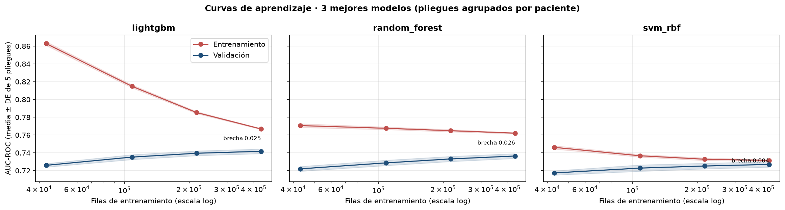

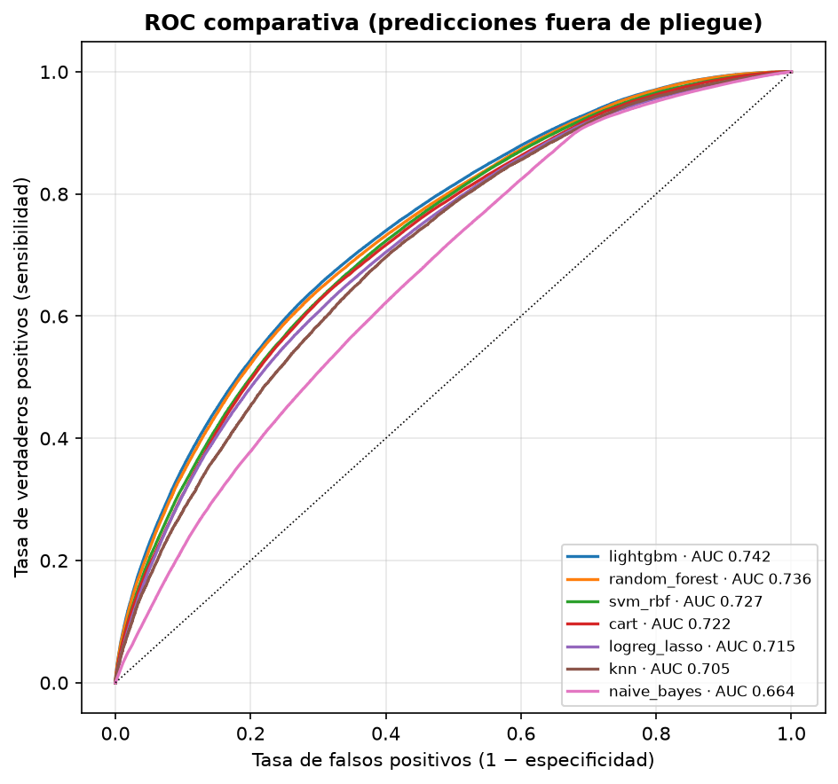

**Código fuente · `modulo_6/m6_4_diagnostico/`**


```python
# Archivo: modulo_6/m6_4_diagnostico/auditoria_brecha.py
"""Auditoría de la brecha de sobreajuste (6.4).

1. **KNN y el AUC de entrenamiento "por resustitución".** Con `weights="distance"`, al predecir
   sobre su propio entrenamiento cada punto se encuentra a sí mismo a distancia 0 y recibe peso
   infinito: el modelo "devuelve" su propia etiqueta y el AUC de entrenamiento sale ≈ 1. Eso no
   mide memorización útil sino un artefacto del procedimiento. La buena práctica en modelos
   basados en instancias es el **AUC de entrenamiento leave-one-out**: cada punto se predice con
   sus vecinos **excluyéndose a sí mismo** (`kneighbors()` sin `X`). Esa es la cifra comparable con
   la validación.
2. **Random Forest y la regularización.** Los árboles profundos sí se ajustan de más a su
   entrenamiento (brecha real). Se explora una ruta de regularización (más profundidad limitada,
   hojas más grandes) y se elige la configuración con **mayor AUC de validación entre las que
   cumplen brecha ≤ 0,05**. La exploración usa los mismos pliegues aislados por paciente; la
   prueba temporal no participa.
"""
from __future__ import annotations

import warnings

import numpy as np
import pandas as pd
from sklearn.base import clone
from sklearn.metrics import roc_auc_score

from modulo_6.m6_4_diagnostico.diagnostico import CacheDiagnostico, puntaje


def proba_knn_sin_si_mismo(knn, n_vecinos: int | None = None) -> np.ndarray:
    """P(y=1) de cada punto de entrenamiento usando sus k vecinos **sin incluirse a sí mismo**.

    Reproduce la ponderación de scikit-learn (`uniform` o `distance`; con distancia 0 frente a
    otro punto duplicado, ese vecino recibe todo el peso, igual que en scikit-learn).
    """
    k = n_vecinos or knn.n_neighbors
    dist, ind = knn.kneighbors(n_neighbors=k)  # X=None → excluye al propio punto
    y_fit = np.asarray(knn._y)
    clase_pos = int(np.flatnonzero(knn.classes_ == 1)[0]) if 1 in knn.classes_ else len(knn.classes_) - 1
    es_pos = (y_fit[ind] == clase_pos).astype(float)
    if knn.weights == "distance":
        with np.errstate(divide="ignore"):
            w = 1.0 / dist
        ceros = np.isinf(w)
        filas_cero = ceros.any(axis=1)
        w[filas_cero] = ceros[filas_cero].astype(float)
    else:
        w = np.ones_like(dist)
    return (w * es_pos).sum(axis=1) / w.sum(axis=1)


def proba_knn_sin_mismo_paciente(knn, grupos, n_vecinos: int | None = None,
                                 extra_max: int = 500) -> tuple[np.ndarray, int]:
    """P(y=1) de cada punto de entrenamiento con sus k vecinos **de otros pacientes** (leave-one-patient-out).

    Un paciente aporta varias filas casi idénticas (snapshots τ = 0/2/6 h, episodios repetidos) con la
    misma etiqueta. Excluir solo la propia fila deja a sus "gemelos" como vecinos más cercanos, y el AUC
    de entrenamiento sigue inflado. Esto replica la condición de la validación, donde ningún paciente
    del pliegue de validación está en entrenamiento. Devuelve (probabilidades, nº de filas con menos de
    k vecinos válidos, que solo ocurre si un paciente tiene más de `extra_max` + 1 filas).
    """
    k = n_vecinos or knn.n_neighbors
    grupos = np.asarray(grupos)
    _, cnt = np.unique(grupos, return_counts=True)
    kk = int(min(k + min(cnt.max() - 1, extra_max), len(grupos) - 1))
    dist, ind = knn.kneighbors(n_neighbors=kk)  # X=None → excluye la propia fila
    validos = grupos[ind] != grupos[:, None]
    usar = validos & (np.cumsum(validos, axis=1) <= k)
    y_fit = np.asarray(knn._y)
    clase_pos = int(np.flatnonzero(knn.classes_ == 1)[0]) if 1 in knn.classes_ else len(knn.classes_) - 1
    es_pos = (y_fit[ind] == clase_pos).astype(float)
    if knn.weights == "distance":
        with np.errstate(divide="ignore"):
            w = np.where(usar, 1.0 / dist, 0.0)
        ceros = usar & (dist == 0)
        filas_cero = ceros.any(axis=1)
        w[filas_cero] = ceros[filas_cero].astype(float)
    else:
        w = usar.astype(float)
    return (w * es_pos).sum(axis=1) / w.sum(axis=1), int((usar.sum(axis=1) < k).sum())


def auditar_knn_por_paciente(pipe_knn, cache: CacheDiagnostico) -> pd.DataFrame:
    """Por pliegue: AUC de entrenamiento leave-one-patient-out (cifra comparable con la validación agrupada)."""
    filas = []
    for k, p in enumerate(cache.pliegues, 1):
        m = clone(pipe_knn.named_steps["modelo"]).fit(p.Z_tr, p.y_tr)
        proba, n_incompletas = proba_knn_sin_mismo_paciente(m, p.g_tr)
        filas.append({"pliegue": k, "train_auc_lopo": roc_auc_score(p.y_tr, proba),
                      "filas_con_menos_de_k_vecinos": n_incompletas})
    return pd.DataFrame(filas)


def auditar_knn(pipe_knn, cache: CacheDiagnostico, resustitucion_previa: pd.DataFrame | None = None) -> pd.DataFrame:
    """Por pliegue: AUC train por resustitución (con el propio punto), AUC train leave-one-out y AUC val.

    `resustitucion_previa` (columnas `pliegue`, `train_auc`, `val_auc` de la corrida de la 6.4 con los
    mismos pliegues) evita recalcular las dos predicciones más caras; solo se calcula el leave-one-out.
    """
    filas = []
    for k, p in enumerate(cache.pliegues, 1):
        m = clone(pipe_knn.named_steps["modelo"])
        m.fit(p.Z_tr, p.y_tr)
        if resustitucion_previa is not None:
            prev = resustitucion_previa.set_index("pliegue").loc[k]
            tr_res, va = float(prev.train_auc), float(prev.val_auc)
        else:
            tr_res = roc_auc_score(p.y_tr, m.predict_proba(p.Z_tr)[:, 1])
            va = roc_auc_score(p.y_va, m.predict_proba(p.Z_va)[:, 1])
        filas.append({
            "pliegue": k,
            "train_auc_resustitucion": tr_res,
            "train_auc_loo": roc_auc_score(p.y_tr, proba_knn_sin_si_mismo(m)),
            "val_auc": va,
        })
    df = pd.DataFrame(filas)
    df["brecha_resustitucion"] = df.train_auc_resustitucion - df.val_auc
    df["brecha_loo"] = df.train_auc_loo - df.val_auc
    return df


def ruta_regularizacion(nombre: str, pipe, cache: CacheDiagnostico, configuraciones: list[dict]) -> pd.DataFrame:
    """AUC train/val medios (5 pliegues) para cada configuración de hiperparámetros del modelo."""
    filas = []
    for i, cfg in enumerate(configuraciones):
        base = clone(pipe.named_steps["modelo"]).set_params(**cfg)
        tr, va = [], []
        for p in cache.pliegues:
            m = clone(base)
            with warnings.catch_warnings():
                warnings.simplefilter("ignore")
                m.fit(p.Z_tr, p.y_tr)
                tr.append(roc_auc_score(p.y_tr, puntaje(m, nombre, p.Z_tr)))
                va.append(roc_auc_score(p.y_va, puntaje(m, nombre, p.Z_va)))
        filas.append({"config": i, **cfg, "train_auc": float(np.mean(tr)), "val_auc": float(np.mean(va)),
                      "val_auc_std": float(np.std(va, ddof=1)), "brecha": float(np.mean(tr) - np.mean(va))})
    return pd.DataFrame(filas)


def elegir_con_brecha(ruta: pd.DataFrame, umbral: float = 0.05) -> pd.Series:
    """Mayor AUC de validación entre las configuraciones con brecha ≤ umbral."""
    ok = ruta[ruta.brecha <= umbral]
    if ok.empty:
        raise ValueError(f"Ninguna configuración cumple brecha ≤ {umbral}: ampliar la ruta de regularización")
    return ok.sort_values("val_auc", ascending=False).iloc[0]

```


```python
# Archivo: modulo_6/m6_4_diagnostico/diagnostico.py
"""Subfase 6.4 · Diagnóstico de sobreajuste, curvas de aprendizaje y empaquetado (.joblib).

1. **Brecha de generalización.** Para cada modelo optimizado (6.3) se reentrena el Pipeline en
   los 5 pliegues de la 6.1, ahora con **todo** el entrenamiento estable (la búsqueda usó el
   20 % de los pacientes). En cada pliegue se mide el AUC-ROC sobre el entrenamiento del pliegue
   y sobre su validación; la brecha es `train_auc − val_auc` (media de los 5 pliegues). Una
   brecha > 0,05 se advierte explícitamente: indica memorización del entrenamiento.
   Ojo: en ensambles de árboles una brecha alta es habitual (cada árbol ve sus datos) y no
   implica peor validación. Lo que decide es el AUC de validación; la brecha es un diagnóstico.
2. **Predicciones fuera de pliegue (OOF).** Las predicciones de validación de los 5 pliegues
   cubren cada fila del entrenamiento una sola vez. Con ellas se dibuja la ROC comparativa y se
   alimenta M7 (calibración y pruebas de hipótesis pareadas sobre los mismos pacientes).
3. **Curvas de aprendizaje.** Para los 3 mejores modelos: AUC de entrenamiento y validación
   con 10 %, 25 %, 50 % y 100 % del entrenamiento de cada pliegue. El submuestreo se hace por
   pacientes completos, y la validación siempre es el pliegue completo.
4. **Empaquetado.** Pipeline final (preprocesador + modelo) ajustado con todo el entrenamiento,
   serializado en `models/<modelo>_pipeline.joblib`.

Detalles anti-fuga
------------------
- El preprocesador del M5 se ajusta una vez por pliegue, solo con el entrenamiento del pliegue
  (`CacheDiagnostico`, mismo principio que la caché de la 6.3). Así es idéntico al Pipeline.
- En la curva de aprendizaje el preprocesador se ajusta con todo el entrenamiento del pliegue
  y el modelo con la fracción. Es pasado del mismo pliegue: no hay fuga hacia la validación.
  Rehacer la SVD para cada fracción multiplicaría el costo sin cambiar la lectura de la curva.
- La prueba temporal (`es_entrenamiento = False`) no se usa en ningún paso de la 6.4.
"""
from __future__ import annotations

import json
import time
import warnings
from dataclasses import dataclass, field
from pathlib import Path

import numpy as np
import pandas as pd
from sklearn.base import clone
from sklearn.metrics import roc_auc_score, roc_curve
from sklearn.pipeline import Pipeline

from modulo_6.m6_2_bateria_modelos import SALIDA_PUNTAJE, get_pipeline_and_space
from modulo_6.m6_3_optuna import FAMILIAS

UMBRAL_BRECHA = 0.05
FRACCIONES = (0.10, 0.25, 0.50, 1.00)
SEMILLA = 42


class AdvertenciaSobreajuste(UserWarning):
    """Brecha train − val del AUC-ROC por encima del umbral."""


# --------------------------------------------------------------------------------------
# Carga de los mejores hiperparámetros
# --------------------------------------------------------------------------------------
def cargar_mejores(ruta_json: Path, modelos: list[str] | None = None, por_familia: bool = True) -> dict[str, dict]:
    """Lee `best_hyperparameters.json` (6.3).

    Con `por_familia=True` devuelve el mejor modelo de cada una de las 7 familias del prompt.
    """
    datos = json.loads(Path(ruta_json).read_text(encoding="utf-8"))["modelos"]
    if modelos is None and por_familia:
        modelos = []
        for miembros in FAMILIAS.values():
            presentes = [m for m in miembros if m in datos]
            if presentes:
                modelos.append(max(presentes, key=lambda m: datos[m]["mejor_auc_cv"]))
    modelos = modelos or list(datos)
    return {m: datos[m] for m in modelos}


def instanciar(nombre: str, hiperparametros: dict, preprocesador) -> Pipeline:
    """Pipeline optimizado sin entrenar (preprocesador del M5 + modelo con los hiperparámetros ganadores)."""
    pipe, _ = get_pipeline_and_space(nombre, preprocesador)
    return pipe.set_params(**hiperparametros)


def puntaje(modelo, nombre: str, Z) -> np.ndarray:
    return modelo.decision_function(Z) if SALIDA_PUNTAJE[nombre] == "decision_function" else modelo.predict_proba(Z)[:, 1]


# --------------------------------------------------------------------------------------
# Caché de pliegues
# --------------------------------------------------------------------------------------
@dataclass
class _Pliegue:
    Z_tr: np.ndarray
    y_tr: np.ndarray
    g_tr: np.ndarray
    Z_va: np.ndarray
    y_va: np.ndarray
    i_va: np.ndarray


@dataclass
class CacheDiagnostico:
    """Preprocesador ajustado por pliegue (solo con su entrenamiento) + índices de validación para el OOF."""

    pliegues: list[_Pliegue] = field(default_factory=list)
    n: int = 0

    @classmethod
    def construir(cls, preprocesador, X: pd.DataFrame, y, groups, cv, dtype=np.float32) -> "CacheDiagnostico":
        y, g = np.asarray(y), np.asarray(groups)
        c = cls(n=len(X))
        for i_tr, i_va in cv.split(X, y, groups=g):
            if set(g[i_tr]) & set(g[i_va]):
                raise ValueError("Un person_id está en entrenamiento y validación del mismo pliegue")
            pre = clone(preprocesador).fit(X.iloc[i_tr], y[i_tr])
            c.pliegues.append(_Pliegue(pre.transform(X.iloc[i_tr]).astype(dtype), y[i_tr], g[i_tr],
                                       pre.transform(X.iloc[i_va]).astype(dtype), y[i_va], np.asarray(i_va)))
        return c


# --------------------------------------------------------------------------------------
# Diagnóstico de brecha + OOF
# --------------------------------------------------------------------------------------
def diagnosticar(nombre: str, pipe: Pipeline, cache: CacheDiagnostico) -> dict:
    """AUC de entrenamiento y validación por pliegue, brecha y predicciones OOF."""
    modelo_base = pipe.named_steps["modelo"]
    oof = np.full(cache.n, np.nan)
    filas = []
    t0 = time.time()
    for k, p in enumerate(cache.pliegues, 1):
        m = clone(modelo_base)
        with warnings.catch_warnings():
            warnings.simplefilter("ignore")
            m.fit(p.Z_tr, p.y_tr)
            s_tr, s_va = puntaje(m, nombre, p.Z_tr), puntaje(m, nombre, p.Z_va)
        oof[p.i_va] = s_va
        filas.append({"pliegue": k, "train_auc": roc_auc_score(p.y_tr, s_tr), "val_auc": roc_auc_score(p.y_va, s_va)})
    df = pd.DataFrame(filas)
    df["brecha"] = df.train_auc - df.val_auc
    return {"modelo": nombre, "por_pliegue": df, "oof": oof, "segundos_cv": time.time() - t0,
            "train_auc": df.train_auc.mean(), "val_auc": df.val_auc.mean(), "val_auc_std": df.val_auc.std(ddof=1),
            "brecha": df.brecha.mean()}


def advertir_brechas(resumen: pd.DataFrame, umbral: float = UMBRAL_BRECHA) -> list[str]:
    """Advertencia explícita en consola (y `warnings`) por cada modelo con brecha > umbral."""
    sobre = resumen[resumen.brecha > umbral]
    for r in sobre.itertuples():
        msg = (f"⚠️  SOBREAJUSTE · {r.modelo}: train_auc {r.train_auc:.4f} − val_auc {r.val_auc:.4f} = "
               f"brecha {r.brecha:.4f} > {umbral}")
        print(msg, flush=True)
        warnings.warn(msg, AdvertenciaSobreajuste, stacklevel=2)
    return sobre.modelo.tolist()


# --------------------------------------------------------------------------------------
# Curva de aprendizaje
# --------------------------------------------------------------------------------------
def curva_aprendizaje(nombre: str, pipe: Pipeline, cache: CacheDiagnostico, fracciones=FRACCIONES,
                      diagnostico: dict | None = None, semilla: int = SEMILLA) -> pd.DataFrame:
    """AUC train/val por fracción del entrenamiento (submuestreo por pacientes completos) y pliegue.

    Si se pasa el `diagnostico` del mismo modelo, la fracción 1,0 reutiliza esos ajustes.
    """
    modelo_base = pipe.named_steps["modelo"]
    rng = np.random.default_rng(semilla)
    filas = []
    for k, p in enumerate(cache.pliegues, 1):
        personas = np.unique(p.g_tr)
        orden = rng.permutation(personas)
        for f in fracciones:
            if f >= 1 and diagnostico is not None:
                r = diagnostico["por_pliegue"].iloc[k - 1]
                filas.append({"modelo": nombre, "fraccion": 1.0, "pliegue": k, "n_train": len(p.y_tr),
                              "train_auc": r.train_auc, "val_auc": r.val_auc})
                continue
            elegidas = set(orden[: max(1, int(round(f * len(personas))))])
            mask = np.fromiter((g in elegidas for g in p.g_tr), bool, len(p.g_tr))
            m = clone(modelo_base)
            with warnings.catch_warnings():
                warnings.simplefilter("ignore")
                m.fit(p.Z_tr[mask], p.y_tr[mask])
                filas.append({"modelo": nombre, "fraccion": f, "pliegue": k, "n_train": int(mask.sum()),
                              "train_auc": roc_auc_score(p.y_tr[mask], puntaje(m, nombre, p.Z_tr[mask])),
                              "val_auc": roc_auc_score(p.y_va, puntaje(m, nombre, p.Z_va))})
    return pd.DataFrame(filas)


# --------------------------------------------------------------------------------------
# Ajuste final y empaquetado
# --------------------------------------------------------------------------------------
def ajustar_final(nombre: str, pipe: Pipeline, preprocesador_ajustado, Z, y) -> Pipeline:
    """Pipeline final: preprocesador ya ajustado con todo el entrenamiento + modelo ajustado sobre su salida.

    Es equivalente a `pipe.fit(X, y)`, pero el preprocesador se ajusta una sola vez para los 7 modelos.
    """
    m = clone(pipe.named_steps["modelo"])
    with warnings.catch_warnings():
        warnings.simplefilter("ignore")
        m.fit(Z, y)
    return Pipeline([("preprocesador", preprocesador_ajustado), ("modelo", m)])


# --------------------------------------------------------------------------------------
# Gráficos
# --------------------------------------------------------------------------------------
def graficar_curvas_aprendizaje(curvas: pd.DataFrame, ruta: Path) -> None:
    import matplotlib
    matplotlib.use("Agg")
    import matplotlib.pyplot as plt

    modelos = list(dict.fromkeys(curvas.modelo))
    fig, axes = plt.subplots(1, len(modelos), figsize=(5.2 * len(modelos), 4.2), sharey=True, squeeze=False)
    for ax, m in zip(axes[0], modelos):
        d = curvas[curvas.modelo == m].groupby("fraccion").agg(
            n=("n_train", "mean"), tr=("train_auc", "mean"), tr_sd=("train_auc", "std"),
            va=("val_auc", "mean"), va_sd=("val_auc", "std")).reset_index()
        for col, sd, color, etq in (("tr", "tr_sd", "#c0504d", "Entrenamiento"), ("va", "va_sd", "#1f4e79", "Validación")):
            ax.plot(d.n, d[col], "-o", color=color, label=etq)
            ax.fill_between(d.n, d[col] - d[sd].fillna(0), d[col] + d[sd].fillna(0), color=color, alpha=0.15)
        ax.set_xscale("log")
        ax.set_title(m, fontweight="bold")
        ax.set_xlabel("Filas de entrenamiento (escala log)")
        ax.grid(alpha=0.3)
        final = d.iloc[-1]
        ax.annotate(f"brecha {final.tr - final.va:.3f}", (final.n, (final.tr + final.va) / 2), fontsize=8,
                    ha="right")
    axes[0][0].set_ylabel("AUC-ROC (media ± DE de 5 pliegues)")
    axes[0][0].legend()
    fig.suptitle("Curvas de aprendizaje · 3 mejores modelos (pliegues agrupados por paciente)", fontweight="bold")
    fig.tight_layout()
    fig.savefig(ruta, dpi=150, bbox_inches="tight")
    plt.close(fig)


def graficar_roc(y, oofs: dict[str, np.ndarray], ruta: Path) -> pd.DataFrame:
    """ROC comparativa con las predicciones OOF de todos los modelos."""
    import matplotlib
    matplotlib.use("Agg")
    import matplotlib.pyplot as plt

    fig, ax = plt.subplots(figsize=(6.4, 6))
    filas = []
    for nombre, s in sorted(oofs.items(), key=lambda kv: -roc_auc_score(y[~np.isnan(kv[1])], kv[1][~np.isnan(kv[1])])):
        ok = ~np.isnan(s)
        fpr, tpr, _ = roc_curve(y[ok], s[ok])
        auc = roc_auc_score(y[ok], s[ok])
        filas.append({"modelo": nombre, "auc_oof": auc, "n": int(ok.sum())})
        ax.plot(fpr, tpr, lw=1.6, label=f"{nombre} · AUC {auc:.3f}")
    ax.plot([0, 1], [0, 1], "k:", lw=0.8)
    ax.set_xlabel("Tasa de falsos positivos (1 − especificidad)")
    ax.set_ylabel("Tasa de verdaderos positivos (sensibilidad)")
    ax.set_title("ROC comparativa (predicciones fuera de pliegue)", fontweight="bold")
    ax.legend(fontsize=8, loc="lower right")
    ax.grid(alpha=0.3)
    fig.tight_layout()
    fig.savefig(ruta, dpi=150, bbox_inches="tight")
    plt.close(fig)
    return pd.DataFrame(filas)

```

**Ejecución sobre los datos reales**


```python
# Archivo: modulo_6/m6_4_diagnostico/run_auditoria_knn_paciente.py
"""Auditoría de KNN, parte 2: AUC de entrenamiento leave-one-patient-out (se corre después de run_auditoria_m6_4.py).

El LOO por fila (0,762) seguía 0,057 por encima de la validación: el 99 % de las filas comparte paciente con
otras filas casi idénticas (snapshots τ = 0/2/6 h) y con la misma etiqueta. La validación agrupada nunca ve
al mismo paciente, así que el AUC de entrenamiento comparable debe excluir **al paciente completo**.

Si aun así la brecha supera 0,05, regulariza KNN (más vecinos y pesos uniformes), elige la mejor validación
con brecha ≤ 0,05, lo reempaqueta y actualiza el benchmark, el manifiesto, el OOF y la ROC.

Uso (desde la raíz del proyecto):
    python modulo_6/m6_4_diagnostico/run_auditoria_knn_paciente.py
"""
from __future__ import annotations

import json
import sys
import time
import warnings
from datetime import datetime
from pathlib import Path

import joblib
import numpy as np
import pandas as pd
from sklearn.base import clone
from sklearn.metrics import roc_auc_score

if hasattr(sys.stdout, "reconfigure"):
    sys.stdout.reconfigure(encoding="utf-8")

ROOT = Path(__file__).resolve().parents[2]
sys.path.insert(0, str(ROOT))

from modulo_5.m5_4_pipeline import construir_preprocesador, preparar_X  # noqa: E402
from modulo_6.m6_1_cv_agrupada import PlieguesPredefinidos  # noqa: E402
from modulo_6.m6_4_diagnostico import UMBRAL_BRECHA, CacheDiagnostico, ajustar_final, cargar_mejores, graficar_roc, instanciar  # noqa: E402
from modulo_6.m6_4_diagnostico.auditoria_brecha import proba_knn_sin_mismo_paciente  # noqa: E402

TARGET = "y_target_los_largo"
# Ruta de regularización de KNN si la brecha LOPO supera el umbral (de menos a más suavizado).
RUTA_KNN = [{"weights": "uniform"}, {"n_neighbors": 300, "weights": "uniform"}, {"n_neighbors": 500, "weights": "uniform"}]


def log(msg):
    print(f"[{datetime.now():%H:%M:%S}] {msg}", flush=True)


def evaluar(modelo, cache):
    """AUC train (leave-one-patient-out) y val por pliegue, más el OOF de validación."""
    filas, oof = [], {}
    for k, p in enumerate(cache.pliegues, 1):
        m = clone(modelo).fit(p.Z_tr, p.y_tr)
        proba, inc = proba_knn_sin_mismo_paciente(m, p.g_tr)
        s_va = m.predict_proba(p.Z_va)[:, 1]
        oof[k] = (p.i_va, s_va)
        filas.append({"pliegue": k, "train_auc_lopo": roc_auc_score(p.y_tr, proba),
                      "val_auc": roc_auc_score(p.y_va, s_va), "filas_con_menos_de_k_vecinos": inc})
    df = pd.DataFrame(filas)
    df["brecha_lopo"] = df.train_auc_lopo - df.val_auc
    return df, oof


def main() -> None:
    warnings.filterwarnings("ignore")
    log("Cargando datos")
    X, esquema = preparar_X(ROOT)
    tr = X[X.en_periodo_estable.astype(bool) & X.es_entrenamiento.astype(bool)].reset_index(drop=True)
    tr["pliegue"] = pd.read_parquet(ROOT / "data" / "m6" / "pliegues_m6_1.parquet").pliegue.to_numpy()
    cols = esquema.todas()
    pre = construir_preprocesador(esquema)
    mejores = cargar_mejores(ROOT / "outputs" / "m6" / "best_hyperparameters.json")
    hp = dict(mejores["knn"]["hiperparametros"])
    tab = ROOT / "outputs" / "m6" / "tablas"

    personas = tr.person_id.drop_duplicates().sample(frac=0.2, random_state=42)  # misma submuestra que la 6.3/6.4
    sub = tr[tr.person_id.isin(personas)].reset_index(drop=True)
    cache = CacheDiagnostico.construir(pre, sub[cols], sub[TARGET].to_numpy(), sub.person_id.to_numpy(),
                                       PlieguesPredefinidos(sub.pliegue))
    log(f"Submuestra 20 %: {len(sub):,} filas")

    t0 = time.time()
    base = instanciar("knn", hp, pre).named_steps["modelo"]
    df, _ = evaluar(base, cache)
    aud = pd.read_csv(tab / "m6_4_auditoria_knn.csv").drop(columns=["train_auc_lopo", "brecha_lopo",
                                                                     "filas_con_menos_de_k_vecinos"], errors="ignore")
    aud = aud.merge(df[["pliegue", "train_auc_lopo", "brecha_lopo", "filas_con_menos_de_k_vecinos"]], on="pliegue")
    aud.to_csv(tab / "m6_4_auditoria_knn.csv", index=False)
    log(f"KNN de la 6.3 ({(time.time() - t0) / 60:.1f} min): train LOPO {df.train_auc_lopo.mean():.4f} · "
        f"val {df.val_auc.mean():.4f} · brecha LOPO {df.brecha_lopo.mean():+.4f} "
        f"(filas con < k vecinos: {df.filas_con_menos_de_k_vecinos.sum()})")

    hp_final, d_final, ruta = hp, df, [{"config": "6.3", **{k.replace('modelo__', ''): v for k, v in hp.items()},
                                         "train_auc_lopo": df.train_auc_lopo.mean(), "val_auc": df.val_auc.mean(),
                                         "brecha_lopo": df.brecha_lopo.mean()}]
    oof_final = None
    if df.brecha_lopo.mean() > UMBRAL_BRECHA:
        log("Brecha LOPO > 0,05: ruta de regularización de KNN")
        mejor = None
        for i, cfg in enumerate(RUTA_KNN, 1):
            t0 = time.time()
            d, oof = evaluar(clone(base).set_params(**cfg), cache)
            fila = {"config": f"r{i}", **{**{k.replace('modelo__', ''): v for k, v in hp.items()}, **cfg},
                    "train_auc_lopo": d.train_auc_lopo.mean(), "val_auc": d.val_auc.mean(), "brecha_lopo": d.brecha_lopo.mean()}
            ruta.append(fila)
            log(f"  {cfg} ({(time.time() - t0) / 60:.1f} min): train LOPO {fila['train_auc_lopo']:.4f} · "
                f"val {fila['val_auc']:.4f} · brecha {fila['brecha_lopo']:+.4f}")
            if fila["brecha_lopo"] <= UMBRAL_BRECHA and (mejor is None or fila["val_auc"] > mejor[0]["val_auc"]):
                mejor = (fila, cfg, d, oof)
        if mejor is None:
            raise SystemExit("Ninguna configuración de KNN cumple brecha ≤ 0,05: ampliar RUTA_KNN")
        _, cfg, d_final, oof_final = mejor
        hp_final = {**hp, **{f"modelo__{k}": v for k, v in cfg.items()}}
    pd.DataFrame(ruta).to_csv(tab / "m6_4_ruta_regularizacion_knn.csv", index=False)

    # -------- actualización de artefactos
    bench_p = ROOT / "outputs" / "m6" / "model_benchmark_summary.csv"
    bench = pd.read_csv(bench_p)
    j = bench.index[bench.modelo == "knn"][0]
    bench.loc[j, "train_auc"] = d_final.train_auc_lopo.mean()
    bench.loc[j, "val_auc"] = d_final.val_auc.mean()
    bench.loc[j, "val_auc_std"] = d_final.val_auc.std(ddof=1)
    bench.loc[j, "brecha_train_val"] = d_final.brecha_lopo.mean()
    bench.loc[j, "metodo_train_auc"] = "leave-one-patient-out (excluye todas las filas del mismo paciente)"
    man_p = ROOT / "models" / "manifest.json"
    man = json.loads(man_p.read_text(encoding="utf-8"))

    if oof_final is not None:  # KNN regularizado: reempaquetar, OOF y ROC
        log("Reempaquetando KNN regularizado")
        oof_p = ROOT / "data" / "m6" / "oof_m6_4.parquet"
        oof = pd.read_parquet(oof_p)
        y_full = tr[TARGET].to_numpy()
        s = np.full(len(tr), np.nan)
        idx_sub = np.flatnonzero(tr.person_id.isin(personas).to_numpy())  # filas de la submuestra en orden
        for i_va, s_va in oof_final.values():
            s[idx_sub[i_va]] = s_va
        oof["oof_knn"] = s
        oof.to_parquet(oof_p, index=False)
        ok = ~np.isnan(s)
        estr = (tr.servicio + "_t" + tr.horas_desde_ingreso.astype(str)).to_numpy()
        dfe = pd.DataFrame({"y": y_full[ok], "s": s[ok], "e": estr[ok]})
        bench.loc[j, "auc_oof"] = roc_auc_score(dfe.y, dfe.s)
        bench.loc[j, "auc_oof_servicio_tau"] = float(np.mean([roc_auc_score(g.y, g.s) for _, g in dfe.groupby("e")
                                                              if g.y.nunique() == 2]))
        pre_sub = clone(pre).fit(sub[cols], sub[TARGET].to_numpy())
        final = ajustar_final("knn", instanciar("knn", hp_final, pre), pre_sub,
                              pre_sub.transform(sub[cols]).astype(np.float32), sub[TARGET].to_numpy())
        ruta_m = ROOT / "models" / "knn_pipeline.joblib"
        joblib.dump(final, ruta_m, compress=3)
        joblib.load(ruta_m).predict(sub[cols].iloc[:5])
        bench.loc[j, "mb"] = round(ruta_m.stat().st_size / 1e6, 1)
        bench.loc[j, "hiperparametros"] = json.dumps(hp_final, default=str)
        man["modelos"]["knn"]["hiperparametros"] = hp_final
        graficar_roc(y_full, {c.replace("oof_", ""): oof[c].to_numpy() for c in oof.columns if c.startswith("oof_")},
                     ROOT / "outputs" / "m6" / "figuras" / "m6_4_roc_comparativa.png")
        fin_p = ROOT / "outputs" / "m6" / "hiperparametros_finales.json"
        fin = json.loads(fin_p.read_text(encoding="utf-8"))
        fin["modelos"]["knn"] = hp_final
        fin["nota"] = ("Hiperparámetros de la 6.3, salvo random_forest y knn regularizados en la auditoría de la 6.4 "
                       "(brecha ≤ 0,05)")
        fin_p.write_text(json.dumps(fin, ensure_ascii=False, indent=2, default=str), encoding="utf-8")

    bench["sobreajuste_gt_005"] = bench.brecha_train_val > UMBRAL_BRECHA
    bench = bench.sort_values("val_auc", ascending=False)
    bench.to_csv(bench_p, index=False)
    for _, r in bench.iterrows():
        if r.modelo in man["modelos"]:
            for k in ("train_auc", "val_auc", "val_auc_std", "brecha_train_val", "sobreajuste_gt_005", "auc_oof",
                      "auc_oof_servicio_tau", "mb", "metodo_train_auc"):
                v = r[k]
                man["modelos"][r.modelo][k] = v.item() if hasattr(v, "item") else v
    man.setdefault("auditoria_brecha", {})["knn"] = (
        "AUC de entrenamiento leave-one-patient-out (el de resustitución ≈ 1 es un artefacto de weights='distance' y el "
        "LOO por fila sigue inflado por las filas gemelas del mismo paciente)"
        + ("; regularizado: " + json.dumps({k: v for k, v in hp_final.items() if k not in hp or hp[k] != v})
           if oof_final is not None else ""))
    man_p.write_text(json.dumps(man, ensure_ascii=False, indent=2, default=str), encoding="utf-8")

    print("\nResumen auditado (model_benchmark_summary.csv):")
    print(bench[["modelo", "train_auc", "val_auc", "brecha_train_val", "sobreajuste_gt_005", "auc_oof",
                 "metodo_train_auc"]].round(4).to_string(index=False))
    log("Listo")


if __name__ == "__main__":
    main()

```


```python
# Archivo: modulo_6/m6_4_diagnostico/run_auditoria_m6_4.py
"""Auditoría de la brecha de sobreajuste de la 6.4 sobre los datos reales (se corre después de run_m6_4.py).

1. KNN: AUC de entrenamiento por resustitución vs leave-one-out (excluyendo el propio punto).
2. Random Forest: ruta de regularización en la submuestra del 20 % de pacientes (misma de la 6.3/6.4),
   elección de la mejor validación con brecha ≤ 0,05, confirmación con todo el entrenamiento y
   reempaquetado de `models/random_forest_pipeline.joblib`.
3. Actualiza `model_benchmark_summary.csv`, `models/manifest.json`, el OOF, la curva de aprendizaje,
   la ROC, y escribe `outputs/m6/hiperparametros_finales.json` (los de la 6.3 salvo el RF regularizado).

Uso (desde la raíz del proyecto):
    python modulo_6/m6_4_diagnostico/run_auditoria_m6_4.py
"""
from __future__ import annotations

import json
import sys
import time
import warnings
from datetime import datetime
from pathlib import Path

import joblib
import numpy as np
import pandas as pd
from sklearn.base import clone
from sklearn.metrics import roc_auc_score

if hasattr(sys.stdout, "reconfigure"):
    sys.stdout.reconfigure(encoding="utf-8")

ROOT = Path(__file__).resolve().parents[2]
sys.path.insert(0, str(ROOT))

from modulo_5.m5_4_pipeline import construir_preprocesador, preparar_X  # noqa: E402
from modulo_6.m6_1_cv_agrupada import PlieguesPredefinidos  # noqa: E402
from modulo_6.m6_4_diagnostico import (  # noqa: E402
    UMBRAL_BRECHA,
    CacheDiagnostico,
    ajustar_final,
    cargar_mejores,
    curva_aprendizaje,
    diagnosticar,
    graficar_curvas_aprendizaje,
    graficar_roc,
    instanciar,
)
from modulo_6.m6_4_diagnostico.auditoria_brecha import auditar_knn, elegir_con_brecha, ruta_regularizacion  # noqa: E402

TARGET = "y_target_los_largo"
# Ruta de regularización del RF: de la configuración de la 6.3 (max_depth 20, hojas de 24) hacia árboles más simples.
RUTA_RF = [
    {"max_depth": 20, "min_samples_leaf": 24},
    {"max_depth": 16, "min_samples_leaf": 50},
    {"max_depth": 14, "min_samples_leaf": 100},
    {"max_depth": 12, "min_samples_leaf": 100},
    {"max_depth": 12, "min_samples_leaf": 200},
    {"max_depth": 10, "min_samples_leaf": 200},
    {"max_depth": 10, "min_samples_leaf": 400},
    {"max_depth": 8, "min_samples_leaf": 400},
]


def log(msg):
    print(f"[{datetime.now():%H:%M:%S}] {msg}", flush=True)


def auc_estratos(y, s, e):
    df = pd.DataFrame({"y": y, "s": s, "e": e}).dropna()
    return float(np.mean([roc_auc_score(d.y, d.s) for _, d in df.groupby("e") if d.y.nunique() == 2]))


def main() -> None:
    warnings.filterwarnings("ignore")
    log("Cargando datos")
    X, esquema = preparar_X(ROOT)
    tr = X[X.en_periodo_estable.astype(bool) & X.es_entrenamiento.astype(bool)].reset_index(drop=True)
    tr["pliegue"] = pd.read_parquet(ROOT / "data" / "m6" / "pliegues_m6_1.parquet").pliegue.to_numpy()
    cols = esquema.todas()
    y, g = tr[TARGET].to_numpy(), tr.person_id.to_numpy()
    estratos = (tr.servicio + "_t" + tr.horas_desde_ingreso.astype(str)).to_numpy()
    pre = construir_preprocesador(esquema)
    mejores = cargar_mejores(ROOT / "outputs" / "m6" / "best_hyperparameters.json")
    tab, fig = ROOT / "outputs" / "m6" / "tablas", ROOT / "outputs" / "m6" / "figuras"

    # Misma submuestra del 20 % de pacientes que run_m6_4 (KNN) y que la búsqueda de la 6.3.
    personas = tr.person_id.drop_duplicates().sample(frac=0.2, random_state=42)
    sub = tr[tr.person_id.isin(personas)].reset_index(drop=True)
    cache_sub = CacheDiagnostico.construir(pre, sub[cols], sub[TARGET].to_numpy(), sub.person_id.to_numpy(),
                                           PlieguesPredefinidos(sub.pliegue))
    log(f"Submuestra 20 %: {len(sub):,} filas")

    # ---------------- 1. KNN
    t0 = time.time()
    previa = pd.read_csv(tab / "m6_4_brecha_por_pliegue.csv")
    previa = previa[previa.modelo == "knn"]  # misma submuestra y pliegues que run_m6_4 → se reutiliza
    knn = auditar_knn(instanciar("knn", mejores["knn"]["hiperparametros"], pre), cache_sub,
                      resustitucion_previa=previa if len(previa) == 5 else None)
    knn.to_csv(tab / "m6_4_auditoria_knn.csv", index=False)
    log(f"KNN ({(time.time() - t0) / 60:.1f} min): train resustitución {knn.train_auc_resustitucion.mean():.4f} · "
        f"train LOO {knn.train_auc_loo.mean():.4f} · val {knn.val_auc.mean():.4f} · "
        f"brecha LOO {knn.brecha_loo.mean():+.4f} (resustitución {knn.brecha_resustitucion.mean():+.4f})")

    # ---------------- 2. RF: ruta de regularización (200 árboles para explorar; el nº de árboles no aumenta la brecha)
    t0 = time.time()
    hp_rf = dict(mejores["random_forest"]["hiperparametros"])
    pipe_rf = instanciar("random_forest", hp_rf, pre)
    ruta = ruta_regularizacion("random_forest", pipe_rf, cache_sub, [{**c, "n_estimators": 200} for c in RUTA_RF])
    ruta.to_csv(tab / "m6_4_ruta_regularizacion_rf.csv", index=False)
    log(f"Ruta de regularización RF en submuestra ({(time.time() - t0) / 60:.1f} min):")
    print(ruta[["max_depth", "min_samples_leaf", "train_auc", "val_auc", "brecha"]].round(4).to_string(index=False),
          flush=True)

    log("Confirmación con todo el entrenamiento")
    cache_full = CacheDiagnostico.construir(pre, tr[cols], y, g, PlieguesPredefinidos(tr.pliegue))
    candidatas = ruta[ruta.brecha <= UMBRAL_BRECHA].sort_values("val_auc", ascending=False)
    if candidatas.empty:
        raise SystemExit("Ninguna configuración del RF cumple la brecha en la submuestra: ampliar RUTA_RF")
    elegida, d_rf = None, None
    for _, c in candidatas.iterrows():
        hp_try = {**hp_rf, "modelo__max_depth": int(c.max_depth), "modelo__min_samples_leaf": int(c.min_samples_leaf)}
        d = diagnosticar("random_forest", instanciar("random_forest", hp_try, pre), cache_full)
        log(f"  max_depth {int(c.max_depth)}, min_samples_leaf {int(c.min_samples_leaf)}: train {d['train_auc']:.4f} · "
            f"val {d['val_auc']:.4f} · brecha {d['brecha']:+.4f}")
        if d["brecha"] <= UMBRAL_BRECHA:
            elegida, d_rf, hp_rf_final = c, d, hp_try
            break
    if elegida is None:
        raise SystemExit("Con todos los datos ninguna candidata cumple la brecha")
    _ = elegir_con_brecha  # (regla documentada: mejor validación con brecha ≤ umbral)

    # ---------------- 3. Reempaquetado y actualización de artefactos
    log("Ajuste final del RF regularizado y reempaquetado")
    pre_full = clone(pre).fit(tr[cols], y)
    final = ajustar_final("random_forest", instanciar("random_forest", hp_rf_final, pre), pre_full,
                          pre_full.transform(tr[cols]).astype(np.float32), y)
    ruta_rf = ROOT / "models" / "random_forest_pipeline.joblib"
    joblib.dump(final, ruta_rf, compress=3)
    joblib.load(ruta_rf).predict(tr[cols].iloc[:5])

    oof = pd.read_parquet(ROOT / "data" / "m6" / "oof_m6_4.parquet")
    oof["oof_random_forest"] = d_rf["oof"]
    oof.to_parquet(ROOT / "data" / "m6" / "oof_m6_4.parquet", index=False)

    bench = pd.read_csv(ROOT / "outputs" / "m6" / "model_benchmark_summary.csv")
    bench["metodo_train_auc"] = "resustitución"
    i = bench.index[bench.modelo == "random_forest"][0]
    s = d_rf["oof"]
    bench.loc[i, ["train_auc", "val_auc", "val_auc_std", "brecha_train_val"]] = [d_rf["train_auc"], d_rf["val_auc"],
                                                                                 d_rf["val_auc_std"], d_rf["brecha"]]
    bench.loc[i, ["auc_oof", "auc_oof_servicio_tau"]] = [roc_auc_score(y, s), auc_estratos(y, s, estratos)]
    bench.loc[i, "hiperparametros"] = json.dumps(hp_rf_final, default=str)
    bench.loc[i, "mb"] = round(ruta_rf.stat().st_size / 1e6, 1)
    bench.loc[i, "metodo_train_auc"] = "resustitución (RF regularizado en la auditoría)"
    j = bench.index[bench.modelo == "knn"][0]
    bench.loc[j, "train_auc"] = knn.train_auc_loo.mean()
    bench.loc[j, "brecha_train_val"] = knn.brecha_loo.mean()
    bench.loc[j, "metodo_train_auc"] = "leave-one-out (excluye el propio punto)"
    bench["sobreajuste_gt_005"] = bench.brecha_train_val > UMBRAL_BRECHA
    bench = bench.sort_values("val_auc", ascending=False)
    bench.to_csv(ROOT / "outputs" / "m6" / "model_benchmark_summary.csv", index=False)

    man_p = ROOT / "models" / "manifest.json"
    man = json.loads(man_p.read_text(encoding="utf-8"))
    for _, r in bench.iterrows():
        if r.modelo in man["modelos"]:
            for k in ("train_auc", "val_auc", "val_auc_std", "brecha_train_val", "sobreajuste_gt_005", "auc_oof",
                      "auc_oof_servicio_tau", "mb", "metodo_train_auc"):
                v = r[k]
                man["modelos"][r.modelo][k] = v.item() if hasattr(v, "item") else v
    man["modelos"]["random_forest"]["hiperparametros"] = hp_rf_final
    man["auditoria_brecha"] = {
        "fecha": datetime.now().isoformat(timespec="seconds"),
        "knn": "AUC de entrenamiento medido leave-one-out; el de resustitución (≈1) es un artefacto de weights='distance'",
        "random_forest": f"regularizado: max_depth {int(elegida.max_depth)}, min_samples_leaf {int(elegida.min_samples_leaf)}",
    }
    man_p.write_text(json.dumps(man, ensure_ascii=False, indent=2, default=str), encoding="utf-8")

    finales = {m: info["hiperparametros"] for m, info in mejores.items()}
    finales["random_forest"] = hp_rf_final
    (ROOT / "outputs" / "m6" / "hiperparametros_finales.json").write_text(json.dumps(
        {"nota": "Hiperparámetros de la 6.3, salvo random_forest regularizado en la auditoría de la 6.4 (brecha ≤ 0,05)",
         "modelos": finales}, ensure_ascii=False, indent=2, default=str), encoding="utf-8")

    # Curva de aprendizaje y ROC con el RF regularizado
    curvas = pd.read_csv(tab / "m6_4_curvas_aprendizaje.csv")
    pipe_rf_final = instanciar("random_forest", hp_rf_final, pre)
    curvas = pd.concat([curvas[curvas.modelo != "random_forest"],
                        curva_aprendizaje("random_forest", pipe_rf_final, cache_full, diagnostico=d_rf)])
    orden = bench.modelo.tolist()
    curvas["_o"] = curvas.modelo.map({m: k for k, m in enumerate(orden)})
    curvas = curvas.sort_values(["_o", "pliegue", "fraccion"]).drop(columns="_o")
    curvas.to_csv(tab / "m6_4_curvas_aprendizaje.csv", index=False)
    graficar_curvas_aprendizaje(curvas, fig / "m6_4_curvas_aprendizaje.png")
    graficar_roc(y, {c.replace("oof_", ""): oof[c].to_numpy() for c in oof.columns if c.startswith("oof_")},
                 fig / "m6_4_roc_comparativa.png")

    print("\nResumen auditado (model_benchmark_summary.csv):")
    print(bench[["modelo", "train_auc", "val_auc", "brecha_train_val", "sobreajuste_gt_005", "auc_oof",
                 "auc_oof_servicio_tau", "metodo_train_auc"]].round(4).to_string(index=False))
    log("Listo")


if __name__ == "__main__":
    main()

```


```python
# Archivo: modulo_6/m6_4_diagnostico/run_m6_4.py
"""Ejecuta la subfase 6.4 sobre los datos reales.

1. Carga `outputs/m6/best_hyperparameters.json` e instancia los 7 Pipelines (mejor modelo de cada familia).
2. Reentrena cada uno en los 5 pliegues de la 6.1 con **todo** el entrenamiento estable: AUC train vs val,
   brecha y predicciones fuera de pliegue (OOF). Advierte si la brecha supera 0,05.
3. Curvas de aprendizaje (10–100 %) de los 3 mejores y ROC comparativa (OOF) de los 7.
4. Ajuste final con todo el entrenamiento y serialización en `models/<modelo>_pipeline.joblib`.

KNN se entrena y evalúa con el 20 % de los pacientes: predecir con 433 000 vecinos de referencia
toma ~45 min por pliegue (6.2), y su .joblib guardaría todas las filas de entrenamiento.

Escribe:
    models/<modelo>_pipeline.joblib            7 Pipelines finales (preprocesador + modelo)
    models/manifest.json                       métricas, hiperparámetros, columnas de entrada y versiones
    data/m6/oof_m6_4.parquet                   predicciones OOF por snapshot (nivel paciente: para M7)
    outputs/m6/model_benchmark_summary.csv     resumen: hiperparámetros + métricas finales
    outputs/m6/tablas/m6_4_brecha_por_pliegue.csv, m6_4_curvas_aprendizaje.csv
    outputs/m6/figuras/m6_4_curvas_aprendizaje.png, m6_4_roc_comparativa.png

Uso (desde la raíz del proyecto):
    python modulo_6/m6_4_diagnostico/run_m6_4.py [--frac-knn 0.2]
"""
from __future__ import annotations

import argparse
import json
import platform
import sys
import time
import warnings
from datetime import datetime
from pathlib import Path

import joblib
import numpy as np
import pandas as pd
from sklearn.base import clone
from sklearn.metrics import roc_auc_score

if hasattr(sys.stdout, "reconfigure"):
    sys.stdout.reconfigure(encoding="utf-8")

ROOT = Path(__file__).resolve().parents[2]
sys.path.insert(0, str(ROOT))

from modulo_5.m5_4_pipeline import construir_preprocesador, preparar_X  # noqa: E402
from modulo_6.m6_1_cv_agrupada import PlieguesPredefinidos, verify_group_isolation  # noqa: E402
from modulo_6.m6_3_optuna import FAMILIAS  # noqa: E402
from modulo_6.m6_4_diagnostico import (  # noqa: E402
    UMBRAL_BRECHA,
    CacheDiagnostico,
    advertir_brechas,
    ajustar_final,
    cargar_mejores,
    curva_aprendizaje,
    diagnosticar,
    graficar_curvas_aprendizaje,
    graficar_roc,
    instanciar,
)

TARGET = "y_target_los_largo"


def auc_estratos(y, s, estratos) -> float:
    df = pd.DataFrame({"y": y, "s": s, "e": estratos}).dropna()
    return float(np.mean([roc_auc_score(d.y, d.s) for _, d in df.groupby("e") if d.y.nunique() == 2]))


def log(msg: str) -> None:
    print(f"[{datetime.now():%H:%M:%S}] {msg}", flush=True)


def main() -> None:
    ap = argparse.ArgumentParser()
    ap.add_argument("--frac-knn", type=float, default=0.2)
    a = ap.parse_args()
    warnings.filterwarnings("ignore")
    import sklearn, lightgbm, xgboost  # noqa: E401

    log("Cargando maestro (M5), pliegues (6.1) y mejores hiperparámetros (6.3)")
    X, esquema = preparar_X(ROOT)
    tr = X[X.en_periodo_estable.astype(bool) & X.es_entrenamiento.astype(bool)].reset_index(drop=True)
    pl = pd.read_parquet(ROOT / "data" / "m6" / "pliegues_m6_1.parquet")
    if not pl.snapshot_id.equals(tr.snapshot_id):
        raise SystemExit("Los pliegues de la 6.1 no están alineados con el maestro: volver a correr run_m6_1.py")
    tr["pliegue"] = pl.pliegue.to_numpy()
    cols = esquema.todas()
    y, g = tr[TARGET].to_numpy(), tr.person_id.to_numpy()
    estratos = (tr.servicio + "_t" + tr.horas_desde_ingreso.astype(str)).to_numpy()
    cv = PlieguesPredefinidos(tr.pliegue)
    verify_group_isolation(tr[cols], y, g, cv, n_splits=5)
    pre = construir_preprocesador(esquema)
    mejores = cargar_mejores(ROOT / "outputs" / "m6" / "best_hyperparameters.json")
    log(f"Modelos (mejor de cada familia): {list(mejores)}")

    t0 = time.time()
    cache = CacheDiagnostico.construir(pre, tr[cols], y, g, cv)
    log(f"Preprocesador ajustado por pliegue con todo el entrenamiento ({len(tr):,} filas): {time.time() - t0:.0f} s")

    cache_knn = idx_knn = None
    if "knn" in mejores:
        personas = tr.person_id.drop_duplicates().sample(frac=a.frac_knn, random_state=42)
        idx_knn = np.flatnonzero(tr.person_id.isin(personas).to_numpy())
        sub = tr.iloc[idx_knn].reset_index(drop=True)
        cache_knn = CacheDiagnostico.construir(pre, sub[cols], sub[TARGET].to_numpy(), sub.person_id.to_numpy(),
                                               PlieguesPredefinidos(sub.pliegue))
        log(f"KNN: submuestra de {len(sub):,} filas ({a.frac_knn:.0%} de los pacientes)")

    dirs = {"models": ROOT / "models", "fig": ROOT / "outputs" / "m6" / "figuras", "tab": ROOT / "outputs" / "m6" / "tablas"}
    for d in dirs.values():
        d.mkdir(parents=True, exist_ok=True)

    # ---------------- 2. brecha + OOF
    diag, pipes = {}, {}
    oof = pd.DataFrame({"snapshot_id": tr.snapshot_id, "person_id": g, "pliegue": tr.pliegue, TARGET: y,
                        "servicio": tr.servicio, "horas_desde_ingreso": tr.horas_desde_ingreso})
    for nombre, info in mejores.items():
        pipes[nombre] = instanciar(nombre, info["hiperparametros"], pre)
        if nombre == "knn":
            d = diagnosticar(nombre, pipes[nombre], cache_knn)
            s = np.full(len(tr), np.nan)
            s[idx_knn] = d["oof"]
            d["oof"] = s
        else:
            d = diagnosticar(nombre, pipes[nombre], cache)
        diag[nombre] = d
        oof[f"oof_{nombre}"] = d["oof"]
        log(f"{nombre:<13} train {d['train_auc']:.4f} · val {d['val_auc']:.4f} (± {d['val_auc_std']:.4f}) · "
            f"brecha {d['brecha']:+.4f} · {d['segundos_cv'] / 60:.1f} min")
    oof.to_parquet(ROOT / "data" / "m6" / "oof_m6_4.parquet", index=False)
    pd.concat([d["por_pliegue"].assign(modelo=n) for n, d in diag.items()]).to_csv(
        dirs["tab"] / "m6_4_brecha_por_pliegue.csv", index=False)

    resumen = pd.DataFrame([{"modelo": n, "train_auc": d["train_auc"], "val_auc": d["val_auc"],
                             "val_auc_std": d["val_auc_std"], "brecha": d["brecha"]} for n, d in diag.items()])
    print()
    sobre = advertir_brechas(resumen, UMBRAL_BRECHA)
    print()

    # ---------------- 3. curvas de aprendizaje (3 mejores) y ROC (todos)
    top3 = resumen.sort_values("val_auc", ascending=False).modelo.head(3).tolist()
    log(f"Curvas de aprendizaje para {top3}")
    curvas = []
    for nombre in top3:
        c = cache_knn if nombre == "knn" else cache
        curvas.append(curva_aprendizaje(nombre, pipes[nombre], c, diagnostico=diag[nombre]))
        log(f"  {nombre} listo")
    curvas = pd.concat(curvas)
    curvas.to_csv(dirs["tab"] / "m6_4_curvas_aprendizaje.csv", index=False)
    graficar_curvas_aprendizaje(curvas, dirs["fig"] / "m6_4_curvas_aprendizaje.png")
    roc = graficar_roc(y, {n: d["oof"] for n, d in diag.items()}, dirs["fig"] / "m6_4_roc_comparativa.png")

    # ---------------- 4. ajuste final y empaquetado
    log("Ajuste final con todo el entrenamiento")
    t0 = time.time()
    pre_full = clone(pre).fit(tr[cols], y)
    Z_full = pre_full.transform(tr[cols]).astype(np.float32)
    log(f"  preprocesador final: {time.time() - t0:.0f} s")
    manifest = {"creado": datetime.now().isoformat(timespec="seconds"),
                "tarea": "paciente: y_target_los_largo (LOS > P75 del servicio)",
                "entrenado_con": "es_entrenamiento & en_periodo_estable", "columnas_entrada": cols,
                "esquema_ramas": esquema.__dict__, "salida": {}, "versiones": {
                    "python": platform.python_version(), "scikit-learn": sklearn.__version__,
                    "lightgbm": lightgbm.__version__, "xgboost": xgboost.__version__}, "modelos": {}}
    filas = []
    for nombre, info in mejores.items():
        t0 = time.time()
        if nombre == "knn":
            sub = tr.iloc[idx_knn]
            pre_k = clone(pre).fit(sub[cols], sub[TARGET])
            final = ajustar_final(nombre, pipes[nombre], pre_k, pre_k.transform(sub[cols]).astype(np.float32),
                                  sub[TARGET].to_numpy())
            n_final = len(sub)
        else:
            final = ajustar_final(nombre, pipes[nombre], pre_full, Z_full, y)
            n_final = len(tr)
        seg = time.time() - t0
        ruta = dirs["models"] / f"{nombre}_pipeline.joblib"
        joblib.dump(final, ruta, compress=3)
        # Verificación: el Pipeline cargado predice sobre las columnas crudas
        cargado = joblib.load(ruta)
        _ = cargado.predict(tr[cols].iloc[:5])
        d, s = diag[nombre], diag[nombre]["oof"]
        ok = ~np.isnan(s)
        fila = {
            "modelo": nombre, "familia": next(f for f, ms in FAMILIAS.items() if nombre in ms),
            "auc_cv_busqueda_6_3": info["mejor_auc_cv"],
            "train_auc": d["train_auc"], "val_auc": d["val_auc"], "val_auc_std": d["val_auc_std"],
            "brecha_train_val": d["brecha"], "sobreajuste_gt_005": d["brecha"] > UMBRAL_BRECHA,
            "auc_oof": roc_auc_score(y[ok], s[ok]), "auc_oof_servicio_tau": auc_estratos(y[ok], s[ok], estratos[ok]),
            "n_train_final": n_final, "min_cv": round(d["segundos_cv"] / 60, 2), "min_ajuste_final": round(seg / 60, 2),
            "archivo": str(ruta.relative_to(ROOT)).replace("\\", "/"), "mb": round(ruta.stat().st_size / 1e6, 1),
            "hiperparametros": json.dumps(info["hiperparametros"], default=str),
        }
        filas.append(fila)
        manifest["modelos"][nombre] = {k: (v if not isinstance(v, (np.floating, np.bool_)) else v.item())
                                       for k, v in fila.items() if k != "hiperparametros"}
        manifest["modelos"][nombre]["hiperparametros"] = info["hiperparametros"]
        manifest["salida"][nombre] = "decision_function" if nombre.startswith("svm") else "predict_proba"
        log(f"  {nombre:<13} → {fila['archivo']} ({fila['mb']} MB, {seg / 60:.1f} min)")
        bench = pd.DataFrame(filas).sort_values("val_auc", ascending=False)
        bench.to_csv(ROOT / "outputs" / "m6" / "model_benchmark_summary.csv", index=False)
    if "knn" in mejores:
        manifest["advertencia_knn"] = ("knn_pipeline.joblib contiene las filas (transformadas) de entrenamiento de "
                                       f"{len(idx_knn):,} snapshots: es dato a nivel paciente, no compartir.")
    (dirs["models"] / "manifest.json").write_text(json.dumps(manifest, ensure_ascii=False, indent=2, default=str),
                                                  encoding="utf-8")

    print("\nResumen (model_benchmark_summary.csv):")
    print(bench[["modelo", "train_auc", "val_auc", "brecha_train_val", "sobreajuste_gt_005", "auc_oof",
                 "auc_oof_servicio_tau", "mb"]].round(4).to_string(index=False))
    if sobre:
        print(f"\n⚠️  Modelos con brecha > {UMBRAL_BRECHA}: {', '.join(sobre)}")
    log("Listo")


if __name__ == "__main__":
    main()

```

**Pruebas con datos sintéticos**


```python
# Archivo: modulo_6/m6_4_diagnostico/test_diagnostico.py
"""Pruebas de la subfase 6.4 con datos sintéticos (no usa datos reales).

    python -m pytest modulo_6/m6_4_diagnostico -q
"""
from __future__ import annotations

import json
import sys
import warnings
from pathlib import Path

import joblib
import numpy as np
import pandas as pd
import pytest
from sklearn.base import clone
from sklearn.metrics import roc_auc_score
from sklearn.model_selection import KFold, StratifiedGroupKFold

sys.path.insert(0, str(Path(__file__).resolve().parents[2]))

from modulo_5.m5_4_pipeline import EsquemaPipeline, construir_preprocesador  # noqa: E402
from modulo_6.m6_4_diagnostico import (  # noqa: E402
    AdvertenciaSobreajuste,
    CacheDiagnostico,
    advertir_brechas,
    ajustar_final,
    cargar_mejores,
    curva_aprendizaje,
    diagnosticar,
    graficar_curvas_aprendizaje,
    graficar_roc,
    instanciar,
    puntaje,
)

ESQ = EsquemaPipeline(num=["edad", "ocupacion"], num_log=["n_dx"], cat=["servicio", "sexo"], clinica="dx_codigos")
PRE = construir_preprocesador(ESQ, n_componentes_svd=4, min_df_svd=2)
CV = StratifiedGroupKFold(5, shuffle=True, random_state=42)


def _datos(n=700, semilla=0):
    rng = np.random.default_rng(semilla)
    cod = np.array([f"dx_{i}" for i in range(25)])
    X = pd.DataFrame({
        "person_id": rng.integers(0, n // 3, n),
        "edad": rng.normal(45, 20, n), "ocupacion": rng.uniform(0.5, 1.1, n), "n_dx": rng.poisson(3, n).astype(float),
        "servicio": rng.choice(["hospitalizacion", "urgencias_observacion"], n), "sexo": rng.choice(["F", "M"], n),
        "dx_codigos": [" ".join(rng.choice(cod, rng.integers(0, 5), replace=False)) for _ in range(n)],
    })
    y = ((X.edad - 45) / 20 + X.dx_codigos.str.contains("dx_1 ").astype(int) + rng.normal(0, 0.8, n) > 0.3).astype(int)
    return X, y.to_numpy(), X.person_id.to_numpy()


def _json(tmp_path):
    modelos = {
        "logreg_ridge": {"mejor_auc_cv": 0.70, "hiperparametros": {"modelo__C": 1.0, "modelo__class_weight": None}},
        "logreg_lasso": {"mejor_auc_cv": 0.71, "hiperparametros": {"modelo__C": 0.5, "modelo__class_weight": None}},
        "cart": {"mejor_auc_cv": 0.65, "hiperparametros": {"modelo__max_depth": 4, "modelo__min_samples_leaf": 10,
                                                           "modelo__ccp_alpha": 1e-6, "modelo__criterion": "gini",
                                                           "modelo__class_weight": None}},
        "naive_bayes": {"mejor_auc_cv": 0.66, "hiperparametros": {"modelo__var_smoothing": 1e-9}},
    }
    ruta = tmp_path / "best.json"
    ruta.write_text(json.dumps({"modelos": modelos}), encoding="utf-8")
    return ruta


def test_cargar_mejor_de_cada_familia(tmp_path):
    m = cargar_mejores(_json(tmp_path))
    assert set(m) == {"logreg_lasso", "cart", "naive_bayes"}  # Ridge y Lasso son una familia: gana Lasso
    assert set(cargar_mejores(_json(tmp_path), por_familia=False)) == {"logreg_ridge", "logreg_lasso", "cart", "naive_bayes"}


def test_instanciar_aplica_hiperparametros(tmp_path):
    m = cargar_mejores(_json(tmp_path))
    pipe = instanciar("cart", m["cart"]["hiperparametros"], PRE)
    assert pipe.named_steps["modelo"].max_depth == 4
    assert not hasattr(pipe.named_steps["preprocesador"], "transformers_")


def test_cache_rechaza_pliegues_no_agrupados():
    X, y, g = _datos()
    with pytest.raises(ValueError, match="person_id"):
        CacheDiagnostico.construir(PRE, X, y, g, KFold(5, shuffle=True, random_state=0))


def test_diagnostico_oof_y_brecha_equivalen_al_pipeline():
    X, y, g = _datos()
    pipe = instanciar("logreg_lasso", {"modelo__C": 0.5, "modelo__class_weight": None}, PRE)
    cache = CacheDiagnostico.construir(PRE, X, y, g, CV, dtype=np.float64)
    d = diagnosticar("logreg_lasso", pipe, cache)
    assert not np.isnan(d["oof"]).any()  # cada fila validada exactamente una vez
    assert d["brecha"] == pytest.approx(d["train_auc"] - d["val_auc"])
    # Mismo resultado que reentrenar el Pipeline completo en cada pliegue
    for r, (a, b) in zip(d["por_pliegue"].itertuples(), CV.split(X, y, groups=g)):
        p = clone(pipe).fit(X.iloc[a], y[a])
        assert r.val_auc == pytest.approx(roc_auc_score(y[b], p.predict_proba(X.iloc[b])[:, 1]), abs=1e-10)
        assert np.allclose(d["oof"][b], p.predict_proba(X.iloc[b])[:, 1])


def test_advertencia_explicita_si_brecha_supera_005(capsys):
    X, y, g = _datos()
    sin_poda = instanciar("cart", {"modelo__max_depth": 30, "modelo__min_samples_leaf": 1, "modelo__ccp_alpha": 1e-9,
                                   "modelo__criterion": "gini", "modelo__class_weight": None}, PRE)
    d = diagnosticar("cart", sin_poda, CacheDiagnostico.construir(PRE, X, y, g, CV))
    assert d["brecha"] > 0.05  # un árbol sin poda memoriza
    resumen = pd.DataFrame([{k: d[k] for k in ("modelo", "train_auc", "val_auc", "brecha")},
                            {"modelo": "estable", "train_auc": 0.72, "val_auc": 0.70, "brecha": 0.02}])
    with pytest.warns(AdvertenciaSobreajuste, match="cart"):
        sobre = advertir_brechas(resumen)
    assert sobre == ["cart"]
    assert "SOBREAJUSTE" in capsys.readouterr().out


def test_curva_aprendizaje_por_pacientes_y_reutiliza_el_100():
    X, y, g = _datos()
    pipe = instanciar("naive_bayes", {"modelo__var_smoothing": 1e-9}, PRE)
    cache = CacheDiagnostico.construir(PRE, X, y, g, CV)
    d = diagnosticar("naive_bayes", pipe, cache)
    c = curva_aprendizaje("naive_bayes", pipe, cache, diagnostico=d)
    assert sorted(c.fraccion.unique()) == [0.1, 0.25, 0.5, 1.0]
    n = c.groupby("fraccion").n_train.mean()
    assert n.is_monotonic_increasing
    uno = c[c.fraccion == 1.0].reset_index(drop=True)
    assert np.allclose(uno.val_auc, d["por_pliegue"].val_auc)


def test_ajuste_final_equivale_a_pipeline_fit_y_se_serializa(tmp_path):
    X, y, g = _datos()
    pipe = instanciar("logreg_lasso", {"modelo__C": 0.5, "modelo__class_weight": None}, PRE)
    pre = clone(PRE).fit(X, y)
    final = ajustar_final("logreg_lasso", pipe, pre, pre.transform(X), y)
    directo = clone(pipe).fit(X, y)
    assert np.allclose(final.predict_proba(X), directo.predict_proba(X))
    joblib.dump(final, tmp_path / "logreg_lasso_pipeline.joblib")
    cargado = joblib.load(tmp_path / "logreg_lasso_pipeline.joblib")
    assert np.array_equal(cargado.predict_proba(X.iloc[:5]), final.predict_proba(X.iloc[:5]))


def test_graficos(tmp_path):
    X, y, g = _datos()
    cache = CacheDiagnostico.construir(PRE, X, y, g, CV)
    oofs, curvas = {}, []
    for nombre, hp in [("logreg_lasso", {"modelo__C": 0.5, "modelo__class_weight": None}),
                       ("naive_bayes", {"modelo__var_smoothing": 1e-9})]:
        pipe = instanciar(nombre, hp, PRE)
        d = diagnosticar(nombre, pipe, cache)
        oofs[nombre] = d["oof"]
        curvas.append(curva_aprendizaje(nombre, pipe, cache, diagnostico=d))
    graficar_curvas_aprendizaje(pd.concat(curvas), tmp_path / "curvas.png")
    roc = graficar_roc(y, oofs, tmp_path / "roc.png")
    assert (tmp_path / "curvas.png").stat().st_size > 10_000 and (tmp_path / "roc.png").stat().st_size > 10_000
    assert roc.modelo.iloc[0] == "logreg_lasso"  # ordenado por AUC


# ---------------------------------------------------------------- auditoría de la brecha
from modulo_6.m6_4_diagnostico.auditoria_brecha import (  # noqa: E402
    auditar_knn, auditar_knn_por_paciente, elegir_con_brecha, proba_knn_sin_mismo_paciente, proba_knn_sin_si_mismo,
    ruta_regularizacion,
)


def test_knn_resustitucion_es_artefacto_y_loo_lo_corrige():
    X, y, g = _datos()
    pipe = instanciar("knn", {"modelo__n_neighbors": 15, "modelo__weights": "distance", "modelo__leaf_size": 30}, PRE)
    df = auditar_knn(pipe, CacheDiagnostico.construir(PRE, X, y, g, CV))
    assert (df.train_auc_resustitucion > 0.99).all()  # cada punto es su propio vecino a distancia 0
    assert df.brecha_loo.abs().mean() < df.brecha_resustitucion.mean() / 3  # LOO ≈ validación


def test_proba_loo_coincide_con_reentrenar_sin_el_punto():
    from sklearn.neighbors import KNeighborsClassifier
    rng = np.random.default_rng(1)
    Z, yy = rng.normal(size=(120, 3)), rng.integers(0, 2, 120)
    for w in ("uniform", "distance"):
        knn = KNeighborsClassifier(n_neighbors=7, weights=w).fit(Z, yy)
        p = proba_knn_sin_si_mismo(knn)
        for i in (0, 17, 99):
            sin_i = KNeighborsClassifier(n_neighbors=7, weights=w).fit(np.delete(Z, i, 0), np.delete(yy, i))
            assert p[i] == pytest.approx(sin_i.predict_proba(Z[[i]])[0, 1])


def test_ruta_de_regularizacion_elige_dentro_del_umbral():
    X, y, g = _datos()
    pipe = instanciar("cart", {"modelo__max_depth": 30, "modelo__min_samples_leaf": 1, "modelo__ccp_alpha": 1e-9,
                               "modelo__criterion": "gini", "modelo__class_weight": None}, PRE)
    ruta = ruta_regularizacion("cart", pipe, CacheDiagnostico.construir(PRE, X, y, g, CV),
                               [{"max_depth": 30, "min_samples_leaf": 1}, {"max_depth": 3, "min_samples_leaf": 30}])
    assert ruta.brecha.iloc[0] > ruta.brecha.iloc[1]
    elegido = elegir_con_brecha(ruta, 0.05)
    assert elegido.brecha <= 0.05
    with pytest.raises(ValueError, match="Ninguna"):
        elegir_con_brecha(ruta.assign(brecha=0.2), 0.05)


def test_proba_lopo_coincide_con_reentrenar_sin_el_paciente():
    from sklearn.neighbors import KNeighborsClassifier
    rng = np.random.default_rng(2)
    grupos = rng.integers(0, 40, 150)
    Z, yy = rng.normal(size=(150, 3)), rng.integers(0, 2, 150)
    Z[1] = Z[0]  # duplicado exacto de otra fila → caso de distancia 0
    for w in ("uniform", "distance"):
        knn = KNeighborsClassifier(n_neighbors=7, weights=w).fit(Z, yy)
        p, incompletas = proba_knn_sin_mismo_paciente(knn, grupos)
        assert incompletas == 0
        for i in (0, 1, 17, 99):
            fuera = grupos != grupos[i]
            sin_pac = KNeighborsClassifier(n_neighbors=7, weights=w).fit(Z[fuera], yy[fuera])
            assert p[i] == pytest.approx(sin_pac.predict_proba(Z[[i]])[0, 1])


def test_lopo_corrige_la_fuga_entre_filas_del_mismo_paciente():
    # Cada paciente aporta 4 filas casi idénticas con su etiqueta: el LOO por fila sigue inflado, el LOPO no.
    rng = np.random.default_rng(3)
    base, yb = rng.normal(size=(150, 4)), rng.integers(0, 2, 150)
    X = pd.DataFrame(np.repeat(base, 4, 0) + rng.normal(0, 0.01, (600, 4)), columns=["edad", "ocupacion", "n_dx", "x"])
    X["n_dx"] = X.n_dx.abs()
    cod = [f"dx_{i}" for i in range(20)]
    dx = [" ".join(rng.choice(cod, 3, replace=False)) for _ in range(150)]
    X["servicio"], X["sexo"], X["dx_codigos"] = "hospitalizacion", "F", np.repeat(dx, 4)
    y, g = np.repeat(yb, 4), np.repeat(np.arange(150), 4)
    pipe = instanciar("knn", {"modelo__n_neighbors": 9, "modelo__weights": "distance", "modelo__leaf_size": 30}, PRE)
    cache = CacheDiagnostico.construir(PRE, X, y, g, CV, dtype=np.float64)
    loo, lopo = auditar_knn(pipe, cache), auditar_knn_por_paciente(pipe, cache)
    assert loo.train_auc_loo.mean() > 0.9  # los gemelos del mismo paciente delatan la etiqueta
    assert abs(lopo.train_auc_lopo.mean() - loo.val_auc.mean()) < 0.1  # LOPO ≈ validación agrupada

```

### Cifras de control

| Qué | Valor |
|---|---|
| Entrenamiento estable | 541 260 snapshots · 97 024 pacientes · 53,34 % positivos |
| Por pliegue | train ≈ 433 008 / val ≈ 108 252 filas · val 19 285 – 19 488 pacientes · **0 pacientes compartidos** |
| Proporción positiva en validación | 53,34 % en los 5 pliegues (desvío < 0,01 pp) |
| Por servicio × τ (rango entre pliegues) | hosp. 23,8 – 25,9 % · urg. τ0 51,0 – 51,5 %, τ2 57,9 – 58,3 %, τ6 75,1 – 75,8 % |

La estratificación se hace sobre el target global, así que en hospitalización (8 % de las filas) la prevalencia oscila ±1 pp entre pliegues. Si M6 reporta métricas por servicio, es normal ver más varianza entre pliegues ahí.

## Módulo 7 · Evaluación, calibración y pruebas estadísticas

Evalúa los 7 modelos de la tarea de **paciente** (`y_target_los_largo`) empaquetados en la 6.4. Antes de empezar, lee `CLAUDE.md` y `modulo_6/README.md`.

### Estructura

| Carpeta | Subfase | Estado |
|---|---|---|
| `m7_1_multimetrica/` | 7.1 · Evaluación multimétrica fuera de muestra (OOF) con IC bootstrap | Hecha, con datos reales (2026-11-16) |
| `m7_2_calibracion_costo/` | 7.2 · Calibración (isotónica / sigmoide) y umbral de costo c_FN = 5·c_FP, prueba única sellada | Hecha, con datos reales (2026-11-16) |
| `m7_3_shap/` | 7.3 · Explicabilidad global y local con SHAP (TreeExplainer, agrupado por variable clínica) | Hecha, con datos reales (2026-11-16) |
| `m7_4_pruebas_hipotesis/` | 7.4 · DeLong por conglomerados + BCa, Friedman + Nemenyi, Wilcoxon + Holm | Hecha, con datos reales (2026-11-16) |

```bash
python -m pytest modulo_7 -q                          # 35 pruebas, ~3 min (SHAP y DeLong)
python modulo_7/m7_1_multimetrica/run_m7_1.py         # ~5 min (1 000 réplicas bootstrap)
python modulo_7/m7_2_calibracion_costo/run_m7_2.py --fase desarrollo   # ~20 s; congela los umbrales
python modulo_7/m7_2_calibracion_costo/run_m7_2.py --fase final        # CalibratedClassifierCV, ~1,5 h
python modulo_7/m7_2_calibracion_costo/run_m7_2.py --fase prueba       # UNA sola vez (queda sellada)
python modulo_7/m7_3_shap/run_m7_3.py                 # SHAP (~1 min con caché; --recalcular ~20 min)
python modulo_7/m7_4_pruebas_hipotesis/run_m7_4.py    # DeLong + BCa, Friedman + Nemenyi, Wilcoxon (~10 min)
```

### Subfase 7.1 · Evaluación multimétrica fuera de muestra

`m7_1_multimetrica/multimetrica.py` + `run_m7_1.py`. La entrada es `data/m6/oof_m6_4.parquet`: en cada fila, la predicción de un modelo que no vio a ese paciente (5 pliegues agrupados de la 6.1). La prueba temporal no se usa.

**Métricas por modelo**
- **Discriminación**: AUC-ROC y AUC-PR (`average_precision_score`). El AUC-PR sin información vale la **prevalencia**, no 0,5. La tabla la trae en `auc_pr_sin_informacion`.
- **Calibración**:
  - Brier, más `brier_skill = 1 − Brier / [p₀(1 − p₀)]`, que compara contra predecir siempre la prevalencia;
  - ECE con **15 intervalos de igual frecuencia** (cuantiles de la probabilidad). El prompt dice "15 deciles", pero 15 intervalos de igual frecuencia es lo que se implementa.
- **Umbral 0,5**: F1, sensibilidad, especificidad, precisión (VPP) y tasa de predichos positivos.

**IC del 95 % (AUC-ROC y AUC-PR): bootstrap estratificado por paciente, 1 000 réplicas, percentil.**
- Se remuestrean **pacientes**, no filas: cada paciente aporta ~5,6 snapshots correlacionados (τ = 0/2/6 h, episodios repetidos). Remuestrear filas trataría como independientes observaciones que no lo son y daría IC demasiado estrechos.
- Estratos: pacientes todo negativos / mixtos / todo positivos. El tamaño de cada estrato queda fijo en cada réplica.
- Cada réplica se aplica como pesos (veces que sale el paciente). `CurvaPreordenada` ordena los puntajes una vez y calcula AUC-ROC y AP ponderados en O(n). Las pruebas verifican que es idéntico a scikit-learn con `sample_weight`, incluidos los empates.
- **Réplicas pareadas**: las mismas para los 7 modelos (`tablas/m7_1_bootstrap_replicas.csv`). Sirven para comparar pares en las pruebas siguientes de M7.

**Dos ajustes respecto al prompt original**
1. **El desbalance no está en el agregado.** A nivel de snapshot la clase positiva es mayoría (53,3 %): los snapshots de urgencias a las 6 h son 75 % positivos. El desbalance real está en **hospitalización** (25 % de positivos). Por eso, además de la tabla global, hay métricas por **servicio × τ** (`tablas/m7_1_por_servicio_tau.csv`), cada una con su propia línea sin información.
2. **SVM** entrega `decision_function`, no probabilidades. Para Brier, ECE y umbral se convierte con **Platt cruzado por pliegue**: cada pliegue se calibra con los otros cuatro, nunca con sus propias etiquetas (las pruebas lo verifican). AUC-ROC antes y después: 0,7270 → 0,7270.

**KNN** solo tiene OOF para el 20 % de los pacientes (6.4). En la tabla global se evalúa sobre sus filas. `tablas/m7_1_subconjunto_comun.csv` compara los 7 modelos sobre **esas mismas filas**.

#### Resultados (541 260 snapshots · 97 024 pacientes · prevalencia 0,533; KNN 108 495 filas)

`multimetric_evaluation_summary.csv` (IC 95 % bootstrap por paciente, 1 000 réplicas):

| Modelo | AUC-PR [IC 95 %] | AUC-ROC [IC 95 %] | Brier | Brier skill | ECE | F1 | Sens. | Espec. |
|---|---|---|---|---|---|---|---|---|
| lightgbm | **0,755** [0,753 – 0,758] | **0,742** [0,740 – 0,744] | 0,205 | 0,178 | 0,018 | 0,704 | 0,724 | 0,620 |
| random_forest | 0,750 [0,748 – 0,752] | 0,736 [0,735 – 0,738] | 0,207 | 0,169 | 0,030 | 0,681 | 0,659 | 0,683 |
| svm_rbf | 0,737 [0,735 – 0,740] | 0,727 [0,725 – 0,729] | 0,210 | 0,158 | 0,008 | 0,700 | 0,733 | 0,589 |
| cart | 0,732 [0,730 – 0,734] | 0,722 [0,720 – 0,724] | 0,211 | 0,152 | 0,008 | 0,689 | 0,702 | 0,617 |
| logreg_lasso | 0,724 [0,721 – 0,727] | 0,715 [0,713 – 0,717] | 0,215 | 0,137 | 0,029 | 0,680 | 0,687 | 0,620 |
| knn (20 % pac.) | 0,712 [0,705 – 0,719] | 0,705 [0,701 – 0,711] | 0,217 | 0,130 | 0,014 | 0,694 | 0,742 | 0,549 |
| naive_bayes | 0,664 [0,661 – 0,667] | 0,664 [0,662 – 0,667] | 0,307 | −0,231 | 0,272 | 0,704 | 0,834 | 0,389 |

El orden por AUC-PR coincide con el de AUC-ROC. Sobre el subconjunto común (las filas de KNN) se mantiene el mismo orden.

**Lectura**
- **LightGBM es el mejor en discriminación**, y su IC de AUC-PR apenas no se solapa con el del RF (0,7528 vs 0,7523). Que no se solapen no equivale a una prueba formal. La comparación pareada queda para las pruebas siguientes de M7, con las réplicas guardadas.
- **Calibración.**
  - SVM (con Platt) y CART son los mejor calibrados (ECE < 0,01).
  - RF y Lasso tienen ECE ≈ 0,03: se entrenaron con `class_weight="balanced"`, que desplaza las probabilidades.
  - **Naive Bayes está mal calibrado** (ECE 0,27, Brier peor que predecir la prevalencia: skill negativo). Sus probabilidades se amontonan cerca de 0 y 1.
- **El F1 no ordena bien los modelos.** Naive Bayes empata con LightGBM en F1 (0,704) porque predice positivo el 73 % de las veces (sensibilidad 0,83, especificidad 0,39). Por eso la métrica primaria es AUC-PR, junto con Brier/ECE.

**Por servicio × τ** (`tablas/m7_1_por_servicio_tau.csv`, promedio de τ0/2/6 en hospitalización):

| Modelo | AUC-PR hosp. (sin info 0,25) | AUC-ROC hosp. | Sens. @0,5 | Espec. @0,5 |
|---|---|---|---|---|
| lightgbm | 0,454 | 0,727 | 0,138 | 0,964 |
| random_forest | 0,443 | 0,721 | 0,042 | 0,992 |
| svm_rbf | 0,410 | 0,686 | 0,074 | 0,979 |
| cart | 0,388 | 0,671 | 0,127 | 0,958 |

- En urgencias, el AUC-PR va de 0,67 (τ0, sin info 0,51) a 0,85 (τ6, sin info 0,76).
- **Hallazgo para las siguientes subfases: el umbral 0,5 no sirve en hospitalización.** Con 25 % de prevalencia, el mejor modelo detecta solo el 14 % de las estancias largas. Hacen falta **umbrales por servicio**, elegidos sobre el OOF según el costo clínico de cada error, y calibración por servicio.

**Salidas**

| Archivo | Contenido |
|---|---|
| `outputs/m7/multimetric_evaluation_summary.csv` | Tabla consolidada, ordenada por AUC-PR descendente |
| `outputs/m7/tablas/m7_1_subconjunto_comun.csv` | Los 7 modelos sobre las filas de KNN |
| `outputs/m7/tablas/m7_1_por_servicio_tau.csv` | Métricas por servicio × τ |
| `outputs/m7/tablas/m7_1_bootstrap_replicas.csv` | Réplicas pareadas de AUC-ROC y AUC-PR (agregados) |
| `outputs/m7/figuras/m7_1_roc_pr.png` | Curvas ROC y Precision-Recall |
| `data/m7/probabilidades_oof_m7_1.parquet` | OOF en escala de probabilidad, con la SVM ya en probabilidad (nivel paciente: no compartir) |

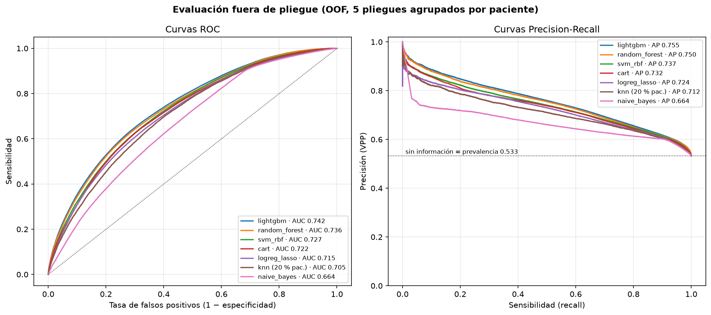

**Código fuente · `modulo_7/m7_1_multimetrica/`**


```python
# Archivo: modulo_7/m7_1_multimetrica/multimetrica.py
"""Subfase 7.1 · Evaluación multimétrica fuera de muestra (OOF de la 6.4).

Métricas por modelo:
- discriminación: AUC-ROC y AUC-PR (average precision; su valor sin información es la prevalencia, no 0,5);
- calibración: Brier y ECE con 15 intervalos de igual frecuencia;
- umbral 0,5: F1, sensibilidad, especificidad y precisión.

Intervalos de confianza del 95 % para AUC-ROC y AUC-PR con **bootstrap estratificado por conglomerados**:
- se remuestrean **pacientes** (cada uno aporta ~5,6 snapshots correlacionados; remuestrear filas daría IC
  demasiado estrechos), estratificados por su composición de clases (todo negativo / mixto / todo positivo);
- cada réplica se aplica como pesos (nº de veces que sale el paciente) y las métricas se calculan con un orden
  precalculado, en O(n) por réplica (`CurvaPreordenada`, equivalente a scikit-learn con `sample_weight`);
- las mismas réplicas sirven para todos los modelos (bootstrap pareado, reutilizable en comparaciones de M7).

Salidas de tipo `decision_function` (SVM): se convierten a probabilidad con **Platt cruzado por pliegue**
(cada pliegue se calibra con los otros cuatro), sin usar sus propias etiquetas.
"""
from __future__ import annotations

from dataclasses import dataclass

import numpy as np
import pandas as pd
from sklearn.linear_model import LogisticRegression
from sklearn.metrics import (
    average_precision_score,
    brier_score_loss,
    confusion_matrix,
    f1_score,
    precision_recall_curve,
    roc_auc_score,
    roc_curve,
)

N_BINS_ECE = 15
UMBRAL = 0.5
N_BOOTSTRAP = 1000


# ---------------------------------------------------------------------------- métricas puntuales
def ece_igual_frecuencia(y, p, n_bins: int = N_BINS_ECE) -> float:
    """Expected Calibration Error con `n_bins` intervalos de igual frecuencia (cuantiles de p).

    ECE = Σ_b (n_b / N) · |media(y_b) − media(p_b)|.
    """
    y, p = np.asarray(y, float), np.asarray(p, float)
    orden = np.argsort(p, kind="mergesort")
    total = 0.0
    for b in np.array_split(orden, n_bins):
        if len(b):
            total += len(b) * abs(y[b].mean() - p[b].mean())
    return total / len(y)


def metricas_umbral(y, p, umbral: float = UMBRAL) -> dict:
    y = np.asarray(y).astype(int)
    pred = (np.asarray(p) >= umbral).astype(int)
    tn, fp, fn, tp = confusion_matrix(y, pred, labels=[0, 1]).ravel()
    return {
        "f1": f1_score(y, pred, zero_division=0),
        "sensibilidad": tp / (tp + fn) if tp + fn else np.nan,
        "especificidad": tn / (tn + fp) if tn + fp else np.nan,
        "precision": tp / (tp + fp) if tp + fp else np.nan,
        "tasa_predichos_positivos": pred.mean(),
    }


def metricas(y, p) -> dict:
    """Vector multimétrico completo (sin IC) para probabilidades `p`."""
    y = np.asarray(y).astype(int)
    prev = y.mean()
    brier = brier_score_loss(y, p)
    return {
        "n": len(y),
        "prevalencia": prev,
        "auc_roc": roc_auc_score(y, p),
        "auc_pr": average_precision_score(y, p),
        "auc_pr_sin_informacion": prev,
        "brier": brier,
        "brier_skill": 1 - brier / (prev * (1 - prev)),  # vs predecir siempre la prevalencia
        "ece": ece_igual_frecuencia(y, p),
        **metricas_umbral(y, p),
    }


def platt_cruzado(s, y, pliegues) -> np.ndarray:
    """Probabilidades a partir de puntajes no probabilísticos: Platt ajustado en los otros pliegues."""
    s, y, pliegues = np.asarray(s, float), np.asarray(y).astype(int), np.asarray(pliegues)
    out = np.full(len(s), np.nan)
    for k in np.unique(pliegues):
        en, fuera = pliegues == k, pliegues != k
        lr = LogisticRegression(C=1e6, max_iter=1000).fit(s[fuera].reshape(-1, 1), y[fuera])
        out[en] = lr.predict_proba(s[en].reshape(-1, 1))[:, 1]
    return out


# ---------------------------------------------------------------------------- bootstrap
@dataclass
class CurvaPreordenada:
    """Puntajes ordenados una sola vez; AUC-ROC y AP ponderados en O(n) por réplica.

    Con pesos enteros w (veces que sale cada fila) reproduce `roc_auc_score` / `average_precision_score`
    con `sample_weight=w`, incluidos los empates de puntaje.
    """

    orden: np.ndarray
    inicios: np.ndarray  # índice (en el orden) donde empieza cada grupo de puntaje empatado
    y_ord: np.ndarray

    @classmethod
    def desde(cls, y, s) -> "CurvaPreordenada":
        s = np.asarray(s, float)
        orden = np.argsort(-s, kind="mergesort")
        s_ord = s[orden]
        inicios = np.r_[0, np.flatnonzero(np.diff(s_ord) != 0) + 1]
        return cls(orden, inicios, np.asarray(y, float)[orden])

    def _acumulados(self, w):
        w_ord = np.asarray(w, float)[self.orden]
        pos = np.add.reduceat(w_ord * self.y_ord, self.inicios)
        neg = np.add.reduceat(w_ord * (1 - self.y_ord), self.inicios)
        return pos, neg

    def auc_roc(self, w) -> float:
        pos, neg = self._acumulados(w)
        tp_antes = np.cumsum(pos) - pos
        return float((neg * (tp_antes + pos / 2)).sum() / (pos.sum() * neg.sum()))

    def auc_pr(self, w) -> float:
        pos, neg = self._acumulados(w)
        tp, fp = np.cumsum(pos), np.cumsum(neg)
        precision = np.divide(tp, tp + fp, out=np.zeros_like(tp), where=(tp + fp) > 0)
        return float((pos * precision).sum() / pos.sum())


def estratos_paciente(y, grupos) -> tuple[np.ndarray, np.ndarray]:
    """Código de paciente por fila y estrato de cada paciente (0 todo negativo, 1 mixto, 2 todo positivo)."""
    codigos, inv = np.unique(np.asarray(grupos), return_inverse=True)
    n_pos = np.bincount(inv, weights=np.asarray(y, float), minlength=len(codigos))
    n = np.bincount(inv, minlength=len(codigos))
    estrato = np.where(n_pos == 0, 0, np.where(n_pos == n, 2, 1))
    return inv, estrato


def replicas_bootstrap(y, grupos, n_iter: int = N_BOOTSTRAP, semilla: int = 42):
    """Generador de pesos por fila: pacientes remuestreados con reemplazo dentro de su estrato."""
    inv, estrato = estratos_paciente(y, grupos)
    rng = np.random.default_rng(semilla)
    por_estrato = [np.flatnonzero(estrato == e) for e in np.unique(estrato)]
    n_pac = len(estrato)
    for _ in range(n_iter):
        cuenta = np.zeros(n_pac)
        for idx in por_estrato:
            cuenta += np.bincount(rng.choice(idx, size=len(idx), replace=True), minlength=n_pac)
        yield cuenta[inv]


def bootstrap_ic(y, puntajes: dict[str, np.ndarray], grupos, n_iter: int = N_BOOTSTRAP, semilla: int = 42,
                 alfa: float = 0.05) -> tuple[pd.DataFrame, pd.DataFrame]:
    """IC percentil (1 − alfa) de AUC-ROC y AUC-PR para cada modelo, con réplicas pareadas.

    Los puntajes con NaN (p. ej. KNN, evaluado en un subconjunto de pacientes) usan solo sus filas válidas,
    con los mismos pesos de la réplica. Devuelve (IC por modelo, réplicas largas modelo × iteración).
    """
    y = np.asarray(y)
    curvas, mascaras = {}, {}
    for m, s in puntajes.items():
        ok = ~np.isnan(s)
        mascaras[m] = ok
        curvas[m] = CurvaPreordenada.desde(y[ok], s[ok])
    filas = []
    for it, w in enumerate(replicas_bootstrap(y, grupos, n_iter, semilla)):
        for m, c in curvas.items():
            wm = w[mascaras[m]]
            filas.append((m, it, c.auc_roc(wm), c.auc_pr(wm)))
    rep = pd.DataFrame(filas, columns=["modelo", "iteracion", "auc_roc", "auc_pr"])
    q = rep.groupby("modelo")[["auc_roc", "auc_pr"]].quantile([alfa / 2, 1 - alfa / 2]).unstack()
    ic = pd.DataFrame({
        "auc_roc_ic95_inf": q[("auc_roc", alfa / 2)], "auc_roc_ic95_sup": q[("auc_roc", 1 - alfa / 2)],
        "auc_pr_ic95_inf": q[("auc_pr", alfa / 2)], "auc_pr_ic95_sup": q[("auc_pr", 1 - alfa / 2)],
    }).reset_index()
    return ic, rep


# ---------------------------------------------------------------------------- tablas
def evaluar_modelos(y, probas: dict[str, np.ndarray], grupos, n_iter: int = N_BOOTSTRAP,
                    semilla: int = 42) -> tuple[pd.DataFrame, pd.DataFrame]:
    """Tabla consolidada (ordenada por AUC-PR descendente) + réplicas bootstrap."""
    y = np.asarray(y).astype(int)
    filas = []
    for m, p in probas.items():
        ok = ~np.isnan(p)
        filas.append({"modelo": m, **metricas(y[ok], p[ok])})
    tabla = pd.DataFrame(filas)
    ic, rep = bootstrap_ic(y, probas, grupos, n_iter, semilla)
    tabla = tabla.merge(ic, on="modelo")
    cols = ["modelo", "n", "prevalencia", "auc_roc", "auc_roc_ic95_inf", "auc_roc_ic95_sup", "auc_pr",
            "auc_pr_ic95_inf", "auc_pr_ic95_sup", "auc_pr_sin_informacion", "brier", "brier_skill", "ece",
            "f1", "sensibilidad", "especificidad", "precision", "tasa_predichos_positivos"]
    return tabla[cols].sort_values("auc_pr", ascending=False).reset_index(drop=True), rep


def metricas_por_estrato(y, probas: dict[str, np.ndarray], estratos) -> pd.DataFrame:
    """Vector multimétrico (sin IC) por estrato (servicio × τ): ahí la prevalencia cambia mucho."""
    y, estratos = np.asarray(y).astype(int), np.asarray(estratos)
    filas = []
    for e in pd.unique(estratos):
        en = estratos == e
        for m, p in probas.items():
            ok = en & ~np.isnan(p)
            if y[ok].min() != y[ok].max():
                filas.append({"estrato": e, "modelo": m, **metricas(y[ok], p[ok])})
    return pd.DataFrame(filas)


# ---------------------------------------------------------------------------- gráfico
def graficar_roc_pr(y, probas: dict[str, np.ndarray], ruta, etiquetas: dict[str, str] | None = None) -> None:
    """Curvas ROC y Precision-Recall de todos los modelos en una figura de dos paneles."""
    import matplotlib
    matplotlib.use("Agg")
    import matplotlib.pyplot as plt

    y = np.asarray(y).astype(int)
    etiquetas = etiquetas or {}
    orden = sorted(probas, key=lambda m: -average_precision_score(y[~np.isnan(probas[m])],
                                                                   probas[m][~np.isnan(probas[m])]))
    colores = dict(zip(orden, plt.cm.tab10.colors))
    fig, (a1, a2) = plt.subplots(1, 2, figsize=(13, 5.8))
    for m in orden:
        ok = ~np.isnan(probas[m])
        yy, pp = y[ok], probas[m][ok]
        fpr, tpr, _ = roc_curve(yy, pp)
        pr, rc, _ = precision_recall_curve(yy, pp)
        nombre = m + etiquetas.get(m, "")
        a1.plot(fpr, tpr, lw=1.6, color=colores[m], label=f"{nombre} · AUC {roc_auc_score(yy, pp):.3f}")
        a2.plot(rc, pr, lw=1.6, color=colores[m], label=f"{nombre} · AP {average_precision_score(yy, pp):.3f}")
    a1.plot([0, 1], [0, 1], "k:", lw=0.8)
    a2.axhline(y.mean(), color="k", ls=":", lw=0.8)
    a2.text(0.01, y.mean() + 0.008, f"sin información = prevalencia {y.mean():.3f}", fontsize=8)
    a1.set(xlabel="Tasa de falsos positivos (1 − especificidad)", ylabel="Sensibilidad", title="Curvas ROC")
    a2.set(xlabel="Sensibilidad (recall)", ylabel="Precisión (VPP)", title="Curvas Precision-Recall", ylim=(0, 1.02))
    for a in (a1, a2):
        a.legend(fontsize=8, loc="lower right" if a is a1 else "upper right")
        a.grid(alpha=0.3)
    fig.suptitle("Evaluación fuera de pliegue (OOF, 5 pliegues agrupados por paciente)", fontweight="bold")
    fig.tight_layout()
    fig.savefig(ruta, dpi=150, bbox_inches="tight")
    plt.close(fig)

```

**Ejecución sobre los datos reales**


```python
# Archivo: modulo_7/m7_1_multimetrica/run_m7_1.py
"""Subfase 7.1 sobre los datos reales: evaluación multimétrica de las predicciones OOF de la 6.4.

Entrada: `data/m6/oof_m6_4.parquet` (541 260 snapshots de entrenamiento estable; KNN solo en el 20 % de
los pacientes). La prueba temporal no se usa aquí.

Salidas (solo agregados):
    outputs/m7/multimetric_evaluation_summary.csv          tabla consolidada, ordenada por AUC-PR
    outputs/m7/tablas/m7_1_subconjunto_comun.csv            los 7 modelos sobre las mismas filas (las de KNN)
    outputs/m7/tablas/m7_1_por_servicio_tau.csv             métricas por servicio × τ
    outputs/m7/tablas/m7_1_bootstrap_replicas.csv           réplicas pareadas (AUC-ROC, AUC-PR) por modelo
    outputs/m7/figuras/m7_1_roc_pr.png                      curvas ROC y Precision-Recall
    data/m7/probabilidades_oof_m7_1.parquet                 OOF en escala de probabilidad (SVM con Platt cruzado)

Uso (desde la raíz del proyecto):
    python modulo_7/m7_1_multimetrica/run_m7_1.py [--n-bootstrap 1000]
"""
from __future__ import annotations

import argparse
import json
import sys
import time
from datetime import datetime
from pathlib import Path

import numpy as np
import pandas as pd
from sklearn.metrics import roc_auc_score

if hasattr(sys.stdout, "reconfigure"):
    sys.stdout.reconfigure(encoding="utf-8")

ROOT = Path(__file__).resolve().parents[2]
sys.path.insert(0, str(ROOT))

from modulo_7.m7_1_multimetrica import (  # noqa: E402
    N_BOOTSTRAP,
    evaluar_modelos,
    graficar_roc_pr,
    metricas_por_estrato,
    platt_cruzado,
)

TARGET = "y_target_los_largo"


def log(msg):
    print(f"[{datetime.now():%H:%M:%S}] {msg}", flush=True)


def main() -> None:
    ap = argparse.ArgumentParser()
    ap.add_argument("--n-bootstrap", type=int, default=N_BOOTSTRAP)
    a = ap.parse_args()

    out, tab, fig = ROOT / "outputs" / "m7", ROOT / "outputs" / "m7" / "tablas", ROOT / "outputs" / "m7" / "figuras"
    for d in (tab, fig, ROOT / "data" / "m7"):
        d.mkdir(parents=True, exist_ok=True)

    oof = pd.read_parquet(ROOT / "data" / "m6" / "oof_m6_4.parquet")
    manifest = json.loads((ROOT / "models" / "manifest.json").read_text(encoding="utf-8"))
    y, g = oof[TARGET].to_numpy(), oof.person_id.to_numpy()
    log(f"OOF: {len(oof):,} snapshots · {oof.person_id.nunique():,} pacientes · prevalencia {y.mean():.4f}")

    probas, notas = {}, {}
    for c in [c for c in oof.columns if c.startswith("oof_")]:
        m = c.removeprefix("oof_")
        s = oof[c].to_numpy(float)
        salida = manifest["modelos"].get(m, {}).get("salida", "predict_proba")
        if salida != "predict_proba" or s.min() < 0 or s.max() > 1:
            ok = ~np.isnan(s)
            p = np.full(len(s), np.nan)
            p[ok] = platt_cruzado(s[ok], y[ok], oof.pliegue.to_numpy()[ok])
            log(f"{m}: decision_function → Platt cruzado por pliegue (AUC bruto {roc_auc_score(y[ok], s[ok]):.4f} · "
                f"tras Platt {roc_auc_score(y[ok], p[ok]):.4f})")
            probas[m], notas[m] = p, "decision_function + Platt cruzado por pliegue"
        else:
            probas[m], notas[m] = s, "predict_proba"

    t0 = time.time()
    tabla, rep = evaluar_modelos(y, probas, g, n_iter=a.n_bootstrap, semilla=42)
    tabla["salida"] = tabla.modelo.map(notas)
    tabla["filas_evaluadas"] = np.where(tabla.n < len(oof), "20 % de los pacientes (KNN)", "todas")
    tabla.to_csv(out / "multimetric_evaluation_summary.csv", index=False)
    rep.to_csv(tab / "m7_1_bootstrap_replicas.csv", index=False)
    log(f"Tabla consolidada + bootstrap de {a.n_bootstrap} réplicas por paciente ({(time.time() - t0) / 60:.1f} min)")

    comun = ~np.isnan(probas["knn"]) if "knn" in probas else np.ones(len(oof), bool)
    sub, _ = evaluar_modelos(y[comun], {m: p[comun] for m, p in probas.items()}, g[comun],
                             n_iter=a.n_bootstrap, semilla=42)
    sub.to_csv(tab / "m7_1_subconjunto_comun.csv", index=False)
    log(f"Subconjunto común: {comun.sum():,} filas")

    estratos = (oof.servicio + " · τ" + oof.horas_desde_ingreso.astype(str) + "h").to_numpy()
    por = metricas_por_estrato(y, probas, estratos)
    por.to_csv(tab / "m7_1_por_servicio_tau.csv", index=False)

    graficar_roc_pr(y, probas, fig / "m7_1_roc_pr.png", {"knn": " (20 % pac.)"})
    pd.DataFrame({"snapshot_id": oof.snapshot_id, "person_id": g, "pliegue": oof.pliegue, TARGET: y,
                  "servicio": oof.servicio, "horas_desde_ingreso": oof.horas_desde_ingreso,
                  **{f"p_{m}": p for m, p in probas.items()}}).to_parquet(
        ROOT / "data" / "m7" / "probabilidades_oof_m7_1.parquet", index=False)

    r = lambda x: x.round(4).to_string(index=False)  # noqa: E731
    print("\nmultimetric_evaluation_summary.csv:")
    print(r(tabla[["modelo", "n", "auc_roc", "auc_roc_ic95_inf", "auc_roc_ic95_sup", "auc_pr", "auc_pr_ic95_inf",
                   "auc_pr_ic95_sup", "brier", "ece", "f1", "sensibilidad", "especificidad"]]))
    print("\nSubconjunto común (filas de KNN):")
    print(r(sub[["modelo", "n", "auc_roc", "auc_pr", "auc_pr_ic95_inf", "auc_pr_ic95_sup", "brier", "ece"]]))
    print("\nAUC-PR por servicio × τ (prevalencia = valor sin información):")
    piv = por.pivot(index="modelo", columns="estrato", values="auc_pr")
    piv.loc["(prevalencia)"] = por.groupby("estrato").prevalencia.first()
    print(piv.round(3).to_string())
    log("Listo")


if __name__ == "__main__":
    main()

```

**Pruebas con datos sintéticos**


```python
# Archivo: modulo_7/m7_1_multimetrica/test_multimetrica.py
"""Pruebas de la subfase 7.1 con datos sintéticos (no usa datos reales).

    python -m pytest modulo_7/m7_1_multimetrica -q
"""
from __future__ import annotations

import sys
from pathlib import Path

import numpy as np
import pandas as pd
import pytest
from sklearn.metrics import average_precision_score, roc_auc_score

sys.path.insert(0, str(Path(__file__).resolve().parents[2]))

from modulo_7.m7_1_multimetrica import (  # noqa: E402
    CurvaPreordenada,
    bootstrap_ic,
    ece_igual_frecuencia,
    estratos_paciente,
    evaluar_modelos,
    graficar_roc_pr,
    metricas,
    metricas_por_estrato,
    metricas_umbral,
    platt_cruzado,
    replicas_bootstrap,
)


def _datos(n=3000, semilla=0, prev=0.3):
    rng = np.random.default_rng(semilla)
    g = rng.integers(0, n // 5, n)
    y = (rng.random(n) < prev).astype(int)
    bueno = 1 / (1 + np.exp(-(1.5 * (y - 0.5) + rng.normal(0, 1, n) - np.log((1 - prev) / prev) / 2)))
    malo = rng.random(n)
    return y, g, bueno, malo


def test_curva_preordenada_igual_a_sklearn_con_pesos_y_empates():
    rng = np.random.default_rng(1)
    y = rng.integers(0, 2, 500)
    s = np.round(rng.random(500), 1)  # muchos empates
    w = rng.integers(0, 4, 500).astype(float)  # incluye pesos 0, como en el bootstrap
    c = CurvaPreordenada.desde(y, s)
    assert c.auc_roc(w) == pytest.approx(roc_auc_score(y, s, sample_weight=w))
    assert c.auc_pr(w) == pytest.approx(average_precision_score(y, s, sample_weight=w))
    uno = np.ones(500)
    assert c.auc_roc(uno) == pytest.approx(roc_auc_score(y, s))
    assert c.auc_pr(uno) == pytest.approx(average_precision_score(y, s))


def test_ece_igual_frecuencia():
    rng = np.random.default_rng(2)
    p = rng.random(30000)
    y = (rng.random(30000) < p).astype(int)
    assert ece_igual_frecuencia(y, p) < 0.02  # bien calibrado
    assert ece_igual_frecuencia(y, np.clip(p + 0.2, 0, 1)) > 0.15  # sesgo sistemático
    # cálculo a mano con 3 intervalos de igual frecuencia
    yy, pp = np.array([0, 0, 1, 1, 1, 0]), np.array([0.1, 0.2, 0.4, 0.5, 0.8, 0.9])
    esperado = (2 * abs(0 - 0.15) + 2 * abs(1 - 0.45) + 2 * abs(0.5 - 0.85)) / 6
    assert ece_igual_frecuencia(yy, pp, n_bins=3) == pytest.approx(esperado)


def test_metricas_umbral_a_mano():
    y = np.array([1, 1, 1, 0, 0, 0, 0, 1])
    p = np.array([0.9, 0.6, 0.4, 0.7, 0.2, 0.1, 0.3, 0.5])  # pred: 1 1 0 1 0 0 0 1
    m = metricas_umbral(y, p)
    assert m["sensibilidad"] == pytest.approx(3 / 4)
    assert m["especificidad"] == pytest.approx(3 / 4)
    assert m["precision"] == pytest.approx(3 / 4)
    assert m["f1"] == pytest.approx(3 / 4)


def test_metricas_auc_pr_sin_informacion_es_la_prevalencia():
    y, g, bueno, malo = _datos(n=20000, prev=0.2)
    m = metricas(y, malo)
    assert m["auc_pr"] == pytest.approx(m["prevalencia"], abs=0.02)  # no 0,5
    assert m["auc_roc"] == pytest.approx(0.5, abs=0.02)
    assert metricas(y, bueno)["auc_pr"] > m["auc_pr"] + 0.1


def test_bootstrap_por_paciente_y_estratificado():
    y, g, *_ = _datos()
    inv, estrato = estratos_paciente(y, g)
    assert set(np.unique(estrato)) <= {0, 1, 2}
    for w in replicas_bootstrap(y, g, n_iter=5, semilla=3):
        assert pd.Series(w).groupby(inv).nunique().eq(1).all()  # todas las filas del paciente salen juntas
        cuenta = np.bincount(inv, weights=w) / np.bincount(inv)
        for e in np.unique(estrato):
            assert cuenta[estrato == e].sum() == pytest.approx((estrato == e).sum())  # tamaño de cada estrato fijo


def test_ic_contiene_el_valor_y_es_reproducible():
    y, g, bueno, malo = _datos()
    s = {"bueno": bueno, "malo": malo}
    ic, rep = bootstrap_ic(y, s, g, n_iter=200, semilla=7)
    ic2, _ = bootstrap_ic(y, s, g, n_iter=200, semilla=7)
    pd.testing.assert_frame_equal(ic, ic2)
    fila = ic.set_index("modelo").loc["bueno"]
    assert fila.auc_roc_ic95_inf < roc_auc_score(y, bueno) < fila.auc_roc_ic95_sup
    assert fila.auc_pr_ic95_inf < average_precision_score(y, bueno) < fila.auc_pr_ic95_sup
    assert len(rep) == 400 and rep.groupby("iteracion").size().eq(2).all()  # réplicas pareadas


def test_puntajes_con_nan_usan_solo_sus_filas():
    y, g, bueno, _ = _datos()
    parcial = bueno.copy()
    parcial[g % 5 != 0] = np.nan
    tabla, _ = evaluar_modelos(y, {"completo": bueno, "parcial": parcial}, g, n_iter=50)
    t = tabla.set_index("modelo")
    ok = ~np.isnan(parcial)
    assert t.loc["parcial", "n"] == ok.sum()
    assert t.loc["parcial", "auc_roc"] == pytest.approx(roc_auc_score(y[ok], bueno[ok]))
    assert tabla.auc_pr.is_monotonic_decreasing  # ordenada por AUC-PR


def test_platt_cruzado_no_usa_las_etiquetas_del_pliegue():
    y, g, bueno, _ = _datos()
    s = np.log(bueno / (1 - bueno)) * 3 + 1  # puntaje tipo decision_function
    pliegues = g % 5
    p = platt_cruzado(s, y, pliegues)
    assert ((p > 0) & (p < 1)).all()
    assert roc_auc_score(y, p) == pytest.approx(roc_auc_score(y, s), abs=0.01)
    assert ece_igual_frecuencia(y, p) < 0.05
    y_alterado = y.copy()
    y_alterado[pliegues == 0] = 1 - y_alterado[pliegues == 0]  # cambiar etiquetas del pliegue 0
    assert np.allclose(platt_cruzado(s, y_alterado, pliegues)[pliegues == 0], p[pliegues == 0])


def test_estratos_y_grafico(tmp_path):
    y, g, bueno, malo = _datos()
    estr = np.where(g % 2 == 0, "a", "b")
    t = metricas_por_estrato(y, {"bueno": bueno, "malo": malo}, estr)
    assert set(t.estrato) == {"a", "b"} and len(t) == 4
    graficar_roc_pr(y, {"bueno": bueno, "malo": malo}, tmp_path / "roc_pr.png", {"malo": " (aleatorio)"})
    assert (tmp_path / "roc_pr.png").stat().st_size > 20_000

```

### Subfase 7.2 · Calibración y umbral de costo asimétrico

`m7_2_calibracion_costo/calibracion_costo.py` + `run_m7_2.py`. Modelos: los 3 mejores de la 7.1 (lightgbm, random_forest, svm_rbf).

**Dos niveles, para no reutilizar datos**
1. **Desarrollo** (OOF del entrenamiento estable).
   - *Calibración cruzada por pliegue*: el calibrador del pliegue k se ajusta con el OOF de los otros cuatro pliegues. Así cada probabilidad calibrada viene de un modelo y un calibrador que no vieron a ese paciente. Es lo mismo que hace `CalibratedClassifierCV(cv=pliegues agrupados)`, pero sin reentrenar.
   - Aquí, y solo aquí, se eligen el **método** (menor Brier) y el **umbral θ\*** (menor costo). Ambos quedan congelados en `outputs/m7/m7_2_umbrales_congelados.json`, junto con el hash del OOF.
2. **Modelo desplegable.** `CalibratedClassifierCV(Pipeline, method, cv=pliegues agrupados de la 6.1, ensemble=True)` con todo el entrenamiento estable → `models/<modelo>_calibrado.joblib`.
   - Son 5 Pipelines, cada uno calibrado en su pliegue de validación.
   - Es el modelo que se evalúa **una sola vez** en la prueba temporal (periodo estable posterior al 2025-07-13), con los umbrales congelados.
   - La fase `prueba` deja un sello (`m7_2_prueba_unica.json`). Repetirla exige `--repetir-prueba` y queda registrado en el sello.

**Costo:** C(θ) = 5·FN(θ) + 1·FP(θ), con alerta si p ≥ θ, por cada 100 evaluaciones (snapshots), con θ ∈ [0,01; 0,99] en pasos de 0,01.
- Con probabilidades calibradas, el umbral de Bayes es c_FP / (c_FP + c_FN) = **1/6 ≈ 0,167**. Sirve de control: si θ\* empírico ≈ 0,167, la calibración es buena.
- **Referencias sin modelo**: "alertar a todos" cuesta (1 − p₀)·100 y "no alertar nunca", 5·p₀·100. El valor real del modelo es lo que ahorra **frente a la mejor de ellas**, no frente a θ = 0,5.
- Reglas pre-especificadas para la prueba: θ = 0,5, θ\* global, θ\* por servicio y θ de Bayes. Como sensibilidad, θ\* con c_FN = 10 (solo en desarrollo).

#### Resultados en desarrollo (OOF, 541 260 snapshots, prevalencia 0,533)

**Calibración:** la isotónica gana en los 3 modelos (`tablas/m7_2_calibracion_desarrollo.csv`, `figuras/m7_2_fiabilidad_desarrollo.png`).

| Modelo | ECE sin calibrar | ECE isotónica | ECE sigmoide | Brier sin cal. → isotónica | ECE isotónica hosp. / urg. |
|---|---|---|---|---|---|
| lightgbm | 0,018 | **0,001** | 0,017 | 0,2046 → 0,2041 | 0,011 / 0,003 |
| random_forest | 0,030 | **0,001** | 0,016 | 0,2069 → 0,2058 | 0,014 / 0,003 |
| svm_rbf | — (decision_function) | **0,001** | 0,008 | — → 0,2094 | 0,005 / 0,002 |

- La sigmoide (Platt) es una logística *lineal* sobre el puntaje. No corrige la curvatura de LightGBM y RF, y en hospitalización empeora la calibración frente a no calibrar (0,037 vs 0,019 en LightGBM).
- La isotónica conserva el AUC (−0,0003): la calibración no cambia el orden.

**Umbral de costo** (`tablas/m7_2_umbrales_desarrollo.csv`, `figuras/m7_2_costo_umbral_desarrollo.png`):

| Modelo | θ\* | Costo/100 @ θ = 0,5 | Costo/100 @ θ\* | Alertar a todos | Ahorro vs θ = 0,5 | **Ahorro vs alertar a todos** |
|---|---|---|---|---|---|---|
| lightgbm | 0,16 | 95,5 | **43,8** | 46,7 | 51,8 | **2,9** |
| random_forest | 0,17 | 96,2 | 43,8 | 46,7 | 52,3 | 2,8 |
| svm_rbf | 0,17 | 93,5 | 44,9 | 46,7 | 48,6 | 1,8 |

- **θ\* ≈ 0,16–0,17 coincide con el umbral de Bayes (0,167)**: las probabilidades isotónicas están bien calibradas.
- **Lectura honesta.** θ\* reduce el costo a menos de la mitad frente a θ = 0,5 (sensibilidad 0,70 → 0,99). Pero, con 53 % de prevalencia y 5:1, "alertar a todos" ya cuesta 46,7, y el modelo solo ahorra 2–3 puntos más.
- **Por servicio.**
  - **Urgencias**: θ\* alerta al 100 % de los snapshots. Casi ninguno tiene una probabilidad calibrada < 0,33 (`figuras/m7_2_fiabilidad_por_servicio_desarrollo.png`), así que con 5:1 el modelo no cambia la decisión.
  - **Hospitalización** (prevalencia 25 %): con LightGBM y θ\* el costo baja de 74,9 (alertar a todos) a **59,7**, un **−20 %**. Sensibilidad 0,90, especificidad 0,37, alertas en el 70 % de los casos.
- El θ\* por servicio casi no difiere del global (hosp. 0,16–0,17). Es lo esperable si la calibración se sostiene dentro de cada servicio.
- Con c_FN = 10, θ\* baja a 0,07–0,10: más alertas todavía.
- **Para el equipo:** el valor operativo del modelo con un costo de 5:1 está en **hospitalización**. En urgencias habría que revisar la razón de costos con el hospital o fijarla por servicio: con 5:1, alertar siempre es casi óptimo.

#### Resultados en la prueba temporal (evaluación única, 2026-11-16 09:56)

Datos: 148 673 snapshots de 31 165 pacientes, del periodo estable posterior al 2025-07-13. Prevalencia **0,578**, frente a 0,533 en desarrollo. Los umbrales se congelaron a las 08:20 (sello en `m7_2_prueba_unica.json`, sin repeticiones). Detalle en `tablas/m7_2_{calibracion,umbrales}_prueba.csv` y `figuras/m7_2_fiabilidad_prueba.png`.

| Modelo (isotónica) | AUC-ROC prueba (OOF) | AUC-PR | Brier | ECE prueba (desarrollo) | p media vs prevalencia |
|---|---|---|---|---|---|
| lightgbm | **0,729** (0,742) | 0,773 | 0,205 | 0,027 (0,001) | 0,551 vs 0,578 |
| random_forest | 0,725 (0,736) | 0,770 | 0,206 | 0,029 (0,001) | 0,549 vs 0,578 |
| svm_rbf | 0,711 (0,727) | 0,752 | 0,211 | 0,021 (0,001) | 0,556 vs 0,578 |

- **Degradación temporal moderada.** El AUC cae entre 0,011 y 0,016 frente al OOF, y el orden de los modelos se mantiene. La calibración pierde precisión porque la prevalencia subió 4,4 pp en el periodo de prueba: el modelo **subestima el riesgo ~2,7 pp** (ECE de 0,001 a 0,027). Aun así, la isotónica mejora a los modelos sin calibrar (RF: ECE de 0,058 a 0,029).
- **Costo por cada 100 evaluaciones (LightGBM):**

| Regla | Global | Hospitalización | Urgencias |
|---|---|---|---|
| θ = 0,5 | 95,7 | 124,4 | 88,7 |
| **θ\* = 0,16** (congelado) | **40,1** | **61,0** | 35,0 |
| Alertar a todos (sin modelo) | 42,2 | 71,8 | 35,0 |

- Lo observado en desarrollo **se replica en la prueba**:
  - θ\* ahorra 55,6 por cada 100 frente a θ = 0,5;
  - frente a alertar a todos, ahorra 2,1 en el global y **10,8 en hospitalización (−15 %)**, con sensibilidad 0,90 y especificidad 0,35;
  - en urgencias el modelo no cambia la decisión con una razón de costos de 5:1.
- El θ\* por servicio no mejora al global, y el θ de Bayes (0,167) rinde igual que θ\*.
- **Recomendaciones para M8:**
  - recalibrar periódicamente (la prevalencia sube con el tiempo);
  - usar el modelo en hospitalización;
  - acordar con el hospital la razón de costos de urgencias.


**Salidas**

| Archivo | Contenido |
|---|---|
| `outputs/m7/m7_2_umbrales_congelados.json` | Método y θ\* por modelo, fijados en desarrollo (con hash del OOF) |
| `outputs/m7/m7_2_prueba_unica.json` | Sello de la evaluación única en prueba |
| `outputs/m7/tablas/m7_2_calibracion_{desarrollo,prueba}.csv` | Brier, ECE, AUC y p media vs prevalencia, por versión y servicio |
| `outputs/m7/tablas/m7_2_umbrales_{desarrollo,prueba}.csv` | θ = 0,5 vs θ\* (y las otras reglas), por servicio, con las políticas sin modelo |
| `outputs/m7/tablas/m7_2_barrido_costo_desarrollo.csv` | Costo por 100 para cada θ |
| `outputs/m7/figuras/m7_2_fiabilidad_*.png`, `m7_2_costo_umbral_desarrollo.png` | Diagramas de fiabilidad y curva de costo |
| `models/<modelo>_calibrado.joblib` | `CalibratedClassifierCV` (isotónica, 5 pliegues agrupados) |
| `data/m7/probabilidades_prueba_m7_2.parquet` | Probabilidades calibradas en la prueba (nivel paciente: no compartir) |

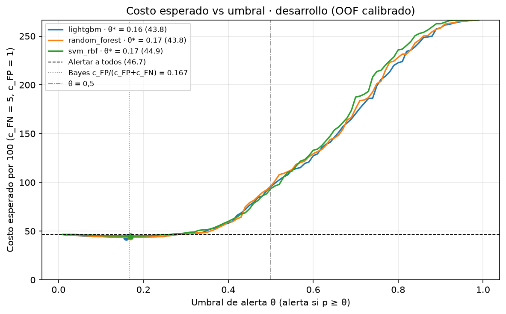

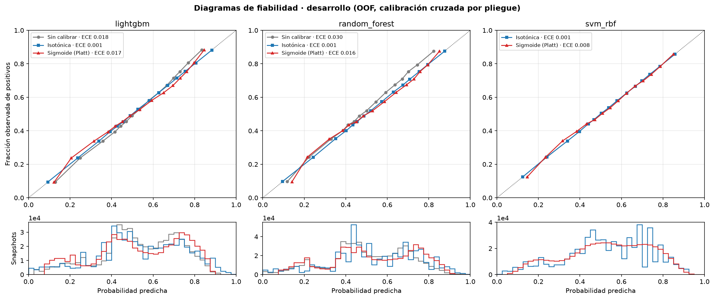

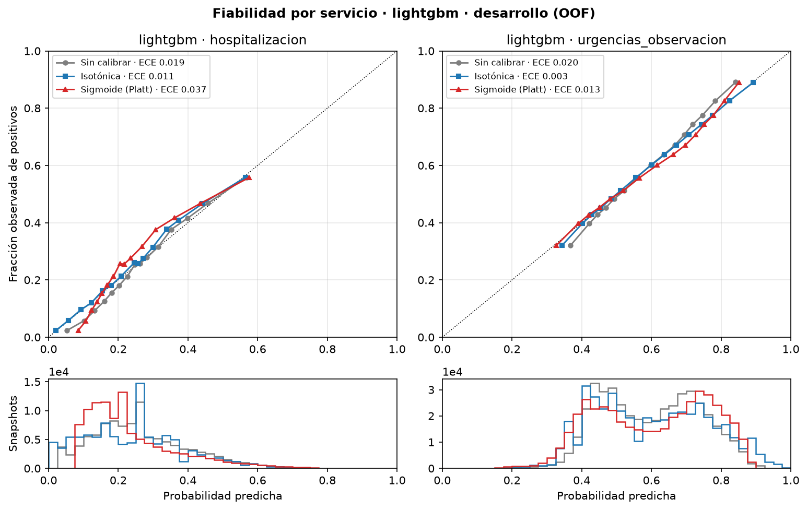

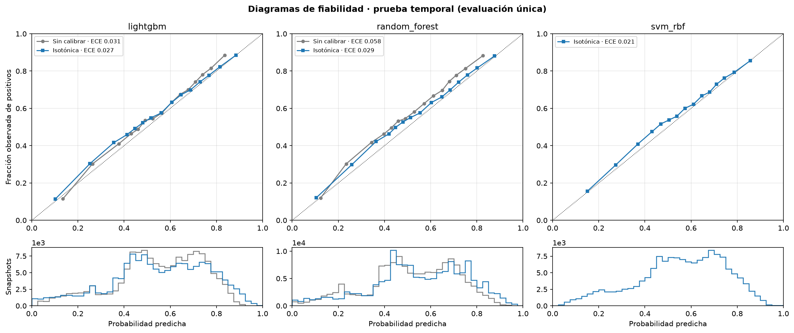

**Código fuente · `modulo_7/m7_2_calibracion_costo/`**


```python
# Archivo: modulo_7/m7_2_calibracion_costo/calibracion_costo.py
"""Subfase 7.2 · Calibración (isotónica / sigmoide) y umbral de costo asimétrico (c_FN = 5 · c_FP).

Dos niveles, para no reutilizar datos:

1. **Desarrollo (OOF del entrenamiento estable).** Calibración *cruzada por pliegue*: el calibrador del pliegue
   k se ajusta con las predicciones OOF de los otros cuatro pliegues y se aplica al pliegue k. Así cada
   probabilidad calibrada viene de un modelo y un calibrador que no vieron a ese paciente. Esto replica lo
   que hace `CalibratedClassifierCV(cv=pliegues agrupados)`, sin reentrenar los modelos. Sobre estas
   probabilidades se elige el método (menor Brier) y el umbral θ* (menor costo).
2. **Modelo desplegable.** `CalibratedClassifierCV(Pipeline, method, cv=pliegues de la 6.1, ensemble=True)`
   ajustado con todo el entrenamiento estable. Es el que se evalúa **una sola vez** en la prueba temporal,
   con θ* ya congelado.

Costo: C(θ) = c_FN · FN(θ) + c_FP · FP(θ), con alerta si p ≥ θ. Con probabilidades bien calibradas el
umbral de Bayes es c_FP / (c_FP + c_FN) = 1/6 ≈ 0,167. Las políticas de referencia "alertar a todos" y
"no alertar nunca" no necesitan modelo; el valor del modelo es lo que ahorra frente a la mejor de ellas.
"""
from __future__ import annotations

import numpy as np
import pandas as pd
from sklearn.calibration import CalibratedClassifierCV
from sklearn.isotonic import IsotonicRegression
from sklearn.linear_model import LogisticRegression
from sklearn.metrics import average_precision_score, brier_score_loss, roc_auc_score

from modulo_7.m7_1_multimetrica import ece_igual_frecuencia

C_FN, C_FP = 5.0, 1.0
UMBRALES = np.round(np.arange(0.01, 1.0, 0.01), 2)  # θ ∈ [0,01; 0,99]
METODOS = ("isotonic", "sigmoid")


# ---------------------------------------------------------------------------- calibración
def _calibrador(metodo: str):
    if metodo == "isotonic":
        return IsotonicRegression(out_of_bounds="clip", y_min=0.0, y_max=1.0)
    if metodo == "sigmoid":  # Platt: regresión logística de 1 variable sobre el puntaje
        return LogisticRegression(C=1e6, max_iter=1000)
    raise ValueError(f"Método de calibración desconocido: {metodo}")


def _ajustar_aplicar(cal, s_fit, y_fit, s_apl):
    if isinstance(cal, IsotonicRegression):
        return cal.fit(s_fit, y_fit).predict(s_apl)
    return cal.fit(s_fit.reshape(-1, 1), y_fit).predict_proba(s_apl.reshape(-1, 1))[:, 1]


def calibrar_cruzado(s, y, pliegues, metodo: str) -> np.ndarray:
    """Probabilidades calibradas fuera de pliegue: el pliegue k se calibra con los otros pliegues."""
    s, y, pliegues = np.asarray(s, float), np.asarray(y).astype(int), np.asarray(pliegues)
    out = np.full(len(s), np.nan)
    for k in np.unique(pliegues):
        en = pliegues == k
        out[en] = _ajustar_aplicar(_calibrador(metodo), s[~en], y[~en], s[en])
    return out


def ajustar_calibrado_final(pipe, X, y, pliegues, metodo: str) -> CalibratedClassifierCV:
    """Modelo desplegable: 5 Pipelines (uno por pliegue agrupado), cada uno calibrado en su pliegue de validación."""
    pliegues = np.asarray(pliegues)
    cv = [(np.flatnonzero(pliegues != k), np.flatnonzero(pliegues == k)) for k in np.unique(pliegues)]
    return CalibratedClassifierCV(pipe, method=metodo, cv=cv, ensemble=True).fit(X, np.asarray(y))


def curva_fiabilidad(y, p, n_bins: int = 15) -> pd.DataFrame:
    """Diagrama de fiabilidad con intervalos de igual frecuencia: p medio vs fracción observada de positivos."""
    y, p = np.asarray(y, float), np.asarray(p, float)
    orden = np.argsort(p, kind="mergesort")
    filas = [{"p_media": p[b].mean(), "fraccion_positivos": y[b].mean(), "n": len(b)}
             for b in np.array_split(orden, n_bins) if len(b)]
    return pd.DataFrame(filas)


def metricas_calibracion(y, p) -> dict:
    y = np.asarray(y).astype(int)
    prev = y.mean()
    brier = brier_score_loss(y, p)
    return {"n": len(y), "prevalencia": prev, "p_media": float(np.mean(p)), "auc_roc": roc_auc_score(y, p),
            "auc_pr": average_precision_score(y, p), "brier": brier, "brier_skill": 1 - brier / (prev * (1 - prev)),
            "ece": ece_igual_frecuencia(y, p)}


# ---------------------------------------------------------------------------- costo asimétrico
def barrido_umbrales(y, p, umbrales=UMBRALES, c_fn: float = C_FN, c_fp: float = C_FP) -> pd.DataFrame:
    """FN, FP y costo esperado por cada 100 evaluaciones para cada θ (alerta si p ≥ θ)."""
    y, p = np.asarray(y).astype(int), np.asarray(p, float)
    ps, ns = np.sort(p[y == 1]), np.sort(p[y == 0])
    umbrales = np.asarray(umbrales, float)
    fn = np.searchsorted(ps, umbrales, side="left")          # positivos con p < θ
    fp = len(ns) - np.searchsorted(ns, umbrales, side="left")  # negativos con p ≥ θ
    n = len(y)
    return pd.DataFrame({"umbral": umbrales, "fn": fn, "fp": fp, "tp": len(ps) - fn, "tn": len(ns) - fp,
                         "costo_por_100": (c_fn * fn + c_fp * fp) / n * 100})


def umbral_optimo(barrido: pd.DataFrame) -> float:
    """θ* que minimiza el costo (en empate, el primero: menos alertas no es un criterio aquí)."""
    return float(barrido.umbral.iloc[int(np.argmin(barrido.costo_por_100.to_numpy()))])


def desempeno_umbral(y, p, umbral: float, c_fn: float = C_FN, c_fp: float = C_FP) -> dict:
    """Matriz de confusión y costo por cada 100 evaluaciones para una regla de alerta p ≥ θ."""
    y, p = np.asarray(y).astype(int), np.asarray(p, float)
    alerta = p >= umbral
    tp, fp = int((alerta & (y == 1)).sum()), int((alerta & (y == 0)).sum())
    fn, tn = int((~alerta & (y == 1)).sum()), int((~alerta & (y == 0)).sum())
    n = len(y)
    return {
        "umbral": umbral, "n": n,
        "sensibilidad": tp / (tp + fn) if tp + fn else np.nan,
        "especificidad": tn / (tn + fp) if tn + fp else np.nan,
        "vpp": tp / (tp + fp) if tp + fp else np.nan,
        "vpn": tn / (tn + fn) if tn + fn else np.nan,
        "alertas_por_100": (tp + fp) / n * 100,
        "fn_por_100": fn / n * 100, "fp_por_100": fp / n * 100,
        "costo_por_100": (c_fn * fn + c_fp * fp) / n * 100,
    }


def politicas_referencia(y, c_fn: float = C_FN, c_fp: float = C_FP) -> dict:
    """Costo por 100 de las políticas sin modelo."""
    prev = float(np.mean(y))
    return {"alertar_a_todos": c_fp * (1 - prev) * 100, "no_alertar_nunca": c_fn * prev * 100}


def comparar_umbrales(y, p, reglas: dict[str, float], c_fn: float = C_FN, c_fp: float = C_FP) -> pd.DataFrame:
    """Tabla θ = 0,5 vs θ* (y otras reglas), con el ahorro frente a θ = 0,5 y a la mejor política sin modelo."""
    ref = politicas_referencia(y, c_fn, c_fp)
    mejor_ref = min(ref.values())
    filas = [{"regla": r, **desempeno_umbral(y, p, t, c_fn, c_fp)} for r, t in reglas.items()]
    df = pd.DataFrame(filas)
    base = df.loc[df.umbral == 0.5, "costo_por_100"]
    if len(base):
        df["ahorro_vs_0_5"] = base.iloc[0] - df.costo_por_100
    df["ahorro_vs_mejor_sin_modelo"] = mejor_ref - df.costo_por_100
    return df


# ---------------------------------------------------------------------------- gráficos
def _plt():
    import matplotlib
    matplotlib.use("Agg")
    import matplotlib.pyplot as plt
    return plt


ESTILO = {"sin_calibrar": ("#7f7f7f", "o", "Sin calibrar"), "isotonic": ("#1f77b4", "s", "Isotónica"),
          "sigmoid": ("#d62728", "^", "Sigmoide (Platt)")}


def graficar_fiabilidad(y, probas: dict[str, dict[str, np.ndarray]], ruta, titulo: str, n_bins: int = 15) -> None:
    """Un panel por modelo; en cada uno, una curva por versión (sin calibrar / isotónica / sigmoide)."""
    plt = _plt()
    n = len(probas)
    fig, ejes = plt.subplots(2, n, figsize=(5.2 * n, 6.6), gridspec_kw={"height_ratios": [3.2, 1]}, squeeze=False)
    y = np.asarray(y)
    for j, (modelo, versiones) in enumerate(probas.items()):
        a, h = ejes[0, j], ejes[1, j]
        a.plot([0, 1], [0, 1], "k:", lw=0.8)
        for v, p in versiones.items():
            ok = ~np.isnan(p)
            c = curva_fiabilidad(y[ok], p[ok], n_bins)
            color, marca, nombre = ESTILO.get(v, ("k", "o", v))
            a.plot(c.p_media, c.fraccion_positivos, marker=marca, ms=4, lw=1.4, color=color,
                   label=f"{nombre} · ECE {ece_igual_frecuencia(y[ok], p[ok], n_bins):.3f}")
            h.hist(p[ok], bins=40, range=(0, 1), histtype="step", color=color, lw=1.2)
        a.set(xlim=(0, 1), ylim=(0, 1), title=modelo, xlabel="", ylabel="Fracción observada de positivos" if j == 0 else "")
        a.legend(fontsize=8, loc="upper left")
        a.grid(alpha=0.3)
        h.set(xlim=(0, 1), xlabel="Probabilidad predicha", ylabel="Snapshots" if j == 0 else "")
        h.ticklabel_format(axis="y", style="sci", scilimits=(0, 0))
    fig.suptitle(titulo, fontweight="bold")
    fig.tight_layout()
    fig.savefig(ruta, dpi=150, bbox_inches="tight")
    plt.close(fig)


def graficar_costo(barridos: dict[str, pd.DataFrame], referencias: dict, ruta, titulo: str,
                   c_fn: float = C_FN, c_fp: float = C_FP) -> None:
    """Costo por cada 100 evaluaciones vs θ, con θ*, el umbral de Bayes y las políticas sin modelo."""
    plt = _plt()
    fig, a = plt.subplots(figsize=(8, 5))
    for i, (m, b) in enumerate(barridos.items()):
        t = umbral_optimo(b)
        linea, = a.plot(b.umbral, b.costo_por_100, lw=1.6, label=f"{m} · θ* = {t:.2f} ({b.costo_por_100.min():.1f})")
        a.plot([t], [b.costo_por_100.min()], "o", color=linea.get_color())
    a.axhline(referencias["alertar_a_todos"], color="k", ls="--", lw=0.9,
              label=f"Alertar a todos ({referencias['alertar_a_todos']:.1f})")
    a.axvline(c_fp / (c_fp + c_fn), color="grey", ls=":", lw=0.9, label=f"Bayes c_FP/(c_FP+c_FN) = {c_fp / (c_fp + c_fn):.3f}")
    a.axvline(0.5, color="grey", ls="-.", lw=0.8, label="θ = 0,5")
    a.set(xlabel="Umbral de alerta θ (alerta si p ≥ θ)", ylabel=f"Costo esperado por 100 (c_FN = {c_fn:g}, c_FP = {c_fp:g})",
          title=titulo, ylim=(0, min(referencias["no_alertar_nunca"], 1.05 * max(b.costo_por_100.max() for b in barridos.values()))))
    a.legend(fontsize=8)
    a.grid(alpha=0.3)
    fig.tight_layout()
    fig.savefig(ruta, dpi=150, bbox_inches="tight")
    plt.close(fig)

```

**Ejecución sobre los datos reales**


```python
# Archivo: modulo_7/m7_2_calibracion_costo/run_m7_2.py
"""Subfase 7.2 sobre los datos reales: calibración + umbral de costo asimétrico, con prueba única sellada.

Fases (por defecto, las tres en orden):
  desarrollo  OOF de la 6.4 (entrenamiento estable): calibración cruzada por pliegue (isotónica / sigmoide),
              elección del método (menor Brier), barrido θ ∈ [0,01; 0,99] con C = 5·FN + 1·FP, θ* global y por
              servicio. **Congela** los umbrales en outputs/m7/m7_2_umbrales_congelados.json.
  final       CalibratedClassifierCV(Pipeline, método elegido, cv = pliegues agrupados de la 6.1, ensemble=True)
              con todo el entrenamiento estable → models/<modelo>_calibrado.joblib.
  prueba      Evalúa UNA vez en la prueba temporal (periodo estable posterior al corte) con los umbrales congelados.
              Deja un sello (outputs/m7/m7_2_prueba_unica.json); repetirla exige --repetir-prueba y queda registrado.

Uso (desde la raíz del proyecto):
    python modulo_7/m7_2_calibracion_costo/run_m7_2.py [--fase desarrollo|final|prueba|todo]
"""
from __future__ import annotations

import argparse
import hashlib
import json
import sys
import time
import warnings
from datetime import datetime
from pathlib import Path

import joblib
import numpy as np
import pandas as pd

if hasattr(sys.stdout, "reconfigure"):
    sys.stdout.reconfigure(encoding="utf-8")

ROOT = Path(__file__).resolve().parents[2]
sys.path.insert(0, str(ROOT))

from modulo_7.m7_2_calibracion_costo import (  # noqa: E402
    C_FN,
    C_FP,
    METODOS,
    ajustar_calibrado_final,
    barrido_umbrales,
    calibrar_cruzado,
    desempeno_umbral,
    graficar_costo,
    graficar_fiabilidad,
    metricas_calibracion,
    politicas_referencia,
    umbral_optimo,
)

TARGET = "y_target_los_largo"
N_MEJORES = 3
OUT, TAB, FIG = ROOT / "outputs" / "m7", ROOT / "outputs" / "m7" / "tablas", ROOT / "outputs" / "m7" / "figuras"
CONGELADOS = OUT / "m7_2_umbrales_congelados.json"
SELLO = OUT / "m7_2_prueba_unica.json"


def log(msg):
    print(f"[{datetime.now():%H:%M:%S}] {msg}", flush=True)


def sha256(ruta: Path) -> str:
    return hashlib.sha256(ruta.read_bytes()).hexdigest()


def reglas_de(cfg: dict, servicio: np.ndarray) -> dict[str, np.ndarray | float]:
    """Reglas de alerta pre-especificadas para un modelo (todas fijadas en desarrollo)."""
    por_srv = np.vectorize(cfg["theta_por_servicio"].get)(servicio).astype(float)
    return {"θ = 0,5": 0.5, "θ* global": cfg["theta_global"], "θ* por servicio": por_srv,
            f"θ Bayes = {C_FP / (C_FP + C_FN):.3f}": C_FP / (C_FP + C_FN)}


def tabla_reglas(y, p, servicio, reglas: dict, conjunto: str, modelo: str) -> pd.DataFrame:
    filas = []
    for nombre, t in reglas.items():
        for srv, m in [("todos", np.ones(len(y), bool))] + [(s, servicio == s) for s in np.unique(servicio)]:
            tt = t[m] if isinstance(t, np.ndarray) else t
            d = desempeno_umbral(y[m], p[m], tt)
            d["umbral"] = float(np.unique(tt)[0]) if np.size(np.unique(tt)) == 1 else np.nan
            ref = politicas_referencia(y[m])
            filas.append({"conjunto": conjunto, "modelo": modelo, "servicio": srv, "regla": nombre, **d,
                          "costo_alertar_a_todos": ref["alertar_a_todos"], "costo_no_alertar_nunca": ref["no_alertar_nunca"]})
    df = pd.DataFrame(filas)
    base = df[df.regla == "θ = 0,5"].set_index("servicio").costo_por_100
    df["ahorro_vs_0_5"] = df.servicio.map(base) - df.costo_por_100
    df["ahorro_vs_mejor_sin_modelo"] = df[["costo_alertar_a_todos", "costo_no_alertar_nunca"]].min(axis=1) - df.costo_por_100
    return df


# ------------------------------------------------------------------------------------------------ desarrollo
def fase_desarrollo() -> None:
    oof_p = ROOT / "data" / "m6" / "oof_m6_4.parquet"
    oof = pd.read_parquet(oof_p)
    resumen = pd.read_csv(OUT / "multimetric_evaluation_summary.csv")
    mejores = resumen[resumen.n == len(oof)].modelo.head(N_MEJORES).tolist()  # KNN (20 % pac.) no compite aquí
    y, pl, srv = oof[TARGET].to_numpy(), oof.pliegue.to_numpy(), oof.servicio.to_numpy()
    log(f"Desarrollo (OOF): {len(oof):,} snapshots · prevalencia {y.mean():.4f} · modelos {mejores}")

    filas_cal, versiones_todas, congelados, barridos, tablas, sens = [], {}, {}, {}, [], []
    for m in mejores:
        s = oof[f"oof_{m}"].to_numpy(float)
        versiones = {} if m.startswith("svm") else {"sin_calibrar": s}
        for metodo in METODOS:
            versiones[metodo] = calibrar_cruzado(s, y, pl, metodo)
        for v, p in versiones.items():
            for nombre_srv, mk in [("todos", np.ones(len(y), bool))] + [(x, srv == x) for x in np.unique(srv)]:
                filas_cal.append({"modelo": m, "version": v, "servicio": nombre_srv, **metricas_calibracion(y[mk], p[mk])})
        cal = pd.DataFrame([f for f in filas_cal if f["modelo"] == m and f["servicio"] == "todos" and f["version"] in METODOS])
        metodo = cal.sort_values("brier").version.iloc[0]
        p = versiones[metodo]
        b = barrido_umbrales(y, p)
        barridos[m] = b
        theta = umbral_optimo(b)
        theta_srv = {x: umbral_optimo(barrido_umbrales(y[srv == x], p[srv == x])) for x in np.unique(srv)}
        theta10 = umbral_optimo(barrido_umbrales(y, p, c_fn=10))
        congelados[m] = {"metodo": metodo, "theta_global": theta, "theta_por_servicio": theta_srv,
                         "theta_global_cfn10_sensibilidad": theta10}
        versiones_todas[m] = versiones
        tablas.append(tabla_reglas(y, p, srv, reglas_de(congelados[m], srv), "desarrollo (OOF)", m))
        sens.append(b.assign(modelo=m))
        log(f"{m}: método {metodo} · θ* = {theta:.2f} · por servicio {theta_srv} · (c_FN = 10: θ* = {theta10:.2f})")

    cal = pd.DataFrame(filas_cal)
    cal.to_csv(TAB / "m7_2_calibracion_desarrollo.csv", index=False)
    pd.concat(tablas).to_csv(TAB / "m7_2_umbrales_desarrollo.csv", index=False)
    pd.concat(sens).to_csv(TAB / "m7_2_barrido_costo_desarrollo.csv", index=False)

    graficar_fiabilidad(y, versiones_todas, FIG / "m7_2_fiabilidad_desarrollo.png",
                        "Diagramas de fiabilidad · desarrollo (OOF, calibración cruzada por pliegue)")
    best = mejores[0]
    por_srv = {f"{best} · {x}": {v: np.where(srv == x, p, np.nan) for v, p in versiones_todas[best].items()}
               for x in np.unique(srv)}
    graficar_fiabilidad(y, por_srv, FIG / "m7_2_fiabilidad_por_servicio_desarrollo.png",
                        f"Fiabilidad por servicio · {best} · desarrollo (OOF)")
    graficar_costo(barridos, politicas_referencia(y), FIG / "m7_2_costo_umbral_desarrollo.png",
                   "Costo esperado vs umbral · desarrollo (OOF calibrado)")

    CONGELADOS.write_text(json.dumps({
        "congelado": datetime.now().isoformat(timespec="seconds"),
        "c_fn": C_FN, "c_fp": C_FP, "regla": "alerta si p_calibrada ≥ θ",
        "criterio_metodo": "menor Brier en OOF con calibración cruzada por pliegue",
        "criterio_umbral": "menor costo esperado por 100 en OOF calibrado, θ ∈ [0,01; 0,99] paso 0,01",
        "oof_sha256": sha256(oof_p), "modelos": congelados}, ensure_ascii=False, indent=2), encoding="utf-8")
    log(f"Umbrales congelados en {CONGELADOS.relative_to(ROOT)}")

    t = pd.concat(tablas)
    print("\nCalibración (desarrollo, todos los servicios):")
    print(cal[cal.servicio == "todos"][["modelo", "version", "p_media", "prevalencia", "brier", "brier_skill", "ece",
                                        "auc_roc"]].round(4).to_string(index=False))
    print("\nECE por servicio (desarrollo):")
    print(cal[cal.servicio != "todos"].pivot_table(index=["modelo", "version"], columns="servicio", values="ece")
          .round(4).to_string())
    print("\nθ = 0,5 vs θ* (desarrollo):")
    print(t[["modelo", "servicio", "regla", "umbral", "sensibilidad", "especificidad", "vpp", "alertas_por_100",
             "costo_por_100", "ahorro_vs_0_5", "costo_alertar_a_todos", "ahorro_vs_mejor_sin_modelo"]]
          .round(3).to_string(index=False))


# ------------------------------------------------------------------------------------------------ final y prueba
def cargar_X():
    from modulo_5.m5_4_pipeline import preparar_X
    X, esquema = preparar_X(ROOT)
    estable = X.en_periodo_estable.astype(bool)
    tr = X[estable & X.es_entrenamiento.astype(bool)].reset_index(drop=True)
    te = X[estable & ~X.es_entrenamiento.astype(bool)].reset_index(drop=True)
    pl = pd.read_parquet(ROOT / "data" / "m6" / "pliegues_m6_1.parquet")
    if not pl.snapshot_id.reset_index(drop=True).equals(tr.snapshot_id):
        raise ValueError("Los pliegues de la 6.1 no están alineados con el entrenamiento estable")
    tr["pliegue"] = pl.pliegue.to_numpy()
    return tr, te, esquema


def fase_final() -> None:
    from modulo_5.m5_4_pipeline import construir_preprocesador
    from modulo_6.m6_4_diagnostico import instanciar
    cfg = json.loads(CONGELADOS.read_text(encoding="utf-8"))
    hp = json.loads((ROOT / "outputs" / "m6" / "hiperparametros_finales.json").read_text(encoding="utf-8"))["modelos"]
    tr, _, esquema = cargar_X()
    cols = esquema.todas()
    man_p = ROOT / "models" / "manifest.json"
    man = json.loads(man_p.read_text(encoding="utf-8"))
    man.setdefault("calibrados", {})
    for m, c in cfg["modelos"].items():
        t0 = time.time()
        cal = ajustar_calibrado_final(instanciar(m, hp[m], construir_preprocesador(esquema)), tr[cols],
                                      tr[TARGET].to_numpy(), tr.pliegue.to_numpy(), c["metodo"])
        ruta = ROOT / "models" / f"{m}_calibrado.joblib"
        joblib.dump(cal, ruta, compress=3)
        p = joblib.load(ruta).predict_proba(tr[cols].iloc[:5])[:, 1]
        assert ((p >= 0) & (p <= 1)).all()
        man["calibrados"][m] = {"archivo": f"models/{m}_calibrado.joblib", "metodo": c["metodo"],
                                "cv": "5 pliegues agrupados por paciente de la 6.1 (ensemble=True)",
                                "theta_global": c["theta_global"], "theta_por_servicio": c["theta_por_servicio"],
                                "c_fn": cfg["c_fn"], "c_fp": cfg["c_fp"], "salida": "predict_proba (calibrada)",
                                "mb": round(ruta.stat().st_size / 1e6, 1), "min_ajuste": round((time.time() - t0) / 60, 1)}
        man_p.write_text(json.dumps(man, ensure_ascii=False, indent=2, default=str), encoding="utf-8")
        log(f"{m}: CalibratedClassifierCV({c['metodo']}) ajustado en {(time.time() - t0) / 60:.1f} min → {ruta.name}")


def fase_prueba(repetir: bool) -> None:
    if SELLO.exists() and not repetir:
        raise SystemExit(f"La prueba ya se evaluó ({SELLO.relative_to(ROOT)}). Repetirla exige --repetir-prueba "
                         "y anula su carácter de evaluación única.")
    cfg = json.loads(CONGELADOS.read_text(encoding="utf-8"))
    _, te, esquema = cargar_X()
    cols = esquema.todas()
    y, srv = te[TARGET].to_numpy(), te.servicio.to_numpy()
    log(f"PRUEBA (única): {len(te):,} snapshots · {te.person_id.nunique():,} pacientes · prevalencia {y.mean():.4f}")
    filas_cal, tablas, versiones, probas = [], [], {}, {}
    for m, c in cfg["modelos"].items():
        cal = joblib.load(ROOT / "models" / f"{m}_calibrado.joblib")
        p = cal.predict_proba(te[cols])[:, 1]
        v = {c["metodo"]: p}
        if not m.startswith("svm"):
            v = {"sin_calibrar": joblib.load(ROOT / "models" / f"{m}_pipeline.joblib").predict_proba(te[cols])[:, 1], **v}
        versiones[m], probas[f"p_{m}"] = v, p
        for nombre, pp in v.items():
            for s_n, mk in [("todos", np.ones(len(y), bool))] + [(x, srv == x) for x in np.unique(srv)]:
                filas_cal.append({"modelo": m, "version": nombre, "servicio": s_n, **metricas_calibracion(y[mk], pp[mk])})
        tablas.append(tabla_reglas(y, p, srv, reglas_de(c, srv), "prueba (única)", m))
    cal = pd.DataFrame(filas_cal)
    t = pd.concat(tablas)
    cal.to_csv(TAB / "m7_2_calibracion_prueba.csv", index=False)
    t.to_csv(TAB / "m7_2_umbrales_prueba.csv", index=False)
    pd.DataFrame({"snapshot_id": te.snapshot_id, "person_id": te.person_id, TARGET: y, "servicio": srv,
                  "horas_desde_ingreso": te.horas_desde_ingreso, **probas}).to_parquet(
        ROOT / "data" / "m7" / "probabilidades_prueba_m7_2.parquet", index=False)
    graficar_fiabilidad(y, versiones, FIG / "m7_2_fiabilidad_prueba.png",
                        "Diagramas de fiabilidad · prueba temporal (evaluación única)")
    previo = json.loads(SELLO.read_text(encoding="utf-8")) if SELLO.exists() else None
    SELLO.write_text(json.dumps({
        "evaluada": datetime.now().isoformat(timespec="seconds"), "n": int(len(te)),
        "umbrales_congelados": cfg["congelado"], "congelados_sha256": sha256(CONGELADOS),
        "repeticiones_previas": ([previo] + previo.get("repeticiones_previas", [])) if previo else []},
        ensure_ascii=False, indent=2), encoding="utf-8")
    print("\nCalibración (prueba, todos los servicios):")
    print(cal[cal.servicio == "todos"][["modelo", "version", "p_media", "prevalencia", "brier", "brier_skill", "ece",
                                        "auc_roc", "auc_pr"]].round(4).to_string(index=False))
    print("\nθ = 0,5 vs θ* (prueba):")
    print(t[["modelo", "servicio", "regla", "umbral", "sensibilidad", "especificidad", "vpp", "alertas_por_100",
             "costo_por_100", "ahorro_vs_0_5", "costo_alertar_a_todos", "ahorro_vs_mejor_sin_modelo"]]
          .round(3).to_string(index=False))


def main() -> None:
    ap = argparse.ArgumentParser()
    ap.add_argument("--fase", choices=["desarrollo", "final", "prueba", "todo"], default="todo")
    ap.add_argument("--repetir-prueba", action="store_true")
    a = ap.parse_args()
    warnings.filterwarnings("ignore")
    for d in (TAB, FIG, ROOT / "data" / "m7"):
        d.mkdir(parents=True, exist_ok=True)
    if a.fase in ("desarrollo", "todo"):
        fase_desarrollo()
    if a.fase in ("final", "todo"):
        fase_final()
    if a.fase in ("prueba", "todo"):
        fase_prueba(a.repetir_prueba)
    log("Listo")


if __name__ == "__main__":
    main()

```

**Pruebas con datos sintéticos**


```python
# Archivo: modulo_7/m7_2_calibracion_costo/test_calibracion_costo.py
"""Pruebas de la subfase 7.2 con datos sintéticos (no usa datos reales).

    python -m pytest modulo_7/m7_2_calibracion_costo -q
"""
from __future__ import annotations

import sys
from pathlib import Path

import numpy as np
import pandas as pd
import pytest
from sklearn.linear_model import LogisticRegression
from sklearn.pipeline import make_pipeline
from sklearn.preprocessing import StandardScaler
from sklearn.svm import LinearSVC

sys.path.insert(0, str(Path(__file__).resolve().parents[2]))

from modulo_7.m7_1_multimetrica import ece_igual_frecuencia  # noqa: E402
from modulo_7.m7_2_calibracion_costo import (  # noqa: E402
    ajustar_calibrado_final,
    barrido_umbrales,
    calibrar_cruzado,
    comparar_umbrales,
    curva_fiabilidad,
    desempeno_umbral,
    graficar_costo,
    graficar_fiabilidad,
    metricas_calibracion,
    politicas_referencia,
    umbral_optimo,
)


def _calibrado(n=40000, semilla=0):
    rng = np.random.default_rng(semilla)
    p = rng.beta(2, 2, n)
    y = (rng.random(n) < p).astype(int)
    return y, p, rng.integers(0, 5, n)


def test_calibracion_cruzada_corrige_y_no_usa_el_propio_pliegue():
    y, p, pl = _calibrado()
    desc = p ** 3  # descalibrado (sobrestima el riesgo bajo), mismo orden
    assert ece_igual_frecuencia(y, desc) > 0.15
    for m in ("isotonic", "sigmoid"):
        c = calibrar_cruzado(desc, y, pl, m)
        assert ((c >= 0) & (c <= 1)).all()
        # Isotónica corrige cualquier distorsión monótona; Platt (logística lineal sobre el puntaje) solo una parte
        assert ece_igual_frecuencia(y, c) < (0.03 if m == "isotonic" else ece_igual_frecuencia(y, desc) / 2)
        y2 = y.copy()
        y2[pl == 0] = 1 - y2[pl == 0]
        assert np.allclose(calibrar_cruzado(desc, y2, pl, m)[pl == 0], c[pl == 0])
    with pytest.raises(ValueError):
        calibrar_cruzado(desc, y, pl, "beta")


def test_curva_fiabilidad_igual_frecuencia():
    y, p, _ = _calibrado()
    c = curva_fiabilidad(y, p, 15)
    assert len(c) == 15 and c.n.max() - c.n.min() <= 1
    assert np.allclose(c.p_media, c.fraccion_positivos, atol=0.03)


def test_barrido_igual_a_conteo_directo():
    y, p, _ = _calibrado(n=3000)
    b = barrido_umbrales(y, p)
    assert len(b) == 99 and b.umbral.iloc[0] == 0.01 and b.umbral.iloc[-1] == 0.99
    for t in (0.01, 0.17, 0.5, 0.83):
        d = desempeno_umbral(y, p, t)
        fila = b[np.isclose(b.umbral, t)].iloc[0]
        assert fila.costo_por_100 == pytest.approx(d["costo_por_100"])
        assert fila.fn == pytest.approx(d["fn_por_100"] * len(y) / 100)


def test_umbral_optimo_cerca_del_de_bayes_con_probabilidades_calibradas():
    y, p, _ = _calibrado(n=200000)
    t = umbral_optimo(barrido_umbrales(y, p, c_fn=5, c_fp=1))
    assert abs(t - 1 / 6) <= 0.03
    t10 = umbral_optimo(barrido_umbrales(y, p, c_fn=10, c_fp=1))
    assert abs(t10 - 1 / 11) <= 0.03 and t10 < t


def test_politicas_y_comparacion():
    y = np.array([1] * 30 + [0] * 70)
    ref = politicas_referencia(y)
    assert ref["alertar_a_todos"] == pytest.approx(70) and ref["no_alertar_nunca"] == pytest.approx(150)
    p = np.r_[np.full(30, 0.4), np.full(70, 0.1)]
    t = comparar_umbrales(y, p, {"θ = 0,5": 0.5, "θ*": 0.3})
    assert t.costo_por_100.tolist() == pytest.approx([150, 0])
    assert t.ahorro_vs_0_5.tolist() == pytest.approx([0, 150])
    assert t.ahorro_vs_mejor_sin_modelo.tolist() == pytest.approx([-80, 70])


def test_metricas_calibracion():
    y, p, _ = _calibrado()
    m = metricas_calibracion(y, p)
    assert m["ece"] < 0.02 and m["brier_skill"] > 0 and m["p_media"] == pytest.approx(m["prevalencia"], abs=0.01)


def test_calibrado_final_usa_pliegues_agrupados():
    rng = np.random.default_rng(1)
    n = 1500
    X = rng.normal(size=(n, 4))
    y = (X[:, 0] + rng.normal(0, 1, n) > 0).astype(int)
    pliegues = rng.integers(0, 5, n)
    for est, metodo in ((make_pipeline(StandardScaler(), LogisticRegression()), "isotonic"),
                        (make_pipeline(StandardScaler(), LinearSVC()), "sigmoid")):  # SVM: sin predict_proba
        cal = ajustar_calibrado_final(est, X, y, pliegues, metodo)
        assert len(cal.calibrated_classifiers_) == 5
        p = cal.predict_proba(X)[:, 1]
        assert ((p >= 0) & (p <= 1)).all()
        assert cal.method == metodo


def test_graficos(tmp_path):
    y, p, pl = _calibrado(n=5000)
    desc = p ** 3
    versiones = {"m": {"sin_calibrar": desc, "isotonic": calibrar_cruzado(desc, y, pl, "isotonic"),
                       "sigmoid": calibrar_cruzado(desc, y, pl, "sigmoid")}}
    graficar_fiabilidad(y, versiones, tmp_path / "f.png", "prueba")
    graficar_costo({"m": barrido_umbrales(y, p)}, politicas_referencia(y), tmp_path / "c.png", "prueba")
    assert (tmp_path / "f.png").stat().st_size > 20_000 and (tmp_path / "c.png").stat().st_size > 20_000

```

### Subfase 7.3 · Explicabilidad clínica con SHAP

`m7_3_shap/explicabilidad.py` + `run_m7_3.py`. Las figuras van en `reports/figures/` (PNG a 300 DPI) y la síntesis clínica en `reports/m7_3_sintesis_medica.md`.

**Diseño**
- **Explicador:** `TreeExplainer` sobre el LightGBM (el mejor modelo de la 7.1 y la 7.4). Es exacto para árboles y trabaja en log-odds. Se verifica la aditividad, E[f(X)] + Σφ = salida del modelo: error máximo 1,2·10⁻¹³.
- **Muestra de validación honesta.** El Pipeline se reentrena **sin el pliegue 1** (AUC en el pliegue = 0,739) y se explican 10 000 snapshots del pliegue 1, estratificados por servicio × τ × etiqueta. Son pacientes que ese modelo nunca vio. La prueba temporal no se usa.
- **SHAP agrupado por variable clínica.** Las 124 columnas transformadas se suman en 61 variables originales. La suma es exacta por aditividad: las 50 componentes SVD forman el "perfil de diagnósticos"; seno y coseno, la "hora del día"; las categorías one-hot, su variable.
- **"Qué diagnósticos" en vez de "cuántos".** Para cada diagnóstico frecuente se compara el SHAP del perfil de diagnósticos con el código presente y ausente. Va dentro de cada servicio y con nombres traducidos al español.
- **Casos locales sin exponer pacientes** (regla 7). Los waterfalls muestran el SHAP medio del 5 % de mayor y de menor riesgo **dentro de cada servicio**. El SHAP medio también es aditivo, y el punto de partida ya incluye el efecto del servicio. Un caso global quedaría dominado por servicio y τ: el 5 % de mayor riesgo global es 100 % urgencias a las 6 h. La explicación individual corresponde al despliegue (M8).
- **El triaje no existe en los datos**, así que la síntesis habla de admisión, historia clínica, laboratorios, presión del servicio y calendario.

**Resultados** (`tablas/m7_3_importancia_shap*.csv`, `m7_3_diagnosticos_shap.csv`, `m7_3_casos_estudio.csv`)

| Rango | Variable | % de la influencia | Dirección |
|---|---|---|---|
| 1 | Servicio | 27 % | Hospitalización → menor riesgo. **Efecto de la definición** (umbral P75 propio de cada servicio), no clínico |
| 2 | Momento de la evaluación (τ) | 16 % | Seguir en el servicio a las 2 o 6 h → mayor riesgo (información pronóstica) |
| 3 | Perfil de diagnósticos | 10 % | Depende de *qué* diagnósticos (ver abajo) |
| 4 | Diagnósticos en los últimos 30 días | 8 % | Más → mayor riesgo |
| 5 | Edad | 6 % | Mayor → mayor riesgo |

Por dominio: admisión 51 %, historia clínica 27 %, presión del servicio 9 %, laboratorios 8 %, calendario 6 %.

- **Hospitalización** (sin la variable servicio, que ahí es constante):
  - Primeros: perfil de diagnósticos (19 %), llegadas al servicio en 24 h (18 %, efecto no lineal), τ (10 %), edad (9 %).
  - Elevan el riesgo: infección de piel o tejido subcutáneo, infección respiratoria baja, neumonía.
  - Lo reducen: falso trabajo de parto y cesáreas (estancias obstétricas cortas frente al P75).
- **Urgencias:**
  - Primeros: τ (25 %), perfil de diagnósticos (12 %), diagnósticos recientes (11 %), edad (8 %), hora del día (7 %; llegar más tarde → menor riesgo).
  - Elevan el riesgo: infección de piel, cólico renal, insuficiencia cardíaca, infección urinaria.
  - Lo reducen: amenaza de aborto, hemorragia genitourinaria.
- **Perfiles por servicio:**
  - Hospitalización: el 5 % de mayor riesgo tiene riesgo estimado 57 % (observado 59 %; 68 años de mediana); el de menor riesgo, 4 % (observado 4 %; 24 años).
  - Urgencias: 85 % (observado 91 %) vs 36 % (observado 31 %).
- **Cuidado al interpretar.** Las llegadas al servicio en 24 h pesan mucho en hospitalización y su efecto no es lineal. Pueden estar capturando la tendencia temporal del censo (265 → 315 entre 2023 y 2025), no la presión del día. Conviene revisarlo con la prueba temporal antes de usarlo como explicación clínica.

**Salidas**
- `reports/figures/m7_3_shap_beeswarm.png`, `m7_3_shap_bar.png` y `m7_3_shap_bar_por_servicio.png`
- `m7_3_shap_waterfall_{alto,bajo}_riesgo_{hosp,urg}.png`
- `reports/m7_3_sintesis_medica.md`
- `data/m7/shap_m7_3.parquet`: caché de SHAP a nivel paciente; no compartir fuera del equipo

`python modulo_7/m7_3_shap/run_m7_3.py` usa la caché (~1 min); `--recalcular` reentrena (~20 min).

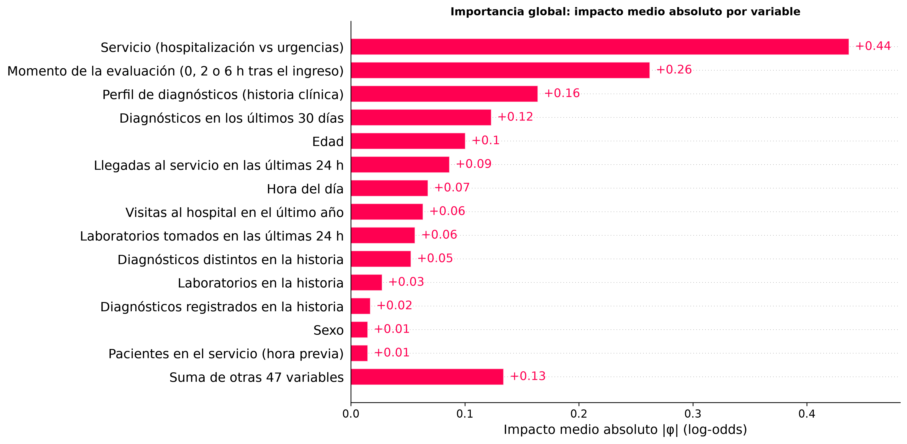

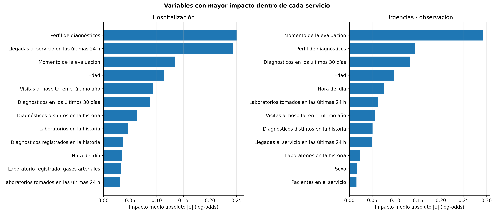

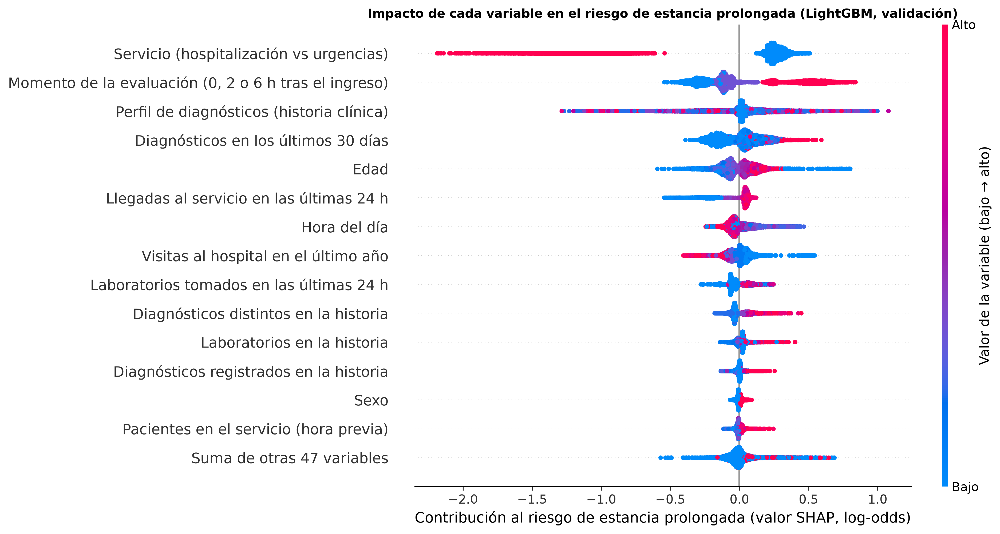

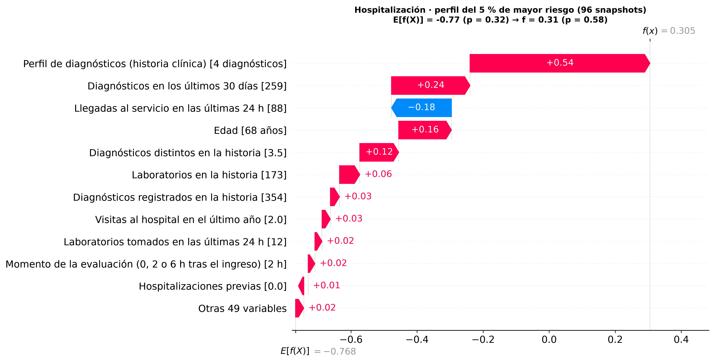

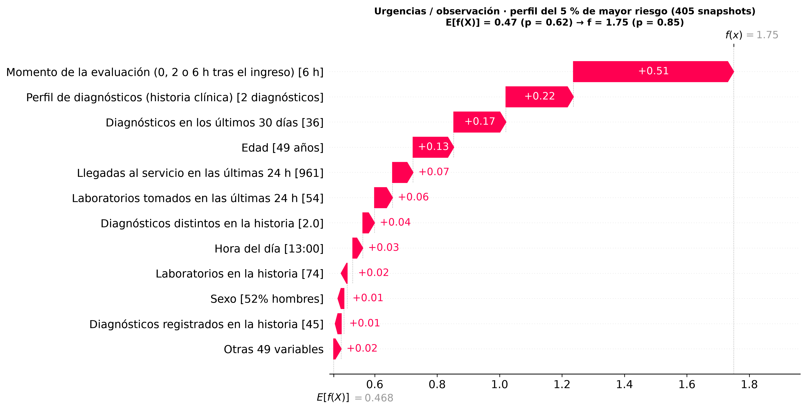

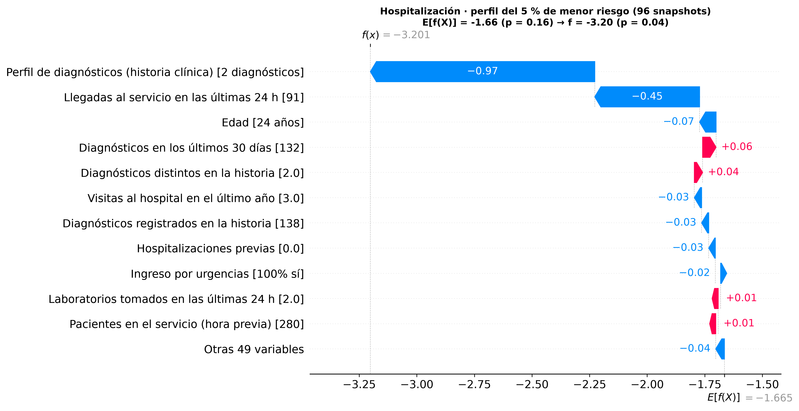

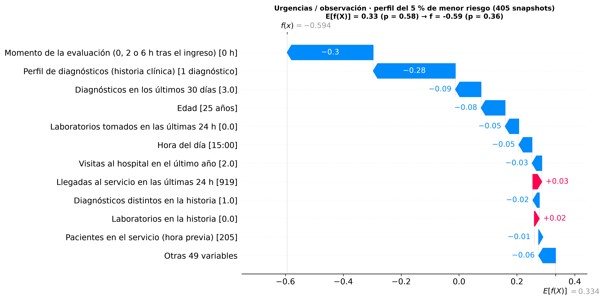

#### Síntesis clínica para el equipo médico


Modelo explicado: predicción de **estancia prolongada** (que la estancia supere el percentil 75 de su servicio), evaluado en pacientes que el modelo no vio durante el entrenamiento.

Riesgo promedio de partida: 53%. Cada variable sube o baja el riesgo de cada paciente a partir de ese punto.

##### Las 5 variables más influyentes en todo el hospital

1. Servicio (hospitalización vs urgencias) (admisión; 27 % de la influencia total). Estar en hospitalización se asocia con un riesgo menor de que la estancia supere lo habitual para su servicio. Este efecto refleja sobre todo cómo se define la estancia prolongada: el umbral es propio de cada servicio y, en urgencias, quien sigue allí a las 2 o 6 horas ya es un paciente de estancia larga. No significa que hospitalizar acorte la estancia.
2. Momento de la evaluación (0, 2 o 6 h tras el ingreso) (admisión; 16 % de la influencia total). Evaluar al paciente más horas después del ingreso se asocia con un riesgo mayor de que la estancia supere lo habitual para su servicio. Que el paciente siga en el servicio horas después del ingreso es en sí información pronóstica: cuanto más tiempo lleva, más probable es que su estancia sea larga.
3. Perfil de diagnósticos (historia clínica) (historia clínica; 10 % de la influencia total). Importa más qué diagnósticos tiene el paciente que cuántos. Entre los más frecuentes, los que más elevan el riesgo son: infección localizada de piel o tejido subcutáneo; cólico renal; infección de vías urinarias. Los que más lo reducen: amenaza de aborto; falso trabajo de parto a término (≥ 37 semanas); falso trabajo de parto.
4. Diagnósticos en los últimos 30 días (historia clínica; 8 % de la influencia total). Tener más diagnósticos recientes se asocia con un riesgo mayor de que la estancia supere lo habitual para su servicio.
5. Edad (admisión; 6 % de la influencia total). Mayor edad se asocia con un riesgo mayor de que la estancia supere lo habitual para su servicio.

##### Dentro de hospitalización

1. Perfil de diagnósticos (historia clínica) (historia clínica; 19 % de la influencia total). Importa más qué diagnósticos tiene el paciente que cuántos. Entre los más frecuentes, los que más elevan el riesgo son: infección localizada de piel o tejido subcutáneo; infección aguda de vías respiratorias bajas; dolor abdominal superior. Los que más lo reducen: falso trabajo de parto a término (≥ 37 semanas); falso trabajo de parto; parto por cesárea.
2. Llegadas al servicio en las últimas 24 h (presión del servicio; 18 % de la influencia total). Su efecto no es lineal: según el rango de valores puede aumentar o disminuir el riesgo, por lo que debe leerse junto con el resto del cuadro.
3. Momento de la evaluación (0, 2 o 6 h tras el ingreso) (admisión; 10 % de la influencia total). Evaluar al paciente más horas después del ingreso se asocia con un riesgo mayor de que la estancia supere lo habitual para su servicio. Que el paciente siga en el servicio horas después del ingreso es en sí información pronóstica: cuanto más tiempo lleva, más probable es que su estancia sea larga.
4. Edad (admisión; 9 % de la influencia total). Mayor edad se asocia con un riesgo mayor de que la estancia supere lo habitual para su servicio.
5. Visitas al hospital en el último año (historia clínica; 7 % de la influencia total). Tener más visitas en el último año se asocia con un riesgo menor de que la estancia supere lo habitual para su servicio.

##### Dentro de urgencias / observación

1. Momento de la evaluación (0, 2 o 6 h tras el ingreso) (admisión; 25 % de la influencia total). Evaluar al paciente más horas después del ingreso se asocia con un riesgo mayor de que la estancia supere lo habitual para su servicio. Que el paciente siga en el servicio horas después del ingreso es en sí información pronóstica: cuanto más tiempo lleva, más probable es que su estancia sea larga.
2. Perfil de diagnósticos (historia clínica) (historia clínica; 12 % de la influencia total). Importa más qué diagnósticos tiene el paciente que cuántos. Entre los más frecuentes, los que más elevan el riesgo son: infección localizada de piel o tejido subcutáneo; cólico renal; insuficiencia cardíaca congestiva. Los que más lo reducen: amenaza de aborto; hemorragia del tracto genitourinario; dolor pélvico y perineal.
3. Diagnósticos en los últimos 30 días (historia clínica; 11 % de la influencia total). Tener más diagnósticos recientes se asocia con un riesgo mayor de que la estancia supere lo habitual para su servicio.
4. Edad (admisión; 8 % de la influencia total). Mayor edad se asocia con un riesgo mayor de que la estancia supere lo habitual para su servicio.
5. Hora del día (calendario; 7 % de la influencia total). Una hora más tardía se asocia con un riesgo menor de que la estancia supere lo habitual para su servicio.

##### Diagnósticos que más mueven el riesgo dentro de cada servicio

- **Hospitalización, elevan el riesgo:** infección localizada de piel o tejido subcutáneo; infección aguda de vías respiratorias bajas; dolor abdominal superior; neumonía; hipertensión esencial
- **Hospitalización, reducen el riesgo:** falso trabajo de parto a término (≥ 37 semanas); falso trabajo de parto; parto por cesárea; cesárea de urgencia; dolor pélvico y perineal
- **Urgencias / observación, elevan el riesgo:** infección localizada de piel o tejido subcutáneo; cólico renal; insuficiencia cardíaca congestiva; infección de vías urinarias; hemorragia gastrointestinal
- **Urgencias / observación, reducen el riesgo:** amenaza de aborto; hemorragia del tracto genitourinario; dolor pélvico y perineal; falso trabajo de parto a término (≥ 37 semanas); falso trabajo de parto pretérmino (< 37 semanas)

##### Perfiles de mayor y menor riesgo dentro de cada servicio

- **Hospitalización, mayor riesgo** (riesgo estimado 57%, observado 59%): perfil de diagnósticos (4 diagnósticos), diagnósticos en los últimos 30 días (259), llegadas al servicio en las últimas 24 h (88), edad (68 años).
- **Hospitalización, menor riesgo** (riesgo estimado 4%, observado 4%): perfil de diagnósticos (2 diagnósticos), llegadas al servicio en las últimas 24 h (91), edad (24 años), diagnósticos en los últimos 30 días (132).
- **Urgencias / observación, mayor riesgo** (riesgo estimado 85%, observado 91%): momento de la evaluación (6 h), perfil de diagnósticos (2 diagnósticos), diagnósticos en los últimos 30 días (36), edad (49 años).
- **Urgencias / observación, menor riesgo** (riesgo estimado 36%, observado 31%): momento de la evaluación (0 h), perfil de diagnósticos (1 diagnóstico), diagnósticos en los últimos 30 días (3.0), edad (25 años).

##### Cómo leerlo

- Son asociaciones aprendidas de los registros, no relaciones causales.
- El registro clínico del hospital no incluye nivel de triaje, por lo que el modelo no lo usa.
- La presión del servicio y el calendario describen el contexto operativo, no el estado clínico del paciente.
- Los perfiles son promedios de grupos de pacientes; la explicación individual se calcula para cada paciente en el momento de usar el modelo.

**Código fuente · `modulo_7/m7_3_shap/`**


```python
# Archivo: modulo_7/m7_3_shap/explicabilidad.py
"""Subfase 7.3 · Explicabilidad global y local con SHAP (TreeExplainer sobre LightGBM).

Decisiones:
- **SHAP agrupado por variable clínica.** El modelo ve ~120 columnas transformadas: one-hot, escalado y 50
  componentes SVD del perfil de diagnósticos, que no son interpretables una por una. Los valores SHAP son
  aditivos, así que la contribución de una variable original es la **suma exacta** de las de sus columnas:
  las 50 SVD → "perfil de diagnósticos"; seno y coseno de la hora → "hora del día"; las categorías de un
  one-hot → la variable categórica.
- **Escala:** log-odds del modelo (`TreeExplainer`, salida cruda). E[f(X)] es el valor base en log-odds; las
  figuras anotan su equivalente en probabilidad.
- **Casos locales sin exponer pacientes** (regla 7 de CLAUDE.md: solo agregados en informes). Cada waterfall
  muestra el **perfil SHAP medio** de un grupo (5 % de mayor / menor riesgo), que también es aditivo:
  E[f(X)] + Σ φ̄_j = f̄ del grupo. Los valores que acompañan a cada variable son medianas (o proporciones)
  del grupo. Las explicaciones individuales se calculan a demanda en el despliegue (M8).
"""
from __future__ import annotations

import re

import numpy as np
import pandas as pd

# ---------------------------------------------------------------------------- vocabulario clínico
LAB = {
    "4016928": "hemograma completo", "4324383": "creatinina", "4074649": "nitrógeno ureico (BUN)",
    "46272908": "proteína C reactiva", "3019550": "sodio", "4245152": "potasio", "4099313": "uroanálisis",
    "3014576": "cloro", "4245261": "tiempo de protrombina", "44809202": "tiempo de tromboplastina (TTP)",
    "3013826": "glucosa", "4146380": "transaminasa ALT", "4263457": "transaminasa AST",
    "3045524": "bilirrubinas", "4239236": "gases arteriales", "40547237": "antibiograma",
    "4213582": "ácido láctico", "4246879": "TSH (tiroides)", "4184637": "hemoglobina glicosilada",
    "42529218": "prueba de VIH",
}

# variable → (etiqueta clínica, dominio, descripción del valor ALTO / de la categoría marcada)
ETIQUETAS: dict[str, tuple[str, str, str]] = {
    "horas_desde_ingreso": ("Momento de la evaluación (0, 2 o 6 h tras el ingreso)", "admisión",
                            "evaluar al paciente más horas después del ingreso"),
    "edad": ("Edad", "admisión", "mayor edad"),
    "sexo": ("Sexo", "admisión", "sexo masculino"),
    "servicio": ("Servicio (hospitalización vs urgencias)", "admisión", "estar en hospitalización"),
    "origen_urgencias": ("Ingreso por urgencias", "admisión", "haber ingresado por urgencias"),
    "horas_desde_ultima_alta_hosp": ("Tiempo desde la última alta hospitalaria", "historia clínica",
                                     "más tiempo desde la última alta"),
    "n_hospitalizaciones_previas": ("Hospitalizaciones previas", "historia clínica", "más hospitalizaciones previas"),
    "nunca_hospitalizado": ("Nunca hospitalizado antes", "historia clínica", "no tener hospitalizaciones previas"),
    "n_visitas_365d": ("Visitas al hospital en el último año", "historia clínica", "más visitas en el último año"),
    "n_dx_historia": ("Diagnósticos registrados en la historia", "historia clínica", "más diagnósticos registrados"),
    "n_dx_distintos_historia": ("Diagnósticos distintos en la historia", "historia clínica",
                                "más diagnósticos distintos (multimorbilidad)"),
    "n_dx_30d": ("Diagnósticos en los últimos 30 días", "historia clínica", "más diagnósticos recientes"),
    "sin_dx_historia": ("Sin diagnósticos previos", "historia clínica", "no tener diagnósticos previos"),
    "dx_codigos": ("Perfil de diagnósticos (historia clínica)", "historia clínica",
                   "un perfil de diagnósticos más cargado"),
    "n_mediciones_24h": ("Laboratorios tomados en las últimas 24 h", "laboratorios", "más laboratorios en 24 h"),
    "n_mediciones_historia": ("Laboratorios en la historia", "laboratorios", "más laboratorios en la historia"),
    "sin_mediciones_24h": ("Sin laboratorios en las últimas 24 h", "laboratorios", "no tener laboratorios en 24 h"),
    "sin_mediciones_historia": ("Sin laboratorios previos", "laboratorios", "no tener laboratorios previos"),
    "censo_servicio_t_menos_1h": ("Pacientes en el servicio (hora previa)", "presión del servicio",
                                  "más pacientes en el servicio"),
    "ocupacion_servicio_t_menos_1h": ("Ocupación del servicio (hora previa)", "presión del servicio",
                                      "mayor ocupación del servicio"),
    "llegadas_servicio_t_menos_1h": ("Llegadas al servicio (hora previa)", "presión del servicio", "más llegadas"),
    "srv_llegadas_suma_4h": ("Llegadas al servicio en las últimas 4 h", "presión del servicio", "más llegadas en 4 h"),
    "srv_llegadas_suma_24h": ("Llegadas al servicio en las últimas 24 h", "presión del servicio", "más llegadas en 24 h"),
    "srv_ocupacion_media_3h": ("Ocupación media del servicio (3 h)", "presión del servicio", "mayor ocupación"),
    "srv_ocupacion_media_6h": ("Ocupación media del servicio (6 h)", "presión del servicio", "mayor ocupación"),
    "srv_ocupacion_media_12h": ("Ocupación media del servicio (12 h)", "presión del servicio", "mayor ocupación"),
    "srv_ocupacion_media_24h": ("Ocupación media del servicio (24 h)", "presión del servicio", "mayor ocupación"),
    "srv_ocupacion_max_24h": ("Ocupación máxima del servicio (24 h)", "presión del servicio", "mayor pico de ocupación"),
    "srv_ocupacion_std_24h": ("Variabilidad de la ocupación (24 h)", "presión del servicio", "ocupación más inestable"),
    "srv_ocupacion_tendencia_3h": ("Tendencia de la ocupación (3 h)", "presión del servicio", "ocupación en aumento"),
    "srv_frac_horas_sobre_umbral_24h": ("Horas del servicio por encima del umbral de saturación (24 h)",
                                        "presión del servicio", "más horas saturado"),
    "srv_ocupacion_semana_previa": ("Ocupación del servicio la semana anterior", "presión del servicio",
                                    "mayor ocupación la semana anterior"),
    "hora_del_dia": ("Hora del día", "calendario", "una hora más tardía"),
    "dia_semana": ("Día de la semana", "calendario", "más cerca del fin de semana"),
    "turno": ("Turno (mañana / tarde / noche)", "calendario", "un turno más tardío"),
    "mes": ("Mes del año", "calendario", "meses más avanzados del año"),
    "es_fin_de_semana": ("Fin de semana", "calendario", "ser fin de semana"),
    "es_festivo": ("Día festivo", "calendario", "ser festivo"),
    "es_hora_pico_urgencias": ("Hora pico de urgencias", "calendario", "estar en hora pico"),
    "tras_festivo": ("Día siguiente a un festivo", "calendario", "ser el día siguiente a un festivo"),
    "primer_dia_habil": ("Primer día hábil", "calendario", "ser primer día hábil"),
}
for _cid, _nom in LAB.items():
    ETIQUETAS[f"has_measurement_{_cid}"] = (f"Laboratorio registrado: {_nom}", "laboratorios",
                                            f"tener registrado {_nom}")

# Traducción al español de los diagnósticos (nombres OMOP en inglés) que aparecen en los informes
TRADUCCION_DX = {
    "Localized infection of skin AND/OR subcutaneous tissue": "infección localizada de piel o tejido subcutáneo",
    "Acute lower respiratory tract infection": "infección aguda de vías respiratorias bajas",
    "Upper abdominal pain": "dolor abdominal superior",
    "Pneumonia": "neumonía",
    "Essential hypertension": "hipertensión esencial",
    "Renal colic": "cólico renal",
    "Congestive heart failure": "insuficiencia cardíaca congestiva",
    "Urinary tract infectious disease": "infección de vías urinarias",
    "Gastrointestinal hemorrhage": "hemorragia gastrointestinal",
    "False labor at or after 37 completed weeks of gestation": "falso trabajo de parto a término (≥ 37 semanas)",
    "False labor before 37 completed weeks of gestation": "falso trabajo de parto pretérmino (< 37 semanas)",
    "False labor": "falso trabajo de parto",
    "Deliveries by cesarean": "parto por cesárea",
    "Delivery by emergency cesarean section": "cesárea de urgencia",
    "Pelvic and perineal pain": "dolor pélvico y perineal",
    "Threatened miscarriage": "amenaza de aborto",
    "Genitourinary tract hemorrhage": "hemorragia del tracto genitourinario",
}

# Notas para variables cuyo efecto viene de la definición del objetivo, no de la fisiología
NOTAS = {
    "servicio": ("Este efecto refleja sobre todo cómo se define la estancia prolongada: el umbral es propio de cada "
                 "servicio y, en urgencias, quien sigue allí a las 2 o 6 horas ya es un paciente de estancia larga. "
                 "No significa que hospitalizar acorte la estancia."),
    "horas_desde_ingreso": ("Que el paciente siga en el servicio horas después del ingreso es en sí información "
                            "pronóstica: cuanto más tiempo lleva, más probable es que su estancia sea larga."),
}

FUSIONES = {"hour_sin": "hora_del_dia", "hour_cos": "hora_del_dia", "dow_sin": "dia_semana", "dow_cos": "dia_semana"}
TURNO_ORDEN = {"manana": 0, "mañana": 0, "tarde": 1, "noche": 2}


def etiqueta(var: str) -> str:
    return ETIQUETAS.get(var, (var, "otro", var))[0]


# ---------------------------------------------------------------------------- agrupación
def mapa_grupos(nombres: list[str], esquema) -> list[str]:
    """Variable clínica original de cada columna transformada (salida de `get_feature_names_out`)."""
    cats = sorted(esquema.cat, key=len, reverse=True)  # el prefijo más largo gana (p. ej. es_festivo vs es_...)
    grupos = []
    for n in nombres:
        rama, _, resto = n.partition("__")
        if rama in ("num", "num_log"):
            grupos.append(FUSIONES.get(resto, resto))
        elif rama == "cat":
            g = next((c for c in cats if resto == c or resto.startswith(c + "_")), None)
            if g is None:
                raise ValueError(f"No se reconoce la variable categórica de la columna {n}")
            grupos.append(g)
        elif rama == "clinica":
            grupos.append(esquema.clinica)
        else:
            raise ValueError(f"Rama desconocida en la columna {n}")
    return grupos


def agrupar_shap(phi: np.ndarray, grupos: list[str]) -> pd.DataFrame:
    """Suma exacta de los SHAP de las columnas de cada variable original (n × variables)."""
    g = pd.Index(grupos)
    orden = list(dict.fromkeys(grupos))
    return pd.DataFrame({v: phi[:, np.flatnonzero(g == v)].sum(axis=1) for v in orden})


def valores_color(X: pd.DataFrame, variables: list[str], clinica: str | None = None) -> pd.DataFrame:
    """Valor numérico (en unidades originales) de cada variable, para colorear el beeswarm y describir perfiles."""
    out = {}
    for v in variables:
        if v == clinica:
            out[v] = X[v].fillna("").astype(str).str.split().str.len().astype(float)
        elif v == "servicio":
            out[v] = (X[v] == "hospitalizacion").astype(float)
        elif v == "sexo":
            out[v] = (X[v] == "M").astype(float)
        elif v == "turno":
            out[v] = X[v].astype(str).str.lower().map(TURNO_ORDEN).astype(float)
        elif v in X.columns:
            out[v] = pd.to_numeric(X[v].astype(float) if X[v].dtype == bool else X[v], errors="coerce")
        else:
            out[v] = np.nan
    return pd.DataFrame(out, index=X.index).reset_index(drop=True)


# ---------------------------------------------------------------------------- SHAP
def explicar(modelo_lgbm, Z: np.ndarray) -> tuple[np.ndarray, float]:
    """φ (n × p) en log-odds y valor base E[f(X)] con TreeExplainer (exacto para árboles)."""
    import shap
    ex = shap.TreeExplainer(modelo_lgbm)
    phi = ex.shap_values(Z)
    base = ex.expected_value
    if isinstance(phi, list):  # versiones antiguas: una matriz por clase
        phi, base = phi[1], base[1]
    phi = np.asarray(phi)
    if phi.ndim == 3:
        phi = phi[:, :, 1]
    base = float(np.ravel(base)[-1])
    return phi, base


def importancia_global(phi_g: pd.DataFrame, colores: pd.DataFrame) -> pd.DataFrame:
    """Impacto medio |φ| por variable, su porcentaje del total y la dirección (Spearman valor ↔ φ)."""
    filas = []
    total = phi_g.abs().mean().sum()
    for v in phi_g.columns:
        c = colores[v]
        ok = c.notna()
        rho = (pd.Series(c[ok]).rank().corr(pd.Series(phi_g[v][ok]).rank())
               if ok.sum() > 2 and c[ok].nunique() > 1 else np.nan)
        filas.append({"variable": v, "etiqueta": etiqueta(v), "dominio": ETIQUETAS.get(v, ("", "otro", ""))[1],
                      "media_abs_shap": phi_g[v].abs().mean(), "porcentaje": 100 * phi_g[v].abs().mean() / total,
                      "spearman_valor_shap": rho})
    return pd.DataFrame(filas).sort_values("media_abs_shap", ascending=False).reset_index(drop=True)


def perfil(phi_g: pd.DataFrame, colores: pd.DataFrame, mascara) -> tuple[pd.Series, pd.Series]:
    """SHAP medio y valor típico (mediana; proporción en binarias) de un grupo de snapshots."""
    m = np.asarray(mascara)
    c = colores[m]
    tipico = pd.Series({v: (c[v].mean() if c[v].dropna().isin([0, 1]).all() else c[v].median()) for v in c.columns})
    return phi_g[m].mean(), tipico


def _direccion(rho: float) -> str | None:
    if np.isnan(rho) or abs(rho) < 0.2:
        return None
    return "mayor" if rho > 0 else "menor"


def efecto_diagnosticos(phi_dx, codigos, nombres: dict[str, str], min_n: int = 100, top: int = 5) -> pd.DataFrame:
    """Diagnósticos (frecuencia ≥ min_n) cuya presencia más sube o baja la contribución del perfil de diagnósticos.

    diferencia = SHAP medio del perfil de diagnósticos con el código presente − con el código ausente (log-odds).
    """
    phi_dx = np.asarray(phi_dx, float)
    listas = pd.Series(codigos).fillna("").astype(str).str.split()
    cuenta = listas.explode().dropna().value_counts()
    filas = []
    for c in cuenta[cuenta >= min_n].index:
        pres = listas.apply(lambda l, c=c: c in l).to_numpy()
        if pres.all():
            continue
        filas.append({"codigo": c, "diagnostico": nombres.get(c, c), "n_snapshots": int(pres.sum()),
                      "shap_con": phi_dx[pres].mean(), "shap_sin": phi_dx[~pres].mean(),
                      "diferencia": phi_dx[pres].mean() - phi_dx[~pres].mean()})
    df = pd.DataFrame(filas)
    if df.empty:
        return df
    df = df.sort_values("diferencia", ascending=False)
    return pd.concat([df.head(top).assign(efecto="aumenta"), df.tail(top).iloc[::-1].assign(efecto="reduce")])


def sintesis_medica(imp: pd.DataFrame, n: int = 5, dx: pd.DataFrame | None = None) -> str:
    """Texto en lenguaje clínico para las n variables con mayor impacto (sin términos de programación)."""
    lineas = []
    for i, (_, r) in enumerate(imp.head(n).iterrows()):
        alto = ETIQUETAS.get(r.variable, (r.etiqueta, "", r.etiqueta))[2]
        if alto.startswith("más "):
            alto = "tener " + alto  # concordancia: "tener más X se asocia…"
        d = _direccion(r.spearman_valor_shap)
        if r.variable == "dx_codigos" and dx is not None and len(dx):
            sube = "; ".join(dx[dx.efecto == "aumenta"].diagnostico.head(3))
            baja = "; ".join(dx[dx.efecto == "reduce"].diagnostico.head(3))
            cuerpo = (f"Importa más qué diagnósticos tiene el paciente que cuántos. Entre los más frecuentes, los que más "
                      f"elevan el riesgo son: {sube}. Los que más lo reducen: {baja}.")
        elif d:
            cuerpo = (f"{alto[0].upper() + alto[1:]} se asocia con un riesgo {d} de que la estancia supere lo habitual "
                      "para su servicio.")
        else:
            cuerpo = ("Su efecto no es lineal: según el rango de valores puede aumentar o disminuir el riesgo, por lo que "
                      "debe leerse junto con el resto del cuadro.")
        nota = f" {NOTAS[r.variable]}" if r.variable in NOTAS else ""
        lineas.append(f"{i + 1}. {r.etiqueta} ({r.dominio}; {r.porcentaje:.0f} % de la influencia total). {cuerpo}{nota}")
    return "\n".join(lineas)


def formatear_valor(var: str, v) -> str:
    """Valor típico legible para el waterfall (sin códigos internos)."""
    if v is None or (isinstance(v, float) and np.isnan(v)):
        return "—"
    if var == "servicio":
        return "hospitalización" if v >= 0.5 else "urgencias"
    if var == "sexo":
        return f"{v:.0%} hombres"
    if var == "horas_desde_ingreso":
        return f"{v:.0f} h"
    if var == "edad":
        return f"{v:.0f} años"
    if var == "hora_del_dia":
        return f"{v:.0f}:00"
    if var == "dx_codigos":
        return f"{v:.0f} diagnóstico" + ("" if round(v) == 1 else "s")
    if var.startswith(("ocupacion", "srv_ocupacion", "srv_frac")):
        return f"{v:.2f}"
    if 0 <= v <= 1 and var.startswith(("es_", "sin_", "has_", "nunca", "origen", "tras", "primer")):
        return f"{v:.0%} sí"
    return f"{v:.0f}" if abs(v) >= 10 else f"{v:.1f}"


# ---------------------------------------------------------------------------- gráficos
def _plt():
    import matplotlib
    matplotlib.use("Agg")
    import matplotlib.pyplot as plt
    return plt


def _traducir(fig) -> None:
    """Pasa al español los textos fijos que dibuja shap."""
    reemplazos = [(r"^Sum of (\d+) other features$", r"Suma de otras \1 variables"),
                  (r"^(\d+) other features$", r"Otras \1 variables"), (r"^High$", "Alto"), (r"^Low$", "Bajo")]

    def tr(t):
        for pat, rep in reemplazos:
            t = re.sub(pat, rep, t)
        return t

    for ax in fig.axes:
        for t in ax.texts:
            t.set_text(tr(t.get_text()))
        ys = ax.get_yticklabels()
        if ys:
            ax.set_yticks(ax.get_yticks(), [tr(l.get_text()) for l in ys])


def explicacion(phi_g: pd.DataFrame, base: float, colores: pd.DataFrame):
    import shap
    return shap.Explanation(values=phi_g.to_numpy(), base_values=np.full(len(phi_g), base),
                            data=colores[phi_g.columns].to_numpy(), feature_names=[etiqueta(v) for v in phi_g.columns])


def graficar_beeswarm(exp, ruta, titulo: str, max_display: int = 15) -> None:
    import shap
    plt = _plt()
    shap.plots.beeswarm(exp, max_display=max_display, show=False, plot_size=(10, 7.5),
                        color_bar_label="Valor de la variable (bajo → alto)")
    plt.title(titulo, fontweight="bold", fontsize=11)
    plt.xlabel("Contribución al riesgo de estancia prolongada (valor SHAP, log-odds)")
    _traducir(plt.gcf())
    plt.savefig(ruta, dpi=300, bbox_inches="tight")
    plt.close("all")


def graficar_barras(exp, ruta, titulo: str, max_display: int = 15) -> None:
    import shap
    plt = _plt()
    shap.plots.bar(exp, max_display=max_display, show=False)
    fig = plt.gcf()
    fig.set_size_inches(10, 7)
    plt.title(titulo, fontweight="bold", fontsize=11)
    plt.xlabel("Impacto medio absoluto |φ| (log-odds)")
    _traducir(plt.gcf())
    plt.savefig(ruta, dpi=300, bbox_inches="tight")
    plt.close("all")


def graficar_waterfall(phi_medio: pd.Series, tipico: pd.Series, base: float, ruta, titulo: str,
                       max_display: int = 12) -> None:
    import shap
    plt = _plt()
    nombres = [f"{etiqueta(v)} [{formatear_valor(v, tipico.get(v))}]" for v in phi_medio.index]
    exp = shap.Explanation(values=phi_medio.to_numpy(), base_values=base, data=None, feature_names=nombres)
    shap.plots.waterfall(exp, max_display=max_display, show=False)
    fig = plt.gcf()
    fig.set_size_inches(10, 7)
    f = base + phi_medio.sum()
    sig = lambda z: 1 / (1 + np.exp(-z))  # noqa: E731
    plt.title(f"{titulo}\nE[f(X)] = {base:.2f} (p = {sig(base):.2f}) → f = {f:.2f} (p = {sig(f):.2f})",
              fontweight="bold", fontsize=11)
    _traducir(fig)
    plt.savefig(ruta, dpi=300, bbox_inches="tight")
    plt.close("all")


def graficar_barras_por_servicio(imps: dict[str, pd.DataFrame], ruta, n: int = 12) -> None:
    plt = _plt()
    fig, ejes = plt.subplots(1, len(imps), figsize=(7.5 * len(imps), 6.5))
    for a, (srv, imp) in zip(np.atleast_1d(ejes), imps.items()):
        t = imp.head(n).iloc[::-1]
        a.barh([re.sub(r" \(.*\)$", "", e) for e in t.etiqueta], t.media_abs_shap, color="#1f77b4")
        a.set(title=srv, xlabel="Impacto medio absoluto |φ| (log-odds)")
        a.grid(alpha=0.3, axis="x")
    fig.suptitle("Variables con mayor impacto dentro de cada servicio", fontweight="bold")
    fig.tight_layout()
    fig.savefig(ruta, dpi=300, bbox_inches="tight")
    plt.close(fig)

```

**Ejecución sobre los datos reales**


```python
# Archivo: modulo_7/m7_3_shap/run_m7_3.py
"""Subfase 7.3 sobre los datos reales: SHAP del mejor modelo (LightGBM) en una muestra de validación.

- Modelo: el Pipeline LightGBM de la 6.4 (hiperparámetros de `hiperparametros_finales.json`) reentrenado **sin
  el pliegue 1**. Se explica una muestra estratificada (servicio × τ × etiqueta) de 10 000 snapshots del pliegue 1:
  pacientes que ese modelo nunca vio (validación agrupada de la 6.1). La prueba temporal no se toca.
- Los SHAP agrupados quedan en caché (`data/m7/shap_m7_3.parquet`, nivel paciente: no compartir); con
  `--recalcular` se reentrena y se recalcula.
- Casos de estudio **dentro de cada servicio** (5 % de mayor / menor riesgo), como perfiles agregados.
- Figuras (PNG, 300 DPI) en reports/figures/; tablas agregadas en outputs/m7/tablas/; síntesis clínica en
  reports/m7_3_sintesis_medica.md.

Uso (desde la raíz del proyecto):
    python modulo_7/m7_3_shap/run_m7_3.py [--n 10000] [--recalcular]
"""
from __future__ import annotations

import argparse
import json
import sys
import time
import warnings
from datetime import datetime
from pathlib import Path

import numpy as np
import pandas as pd
from sklearn.metrics import roc_auc_score

if hasattr(sys.stdout, "reconfigure"):
    sys.stdout.reconfigure(encoding="utf-8")

ROOT = Path(__file__).resolve().parents[2]
sys.path.insert(0, str(ROOT))

from modulo_5.m5_4_pipeline import construir_preprocesador, preparar_X  # noqa: E402
from modulo_6.m6_4_diagnostico import instanciar  # noqa: E402
from modulo_7.m7_3_shap import (  # noqa: E402
    TRADUCCION_DX,
    agrupar_shap,
    efecto_diagnosticos,
    etiqueta,
    explicacion,
    explicar,
    formatear_valor,
    graficar_barras,
    graficar_barras_por_servicio,
    graficar_beeswarm,
    graficar_waterfall,
    importancia_global,
    mapa_grupos,
    perfil,
    sintesis_medica,
    valores_color,
)

TARGET = "y_target_los_largo"
MODELO = "lightgbm"
PLIEGUE_EXPLICADO = 1
FIG, TAB, REP = ROOT / "reports" / "figures", ROOT / "outputs" / "m7" / "tablas", ROOT / "reports"
CACHE, CACHE_META = ROOT / "data" / "m7" / "shap_m7_3.parquet", ROOT / "data" / "m7" / "shap_m7_3.json"
NOMBRE_SRV = {"hospitalizacion": "Hospitalización", "urgencias_observacion": "Urgencias / observación"}
CORTO_SRV = {"hospitalizacion": "hosp", "urgencias_observacion": "urg"}
SIG = lambda z: 1 / (1 + np.exp(-z))  # noqa: E731


def log(msg):
    print(f"[{datetime.now():%H:%M:%S}] {msg}", flush=True)


def calcular(tr, esquema, cols, n):
    hp = json.loads((ROOT / "outputs" / "m6" / "hiperparametros_finales.json").read_text(encoding="utf-8"))["modelos"]
    t0 = time.time()
    ent, val = tr[tr.pliegue != PLIEGUE_EXPLICADO], tr[tr.pliegue == PLIEGUE_EXPLICADO].reset_index(drop=True)
    pipe = instanciar(MODELO, hp[MODELO], construir_preprocesador(esquema)).fit(ent[cols], ent[TARGET])
    auc_val = roc_auc_score(val[TARGET], pipe.predict_proba(val[cols])[:, 1])
    log(f"{MODELO} sin el pliegue {PLIEGUE_EXPLICADO}: {len(ent):,} filas · AUC en el pliegue {auc_val:.4f} "
        f"({(time.time() - t0) / 60:.1f} min)")
    estrato = val.servicio + "_" + val.horas_desde_ingreso.astype(str) + "_" + val[TARGET].astype(str)
    mu = (val.groupby(estrato, group_keys=False).sample(frac=min(1.0, n / len(val)), random_state=42)
          .reset_index(drop=True))
    pre, lgbm = pipe.named_steps["preprocesador"], pipe.named_steps["modelo"]
    Z = pre.transform(mu[cols])
    t0 = time.time()
    phi, base = explicar(lgbm, Z)
    margen = lgbm.predict(Z, raw_score=True)
    err = float(np.abs(base + phi.sum(axis=1) - margen).max())
    if err > 1e-4:
        raise ValueError(f"SHAP no aditivo (error máximo {err:.2e})")
    nombres = list(pre.get_feature_names_out())
    phi_g = agrupar_shap(phi, mapa_grupos(nombres, esquema))
    log(f"SHAP: {len(mu):,} snapshots × {len(nombres)} columnas → {phi_g.shape[1]} variables clínicas "
        f"({(time.time() - t0):.0f} s; aditividad exacta, error máx. {err:.1e})")
    phi_g.assign(snapshot_id=mu.snapshot_id.to_numpy(), _margen=margen).to_parquet(CACHE, index=False)
    CACHE_META.write_text(json.dumps({"base": base, "auc_pliegue": auc_val, "n_columnas": len(nombres),
                                      "error_aditividad": err, "fecha": datetime.now().isoformat(timespec="seconds")},
                                     indent=2), encoding="utf-8")


def main() -> None:
    ap = argparse.ArgumentParser()
    ap.add_argument("--n", type=int, default=10_000)
    ap.add_argument("--recalcular", action="store_true")
    a = ap.parse_args()
    warnings.filterwarnings("ignore")
    for d in (FIG, TAB, CACHE.parent):
        d.mkdir(parents=True, exist_ok=True)

    X, esquema = preparar_X(ROOT)
    tr = X[X.en_periodo_estable.astype(bool) & X.es_entrenamiento.astype(bool)].reset_index(drop=True)
    pl = pd.read_parquet(ROOT / "data" / "m6" / "pliegues_m6_1.parquet")
    if not pl.snapshot_id.reset_index(drop=True).equals(tr.snapshot_id):
        raise ValueError("Pliegues de la 6.1 no alineados con el entrenamiento estable")
    tr["pliegue"] = pl.pliegue.to_numpy()
    cols = esquema.todas()
    if a.recalcular or not CACHE.exists():
        calcular(tr, esquema, cols, a.n)
    cache = pd.read_parquet(CACHE)
    meta = json.loads(CACHE_META.read_text(encoding="utf-8"))
    base = meta["base"]
    mu = tr.set_index("snapshot_id").loc[cache.snapshot_id].reset_index()
    margen = cache.pop("_margen").to_numpy()
    phi_g = cache.drop(columns="snapshot_id")
    col = valores_color(mu, list(phi_g.columns), clinica=esquema.clinica)
    srv = mu.servicio.to_numpy()
    log(f"{len(mu):,} snapshots explicados · E[f(X)] = {base:.3f} (p = {SIG(base):.3f}) · AUC del modelo en el pliegue "
        f"{meta['auc_pliegue']:.4f}")

    # ---------------- importancia global y por servicio (dentro de un servicio, "servicio" es constante)
    imp = importancia_global(phi_g, col)
    imp.to_csv(TAB / "m7_3_importancia_shap.csv", index=False)
    imps_srv = {}
    for s in np.unique(srv):
        m = srv == s
        sin_srv = [c for c in phi_g.columns if c != "servicio"]
        imps_srv[NOMBRE_SRV[s]] = importancia_global(phi_g.loc[m, sin_srv].reset_index(drop=True),
                                                     col.loc[m, sin_srv].reset_index(drop=True))
    pd.concat([d.assign(servicio=s) for s, d in imps_srv.items()]).to_csv(TAB / "m7_3_importancia_shap_por_servicio.csv",
                                                                           index=False)

    # ---------------- diagnósticos concretos detrás del "perfil de diagnósticos"
    concept = pd.read_parquet(ROOT / "data" / "raw" / "concept.parquet", columns=["concept_id", "concept_name"])
    nombres_dx = {f"dx_{int(c)}": TRADUCCION_DX.get(n, n) for c, n in zip(concept.concept_id, concept.concept_name)}
    dx = efecto_diagnosticos(phi_g[esquema.clinica], mu[esquema.clinica], nombres_dx, min_n=100, top=5)
    dx_srv = {}
    for s in np.unique(srv):
        m = srv == s
        dx_srv[NOMBRE_SRV[s]] = efecto_diagnosticos(phi_g.loc[m, esquema.clinica].to_numpy(),
                                                    mu.loc[m, esquema.clinica].reset_index(drop=True), nombres_dx,
                                                    min_n=max(30, int(0.01 * m.sum())), top=5)
    pd.concat([dx.assign(servicio="todos")] + [d.assign(servicio=k) for k, d in dx_srv.items()]).to_csv(
        TAB / "m7_3_diagnosticos_shap.csv", index=False)

    # ---------------- figuras globales
    exp = explicacion(phi_g, base, col)
    graficar_beeswarm(exp, FIG / "m7_3_shap_beeswarm.png",
                      "Impacto de cada variable en el riesgo de estancia prolongada (LightGBM, validación)")
    graficar_barras(exp, FIG / "m7_3_shap_bar.png", "Importancia global: impacto medio absoluto por variable")
    graficar_barras_por_servicio(imps_srv, FIG / "m7_3_shap_bar_por_servicio.png")

    # ---------------- casos de estudio: perfiles agregados dentro de cada servicio
    for viejo in ("m7_3_shap_waterfall_alto_riesgo.png", "m7_3_shap_waterfall_bajo_riesgo.png"):
        (FIG / viejo).unlink(missing_ok=True)
    riesgo, filas = SIG(margen), []
    for s in np.unique(srv):
        ms = srv == s
        q95, q05 = np.quantile(riesgo[ms], [0.95, 0.05])
        for nombre, mk in (("alto_riesgo", ms & (riesgo >= q95)), ("bajo_riesgo", ms & (riesgo <= q05))):
            medio, tipico = perfil(phi_g, col, mk)
            medio = medio.drop("servicio")  # constante dentro del servicio: se suma al punto de partida
            base_srv = base + float(phi_g.loc[mk, "servicio"].mean())
            txt = "mayor" if nombre == "alto_riesgo" else "menor"
            graficar_waterfall(medio, tipico, base_srv, FIG / f"m7_3_shap_waterfall_{nombre}_{CORTO_SRV[s]}.png",
                               f"{NOMBRE_SRV[s]} · perfil del 5 % de {txt} riesgo ({int(mk.sum())} snapshots)")
            for v in medio.abs().sort_values(ascending=False).head(8).index:
                filas.append({"servicio": s, "caso": nombre, "n_snapshots": int(mk.sum()),
                              "riesgo_medio_predicho": riesgo[mk].mean(), "tasa_observada": mu[TARGET][mk].mean(),
                              "variable": etiqueta(v), "shap_medio": medio[v], "valor_tipico": formatear_valor(v, tipico[v])})
            log(f"{s} · {nombre}: {int(mk.sum())} snapshots · riesgo predicho {riesgo[mk].mean():.3f} · "
                f"observado {mu[TARGET][mk].mean():.3f}")
    casos = pd.DataFrame(filas)
    casos.to_csv(TAB / "m7_3_casos_estudio.csv", index=False)

    # ---------------- síntesis clínica
    texto = sintesis_medica(imp, 5, dx)
    texto_srv = {s: sintesis_medica(d, 5, dx_srv[s]) for s, d in imps_srv.items()}
    md = ["# Síntesis clínica de la explicabilidad del modelo (Subfase 7.3)", "",
          "Modelo explicado: predicción de **estancia prolongada** (que la estancia supere el percentil 75 de su "
          "servicio), evaluado en pacientes que el modelo no vio durante el entrenamiento.", "",
          f"Riesgo promedio de partida: {SIG(base):.0%}. Cada variable sube o baja el riesgo de cada paciente a partir "
          "de ese punto.", "", "## Las 5 variables más influyentes en todo el hospital", "", texto, ""]
    for s, t in texto_srv.items():
        md += [f"## Dentro de {s.lower()}", "", t, ""]
    md += ["## Diagnósticos que más mueven el riesgo dentro de cada servicio", ""]
    for k, d in dx_srv.items():
        for efecto, titulo in (("aumenta", "elevan el riesgo"), ("reduce", "reducen el riesgo")):
            md.append(f"- **{k}, {titulo}:** " + "; ".join(d[d.efecto == efecto].diagnostico))
    md += ["", "## Perfiles de mayor y menor riesgo dentro de cada servicio", ""]
    for (s, caso), d in casos.groupby(["servicio", "caso"], sort=False):
        top = d.sort_values("shap_medio", key=abs, ascending=False).head(4)
        partes = [f"{r.variable.split(' (')[0].lower()} ({r.valor_tipico})" for r in top.itertuples()]
        md.append(f"- **{NOMBRE_SRV[s]}, {'mayor' if caso == 'alto_riesgo' else 'menor'} riesgo** (riesgo estimado "
                  f"{d.riesgo_medio_predicho.iloc[0]:.0%}, observado {d.tasa_observada.iloc[0]:.0%}): "
                  + ", ".join(partes) + ".")
    md += ["", "## Cómo leerlo", "",
           "- Son asociaciones aprendidas de los registros, no relaciones causales.",
           "- El registro clínico del hospital no incluye nivel de triaje, por lo que el modelo no lo usa.",
           "- La presión del servicio y el calendario describen el contexto operativo, no el estado clínico del paciente.",
           "- Los perfiles son promedios de grupos de pacientes; la explicación individual se calcula para cada paciente "
           "en el momento de usar el modelo."]
    (REP / "m7_3_sintesis_medica.md").write_text("\n".join(md), encoding="utf-8")

    print("\nImportancia global (top 15):")
    print(imp.head(15)[["etiqueta", "dominio", "media_abs_shap", "porcentaje", "spearman_valor_shap"]]
          .round(3).to_string(index=False))
    print("\nImportancia por dominio (%):")
    print(imp.groupby("dominio").porcentaje.sum().sort_values(ascending=False).round(1).to_string())
    for s, d in imps_srv.items():
        print(f"\nTop 8 en {s} (sin la variable servicio):")
        print(d.head(8)[["etiqueta", "porcentaje", "spearman_valor_shap"]].round(3).to_string(index=False))
    for k, d in [("todos", dx)] + list(dx_srv.items()):
        print(f"\nDiagnósticos con mayor efecto · {k} (log-odds, presente − ausente):")
        print(d[["efecto", "diagnostico", "n_snapshots", "diferencia"]].round(3).to_string(index=False))
    print("\n" + "\n".join(md))
    log("Listo")


if __name__ == "__main__":
    main()

```

**Pruebas con datos sintéticos**


```python
# Archivo: modulo_7/m7_3_shap/test_explicabilidad.py
"""Pruebas de la subfase 7.3 con datos sintéticos (no usa datos reales).

    python -m pytest modulo_7/m7_3_shap -q
"""
from __future__ import annotations

import json
import re
import sys
from pathlib import Path

import numpy as np
import pandas as pd
import pytest

sys.path.insert(0, str(Path(__file__).resolve().parents[2]))

pytest.importorskip("shap")
from lightgbm import LGBMClassifier  # noqa: E402

from modulo_5.m5_4_pipeline import EsquemaPipeline, construir_preprocesador  # noqa: E402
from modulo_7.m7_3_shap import (  # noqa: E402
    ETIQUETAS,
    agrupar_shap,
    efecto_diagnosticos,
    formatear_valor,
    explicacion,
    explicar,
    graficar_barras,
    graficar_barras_por_servicio,
    graficar_beeswarm,
    graficar_waterfall,
    importancia_global,
    mapa_grupos,
    perfil,
    sintesis_medica,
    valores_color,
)

ESQ = EsquemaPipeline(num=["edad", "hour_sin", "hour_cos"], num_log=["n_dx_historia"],
                      cat=["servicio", "sexo", "es_festivo", "es_fin_de_semana"], clinica="dx_codigos")


def _ajustado(n=1500, semilla=0):
    rng = np.random.default_rng(semilla)
    hora = rng.integers(0, 24, n)
    cod = np.array([f"dx_{i}" for i in range(30)])
    X = pd.DataFrame({
        "edad": rng.normal(50, 18, n), "hora_del_dia": hora,
        "hour_sin": np.sin(2 * np.pi * hora / 24), "hour_cos": np.cos(2 * np.pi * hora / 24),
        "n_dx_historia": rng.poisson(4, n).astype(float),
        "servicio": rng.choice(["hospitalizacion", "urgencias_observacion"], n), "sexo": rng.choice(["F", "M"], n),
        "es_festivo": rng.random(n) < 0.1, "es_fin_de_semana": rng.random(n) < 0.3,
        "dx_codigos": [" ".join(rng.choice(cod, rng.integers(0, 6), replace=False)) for _ in range(n)],
    })
    logit = 0.05 * (X.edad - 50) + 1.2 * (X.servicio == "hospitalizacion") + 0.8 * X.dx_codigos.str.contains("dx_3 ")
    y = (rng.random(n) < 1 / (1 + np.exp(-logit))).astype(int)
    pre = construir_preprocesador(ESQ, n_componentes_svd=5, min_df_svd=2).fit(X, y)
    Z = pre.transform(X)
    m = LGBMClassifier(n_estimators=60, num_leaves=15, random_state=42, verbose=-1).fit(Z, y)
    return X, y, pre, Z, m


def test_mapa_grupos_fusiona_columnas_de_una_variable():
    X, y, pre, Z, m = _ajustado()
    nombres = list(pre.get_feature_names_out())
    g = mapa_grupos(nombres, ESQ)
    assert len(g) == len(nombres)
    assert set(g) == {"edad", "hora_del_dia", "n_dx_historia", "servicio", "sexo", "es_festivo", "es_fin_de_semana",
                      "dx_codigos"}
    assert g.count("hora_del_dia") == 2 and g.count("dx_codigos") == 5  # seno+coseno · 5 componentes SVD
    assert g[nombres.index("cat__es_fin_de_semana_True")] == "es_fin_de_semana"  # no se confunde con es_festivo
    with pytest.raises(ValueError):
        mapa_grupos(["otra__x"], ESQ)


def test_shap_agrupado_es_aditivo_y_reproduce_la_salida_del_modelo():
    X, y, pre, Z, m = _ajustado()
    phi, base = explicar(m, Z)
    assert phi.shape == Z.shape
    phi_g = agrupar_shap(phi, mapa_grupos(list(pre.get_feature_names_out()), ESQ))
    assert np.allclose(phi_g.sum(axis=1), phi.sum(axis=1))
    assert np.allclose(base + phi_g.sum(axis=1), m.predict(Z, raw_score=True), atol=1e-5)


def test_importancia_recupera_las_variables_y_su_direccion():
    X, y, pre, Z, m = _ajustado(n=4000)
    phi, base = explicar(m, Z)
    phi_g = agrupar_shap(phi, mapa_grupos(list(pre.get_feature_names_out()), ESQ))
    col = valores_color(X, list(phi_g.columns), clinica="dx_codigos")
    imp = importancia_global(phi_g, col)
    assert set(imp.variable.head(3)) >= {"edad", "servicio"}
    assert imp.porcentaje.sum() == pytest.approx(100)
    fila = imp.set_index("variable")
    assert fila.loc["edad", "spearman_valor_shap"] > 0.5 and fila.loc["servicio", "spearman_valor_shap"] > 0.5
    texto = sintesis_medica(imp)
    assert texto.count("\n") == 4
    assert not re.search(r"[a-z]+_[a-z]+", texto)  # sin nombres de columnas
    assert "mayor edad se asocia con un riesgo mayor" in texto.lower() or "hospitalización se asocia" in texto.lower()


def test_valores_color_y_perfil():
    X, y, pre, Z, m = _ajustado()
    col = valores_color(X, ["servicio", "sexo", "es_festivo", "hora_del_dia", "dx_codigos"], clinica="dx_codigos")
    assert set(col.servicio.unique()) <= {0.0, 1.0} and col.hora_del_dia.max() <= 23
    assert (col.dx_codigos == X.dx_codigos.str.split().str.len()).all()
    phi_g = pd.DataFrame({"servicio": np.ones(len(X)), "sexo": np.zeros(len(X))})
    medio, tipico = perfil(phi_g, col[["servicio", "sexo"]], np.arange(len(X)) < 10)
    assert medio.servicio == 1 and 0 <= tipico.servicio <= 1  # proporción en binarias


def test_todas_las_variables_reales_tienen_etiqueta_clinica():
    raiz = Path(__file__).resolve().parents[2]
    man = raiz / "models" / "manifest.json"
    if man.exists():
        cols = json.loads(man.read_text(encoding="utf-8"))["columnas_entrada"]
        esq = EsquemaPipeline().con_banderas_lab(cols)
    else:
        esq = EsquemaPipeline()
    variables = {v for v in esq.todas() if v not in ("hour_sin", "hour_cos", "dow_sin", "dow_cos")}
    variables |= {"hora_del_dia", "dia_semana"}
    assert not (variables - set(ETIQUETAS))


def test_graficos_a_300_dpi(tmp_path):
    from PIL import Image
    X, y, pre, Z, m = _ajustado()
    phi, base = explicar(m, Z)
    phi_g = agrupar_shap(phi, mapa_grupos(list(pre.get_feature_names_out()), ESQ))
    col = valores_color(X, list(phi_g.columns), clinica="dx_codigos")
    exp = explicacion(phi_g, base, col)
    graficar_beeswarm(exp, tmp_path / "b.png", "prueba")
    graficar_barras(exp, tmp_path / "bar.png", "prueba")
    medio, tipico = perfil(phi_g, col, np.arange(len(X)) < 50)
    graficar_waterfall(medio, tipico, base, tmp_path / "w.png", "prueba")
    imp = importancia_global(phi_g, col)
    graficar_barras_por_servicio({"a": imp, "b": imp}, tmp_path / "s.png")
    for f in ("b", "bar", "w", "s"):
        dpi = Image.open(tmp_path / f"{f}.png").info.get("dpi", (0, 0))[0]
        assert round(dpi) == 300


def test_efecto_diagnosticos_identifica_los_codigos_de_riesgo():
    rng = np.random.default_rng(4)
    cod = np.array([f"dx_{i}" for i in range(12)])
    textos = pd.Series([" ".join(rng.choice(cod, rng.integers(1, 4), replace=False)) for _ in range(3000)])
    lista = textos.str.split()
    phi_dx = (lista.apply(lambda l: "dx_3" in l) * 1.0 - lista.apply(lambda l: "dx_7" in l) * 0.8
              + rng.normal(0, 0.1, 3000)).to_numpy()
    dx = efecto_diagnosticos(phi_dx, textos, {"dx_3": "Diagnóstico tres", "dx_7": "Diagnóstico siete"}, min_n=50, top=2)
    assert dx[dx.efecto == "aumenta"].diagnostico.iloc[0] == "Diagnóstico tres"
    assert dx[dx.efecto == "reduce"].diagnostico.iloc[0] == "Diagnóstico siete"
    imp = pd.DataFrame([{"variable": "dx_codigos", "etiqueta": "Perfil de diagnósticos (historia clínica)",
                         "dominio": "historia clínica", "porcentaje": 30.0, "spearman_valor_shap": 0.0}])
    texto = sintesis_medica(imp, 1, dx)
    assert "Diagnóstico tres" in texto and "Diagnóstico siete" in texto


def test_formatear_valor_sin_codigos_internos():
    assert formatear_valor("servicio", 0.0) == "urgencias" and formatear_valor("servicio", 1.0) == "hospitalización"
    assert formatear_valor("edad", 48.5) == "48 años" and formatear_valor("horas_desde_ingreso", 6) == "6 h"
    assert formatear_valor("es_festivo", 0.25) == "25% sí" and formatear_valor("edad", float("nan")) == "—"

```

### Subfase 7.4 · Tres pruebas formales de superioridad

`m7_4_pruebas_hipotesis/pruebas.py` + `run_m7_4.py`, sobre el OOF de desarrollo. La prueba temporal no se usa.

**Reglas fijadas antes de ver resultados**
- Ganador y top 2 = los dos primeros de la 7.1 por AUC-PR (lightgbm, random_forest).
- α = 0,05. Margen de relevancia práctica: ΔAUC con IC BCa ≥ 0,01.
- Con n grande todo sale significativo (regla 6 de `CLAUDE.md`). Por eso **significancia y magnitud se reportan por separado**.
- **p ≥ 0,05 no demuestra equivalencia**: haría falta un TOST con margen. El script imprime "equivalencia estadística" porque lo pide la rúbrica, pero aclara que no se demuestra diferencia.

**Prueba 1 · DeLong pareado (ganador vs 6 baselines)**
- Principal: **DeLong por conglomerados de paciente** (Obuchowski, 1997). El DeLong clásico supone filas independientes, y aquí cada paciente aporta ~5,6 snapshots. El SE por conglomerados resulta **~1,5 veces** el clásico (`inflacion_se`). Con conglomerados de tamaño 1 coincide exactamente con el clásico (verificado en las pruebas), y su error tipo I con datos agrupados queda cerca del 5 %.
- IC 95 % **BCa**: bootstrap pareado por paciente (1 000 réplicas, las mismas de la 7.1) y aceleración por jackknife de 100 grupos de pacientes.
- Holm sobre las 6 comparaciones. KNN se compara sobre sus filas.

| Baseline | AUC lightgbm | AUC baseline | ΔAUC [IC 95 % BCa] | p (Holm) | Veredicto |
|---|---|---|---|---|---|
| random_forest | 0,7418 | 0,7364 | +0,0053 [0,0049; 0,0057] | < 1e-10 | Superior, **magnitud pequeña** (< 0,01) |
| svm_rbf | 0,7418 | 0,7270 | +0,0147 [0,0139; 0,0156] | < 1e-10 | Superior y relevante |
| cart | 0,7418 | 0,7222 | +0,0196 [0,0188; 0,0204] | < 1e-10 | Superior y relevante |
| logreg_lasso | 0,7418 | 0,7146 | +0,0271 [0,0261; 0,0282] | < 1e-10 | Superior y relevante |
| knn (sus filas) | 0,7440 | 0,7054 | +0,0386 [0,0356; 0,0413] | < 1e-10 | Superior y relevante |
| naive_bayes | 0,7418 | 0,6643 | +0,0774 [0,0755; 0,0793] | < 1e-10 | Superior y relevante |

En la tabla, z y log₁₀ p (`m7_4_prueba1_delong.csv`): p = 0 en pantalla es un desbordamiento numérico.

**Prueba 2 · Friedman + Nemenyi** (AUC-ROC, 5 pliegues × 7 modelos, sobre las 108 495 filas comunes)
- LightGBM queda 1.º en los 5 pliegues, y el orden completo se repite en todos: **W de Kendall = 1**, Friedman χ² = 30,0, p = 3,9·10⁻⁵ → **diferencias significativas**. Iman-Davenport da F = ∞, por la concordancia perfecta.
- Nemenyi: CD = 4,03 rangos, porque con N = 5 la potencia es baja. LightGBM se separa de **KNN (p = 0,005) y Naive Bayes (p = 0,0002)**. Frente a Lasso, p = 0,053. Frente a RF, SVM y CART no se demuestra diferencia (`figuras/m7_4_diagrama_diferencia_critica.png`).
- Sensibilidad con 6 modelos en todas las filas: Friedman p = 1,4·10⁻⁴, W = 1.

**Prueba 3 · Wilcoxon de rangos con signo** (lightgbm vs random_forest, Holm entre 4 métricas: AUC-ROC, AUC-PR, Brier, log-loss)
- **Con 5 pliegues el p exacto mínimo bilateral es 2/2⁵ = 0,0625**: no puede llegar a 0,05, aunque LightGBM gane en los 5 pliegues y en las 4 métricas (biserial de rangos = 1). Se reporta, pero no decide.
- **Decisión: 50 particiones disjuntas de pacientes** (10 por pliegue). LightGBM gana en 50/50 bloques en AUC-ROC, Brier y log-loss, y en 49/50 en AUC-PR. p_Holm = 7·10⁻¹⁵ en las 4 métricas → **superioridad estadística**. La magnitud es la misma que en la Prueba 1 (ΔAUC ≈ 0,005).
- Las particiones comparten el modelo de su pliegue: la prueba compara las predicciones sobre conjuntos disjuntos de pacientes, no reentrenamientos independientes.

**Veredicto conjunto**
- LightGBM es **estadísticamente superior** a los 6 baselines (Prueba 1) y queda primero en todos los pliegues (Prueba 2).
- Frente al Random Forest la superioridad es significativa pero **pequeña**: ΔAUC = 0,005, por debajo del margen de relevancia de 0,01. En la práctica, RF es una alternativa casi equivalente.
- Frente a SVM, CART, Lasso, KNN y Naive Bayes la ventaja es significativa y relevante (≥ 0,015).

**Salidas**
- `outputs/m7/tablas/m7_4_prueba1_delong.csv`
- `m7_4_matriz_p_delong_{crudo,holm}.csv`
- `m7_4_prueba2_auc_por_pliegue.csv` y `m7_4_prueba2_nemenyi_p.csv`
- `m7_4_prueba3_wilcoxon.csv` y `m7_4_prueba3_metricas_por_particion.csv`
- `outputs/m7/m7_4_resultados.json`
- `figuras/m7_4_diagrama_diferencia_critica.png` y `figuras/m7_4_heatmap_pvalores.png` (DeLong con ΔAUC anotado; Nemenyi con Δ de rango medio)

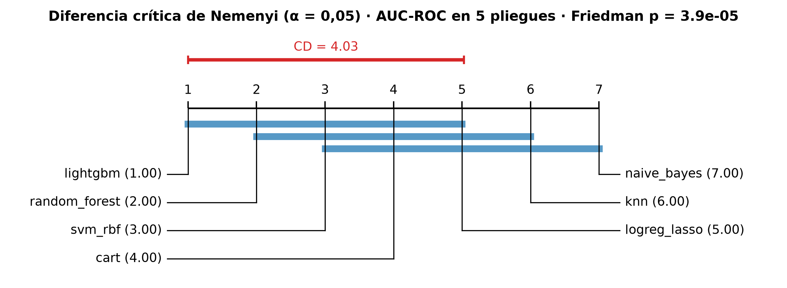

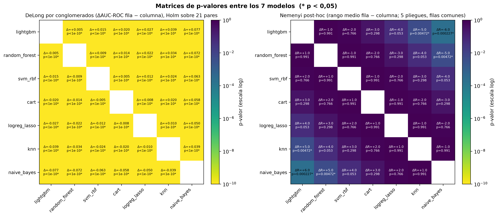

**Código fuente · `modulo_7/m7_4_pruebas_hipotesis/`**


```python
# Archivo: modulo_7/m7_4_pruebas_hipotesis/pruebas.py
"""Subfase 7.4 · Tres pruebas formales de superioridad (α = 0,05).

1. **DeLong pareado** (ΔAUC-ROC, ganador vs cada baseline).
   - Clásico (DeLong 1988, implementación rápida de Sun y Xu 2014), que supone observaciones independientes.
   - **Por conglomerados** (Obuchowski 1997): los valores de colocación se suman por paciente, porque cada
     paciente aporta ~5,6 snapshots correlacionados. Es la prueba principal; con conglomerados de tamaño 1
     coincide exactamente con el clásico.
   - IC 95 % **BCa** de ΔAUC con bootstrap pareado por paciente (réplicas de la 7.1) y aceleración por
     jackknife de grupos de pacientes. Holm sobre las comparaciones.
2. **Friedman + Nemenyi** sobre la matriz pliegues × modelos, con rangos promedio, Iman-Davenport, W de
   Kendall y diagrama de diferencia crítica. Los p de Nemenyi salen del rango estudentizado.
3. **Wilcoxon de rangos con signo**, top 1 vs top 2, sobre las particiones, con Holm entre métricas y la
   correlación biserial de rangos como tamaño de efecto.
"""
from __future__ import annotations

import numpy as np
import pandas as pd
from scipy import stats
from statsmodels.stats.multitest import multipletests

from modulo_7.m7_1_multimetrica import CurvaPreordenada, replicas_bootstrap

ALFA = 0.05
DELTA_RELEVANTE = 0.01  # margen pre-especificado de relevancia práctica para ΔAUC


# ---------------------------------------------------------------------------- DeLong
def _midrank(x: np.ndarray) -> np.ndarray:
    return stats.rankdata(x, method="average")


def colocaciones(y, s) -> tuple[np.ndarray, np.ndarray, np.ndarray, np.ndarray]:
    """Valores de colocación de DeLong: V10 (un valor por positivo) y V01 (por negativo), con sus índices."""
    y, s = np.asarray(y).astype(int), np.asarray(s, float)
    ip, ineg = np.flatnonzero(y == 1), np.flatnonzero(y == 0)
    m, n = len(ip), len(ineg)
    tz = _midrank(np.r_[s[ip], s[ineg]])
    tx, ty = _midrank(s[ip]), _midrank(s[ineg])
    v10 = (tz[:m] - tx) / n            # fracción de negativos por debajo de cada positivo
    v01 = 1 - (tz[m:] - ty) / m        # fracción de positivos por encima de cada negativo
    return v10, v01, ip, ineg


def _var_conglomerados(d10: np.ndarray, d01: np.ndarray, tiene_pos: np.ndarray, tiene_neg: np.ndarray,
                       M: int, N: int) -> float:
    """Varianza de Obuchowski a partir de las desviaciones por conglomerado (sumas centradas)."""
    i10, i01, i = tiene_pos.sum(), tiene_neg.sum(), len(d10)
    return float(i10 / ((i10 - 1) * M ** 2) * (d10 ** 2).sum()
                 + i01 / ((i01 - 1) * N ** 2) * (d01 ** 2).sum()
                 + 2 * i / ((i - 1) * M * N) * (d10 * d01).sum())


def delong(y, s1, s2=None, grupos=None) -> dict:
    """AUC (o ΔAUC = AUC1 − AUC2 si se pasa s2), su error estándar, z y p bilateral.

    Sin `grupos`: DeLong clásico. Con `grupos`: varianza por conglomerados de Obuchowski.
    """
    y = np.asarray(y).astype(int)
    v10a, v01a, ip, ineg = colocaciones(y, s1)
    if s2 is not None:
        v10b, v01b, _, _ = colocaciones(y, s2)
    else:
        v10b, v01b = np.zeros_like(v10a), np.zeros_like(v01a)
    a1, a2 = v10a.mean(), (v10b.mean() if s2 is not None else 0.0)
    d = a1 - a2
    M, N = len(ip), len(ineg)
    if grupos is None:
        dv10, dv01 = v10a - v10b, v01a - v01b
        var = dv10.var(ddof=1) / M + dv01.var(ddof=1) / N
    else:
        cod, inv = np.unique(np.asarray(grupos), return_inverse=True)
        k = len(cod)
        s10 = np.bincount(inv[ip], weights=v10a - v10b, minlength=k)
        s01 = np.bincount(inv[ineg], weights=v01a - v01b, minlength=k)
        m_k = np.bincount(inv[ip], minlength=k)
        n_k = np.bincount(inv[ineg], minlength=k)
        var = _var_conglomerados(s10 - m_k * d, s01 - n_k * d, m_k > 0, n_k > 0, M, N)
    se = float(np.sqrt(var))
    z = d / se if se > 0 else np.inf
    log10_p = float((np.log(2) + stats.norm.logsf(abs(z))) / np.log(10)) if np.isfinite(z) else -np.inf
    out = {"auc_1": a1, "estimado": d, "se": se, "z": z, "p": float(2 * stats.norm.sf(abs(z))), "log10_p": log10_p,
           "ic95_inf": d - 1.959964 * se, "ic95_sup": d + 1.959964 * se}
    if s2 is not None:
        out["auc_2"] = a2
    return out


# ---------------------------------------------------------------------------- bootstrap BCa
def bootstrap_delta(y, s1, s2, grupos, n_iter: int = 1000, semilla: int = 42) -> np.ndarray:
    """Réplicas de ΔAUC con remuestreo de pacientes estratificado (mismas réplicas que la 7.1)."""
    c1, c2 = CurvaPreordenada.desde(y, s1), CurvaPreordenada.desde(y, s2)
    return np.array([c1.auc_roc(w) - c2.auc_roc(w) for w in replicas_bootstrap(y, grupos, n_iter, semilla)])


def jackknife_grupos(y, s1, s2, grupos, n_grupos: int = 100, semilla: int = 42) -> np.ndarray:
    """ΔAUC dejando fuera, por turnos, uno de `n_grupos` bloques aleatorios de pacientes."""
    c1, c2 = CurvaPreordenada.desde(y, s1), CurvaPreordenada.desde(y, s2)
    cod, inv = np.unique(np.asarray(grupos), return_inverse=True)
    bloque = np.random.default_rng(semilla).integers(0, n_grupos, len(cod))[inv]
    out = []
    for b in range(n_grupos):
        w = (bloque != b).astype(float)
        out.append(c1.auc_roc(w) - c2.auc_roc(w))
    return np.array(out)


def ic_bca(estimado: float, boot: np.ndarray, jack: np.ndarray, alfa: float = ALFA) -> tuple[float, float]:
    """Intervalo BCa (Efron 1987): corrección de sesgo z0 y aceleración a por jackknife."""
    prop = (np.sum(boot < estimado) + 0.5 * np.sum(boot == estimado)) / len(boot)
    z0 = stats.norm.ppf(np.clip(prop, 1e-6, 1 - 1e-6))
    dj = jack.mean() - jack
    a = (dj ** 3).sum() / (6 * ((dj ** 2).sum()) ** 1.5) if (dj ** 2).sum() > 0 else 0.0
    zs = stats.norm.ppf([alfa / 2, 1 - alfa / 2])
    q = stats.norm.cdf(z0 + (z0 + zs) / (1 - a * (z0 + zs)))
    lo, hi = np.quantile(boot, q)
    return float(lo), float(hi)


def p_bootstrap(boot: np.ndarray) -> float:
    """p bilateral por inversión del bootstrap: 2·min(P(Δ* ≤ 0), P(Δ* ≥ 0)), con piso 1/(B+1)."""
    b = len(boot)
    return float(min(1.0, max(2 * min((boot <= 0).sum(), (boot >= 0).sum()) / b, 1 / (b + 1))))


def comparar_ganador(y, puntajes: dict[str, np.ndarray], ganador: str, grupos, n_iter: int = 1000,
                     semilla: int = 42, n_jack: int = 100) -> pd.DataFrame:
    """Prueba 1 completa: ganador vs cada baseline (filas comunes no nulas), con Holm."""
    filas = []
    for b, sb in puntajes.items():
        if b == ganador:
            continue
        ok = ~np.isnan(puntajes[ganador]) & ~np.isnan(sb)
        yy, s1, s2, g = np.asarray(y)[ok], puntajes[ganador][ok], sb[ok], np.asarray(grupos)[ok]
        cl, co = delong(yy, s1, s2), delong(yy, s1, s2, grupos=g)
        boot = bootstrap_delta(yy, s1, s2, g, n_iter, semilla)
        jack = jackknife_grupos(yy, s1, s2, g, n_jack, semilla)
        lo, hi = ic_bca(co["estimado"], boot, jack)
        filas.append({"ganador": ganador, "baseline": b, "n": int(ok.sum()), "auc_ganador": co["auc_1"],
                      "auc_baseline": co["auc_2"], "delta_auc": co["estimado"],
                      "p_delong_clasico": cl["p"], "se_clasico": cl["se"],
                      "p_delong_conglomerados": co["p"], "se_conglomerados": co["se"], "z_conglomerados": co["z"],
                      "log10_p_conglomerados": co["log10_p"],
                      "inflacion_se": co["se"] / cl["se"],
                      "ic95_bca_inf": lo, "ic95_bca_sup": hi, "p_bootstrap": p_bootstrap(boot)})
    df = pd.DataFrame(filas)
    df["p_holm"] = multipletests(df.p_delong_conglomerados, method="holm")[1]
    df["superior"] = (df.p_holm < ALFA) & (df.delta_auc > 0)
    df["relevante"] = df.superior & (df.ic95_bca_inf >= DELTA_RELEVANTE)
    return df


def matriz_p_delong(y, puntajes: dict[str, np.ndarray], grupos, orden: list[str]) -> tuple[pd.DataFrame, pd.DataFrame]:
    """p de DeLong por conglomerados para todos los pares (filas comunes), crudos y ajustados por Holm."""
    pares, ps = [], []
    for i, a in enumerate(orden):
        for b in orden[i + 1:]:
            ok = ~np.isnan(puntajes[a]) & ~np.isnan(puntajes[b])
            r = delong(np.asarray(y)[ok], puntajes[a][ok], puntajes[b][ok], grupos=np.asarray(grupos)[ok])
            pares.append((a, b))
            ps.append(r["p"])
    adj = multipletests(ps, method="holm")[1]
    crudo = pd.DataFrame(np.nan, index=orden, columns=orden)
    holm = crudo.copy()
    for (a, b), p, q in zip(pares, ps, adj):
        crudo.loc[a, b] = crudo.loc[b, a] = p
        holm.loc[a, b] = holm.loc[b, a] = q
    return crudo, holm


# ---------------------------------------------------------------------------- Friedman + Nemenyi
def friedman_nemenyi(matriz: pd.DataFrame, mayor_es_mejor: bool = True, alfa: float = ALFA) -> dict:
    """Matriz bloques (pliegues) × modelos. Rango 1 = mejor."""
    x = matriz.to_numpy(float)
    nb, k = x.shape
    rangos = np.apply_along_axis(lambda r: stats.rankdata(-r if mayor_es_mejor else r), 1, x)
    r_medio = pd.Series(rangos.mean(axis=0), index=matriz.columns).sort_values()
    chi2, p = stats.friedmanchisquare(*[x[:, j] for j in range(k)])
    ff = (nb - 1) * chi2 / (nb * (k - 1) - chi2) if nb * (k - 1) != chi2 else np.inf  # Iman-Davenport
    p_ff = float(stats.f.sf(ff, k - 1, (k - 1) * (nb - 1))) if np.isfinite(ff) else 0.0
    se = np.sqrt(k * (k + 1) / (6 * nb))
    q_alfa = stats.studentized_range.ppf(1 - alfa, k, np.inf) / np.sqrt(2)
    rm = r_medio.reindex(matriz.columns).to_numpy()
    q = np.abs(rm[:, None] - rm[None, :]) / se
    p_nem = stats.studentized_range.sf(q * np.sqrt(2), k, np.inf)
    np.fill_diagonal(p_nem, np.nan)
    return {"chi2": float(chi2), "p": float(p), "iman_davenport_F": float(ff), "p_iman_davenport": p_ff,
            "w_kendall": float(chi2 / (nb * (k - 1))), "rangos_medios": r_medio, "cd": float(q_alfa * se),
            "q_alfa": float(q_alfa), "n_bloques": nb, "k": k,
            "p_nemenyi": pd.DataFrame(p_nem, index=matriz.columns, columns=matriz.columns)}


# ---------------------------------------------------------------------------- Wilcoxon
def wilcoxon_pareado(a: np.ndarray, b: np.ndarray, alternativa: str = "two-sided") -> dict:
    """Wilcoxon exacto (si n ≤ 50 y sin empates) con la correlación biserial de rangos como efecto."""
    d = np.asarray(a, float) - np.asarray(b, float)
    res = stats.wilcoxon(d, alternative=alternativa, method="auto", zero_method="wilcox")
    r = stats.rankdata(np.abs(d[d != 0]))
    rbc = (r[d[d != 0] > 0].sum() - r[d[d != 0] < 0].sum()) / r.sum() if len(r) else 0.0
    n = int((d != 0).sum())
    p_min = 2 / 2 ** n if alternativa == "two-sided" else 1 / 2 ** n
    return {"n_pares": n, "mediana_diferencia": float(np.median(d)), "estadistico_W": float(res.statistic),
            "p": float(res.pvalue), "biserial_rangos": float(rbc), "p_minimo_alcanzable": min(1.0, p_min),
            "a_mejor_en": int((d > 0).sum())}


def wilcoxon_metricas(bloques: pd.DataFrame, top1: str, top2: str, metricas: dict[str, bool]) -> pd.DataFrame:
    """Wilcoxon top1 vs top2 por métrica (columna `metrica`, `modelo`, `bloque`, `valor`), Holm entre métricas.

    `metricas`: nombre → True si mayor es mejor. Para las de "menor es mejor" se compara (top2 − top1)
    para que una diferencia positiva siempre favorezca al top 1.
    """
    filas = []
    for met, mayor in metricas.items():
        t = bloques[bloques.metrica == met].pivot(index="bloque", columns="modelo", values="valor")
        a, b = (t[top1], t[top2]) if mayor else (t[top2], t[top1])
        filas.append({"metrica": met, "top1": top1, "top2": top2, "media_top1": t[top1].mean(),
                      "media_top2": t[top2].mean(), **wilcoxon_pareado(a.to_numpy(), b.to_numpy())})
    df = pd.DataFrame(filas)
    df["p_holm"] = multipletests(df.p, method="holm")[1]
    df["top1_superior"] = (df.p_holm < ALFA) & (df.mediana_diferencia > 0)
    return df


def veredicto(p: float, efecto_positivo: bool = True) -> str:
    if p < ALFA and efecto_positivo:
        return "SUPERIORIDAD ESTADÍSTICA (p < 0,05)"
    if p < ALFA:
        return "DIFERENCIA SIGNIFICATIVA A FAVOR DEL OTRO MODELO (p < 0,05)"
    return ("EQUIVALENCIA ESTADÍSTICA según la rúbrica (p ≥ 0,05): no se demuestra diferencia "
            "(formalmente no es una prueba de equivalencia)")


# ---------------------------------------------------------------------------- gráficos
def _plt():
    import matplotlib
    matplotlib.use("Agg")
    import matplotlib.pyplot as plt
    return plt


def graficar_cd(rangos: pd.Series, cd: float, ruta, titulo: str) -> None:
    """Diagrama de diferencia crítica (Demšar 2006). Rango 1 (mejor) a la izquierda; las barras azules unen
    modelos cuyos rangos medios difieren menos que CD (no distinguibles por Nemenyi)."""
    plt = _plt()
    r = rangos.sort_values()
    k = len(r)
    mitad = (k + 1) // 2
    alto = 0.42 * max(mitad, k - mitad) + 1.6
    fig, a = plt.subplots(figsize=(10, alto))
    a.set_xlim(-1.6, k + 2.6)
    y_eje = 0.0
    a.hlines(y_eje, 1, k, color="k", lw=1.2)
    for t in range(1, k + 1):
        a.vlines(t, y_eje, y_eje + 0.08, color="k", lw=1)
        a.text(t, y_eje + 0.13, str(t), ha="center", va="bottom", fontsize=9)
    a.hlines(y_eje + 0.55, 1, 1 + cd, color="#d62728", lw=2.5)
    a.vlines([1, 1 + cd], y_eje + 0.5, y_eje + 0.6, color="#d62728", lw=1.5)
    a.text(1 + cd / 2, y_eje + 0.62, f"CD = {cd:.2f}", ha="center", va="bottom", fontsize=9, color="#d62728")
    # grupos no distinguibles (cliques maximales)
    vals = r.to_numpy()
    grupos = []
    for i in range(k):
        j = max(jj for jj in range(i, k) if vals[jj] - vals[i] < cd)
        if j > i and not any(gi <= i and j <= gj for gi, gj in grupos):
            grupos.append((i, j))
    y_g = y_eje - 0.18
    for n, (gi, gj) in enumerate(grupos):
        y = y_g - 0.14 * n
        a.hlines(y, vals[gi] - 0.05, vals[gj] + 0.05, color="#1f77b4", lw=5, alpha=0.75)
    y0 = y_g - 0.14 * max(len(grupos), 1) - 0.15
    for i, (m, v) in enumerate(r.items()):
        izq = i < mitad
        fila = i if izq else k - 1 - i
        y = y0 - 0.32 * fila
        x_fin = 0.7 if izq else k + 0.3
        a.plot([v, v], [y_eje, y], color="k", lw=0.8)
        a.plot([v, x_fin], [y, y], color="k", lw=0.8)
        a.text(x_fin - 0.08 if izq else x_fin + 0.08, y, f"{m} ({v:.2f})", ha="right" if izq else "left",
               va="center", fontsize=9)
    a.set_ylim(y0 - 0.32 * max(mitad, k - mitad) + 0.1, y_eje + 0.9)
    a.axis("off")
    a.set_title(titulo, fontweight="bold", fontsize=10)
    fig.savefig(ruta, dpi=300, bbox_inches="tight")
    plt.close(fig)


def graficar_heatmaps(mats: dict[str, pd.DataFrame], ruta, titulo: str,
                      anotaciones: dict[str, pd.DataFrame] | None = None) -> None:
    """Mapas de calor de p-valores (escala log10, marca de p < 0,05). `anotaciones`: texto extra por celda
    (p. ej. ΔAUC fila − columna)."""
    anotaciones = anotaciones or {}
    plt = _plt()
    from matplotlib.colors import LogNorm
    fig, ejes = plt.subplots(1, len(mats), figsize=(7.2 * len(mats), 6.2))
    for a, (nombre, m) in zip(np.atleast_1d(ejes), mats.items()):
        v = m.to_numpy(float)
        im = a.imshow(np.clip(v, 1e-300, 1), cmap="viridis_r", norm=LogNorm(vmin=1e-10, vmax=1))
        a.set_xticks(range(len(m)), m.columns, rotation=45, ha="right", fontsize=9)
        a.set_yticks(range(len(m)), m.index, fontsize=9)
        for i in range(len(m)):
            for j in range(len(m)):
                if np.isfinite(v[i, j]):
                    txt = ("p<1e-10" if v[i, j] < 1e-10 else f"p={v[i, j]:.3g}") + ("*" if v[i, j] < ALFA else "")
                    if nombre in anotaciones:
                        txt = f"{anotaciones[nombre].iloc[i, j]}\n{txt}"
                    a.text(j, i, txt, ha="center", va="center", fontsize=6.5,
                           color="black" if v[i, j] < 1e-3 else "white")
        a.set_title(nombre, fontsize=10)
        fig.colorbar(im, ax=a, fraction=0.046, pad=0.04, label="p-valor (escala log)")
    fig.suptitle(titulo + "  (* p < 0,05)", fontweight="bold")
    fig.tight_layout()
    fig.savefig(ruta, dpi=300, bbox_inches="tight")
    plt.close(fig)

```

**Ejecución sobre los datos reales**


```python
# Archivo: modulo_7/m7_4_pruebas_hipotesis/run_m7_4.py
"""Subfase 7.4 sobre los datos reales: tres pruebas formales de superioridad sobre el OOF (desarrollo).

Entrada: `data/m7/probabilidades_oof_m7_1.parquet` (OOF de la 6.4; la SVM ya en probabilidad, con Platt cruzado).
La prueba temporal no se usa (es de evaluación única, en la 7.2).

Reglas fijadas ANTES de ver los resultados:
- Ganador y top 2 = los dos primeros por AUC-PR en la 7.1 (lightgbm, random_forest).
- Prueba 1: DeLong por conglomerados de paciente (principal), Holm sobre las 6 comparaciones; IC BCa por bootstrap
  pareado por paciente (1 000 réplicas) y jackknife de 100 grupos. Relevancia práctica: ΔAUC con IC BCa ≥ 0,01.
- Prueba 2: Friedman + Nemenyi sobre AUC-ROC por pliegue (5 × 7) en las filas comunes a los 7 modelos (las de KNN).
- Prueba 3: Wilcoxon top 1 vs top 2 en 4 métricas (AUC-ROC, AUC-PR, Brier, log-loss), Holm entre métricas.
  Decisión sobre 50 particiones disjuntas de pacientes (10 por pliegue). Con los 5 pliegues se reporta también,
  pero su p exacto mínimo bilateral es 0,0625: no puede llegar a p < 0,05.

Uso (desde la raíz del proyecto):
    python modulo_7/m7_4_pruebas_hipotesis/run_m7_4.py
"""
from __future__ import annotations

import json
import sys
import time
from datetime import datetime
from pathlib import Path

import numpy as np
import pandas as pd
from sklearn.metrics import average_precision_score, brier_score_loss, log_loss, roc_auc_score

if hasattr(sys.stdout, "reconfigure"):
    sys.stdout.reconfigure(encoding="utf-8")

ROOT = Path(__file__).resolve().parents[2]
sys.path.insert(0, str(ROOT))

from modulo_7.m7_4_pruebas_hipotesis import (  # noqa: E402
    ALFA,
    DELTA_RELEVANTE,
    comparar_ganador,
    friedman_nemenyi,
    graficar_cd,
    graficar_heatmaps,
    matriz_p_delong,
    veredicto,
    wilcoxon_metricas,
)

TARGET = "y_target_los_largo"
OUT, TAB, FIG = ROOT / "outputs" / "m7", ROOT / "outputs" / "m7" / "tablas", ROOT / "outputs" / "m7" / "figuras"
METRICAS = {"auc_roc": True, "auc_pr": True, "brier": False, "log_loss": False}  # True: mayor es mejor
SUBBLOQUES = 10


def log(msg):
    print(f"[{datetime.now():%H:%M:%S}] {msg}", flush=True)


def _metricas(y, p) -> dict:
    return {"auc_roc": roc_auc_score(y, p), "auc_pr": average_precision_score(y, p),
            "brier": brier_score_loss(y, p), "log_loss": log_loss(y, np.clip(p, 1e-6, 1 - 1e-6))}


def bloques_largos(df: pd.DataFrame, modelos: list[str], col_bloque: str) -> pd.DataFrame:
    filas = []
    for b, d in df.groupby(col_bloque):
        for m in modelos:
            ok = d[f"p_{m}"].notna()
            for met, v in _metricas(d[TARGET][ok], d[f"p_{m}"][ok]).items():
                filas.append({"bloque": b, "modelo": m, "metrica": met, "valor": v})
    return pd.DataFrame(filas)


def main() -> None:
    for d in (TAB, FIG):
        d.mkdir(parents=True, exist_ok=True)
    df = pd.read_parquet(ROOT / "data" / "m7" / "probabilidades_oof_m7_1.parquet")
    resumen = pd.read_csv(OUT / "multimetric_evaluation_summary.csv")
    orden = resumen.modelo.tolist()
    completos = resumen[resumen.n == len(df)].modelo.tolist()
    ganador, top2 = completos[0], completos[1]
    y, g = df[TARGET].to_numpy(), df.person_id.to_numpy()
    p = {m: df[f"p_{m}"].to_numpy(float) for m in orden}
    log(f"OOF: {len(df):,} snapshots · {df.person_id.nunique():,} pacientes · ganador {ganador} · top 2 {top2}")
    res = {"alfa": ALFA, "delta_relevante": DELTA_RELEVANTE, "ganador": ganador, "top2": top2}

    # ------------------------------------------------------------------ Prueba 1: DeLong + BCa
    t0 = time.time()
    p1 = comparar_ganador(y, p, ganador, g, n_iter=1000, semilla=42, n_jack=100)
    p1.to_csv(TAB / "m7_4_prueba1_delong.csv", index=False)
    crudo, holm = matriz_p_delong(y, p, g, orden)
    crudo.to_csv(TAB / "m7_4_matriz_p_delong_crudo.csv")
    holm.to_csv(TAB / "m7_4_matriz_p_delong_holm.csv")
    log(f"Prueba 1 lista ({(time.time() - t0) / 60:.1f} min)")

    # ------------------------------------------------------------------ Prueba 2: Friedman + Nemenyi
    comun = df[df[[f"p_{m}" for m in orden]].notna().all(axis=1)]
    mat = pd.DataFrame({m: comun.groupby("pliegue")[[TARGET, f"p_{m}"]].apply(lambda d, m=m: roc_auc_score(d[TARGET], d[f"p_{m}"]))
                        for m in orden})
    fr = friedman_nemenyi(mat)
    mat.to_csv(TAB / "m7_4_prueba2_auc_por_pliegue.csv")
    fr["p_nemenyi"].to_csv(TAB / "m7_4_prueba2_nemenyi_p.csv")
    graficar_cd(fr["rangos_medios"], fr["cd"], FIG / "m7_4_diagrama_diferencia_critica.png",
                f"Diferencia crítica de Nemenyi (α = 0,05) · AUC-ROC en {fr['n_bloques']} pliegues · "
                f"Friedman p = {fr['p']:.2g}")
    # sensibilidad: 6 modelos en todas las filas (sin KNN)
    mat6 = pd.DataFrame({m: df.groupby("pliegue")[[TARGET, f"p_{m}"]].apply(lambda d, m=m: roc_auc_score(d[TARGET], d[f"p_{m}"]))
                         for m in completos})
    fr6 = friedman_nemenyi(mat6)

    # ------------------------------------------------------------------ Prueba 3: Wilcoxon top1 vs top2
    df["bloque50"] = df.pliegue.astype(int) * SUBBLOQUES + (
        pd.util.hash_pandas_object(df.person_id, index=False).to_numpy() % SUBBLOQUES).astype(int)
    b5 = bloques_largos(df, [ganador, top2], "pliegue")
    b50 = bloques_largos(df, [ganador, top2], "bloque50")
    w5 = wilcoxon_metricas(b5, ganador, top2, METRICAS).assign(particiones="5 pliegues")
    w50 = wilcoxon_metricas(b50, ganador, top2, METRICAS).assign(particiones="50 particiones de pacientes (decisión)")
    w = pd.concat([w50, w5])
    w.to_csv(TAB / "m7_4_prueba3_wilcoxon.csv", index=False)
    pd.concat([b5.assign(particiones="5"), b50.assign(particiones="50")]).to_csv(
        TAB / "m7_4_prueba3_metricas_por_particion.csv", index=False)

    auc = {m: roc_auc_score(y[~np.isnan(p[m])], p[m][~np.isnan(p[m])]) for m in orden}
    auc_c = {m: roc_auc_score(comun[TARGET], comun[f"p_{m}"]) for m in orden}
    delta = pd.DataFrame([[(f"Δ={(auc_c if 'knn' in (a, b) else auc)[a] - (auc_c if 'knn' in (a, b) else auc)[b]:+.3f}"
                            if a != b else "") for b in orden] for a in orden], index=orden, columns=orden)
    rmed = fr["rangos_medios"]
    drango = pd.DataFrame([[(f"ΔR={rmed[a] - rmed[b]:+.1f}" if a != b else "") for b in orden] for a in orden],
                          index=orden, columns=orden)
    t_delong = "DeLong por conglomerados (ΔAUC-ROC fila − columna), Holm sobre 21 pares"
    t_nem = f"Nemenyi post-hoc (rango medio fila − columna; {fr['n_bloques']} pliegues, filas comunes)"
    graficar_heatmaps({t_delong: holm, t_nem: fr["p_nemenyi"]}, FIG / "m7_4_heatmap_pvalores.png",
                      "Matrices de p-valores entre los 7 modelos", anotaciones={t_delong: delta, t_nem: drango})

    res.update({
        "prueba1": p1.to_dict(orient="records"),
        "prueba2": {k: (v.to_dict() if isinstance(v, (pd.Series, pd.DataFrame)) else v) for k, v in fr.items()},
        "prueba2_sensibilidad_6_modelos_todas_las_filas": {"chi2": fr6["chi2"], "p": fr6["p"], "w_kendall": fr6["w_kendall"],
                                                          "rangos_medios": fr6["rangos_medios"].to_dict()},
        "prueba3": w.to_dict(orient="records"), "fecha": datetime.now().isoformat(timespec="seconds")})
    (OUT / "m7_4_resultados.json").write_text(json.dumps(res, ensure_ascii=False, indent=2, default=float),
                                              encoding="utf-8")

    # ------------------------------------------------------------------ consola: resultados y veredictos
    r4 = lambda x: x.round(4).to_string(index=False)  # noqa: E731
    print("\n=== PRUEBA 1 · DeLong pareado (ΔAUC-ROC = ganador − baseline) ===")
    print(r4(p1[["baseline", "n", "auc_ganador", "auc_baseline", "delta_auc", "ic95_bca_inf", "ic95_bca_sup",
                 "z_conglomerados", "log10_p_conglomerados", "inflacion_se", "p_holm"]]))
    print("  (p = 0,0 en pantalla es desbordamiento numérico: ver z y log10 p; el SE por conglomerados es "
          f"{p1.inflacion_se.mean():.2f}× el del DeLong clásico, que ignora la correlación entre snapshots del paciente)")
    for _, r in p1.iterrows():
        rel = ("relevante (IC BCa ≥ 0,01)" if r.relevante else
               f"magnitud pequeña: IC BCa [{r.ic95_bca_inf:.4f}; {r.ic95_bca_sup:.4f}] no supera 0,01")
        print(f"  {ganador} vs {r.baseline}: {veredicto(r.p_holm, r.delta_auc > 0)} · ΔAUC = {r.delta_auc:+.4f} · {rel}")

    print(f"\n=== PRUEBA 2 · Friedman + Nemenyi (AUC-ROC, {fr['n_bloques']} pliegues × {fr['k']} modelos, "
          f"{len(comun):,} filas comunes) ===")
    print(mat.round(4).to_string())
    idf = ("∞ (concordancia perfecta entre pliegues)" if not np.isfinite(fr["iman_davenport_F"])
           else f"{fr['iman_davenport_F']:.2f}, p = {fr['p_iman_davenport']:.3g}")
    print(f"Friedman χ² = {fr['chi2']:.2f}, p = {fr['p']:.3g} · Iman-Davenport F = {idf} · "
          f"W de Kendall = {fr['w_kendall']:.3f} · CD Nemenyi = {fr['cd']:.2f}")
    print("Rangos medios: " + ", ".join(f"{m} {v:.1f}" for m, v in fr["rangos_medios"].items()))
    print(f"  Friedman: {veredicto(fr['p'])}")
    if fr["p"] < ALFA:
        pn = fr["p_nemenyi"].loc[ganador].drop(ganador)
        for m, v in pn.items():
            print(f"  Nemenyi {ganador} vs {m}: p = {v:.3g} → {veredicto(v)}")
    print(f"  (Sensibilidad, 6 modelos en todas las filas: Friedman p = {fr6['p']:.3g}, W = {fr6['w_kendall']:.3f})")

    print(f"\n=== PRUEBA 3 · Wilcoxon de rangos con signo, {ganador} vs {top2} (Holm entre 4 métricas) ===")
    print(r4(w[["particiones", "metrica", "media_top1", "media_top2", "mediana_diferencia", "a_mejor_en", "n_pares",
                "p", "p_holm", "biserial_rangos", "p_minimo_alcanzable"]]))
    for _, r in w.iterrows():
        nota = " (con 5 pares el p mínimo posible es 0,0625)" if r.n_pares <= 5 else ""
        print(f"  [{r.particiones}] {r.metrica}: {veredicto(r.p_holm, r.mediana_diferencia > 0)}{nota}")

    print("\n=== VEREDICTO FINAL ===")
    sup = p1[p1.superior]
    print(f"Prueba 1 (DeLong por conglomerados + Holm): {ganador} supera estadísticamente a "
          f"{len(sup)}/{len(p1)} baselines" + (f" ({', '.join(sup.baseline)})" if len(sup) else "") + ".")
    print(f"Prueba 2 (Friedman + Nemenyi): {veredicto(fr['p'])}; el post-hoc separa a {ganador} de "
          f"{int((fr['p_nemenyi'].loc[ganador].drop(ganador) < ALFA).sum())}/{fr['k'] - 1} modelos (potencia limitada con 5 pliegues).")
    dec = w50.set_index("metrica")
    print(f"Prueba 3 (Wilcoxon, 50 particiones): {ganador} vs {top2} → "
          + "; ".join(f"{m}: {'superior' if dec.loc[m, 'top1_superior'] else 'sin diferencia demostrada'} "
                      f"(p_Holm = {dec.loc[m, 'p_holm']:.3g})" for m in METRICAS))
    log("Listo")


if __name__ == "__main__":
    main()

```

**Pruebas con datos sintéticos**


```python
# Archivo: modulo_7/m7_4_pruebas_hipotesis/test_pruebas.py
"""Pruebas de la subfase 7.4 con datos sintéticos (no usa datos reales).

    python -m pytest modulo_7/m7_4_pruebas_hipotesis -q
"""
from __future__ import annotations

import sys
from pathlib import Path

import numpy as np
import pandas as pd
import pytest
from scipy import stats
from sklearn.metrics import roc_auc_score

sys.path.insert(0, str(Path(__file__).resolve().parents[2]))

from modulo_7.m7_4_pruebas_hipotesis import (  # noqa: E402
    bootstrap_delta,
    comparar_ganador,
    delong,
    friedman_nemenyi,
    graficar_cd,
    graficar_heatmaps,
    ic_bca,
    jackknife_grupos,
    matriz_p_delong,
    p_bootstrap,
    veredicto,
    wilcoxon_metricas,
    wilcoxon_pareado,
)


def _datos(n=2000, semilla=0, tam_cong=1, señal=(1.0, 0.7)):
    """Pacientes con `tam_cong` filas casi idénticas (misma etiqueta y puntaje base)."""
    rng = np.random.default_rng(semilla)
    k = n // tam_cong
    y_p = rng.integers(0, 2, k)
    base1, base2 = rng.normal(size=k), rng.normal(size=k)
    y = np.repeat(y_p, tam_cong)
    g = np.repeat(np.arange(k), tam_cong)
    s1 = señal[0] * y + np.repeat(base1, tam_cong) + rng.normal(0, 0.1, len(y))
    s2 = señal[1] * y + np.repeat(base2, tam_cong) + rng.normal(0, 0.1, len(y))
    return y, s1, s2, g


def test_delong_auc_y_varianza_clasica():
    y, s1, s2, _ = _datos(n=3000)
    r = delong(y, s1)
    assert r["auc_1"] == pytest.approx(roc_auc_score(y, s1))
    rng = np.random.default_rng(5)
    boot = []
    for _ in range(400):
        i = rng.integers(0, len(y), len(y))
        boot.append(roc_auc_score(y[i], s1[i]))
    assert r["se"] == pytest.approx(np.std(boot, ddof=1), rel=0.15)
    d = delong(y, s1, s2)
    assert d["estimado"] == pytest.approx(roc_auc_score(y, s1) - roc_auc_score(y, s2))


def test_conglomerados_de_tamano_1_coinciden_con_el_clasico():
    y, s1, s2, _ = _datos(n=1500)
    cl, co = delong(y, s1, s2), delong(y, s1, s2, grupos=np.arange(len(y)))
    assert co["se"] == pytest.approx(cl["se"], rel=1e-10)
    assert co["p"] == pytest.approx(cl["p"], rel=1e-8)


def test_conglomerados_corrigen_la_correlacion_intra_paciente():
    y, s1, s2, g = _datos(n=4000, tam_cong=4)
    cl, co = delong(y, s1, s2), delong(y, s1, s2, grupos=g)
    assert co["se"] / cl["se"] == pytest.approx(2.0, rel=0.15)  # √4: 4 filas casi duplicadas por paciente


def test_error_tipo_i_cerca_de_alfa_con_conglomerados():
    rech_co, rech_cl = 0, 0
    for sem in range(200):
        y, s1, s2, g = _datos(n=600, semilla=sem, tam_cong=3, señal=(0.8, 0.8))  # misma discriminación
        rech_co += delong(y, s1, s2, grupos=g)["p"] < 0.05
        rech_cl += delong(y, s1, s2)["p"] < 0.05
    assert 0.01 <= rech_co / 200 <= 0.10
    assert rech_cl / 200 > rech_co / 200  # el clásico ignora la correlación y rechaza de más


def test_bca_y_p_bootstrap():
    y, s1, s2, g = _datos(n=2000, tam_cong=2)
    d = delong(y, s1, s2, grupos=g)["estimado"]
    boot = bootstrap_delta(y, s1, s2, g, n_iter=300, semilla=1)
    jack = jackknife_grupos(y, s1, s2, g, n_grupos=40)
    lo, hi = ic_bca(d, boot, jack)
    assert lo < d < hi
    assert lo == pytest.approx(np.quantile(boot, 0.025), abs=0.01)  # sin sesgo ni asimetría ≈ percentil
    assert p_bootstrap(boot) < 0.01  # s1 discrimina claramente mejor
    sim = np.random.default_rng(0).normal(0, 1, 999)
    assert 0.6 < p_bootstrap(sim) <= 1


def test_comparar_ganador_con_nan_y_holm():
    y, s1, s2, g = _datos(n=2400, tam_cong=2)
    s3 = s2.copy()
    s3[g % 4 != 0] = np.nan  # baseline evaluado en un subconjunto (como KNN)
    t = comparar_ganador(y, {"a": s1, "b": s2, "c": s3}, "a", g, n_iter=200, n_jack=30)
    assert set(t.baseline) == {"b", "c"}
    assert t.set_index("baseline").loc["c", "n"] == int((~np.isnan(s3)).sum())
    assert (t.p_holm >= t.p_delong_conglomerados).all() and (t.inflacion_se > 1).all()
    crudo, holm = matriz_p_delong(y, {"a": s1, "b": s2, "c": s3}, g, ["a", "b", "c"])
    assert np.allclose(crudo.to_numpy(), crudo.to_numpy().T, equal_nan=True) and (holm.fillna(1) >= crudo.fillna(1)).all().all()


def test_friedman_nemenyi_ranking_perfecto():
    k, nb = 7, 5
    rng = np.random.default_rng(0)
    m = pd.DataFrame(np.arange(k)[::-1][None, :] * 0.01 + rng.normal(0, 1e-4, (nb, k)) + 0.7,
                     columns=[f"m{j}" for j in range(k)])
    r = friedman_nemenyi(m)
    assert r["w_kendall"] == pytest.approx(1.0)
    assert r["chi2"] == pytest.approx(stats.friedmanchisquare(*[m[c] for c in m]).statistic)
    assert r["cd"] == pytest.approx(2.949 * np.sqrt(k * (k + 1) / (6 * nb)), rel=1e-3)
    assert list(r["rangos_medios"].index) == list(m.columns)
    assert r["p_nemenyi"].loc["m0", "m6"] < 0.05 and r["p_nemenyi"].loc["m0", "m1"] > 0.05


def test_wilcoxon_cinco_pares_no_alcanza_005():
    w = wilcoxon_pareado(np.array([0.74, 0.75, 0.73, 0.74, 0.76]), np.array([0.73, 0.74, 0.72, 0.73, 0.75]))
    assert w["p"] == pytest.approx(0.0625) and w["p_minimo_alcanzable"] == pytest.approx(0.0625)
    assert w["biserial_rangos"] == pytest.approx(1.0)
    assert "EQUIVALENCIA" in veredicto(w["p"]) and "SUPERIORIDAD" in veredicto(0.01)


def test_wilcoxon_metricas_orienta_las_de_menor_es_mejor():
    rng = np.random.default_rng(3)
    filas = []
    for b in range(30):
        filas += [{"bloque": b, "modelo": "top", "metrica": "auc", "valor": 0.75 + rng.normal(0, 0.003)},
                  {"bloque": b, "modelo": "seg", "metrica": "auc", "valor": 0.74 + rng.normal(0, 0.003)},
                  {"bloque": b, "modelo": "top", "metrica": "brier", "valor": 0.20 + rng.normal(0, 0.002)},
                  {"bloque": b, "modelo": "seg", "metrica": "brier", "valor": 0.21 + rng.normal(0, 0.002)}]
    t = wilcoxon_metricas(pd.DataFrame(filas), "top", "seg", {"auc": True, "brier": False}).set_index("metrica")
    assert t.top1_superior.all() and (t.mediana_diferencia > 0).all() and (t.p_holm >= t.p).all()


def test_graficos(tmp_path):
    m = pd.DataFrame(np.random.default_rng(1).normal(0.7, 0.01, (5, 7)), columns=list("abcdefg"))
    r = friedman_nemenyi(m)
    graficar_cd(r["rangos_medios"], r["cd"], tmp_path / "cd.png", "prueba")
    graficar_heatmaps({"Nemenyi": r["p_nemenyi"]}, tmp_path / "hm.png", "prueba")
    assert (tmp_path / "cd.png").stat().st_size > 10_000 and (tmp_path / "hm.png").stat().st_size > 10_000

```
